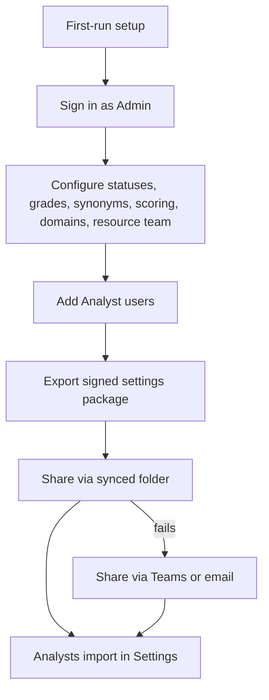

# PerfectFitCandidate — OCC Admin guide

OCC (Object Control Center) is the Admin-only area for users, reference data, matching configuration, audit and settings packages. This guide covers the current screens as built in `PFC/frontend` against the `/api/v1` backend. Anything not yet available is marked **Pending**. Every OCC change is audit-logged.

Shipped archival, retention purge and housekeeping workflows are covered in section 17.

## Contents

1. [Admin flow](#1-admin-flow)
2. [First-run setup](#2-first-run-setup)
3. [Users and one-time passwords](#3-users-and-one-time-passwords)
4. [DL / CT approvals](#4-dl--ct-approvals)
5. [Status list and mapping](#5-status-list-and-mapping)
6. [Grade list](#6-grade-list)
7. [Skill synonyms](#7-skill-synonyms)
8. [Scoring template](#8-scoring-template)
9. [Email templates and resource-team list](#9-email-templates-and-resource-team-list)
10. [Internal domains](#10-internal-domains)
11. [Approved models](#11-approved-models)
12. [Signing key](#12-signing-key)
13. [Export and share a settings package](#13-export-and-share-a-settings-package)
14. [Audit log](#14-audit-log)
15. [Admin settings](#15-admin-settings)
16. [Pending in this build](#16-pending-in-this-build)
17. [Archival and housekeeping](#17-archival-and-housekeeping)

## 1. Admin flow

Sign in with the role **Admin**. OCC Admin is in the left panel; its sections are grouped as:

- **People:** Users & passwords, Resource-team list
- **Data:** DL / CT approvals, Grade list, Status list & mapping, Skill synonyms, Internal domains
- **Matching:** Scoring template, Approved models
- **Operations:** Audit log, Admin settings, Settings packages

## 2. First-run setup

On a new data folder, PFC opens **Welcome to PerfectFitCandidate — first-run setup**.

1. **Setup code:** shown in the PFC console window and in `data\run\setup-code.txt`. It works once.
2. Enter **Full name**, **Corporate email**, **Password** and **Confirm password**. The Admin password must meet every item on the checklist (at least 14 characters, character types, not your email or name, not a common password).
3. **Create admin**, then optionally confirm folders (**Data folder**, **Resume folder path**, which can be set later in Settings), then **Next**.
4. The summary confirms the account. **Go to sign in**.

The setup screen does not appear again unless the data folder is reset.

## 3. Users and one-time passwords

**OCC → Users & passwords**

- **+ Add user:** enter name, email, role (Admin or Analyst) and persona (A — matching and candidate email, B — demand analytics, C — bench analytics), then **Create and generate one-time password**.
- **Reset password** generates a new one-time password.
- The one-time password is **shown once**. Use **Copy**, share it securely, then **Done**. The user must change it at first sign-in.
- **Unlock** clears a lockout; **Disable** / **Enable** blocks or restores sign-in.

Emails are masked in the list; Admins can reveal them.

## 4. DL / CT approvals

Demand List and Candidate Tracker tabs show Pending upload changes with **Approve**, **Modify** (comment and corrected values required), and **Revert** actions.

DL/CT auto-pickup does not change OCC approvals. A watch-folder commit uses the
same ingestion and downstream processing as a manual commit and creates the
same Pending approval entries. The analyst's **Hold for my review before
committing** switch controls the ingestion preview, not OCC approval: releasing
that preview does not approve the resulting OCC entries.

Enable **Show decided** to review history. Admins can **Re-open** only the latest decided entry for a demand or resource, providing a non-blank audit comment. This creates a new Pending entry labelled **Re-opened from #N**; the original decision remains unchanged. A newer entry or an existing Pending review blocks re-opening (409). Approving a re-opened entry restores the original uploaded values, including values previously modified or reverted; Modify and Revert remain available as usual. Re-opening and subsequent decisions flag existing match runs as having newer data; rerun matching to use the current data. Comments in the audit log redact email addresses.

## 5. Status list and mapping

**OCC → Status list & mapping**

- **Status list & priority:** the canonical bench statuses in priority order (arrows reorder), with eligibility, tiered points and caveat text. Excluded statuses remove people from matching.
- **Source-status mapping:** maps each status exactly as written in the CT to a canonical status (**Choose canonical status…**).
- Statuses from uploads that have no mapping are listed as unmapped and flagged on the Bench List.

**Save** sends one change per edited item. If one fails, the error is shown, the list reloads from the server and the items that did not save are named. **Discard** drops unsaved edits.

## 6. Grade list

**OCC → Grade list**

Order grades with ↑ / ↓, **Retire** or **Restore** a grade, then **Save grade list** (or **Discard changes**). People whose grade is not in the active list are excluded from matching. Re-run matching to apply a new order.

## 7. Skill synonyms

**OCC → Skill synonyms** (skill-synonym tracker)

The **Suggestions** tab discovers unrecognised skills from active CT resources, the latest non-removed CVs, and current JD analysis. JD suggestions are limited to short skill-like mandatory/preferred items; experience, qualification, domain, sentence-like, years-of-experience, filler-only and already-recognised phrases are excluded. The **Found in** counts show distinct CT people, CV people and JD demands.

Search the list, use **Select all** for the visible filtered rows, then add selected terms as new canonical skills or reject them. A row can also be mapped to an existing canonical skill with a relation. Approval is the only action that adds a skill or synonym to the active dictionary and refreshes Bench List eligibility. Rejections are stored locally and are not included in signed settings packages; the **Rejected** view can restore a term. Legacy suggested synonym rows remain in their own section. Earlier match runs are not changed.

## 8. Scoring template

Whole-CV scoring is enabled for all candidates on the next run; scores may change
for everyone, not just newly uploaded CVs. Scoring template `rules` accepts
`cv_experience_degree` (boolean, default `true` when absent in older templates).
In the Scoring template screen, clear **Use CV experience & degree rules**, add a
change note and publish the new version to retain legacy experience/degree scoring.
The switch defaults on for older templates and preserves its value on publish.
OCC editing remains Admin-only; Analysts cannot change this setting.
Whole-CV dictionary skill detection is always enabled.
The setting is frozen in each run and changing it forces a full re-score.
Approved OCC dictionary edits also apply to stored CV text without re-ingestion.
Experience uses explicit total experience first, otherwise merged date ranges
(present/current/till date use the run date), otherwise summed stated durations.
Rule credit never reduces existing credit. Degree rules require an explicit
qualification; uncertain evidence retains the existing semantic behavior.

**OCC → Scoring template**

Edit component **Weights**, band thresholds (**Strong**, **Potential**, **Avg**; they must be descending) and adjacent-grade points. Available Capacity, Tracker and Group are not scored (locked, REQ-ELIG-06). **Publish v(N+1)** activates the draft; **Discard draft** drops it. **History** lists earlier versions. Analysts see the template read-only.

## 9. Email templates and resource-team list

- **OCC → Resource-team list:** the recipients of candidate emails (display name, email, active). Changes apply to new drafts only. An address already in the list or not a valid email is rejected.
- **OCC → Email templates:** lists the latest version of each template with its subject, version, created date and whether it is the default. **Show all versions** adds the earlier versions.
  - **Edit** opens a version; **Save as v(N+1)** adds the next version. Versions are never changed in place. **New template** starts a new template name.
  - Subjects and bodies may use only `{candidate_name}`, `{requisition}`, `{role}`, `{match_pct}`, `{analysis}`, `{gaps}`, `{pointers}`, `{spoc_1}` and `{spoc_2}`. Any other `{token}`, an unmatched brace or a `{name:spec}` form is rejected; write a literal brace as `{{` or `}}`.
  - **Set as default** makes that version the one new email drafts use. There is one default at a time, and a new version is not the default until you set it. If no default exists, the template you save becomes the default; with no templates at all, the first email draft creates `candidate_default` v1.
  - Analysts' **Settings → Email template** is separate and stored in their browser.

## 10. Internal domains

**OCC → Internal domains**

Add or remove email domains used to classify candidates as Internal or External (exact match). The domain is a heuristic, not proof of employment. While you edit, **Classification impact** previews how many candidates become Internal, External and Unknown. **Save and re-evaluate** saves; **Discard** drops edits. An edit is a delete plus an add.

### Cached CV text and classification

**OCC → Operations → Cached CV text** lists a selected candidate's cached CV versions with the masked filename, version, extraction time and removed flag. Use **Clear this candidate's extractions** or **Clear all candidates' extractions**, then review the scope and confirm. Cancel makes no change. The result shows versions cleared, chunks deleted, vectors deleted and matching vectors deleted.

Original CV files, candidate identities and past match runs are kept. Candidate emails and CV-derived skills are retained. The next CV sync re-reads the files and restores the extraction and vectors. Removal is Admin-only and audited.

In **Candidate Profile → Overview → Classification**, review the effective and live computed classifications, override reason, setter's user ID and time. Select Internal, External or Unknown and provide a non-blank reason to **Set override**. **Clear override** also requires a reason and immediately returns to automatic classification. Email addresses in the displayed reason are redacted. Analysts can read this information but cannot change it. Domain classification is a heuristic, not proof of employment.

**CV version comparison (Phase 2, REQ-IN-24).** Analysts and Admins can compare two CV versions of one candidate from the Candidate Profile. Viewing a comparison is read-only and is not audited. **Score both versions** queues a `cv_compare` job (task pop-up label *CV comparison scoring CV-x vs CV-y*) and writes one `cv.compare_score` audit entry. The job stores its masked what-if result in the `cv_comparisons` table (migration **0018_cv_comparisons.sql**) and never changes `match_results`, `match_cv_scores` or `score_breakdowns`. Comparison rows are deleted with their CV versions or candidate. Clearing cached CV text hides that version's facts and text in comparisons and blocks scoring it.

## 11. Approved models

**OCC → Approved models**

The list of local models with purpose, licence, RAM / disk, **Approved** and **Default**. Approving a model makes it available to every user.

### Local generation model options

- **Qwen3-4B-Instruct-2507 Q4_K_M** is the standard bundled generation model.
- **Qwen3-4B-Thinking-2507 Q4_K_M** is an optional companion download. It is slower:
  reasoning is capped at **1024 tokens** and generation timeouts are **×3**.
  Only final content is used; reasoning is not saved. Extract its companion ZIP
  next to `PFC.cmd` so the GGUF lands in `models\`.
  OCC registers the verified file on the next start.

Both models still require explicit Admin approval. **Make default** sets the
instance-wide default; users can override it under their own LLM provider settings.
Installing or approving Thinking does not automatically select it.

### Generation context size

The system setting **`llm.ctx_size`** accepts only **4096**, **8192**, or **16384**
(integer values). Changing it restarts the selected local model. If unset or
invalid in existing data, the configured application context size is used.

Larger context requires more RAM. Qwen3-4B f16 KV cache uses approximately
layers × KV heads × head dimension × 2 (K+V) × 2 bytes per token:
36 × 8 × 128 × 2 × 2 = **147456 bytes = 144 KiB/token**.
Relative to 4096 tokens, 8192 needs approximately **+576 MiB**, and 16384
approximately **+1728 MiB**, in KV cache alone.

Measured on a **Linux VM, 8 vCPU, 7 threads, pinned b8936 CPU build**;
these are not Windows laptop measurements. RSS includes mmapped weights.

| Model | ctx 4096 RSS idle/peak | ctx 16384 RSS idle/peak | JD parse (221-token prompt) |
|---|---|---|---|
| Instruct | 4691 / 4774 MB | 6419 / 6499 MB | 363 tokens, 14.1 tok/s, 28 s |
| Thinking (budget 1024) | 4691 / 4773 MB | 6419 / 6498 MB | 1427 tokens (incl. reasoning), 13.5 tok/s, 108 s |

Measured 16384−4096 delta = **1728 MB**, matching the 144 KiB/token KV formula.
The Thinking registry RAM estimate is conservatively rounded to **4800 MB** at ctx 4096.

### Verify local Chat (REQ-LLM-02, P2-EX-05)

Use a disposable portable installation with synthetic records. In **Settings → LLM
provider**, select an approved local model and wait for **Local model ready** in
**Chat**. Disconnect external networking and leave the bundled llama.cpp server
running. Use an Analyst sign-in for the following checks.

1. Import a DL with two open requisitions in BU `INS` starting this month. Confirm
   JD requirements containing SQL on both requisitions and Python on just one.
   **How many open demands are there?** should return 2 and link both requisitions.
   **Top 5 skills in demand for INS this month** should show SQL (2) and Python (1).
2. Import one eligible active CT resource with Databricks at C1. Enable the C1
   and C2 grade mappings in the test install. **Who on the bench has Databricks
   and is C1–C2?** should return one masked resource ID with CT evidence. Ask
   about a skill absent from CT and the latest CVs and expect a no-data answer.
3. Complete a match run for one requisition. Use an actual rank and requisition
   from that run in **Why is the candidate ranked #2 for T10001?**. Compare the
   source row's run, rank, score, band and component points with **Match Results**.
4. Ask **Who should we hire?** and expect a prompt to ask about supported data.
   Confirm that the Chat question appears as a task and opens the saved answer.
5. Stop the local server and choose **Check again**. Chat should report the model
   unavailable and saved answers should remain readable. Restore the model and
   use **Check again** to resume submitting questions.

The offline automated reference tests use a stub model and fixed synthetic data.
The manual steps exercise intent recognition with the bundled model.

### Chat data boundary and query limits

The four fixed lookups remain available. Other read-only questions can generate SQL
over these safe views (migration 0019):

| View | Columns |
|---|---|
| `chat_v_demands` | `requisition`, `account`, `bu`, `region`, `grade`, `start_date`, `lifecycle` |
| `chat_v_demand_skills` | `requisition`, `skill`, `kind` |
| `chat_v_resources` | `resource_ref`, `grade`, `location`, `bench_status`, `bench_start_date`, `bench_end_date`, `capacity`, `eligibility`, `lifecycle` |
| `chat_v_resource_skills` | `resource_ref`, `skill`, `source`, `years` |
| `chat_v_match_results` | `requisition`, `resource_ref`, `rank`, `score`, `band`, `mandatory_missing`, `shortlisted` |

Demands are open only; resources exclude archived records (active and off-bench
records remain visible). Both skill views expose active canonical skills, not raw
skill/evidence text; demand skills come from the confirmed current JD. Match results
use the newest completed assessment per open demand, including newer assessments
with no matches, and exclude archived resources. References are masked `Resource #N`
values. Names, emails, phones, owners/group owners, tracker text/URLs, display names,
raw CV text, JD free text and matching evidence are not exposed by these views.

The guard permits one SELECT/WITH statement of at most 2,000 characters, on a
query-only connection. SQLite authorization restricts reads to safe views and their
internal reads and allows only approved functions. Direct table/schema reads,
recursive CTEs, writes, PRAGMA, ATTACH and extension loading are denied. Queries
return at most **500 rows** and are interrupted after **5 seconds**. SQLite values/rows
are limited to **100,000 bytes** during execution; `printf`/`format` are not allowed.
Resource capacity is `Y`, `N`, or NULL (unknown), not a percentage. Resource skills
are canonicalised at query time from CT skills and the latest non-removed CV of the
linked candidate; raw CT/CV text is never exposed. Every returned
cell is masked again. Rejected SQL gets at most two model-correction retries.
Rank queries show **PFC ranking — human review required**; PFC never decides.
The answer audit includes the executed SQL's SHA-256 and returned row count.

## 12. Signing key

Settings packages are signed with an Ed25519 key. There is no separate key screen: the first export creates the signing key, protected by the passphrase you enter, and later exports need the same passphrase. The passphrase is never stored or logged by the SPA; keep it safe.

**Pending:** the backend serves `GET /occ/settings-package/signing-key`, but no screen shows key details yet.

## 13. Export and share a settings package

**OCC → Settings packages**

1. Enter the **Signing-key passphrase** (masked).
2. **Export settings package**. PFC creates `PFC-settings-v<N>.pfcpkg` with a monotonic version and shows its contents summary.
3. The package contains configuration, approvals and Analyst accounts (one-time password hash, change required); never secrets or tokens. New Analyst one-time passwords are listed once for you to share securely.
4. **Share:** put the file in the synced folder; if that fails, send it by Teams or email. Analysts import it in **Settings → Settings package** (file picker or `inbox\`).

## 14. Audit log

**OCC → Audit log**

The append-only log of sign-ins, OCC changes, uploads, overrides, approvals and sends, with timestamp, user, role, action, entity and summary. Filter by **From** / **To** date, **User**, **Action** and **Entity** (**Clear** resets) and **Export CSV (N)** downloads the filtered rows, with formula-character protection.

For DL/CT watch-folder pickup, ingestion audit details include
`source=watch_folder`, the run ID and kind. Actions are **UPLOAD_PREVIEW**,
**INGEST_COMMIT**, **INGEST_DISCARD**, **INGEST_NO_OP** (identical committed
content), and **INGEST_FAILED** for a failed watch import, including an oversized
or unparseable workbook. Settings changes retain the normal settings audit.
Already-seen watch content is skipped without creating another ingestion run.

For ingestion-history diagnostics, the stored `ingestion_runs.source` column
distinguishes `watch_folder` from `manual_upload` (and `resume_folder` where
applicable). Do not infer the source from a filename. The Settings pickup status
shows the current user's latest watch run and outstanding previews; it is not a
complete ingestion-history table or a replacement for the audit log.

Filter by entity `chat` for `CHAT_QUESTION`, `CHAT_ANSWER` and
`CHAT_CANCEL_REQUESTED`. The audit stores hashes for the question and answer,
plus the answer outcome and source IDs. The masked conversation is held in the
local database (migration 0017) and is accessible in Chat to its author.

For PDF reports, filter by entity `job` and action **PDF_GENERATE** or
**PDF_DOWNLOAD**. Successful generation records the actor, job ID, report type,
scope, sections, orientation, effective masked filters and emitted/total row
counts. Download records the actor and job ID. PDF bytes and report evidence
are not copied into audit details. These events use the existing append-only,
hash-chained audit log; deleting a report file does not erase its audit history.

## 15. Admin settings

**OCC → Admin settings** holds instance-wide settings such as sign-in lockout limits, minimum password lengths, whether Analysts may unmask emails (this also controls whether Analysts can export results with full emails) and the number of pre-selected emails per requisition. **Admin settings saved.** confirms a save.

### PDF report storage and access

Analysts and Admins can generate a **PDF report** from Dashboard or Match Results.
The local background job writes `<data>/reports/<job_id>.pdf` atomically; an
in-progress `.pdf.part` file is not a completed download. The default Windows
location is `%LOCALAPPDATA%\PFC\data\reports\<job_id>.pdf`; with `PFC_DATA_DIR` set,
reports are stored under that directory instead, not inside the extracted application ZIP.
Browser downloads are separate copies.

**Files persist until deleted. No automatic report cleanup or retention limit
is introduced in this change.** Dismissing or automatically hiding a task card
does not remove its PDF. Include `reports` in local storage/backup and retention
planning. Remove completed files only under your organisation's policy; deleting
one makes its download unavailable, without removing the job/audit record or
copies already downloaded. There is no report-deletion screen in this change.

The authenticated download is `GET /api/v1/reports/<job_id>/file`. An Analyst
can download only their own completed report; **an Admin can download any
completed report**, including another user's. An unavailable, incomplete or
unauthorised report returns **404**. This is a download endpoint, not a public
file share or a new OCC report-history page. Keep the data directory protected
by the existing filesystem permissions.

PDF emails are **always masked**, including evidence text, regardless of the
Analyst unmask setting. Names and other staffing information can remain, so
masking does not make a report anonymous. Values use the same analytics/results
services, filters and formatting as the screen, subject to the chosen scope,
sections and 5,000-result cap. See the analyst guide's
[PDF workflow](USER_GUIDE_ANALYST.md#pdf-reports-from-dashboard-and-match-results).

The portable Windows ZIP bundles the hash-locked PDF runtime dependencies:

| Package | Version | Licence |
|---|---|---|
| ReportLab | 5.1.0 | BSD |
| Pillow | 13.0.0 | MIT-CMU |
| charset-normalizer | 3.5.2 | MIT |

ReportLab renders PDFs locally with its bundled fonts and graphics; Pillow and
charset-normalizer are its dependencies. Users do not install these packages
separately. PDF generation needs no LLM, network service, Edge/Chrome executable
or additional system fonts. The existing packaging build downloads verified
Windows wheels from `PFC/packaging/requirements.lock` and vendors them into the
embedded Python runtime; all three entries travel in the ZIP.

### Outlook follow-up reminder

Beside **Email transport**, the **Outlook follow-up reminder** section controls:

- **Enable Outlook follow-up reminder:** on by default. Turning it off prevents new
  follow-ups; it does not remove existing appointments.
- **Reminder time:** local 24-hour `HH:MM`, default **09:00**.
- **Holidays:** ISO dates (`YYYY-MM-DD`), separated by commas or lines; default empty.
  Invalid times/dates prevent saving; server validation errors are shown inline.

Choose **Save admin settings** to save these with the transport. A newly Sent approved
email gets a due date one business day after its local sent date at the configured
time. Saturdays, Sundays and listed holidays are skipped, including consecutive holidays.
Settings changes apply to new schedules, not to reminders already scheduled.

**Transport limits:** classic Outlook COM creates a 15-minute free appointment with a
reminder at its start in the analyst's own default calendar. It is not a flag on the
sent mail, is not a meeting, and has no recipients. New Outlook / **Outlook draft file**
(`eml_handoff`) cannot be automated: after the analyst confirms Sent, PFC records the
due date and offers **Add to Outlook calendar**. The analyst must download, open and
save the `.ics`; PFC cannot verify it was added.

Reminders are only created while PFC is running. Failed COM reminders can be retried
from Email Approval without re-sending the email. Re-sending creates a separate
reminder and never removes the earlier one; replies do not cancel appointments.
Real Outlook is not verified in CI: automated coverage uses a fake COM application
and real-backend `.ics` downloads, not an installed Outlook profile.

### DL/CT auto-pickup operations and troubleshooting

Watch-folder configuration is **per user**, under personal **Settings → Data
sources**, not an OCC-wide folder setting. DL and CT each have an enable switch,
absolute path, filename glob, polling interval (**1–1440 minutes**, default **5**)
and hold-for-review switch. Only enabled sources belonging to active Analyst or
Admin users are scanned. Pickup runs locally **only while PFC is running**;
closing PFC stops it. Use the analyst guide's
[DL/CT auto-pickup instructions](USER_GUIDE_ANALYST.md#dlct-auto-pickup) for setup
and review actions.

- **Folder not accessible / WATCH_PATH_INVALID:** verify that the folder exists,
  is a directory and is listable by the OS account running PFC. Check mapped-drive
  availability and permissions in that account, or restore the local synced
  folder. Runtime reachability errors are shown in pickup status and retried at
  the next polling interval; there is no cloud fallback.
- **WATCH_PATTERN_INVALID:** use a bare filename glob ending in `.xlsx`
  (case-insensitive), with no `/`, `\` or `..`. Scans are non-recursive.
- **No pickup:** confirm PFC is running, the correct user's source is enabled,
  and the file matches its pattern. Check last scan, pending reasons and last
  pickup in Settings. OneDrive folders/files must be **Always keep on this
  device**: online-only files stay **not synced**, without forced downloads.
  Close Excel to remove its sibling `~$<filename>` lock. Let partially synced or
  changing files finish syncing and settle unchanged for about **10 seconds**.
- **No new run for the same file:** content already seen by that user's watcher
  for that kind is not re-picked, even if the previous run failed or was
  discarded. Correct and save changed workbook content; renaming alone is not
  enough. Content identical to an existing committed import is a no-op.
- **Awaiting review instead of committed:** the hold-for-review switch is on,
  or the preview has error-severity rows. Open **Review** in that source's
  **Awaiting review** list; OCC approvals still follow any subsequent commit.

Deployment timing knobs are environment-backed `Settings` fields in
`pfc/config.py`: **PFC_WATCH_TICK_SECONDS** (default **15**, must be greater than
zero) and **PFC_WATCH_SETTLE_SECONDS** (default **10**, may be zero). Set them
before starting PFC and restart to apply. These are not OCC UI settings. The
tick controls internal checks, including settling files; it does not replace
each user's polling interval. Short values such as one second are useful for
tests, not a requirement for normal operation.

### CV formats and offline conversion

Under personal **Settings → Data sources → Resume folder path**, **CV file
formats in this folder** offers `.docx`, `.pdf`, `.txt`, `.pptx`, `.odt`, `.rtf`,
`.doc` and `.ppt`. The default is `.docx` + `.pdf`; at least one must be selected
before saving. `resume.file_types` follows the same user→system precedence as
`resume.root_path`. Both preferences remain local and are not exported in a
`.pfcpkg` settings package. Unticking a format never deletes or deactivates
already-synced CV versions.

The Windows portable ZIP bundles **LibreOffice 25.8.7 (MPL-2.0)** under
`libreoffice/`, with the executable at `libreoffice/program/soffice.exe`.
Its license files are retained there and referenced by `THIRD_PARTY_NOTICES.txt`.
The MSI is pinned and SHA-256 verified during packaging. Bundling adds
**508,482,591 bytes (~508 MB, +18.70%)** to the measured model-complete ZIP
(2,718,772,328 → 3,227,254,919 bytes). Keep the complete `libreoffice/` directory
when distributing or moving the app; the user only unzips the package and does
not install Office or need administrator rights for conversion.

Legacy `.doc`/`.ppt` files convert offline to `.docx`/`.pptx` in private temporary
work directories, then use the normal readers. Conversion plus reading shares
the CV Sync `cv.extract_timeout_s` budget (default **30 seconds**); timed-out
conversion terminates its process tree. Direct legacy calls to the low-level
`extract_text` reader are rejected: integrations must use `bounded_extract`
with their configured timeout and work directory. `PFC_SOFFICE` can override
discovery with a trusted soffice executable path; an invalid override makes the
converter unavailable rather than silently falling back. Without a converter,
unchecked legacy options are disabled with **Converter not installed — save as
.docx/.pptx**; previously selected legacy options can still be unticked.

The backend CV sync job summary adds `skipped_count` and `skipped_files`
(`file_name`, `reason`) when files are skipped, and includes these in warnings:

- `format not selected`: a supported extension was not ticked.
- `format not supported`: an unknown extension was found.
- `converter unavailable`: a selected `.doc`/`.ppt` could not find a converter.

The Bench List does not yet render this detailed summary; inspect the stored
job result for diagnostics. Migration **0012_resume_mime_types.sql** widens the
`resumes.mime_type` CHECK to all eight MIME types. The migration runner rebuilds
the table while preserving rows, IDs, indexes, triggers and dependent foreign
keys, and checks `PRAGMA foreign_key_check` before committing. Back up the
database before upgrading as usual; do not remove the MIME constraint manually.

## 16. Pending in this build

| Area | Status |
|---|---|
| DL / CT approvals | Pending: backend approval routes not merged |
| Global default model | **Make default** sets the instance default; per-user selection can override it |
| Signing-key details screen | Pending |
| Lockout status on sign-in | Pending: the backend answers a locked account with 401 invalid credentials. The sign-in screen shows the lockout message on a 423, with a countdown when the reply carries `Retry-After` |

## 17. Archival and housekeeping

Open **OCC → Archival & housekeeping** (`/occ/archival`), an Admin-only tab.
End-of-cycle, reopen and Archive browsing are described in the Analyst guide;
Admins have those controls too. Archival and maintenance are explicit actions,
not scheduled automatic deletion.

### Preview and archive

1. Optionally set **Ended before** (records ended on that date are excluded),
   then choose **Build archive preview**.
2. Review the counts and the **Demands** / **Resources** tabs. The Reason column
   explains why each record qualifies: a manual outcome, absence from the latest
   DL/CT, Selected, Not on Bench, or a set bench end date. Legacy ended records
   with no recorded source are identified as legacy rather than guessing why.
3. Clear each **Include** checkbox for a record you want to keep out. Choose
   **Archive N records** and check the demand/resource counts in the confirmation.
4. Confirm and follow **Archive records** in the existing task cards. Archived
   rows retain their identifiers and history but leave active views. They are
   available read-only in **Archive**; linked inactive emails are blocked.

Only one archive/purge preview or run is current at a time; building a new preview
expires the previous preview. The run rechecks the full fingerprint of every
included record inside a single immediate transaction. If any included record
changed or disappeared after preview, **nothing in that batch is archived or
purged**. Rebuild the preview, review it and confirm again. Excluded records are
not processed.

### Retention purge

**Retention (months)** defaults to **12**. Save an integer from **1–120** to change
`archive.retention_months`; this uses the audited Admin settings mechanism. Only
records archived **more than** that many calendar months ago qualify, measured
from their archive date, not the date their cycle ended. A record exactly on the
cutoff is not eligible.

Choose **Build purge preview**, review both tabs and the include checkboxes, then
choose **Purge N records** and confirm its irreversible deletion warning. The
**Retention purge** task deletes the selected records and their dependent data.
Audit history is retained; lifecycle events remain with their comments removed
and a Purged event appended. Purge never runs automatically, and this UI does not
restore purged records. Take an appropriate backup before confirming.

### Housekeeping and backups

The preview shows eligible temp/log counts and sizes, orphan chunk/vector counts,
database size and the housekeeping backup list. **Refresh housekeeping preview**
updates it. Select only the operations required, choose **Run housekeeping**,
review the confirmation, then follow the **Housekeeping** task card.

| Option / setting | Default and behavior |
|---|---|
| Delete expired temp files | `housekeeping.temp_days` = **7** days; range 1–365 |
| Delete expired logs | `housekeeping.log_days` = **45** days; range 1–3650; the active log file is never deleted |
| Remove orphan vectors | Removes orphan embedding chunks/vectors; archived-record vectors are retained |
| Compact database (VACUUM) | Explicit compaction after other cleanup, outside a transaction |
| Create backup | SQLite backup to `<data_dir>/backups/pfc-<stamp>-housekeeping.db` |
| Backup retention | `housekeeping.backups_keep` = **3**; range 1–100 |

The three housekeeping settings use the audited Admin endpoint
`PUT /api/v1/occ/settings`, with integer values keyed by the setting names above.
The archival tab displays those values; its editable setting is retention months.
Backup rotation happens when a housekeeping backup is
created and keeps the newest configured number of **housekeeping backups only**.
Pre-migration and other backups are not rotated. The displayed backup list
includes the latest backup. Housekeeping and purge do not delete the audit log.
