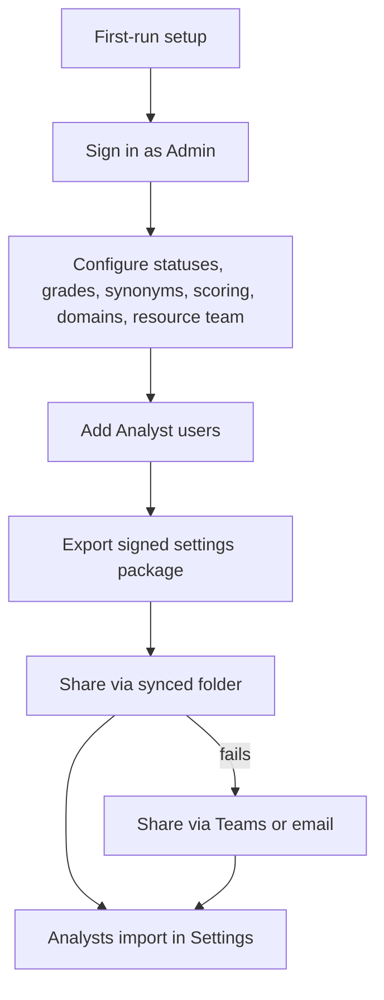

# PerfectFitCandidate — OCC Admin guide (Phase 1)

OCC (Object Control Center) is the Admin-only area for users, reference data, matching configuration, audit and settings packages. This guide covers the Phase 1 screens as built in `PFC/frontend` against the `/api/v1` backend. Anything not yet available is marked **Pending**. Every OCC change is audit-logged.

## Contents

1. [Admin flow](#1-admin-flow)
2. [First-run setup](#2-first-run-setup)
3. [Users and one-time passwords](#3-users-and-one-time-passwords)
4. [DL / CT approvals](#4-dl--ct-approvals)
5. [Status list and mapping](#5-status-list-and-mapping)
6. [Grade list](#6-grade-list)
7. [Skill synonyms](#7-skill-synonyms)
8. [Scoring template](#8-scoring-template)
9. [Email templates and resource-team list](#9-email-templates-and-resource-team-list)
10. [Internal domains](#10-internal-domains)
11. [Approved models](#11-approved-models)
12. [Signing key](#12-signing-key)
13. [Export and share a settings package](#13-export-and-share-a-settings-package)
14. [Audit log](#14-audit-log)
15. [Admin settings](#15-admin-settings)
16. [Pending in this build](#16-pending-in-this-build)

## 1. Admin flow

Sign in with the role **Admin**. OCC Admin is in the left panel; its sections are grouped as:

- **People:** Users & passwords, Resource-team list
- **Data:** DL / CT approvals, Grade list, Status list & mapping, Skill synonyms, Internal domains
- **Matching:** Scoring template, Approved models
- **Operations:** Audit log, Admin settings, Settings packages

## 2. First-run setup

On a new data folder, PFC opens **Welcome to PerfectFitCandidate — first-run setup**.

1. **Setup code:** shown in the PFC console window and in `data\run\setup-code.txt`. It works once.
2. Enter **Full name**, **Corporate email**, **Password** and **Confirm password**. The Admin password must meet every item on the checklist (at least 14 characters, character types, not your email or name, not a common password).
3. **Create admin**, then optionally confirm folders (**Data folder**, **Resume folder path**, which can be set later in Settings), then **Next**.
4. The summary confirms the account. **Go to sign in**.

The setup screen does not appear again unless the data folder is reset.

## 3. Users and one-time passwords

**OCC → Users & passwords**

- **+ Add user:** enter name, email, role (Admin or Analyst) and persona (A — matching and candidate email, B — demand analytics, C — bench analytics), then **Create and generate one-time password**.
- **Reset password** generates a new one-time password.
- The one-time password is **shown once**. Use **Copy**, share it securely, then **Done**. The user must change it at first sign-in.
- **Unlock** clears a lockout; **Disable** / **Enable** blocks or restores sign-in.

Emails are masked in the list; Admins can reveal them.

## 4. DL / CT approvals

**Pending:** the screen is built (Demand List and Candidate Tracker tabs, **Approve**, **Modify**, **Revert**, fields before → after), but the backend routes `GET /occ/approvals` and `PUT /occ/demands/{id}` / `PUT /occ/resources/{id}` are not merged. Against the real backend the queue cannot load yet.

## 5. Status list and mapping

**OCC → Status list & mapping**

- **Status list & priority:** the canonical bench statuses in priority order (arrows reorder), with eligibility, tiered points and caveat text. Excluded statuses remove people from matching.
- **Source-status mapping:** maps each status exactly as written in the CT to a canonical status (**Choose canonical status…**).
- Statuses from uploads that have no mapping are listed as unmapped and flagged on the Bench List.

**Save** sends one change per edited item. If one fails, the error is shown, the list reloads from the server and the items that did not save are named. **Discard** drops unsaved edits.

## 6. Grade list

**OCC → Grade list**

Order grades with ↑ / ↓, **Retire** or **Restore** a grade, then **Save grade list** (or **Discard changes**). People whose grade is not in the active list are excluded from matching. Re-run matching to apply a new order.

## 7. Skill synonyms

**OCC → Skill synonyms** (skill-synonym tracker)

The **Suggestions** tab discovers unrecognised skills from active CT resources, the latest non-removed CVs, and current JD analysis. JD suggestions are limited to short skill-like mandatory/preferred items; experience, qualification, domain, sentence-like, years-of-experience, filler-only and already-recognised phrases are excluded. The **Found in** counts show distinct CT people, CV people and JD demands.

Search the list, use **Select all** for the visible filtered rows, then add selected terms as new canonical skills or reject them. A row can also be mapped to an existing canonical skill with a relation. Approval is the only action that adds a skill or synonym to the active dictionary and refreshes Bench List eligibility. Rejections are stored locally and are not included in signed settings packages; the **Rejected** view can restore a term. Legacy suggested synonym rows remain in their own section. Earlier match runs are not changed.

## 8. Scoring template

**OCC → Scoring template**

Edit component **Weights**, band thresholds (**Strong**, **Potential**, **Avg**; they must be descending) and adjacent-grade points. Available Capacity, Tracker and Group are not scored (locked, REQ-ELIG-06). **Publish v(N+1)** activates the draft; **Discard draft** drops it. **History** lists earlier versions. Analysts see the template read-only.

## 9. Email templates and resource-team list

- **OCC → Resource-team list:** the recipients of candidate emails (display name, email, active). Changes apply to new drafts only. An address already in the list or not a valid email is rejected.
- **OCC → Email templates:** lists the latest version of each template with its subject, version, created date and whether it is the default. **Show all versions** adds the earlier versions.
  - **Edit** opens a version; **Save as v(N+1)** adds the next version. Versions are never changed in place. **New template** starts a new template name.
  - Subjects and bodies may use only `{candidate_name}`, `{requisition}`, `{role}`, `{match_pct}`, `{analysis}`, `{gaps}`, `{pointers}`, `{spoc_1}` and `{spoc_2}`. Any other `{token}`, an unmatched brace or a `{name:spec}` form is rejected; write a literal brace as `{{` or `}}`.
  - **Set as default** makes that version the one new email drafts use. There is one default at a time, and a new version is not the default until you set it. If no default exists, the template you save becomes the default; with no templates at all, the first email draft creates `candidate_default` v1.
  - Analysts' **Settings → Email template** is separate and stored in their browser.

## 10. Internal domains

**OCC → Internal domains**

Add or remove email domains used to classify candidates as Internal or External (exact match). The domain is a heuristic, not proof of employment. While you edit, **Classification impact** previews how many candidates become Internal, External and Unknown. **Save and re-evaluate** saves; **Discard** drops edits. An edit is a delete plus an add.

### Cached CV text and classification

**OCC → Operations → Cached CV text** lists a selected candidate's cached CV versions with the masked filename, version, extraction time and removed flag. Use **Clear this candidate's extractions** or **Clear all candidates' extractions**, then review the scope and confirm. Cancel makes no change. The result shows versions cleared, chunks deleted, vectors deleted and matching vectors deleted.

Original CV files, candidate identities and past match runs are kept. Candidate emails and CV-derived skills are retained. The next CV sync re-reads the files and restores the extraction and vectors. Removal is Admin-only and audited.

In **Candidate Profile → Overview → Classification**, review the effective and live computed classifications, override reason, setter's user ID and time. Select Internal, External or Unknown and provide a non-blank reason to **Set override**. **Clear override** also requires a reason and immediately returns to automatic classification. Email addresses in the displayed reason are redacted. Analysts can read this information but cannot change it. Domain classification is a heuristic, not proof of employment.

## 11. Approved models

**OCC → Approved models**

The list of local models with purpose, licence, RAM / disk, **Approved** and **Default**. Approving a model makes it available to every user.

**Pending:** **Make default** currently sets the signed-in Admin's own active model, not a global default; a global-default backend route is pending.

## 12. Signing key

Settings packages are signed with an Ed25519 key. There is no separate key screen: the first export creates the signing key, protected by the passphrase you enter, and later exports need the same passphrase. The passphrase is never stored or logged by the SPA; keep it safe.

**Pending:** the backend serves `GET /occ/settings-package/signing-key`, but no screen shows key details yet.

## 13. Export and share a settings package

**OCC → Settings packages**

1. Enter the **Signing-key passphrase** (masked).
2. **Export settings package**. PFC creates `PFC-settings-v<N>.pfcpkg` with a monotonic version and shows its contents summary.
3. The package contains configuration, approvals and Analyst accounts (one-time password hash, change required); never secrets or tokens. New Analyst one-time passwords are listed once for you to share securely.
4. **Share:** put the file in the synced folder; if that fails, send it by Teams or email. Analysts import it in **Settings → Settings package** (file picker or `inbox\`).

## 14. Audit log

**OCC → Audit log**

The append-only log of sign-ins, OCC changes, uploads, overrides, approvals and sends, with timestamp, user, role, action, entity and summary. Filter by **From** / **To** date, **User**, **Action** and **Entity** (**Clear** resets) and **Export CSV (N)** downloads the filtered rows, with formula-character protection.

## 15. Admin settings

**OCC → Admin settings** holds instance-wide settings such as sign-in lockout limits, minimum password lengths, whether Analysts may unmask emails (this also controls whether Analysts can export results with full emails) and the number of pre-selected emails per requisition. **Admin settings saved.** confirms a save.

## 16. Pending in this build

| Area | Status |
|---|---|
| DL / CT approvals | Pending: backend approval routes not merged |
| Global default model | Pending: **Make default** is per user |
| Signing-key details screen | Pending |
| Lockout status on sign-in | Pending: the backend answers a locked account with 401 invalid credentials. The sign-in screen shows the lockout message on a 423, with a countdown when the reply carries `Retry-After` |
