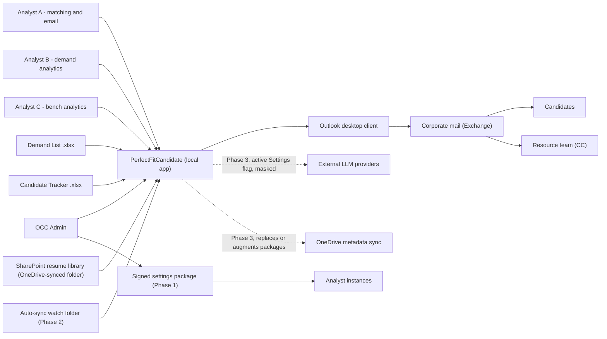
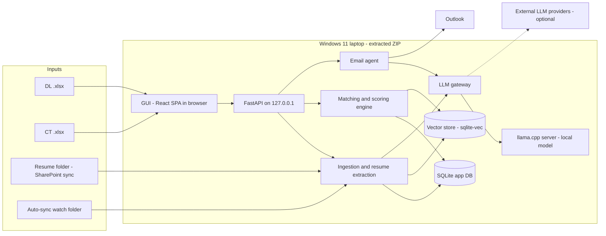
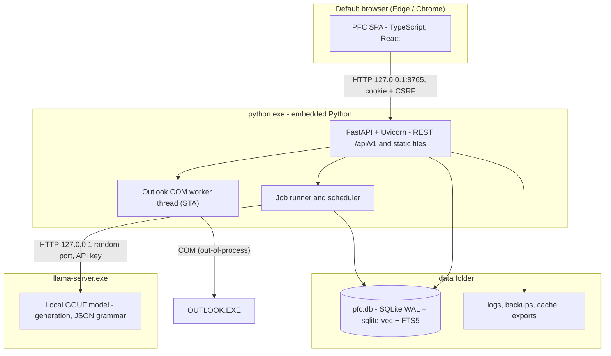
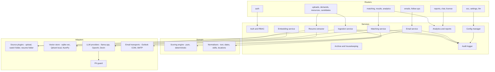
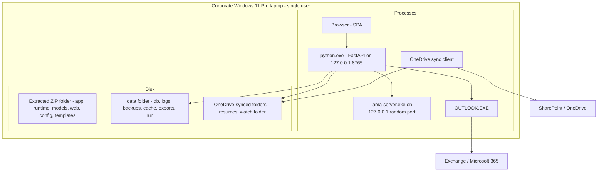
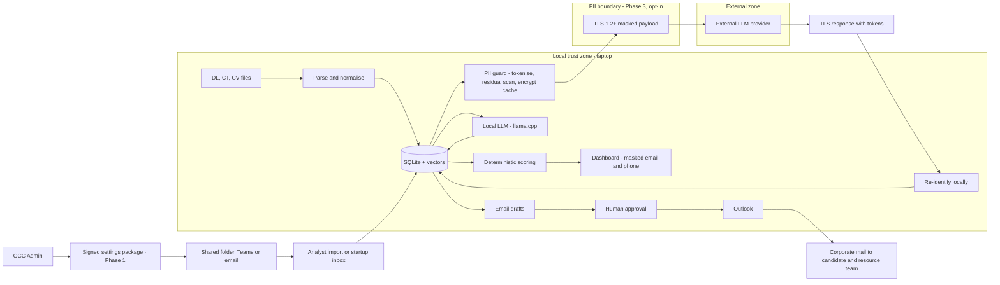
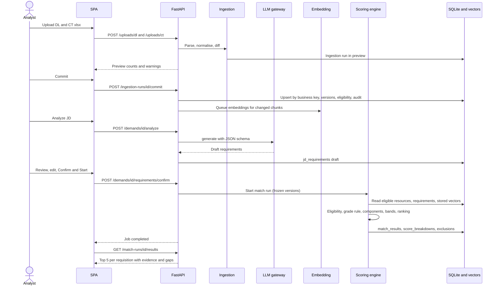
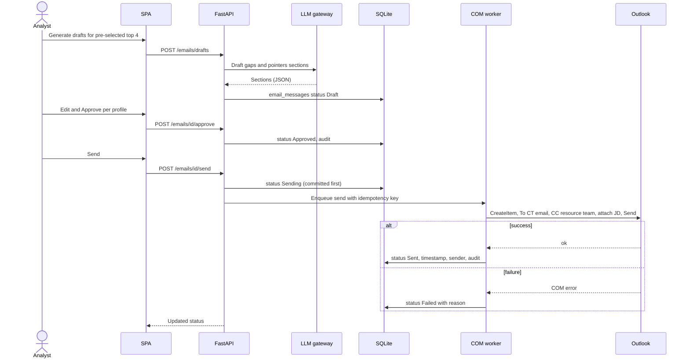
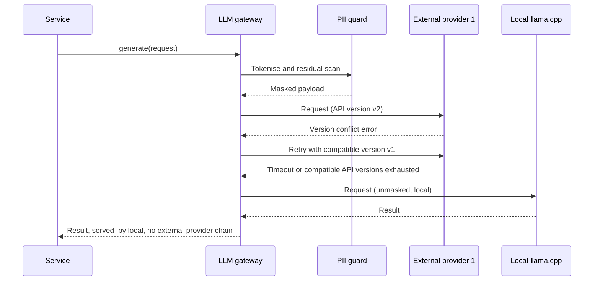

# PerfectFitCandidate (PFC) — System Architecture

| Item | Value |
|---|---|
| Document | System Architecture |
| Version | 1.0 |
| Status | Draft |
| Source of truth | [REQUIREMENTS_BASELINE.md](REQUIREMENTS_BASELINE.md) (requirement IDs `REQ-*`, decisions `D-*`, open items `O-*`) |
| Related documents | [TDD.md](TDD.md) (technical detail behind this architecture) · [BRD.md](BRD.md) · [FDD.md](FDD.md) · [WORKFLOW.md](WORKFLOW.md) · [GUI_OCC_DESIGN.md](GUI_OCC_DESIGN.md) · [FEASIBILITY.md](FEASIBILITY.md) · [PHASES.md](PHASES.md) · [DASHBOARD_RESEARCH.md](DASHBOARD_RESEARCH.md) |
| Reference inputs | [reference/Application-Design.png](reference/Application-Design.png) (original sketch) · [reference/Project-PerfectFitCandidate.docx](reference/Project-PerfectFitCandidate.docx) · [reference/DL-CT-Metadata.xlsx](reference/DL-CT-Metadata.xlsx) |

## Table of contents

1. [Scope and drivers](#1-scope-and-drivers)
2. [Architecture principles](#2-architecture-principles)
3. [System context](#3-system-context)
4. [Architecture overview](#4-architecture-overview)
5. [Container view](#5-container-view)
6. [Component view (backend)](#6-component-view-backend)
7. [Deployment view](#7-deployment-view)
8. [Data flow and PII boundary](#8-data-flow-and-pii-boundary)
9. [Key sequences](#9-key-sequences)
10. [Quality attributes](#10-quality-attributes)
11. [Architecture decision records](#11-architecture-decision-records)
12. [Evolution by phase](#12-evolution-by-phase)
13. [Risks](#13-risks)
14. [Open questions](#14-open-questions)

---

## 1. Scope and drivers

PFC is an internal, local-first web application that matches bench resources (Candidate Tracker, CT) to open demands (Demand List, DL), produces explainable 0–100 % match scores with bands, lets analysts approve personalised candidate emails, and provides demand/bench/match analytics for ~5 users (Analyst personas A/B/C and the OCC Admin) at a volume of 100–500 demands and 100–500 resources. It runs from a **portable ZIP on a locked-down Windows 11 Pro laptop**, mostly offline, without admin rights (REQ-PKG-01). The primary success metric is **auto-match accuracy** (KPI-01).

Architecturally significant requirements:

| Driver | Baseline | Architectural response |
|---|---|---|
| No installation, no admin rights, mostly offline | REQ-PKG-01..04, NFR-02 | Self-contained ZIP: embedded Python, prebuilt llama.cpp, bundled models, static SPA; localhost server; no services/daemons |
| 16 GB RAM CPU-only laptop shared with Outlook/Teams | REQ-LLM-01, NFR-03 | Small quantized model in a separate, lazily started process with a ≤8 GB model-process limit; LLM kept out of the scoring loop |
| Explainable, reproducible, human-reviewed results | REQ-MAT-02/08, REQ-SCR-04, NFR-05 | Deterministic scoring engine; versioned inputs; confirm-before-score; per-profile email approval |
| CV and personal data stay local by default | NFR-04, REQ-LLM-05 | Local inference default; explicit PII boundary with tokenisation + encryption for optional external providers (Phase 3) |
| Extensibility (sources, providers, transports) | NFR-07, REQ-ING-04, REQ-LLM-03, REQ-EML-04 | Plugin interfaces in a modular monolith |

## 2. Architecture principles

| # | Principle | Meaning for PFC |
|---|---|---|
| P-1 | **Local-first** | All core features (ingestion, extraction, embedding, matching, dashboard, drafting) run on the laptop without network; network-backed features are available only when their active Settings flag is enabled (NFR-02). |
| P-2 | **Privacy by default** | CV text, inference and vectors stay local; email/phone masked in the GUI with audited unmasking (REQ-OUT-03); external calls require an enabled Settings flag and PII masking + encryption (REQ-LLM-05, NFR-04). Corporate approval is granted and no candidate privacy notice is required. |
| P-3 | **Human-in-the-loop** | Output is a ranked shortlist for review, never a selection decision (§1 of the baseline). Analyze JD → review → Confirm & Start (REQ-MAT-02); per-profile Approve before any email (REQ-EML-01); audited overrides (REQ-MAT-09). |
| P-4 | **Deterministic, explainable scoring** | Weighted score model 70/10/5/5/5/5 computed by pure code from stored inputs; LLM output is an input that humans confirm, never the score (REQ-LLM-02, D-02). |
| P-5 | **Pluggable providers** | Ingestion sources, vector store, LLM providers and email transports sit behind interfaces, so watch-folder pickup, Qdrant, OpenAI/Devin and SMTP can be added without changing core services (NFR-07). |
| P-6 | **Simplicity over scale** | A single-process modular monolith with SQLite is sufficient for ~5 users and ≤ 500 × 500 records; no message brokers, containers or servers. |
| P-7 | **Copy, never invent** | Source values (requisition IDs, dates, emails) are copied exactly; missing data is reported as "not recorded", never fabricated (REQ-IN-14, REQ-MAT-06). |
| P-8 | **Audit everything that matters** | Logins, unmasking, OCC changes, approvals/sends, archival, settings and external LLM calls are audited (REQ-AUTH-05). |

## 3. System context



| External element | Interaction | Phase |
|---|---|---|
| DL / CT workbooks | Manual upload via GUI (default) | P1 |
| Watch folder (mapped drive / OneDrive-synced) | Auto-pickup of new DL/CT files | P2 (config placeholder in P1) |
| Resume folder (SharePoint synced locally) | Per-candidate / global CV Sync reads PDF/DOCX | P1 |
| Outlook desktop | COM automation for mail (P1) and calendar follow-ups (P2) | P1 / P2 |
| SMTP server | Optional alternative transport | P2 |
| External LLM providers | When their Settings active flag is enabled, retry compatible API versions, then fall directly to local model; no external-provider chain | P3 |
| Signed settings package | OCC export and Analyst file-picker or startup-inbox import; channel may be shared folder, Teams or email | P1 |
| OneDrive shared folder | Metadata sync replaces or augments manual settings packages | P3 |

## 4. Architecture overview



Reading the diagram: analysts use the **browser GUI**, which talks only to the **FastAPI** process on loopback. FastAPI hosts the ingestion, extraction, matching and email services, persists business data in **SQLite** and vectors in **sqlite-vec** (same file), and reaches language models only through the **LLM gateway** — the local **llama.cpp** server by default, external providers optionally (Phase 3). The **email agent** hands approved messages to **Outlook**. The design maps one-to-one to the original sketch ([reference/Application-Design.png](reference/Application-Design.png)): Interface (DL/ActivityTracker) → Interactive Demand-Resource Analytics → Vector Database ↔ Object Control Center → Email Candidate + Resource Team, with Candidate Profile folder and Download Report.

## 5. Container view



| Container | Technology | Responsibility | Lifecycle |
|---|---|---|---|
| SPA | TypeScript, React, CSS (built static files) | Dashboard, results grid, analytics, uploads, JD review, CV sync, email approval, OCC, settings | Served by FastAPI; runs in the user's browser |
| API process | Embedded Python 3.13, FastAPI, Uvicorn (1 worker) | REST API, services, scoring, default nomic-embed-text-v1.5 embeddings via ONNX Runtime, job runner, COM worker | Started by `PFC.cmd`; one instance per user (lock file) |
| Local LLM process | llama.cpp `llama-server.exe`, GGUF model | JD/CV extraction, email section drafting, chat (P2) | Started lazily by the API process; stopped on idle; restarted on crash |
| Data store | SQLite file (WAL) with sqlite-vec and FTS5 | Business data, versions, results, audit log, vectors, keyword index | File in `data/db/` |
| Outlook | Outlook desktop (user's profile) | Sending mail, calendar items | User-managed; driven via COM |

## 6. Component view (backend)



Component responsibilities, interfaces and the full SQLite schema are specified in [TDD.md §2–§4](TDD.md#2-component-breakdown).

## 7. Deployment view

### 7.1 Physical deployment



### 7.2 Extracted ZIP layout

```text
PFC-<version>\
├─ PFC.cmd                     launcher (start / reuse running instance, open browser)
├─ app\                        pfc Python package (FastAPI app, services, domain, adapters)
├─ runtime\python\             Python embeddable distribution + vendored site-packages
├─ runtime\llama\              llama-server.exe + DLLs (CPU x64 build)
├─ models\                     default GGUF LLM, embedding model, MODELS.lock (hashes, licences)
├─ web\                        built React SPA (index.html, assets)
├─ config\                     shipped defaults (nine grades A3–E1, bench statuses + editable source-status map, scoring template, synonyms, internal domains, approved models)
├─ templates\                  email template, prompts, JSON schemas / grammars, report templates
├─ data\                       created at first run; preserved on upgrade (optionally %LOCALAPPDATA%\PFC\data)
│  ├─ db\pfc.db                SQLite (WAL) incl. vectors and FTS index
│  ├─ logs\  backups\  cache\  exports\
│  └─ run\                     pfc.lock, port, one-time setup code
├─ VERSION
└─ THIRD_PARTY_NOTICES.txt, LICENSES\
```

### 7.3 Processes and ports

| Process | Binding | Started by | Notes |
|---|---|---|---|
| `python.exe` (FastAPI/Uvicorn) | `127.0.0.1:8765` (fallback: free ephemeral port, recorded in `data/run/port`) | `PFC.cmd` | Never binds `0.0.0.0` (REQ-AUTH-07); single instance via `data/run/pfc.lock` (REQ-PKG-04) |
| `llama-server.exe` | `127.0.0.1:<random>` with a per-launch API key | API process, lazily | ≤ 8 GB RAM budget (NFR-03); idle shutdown |
| Browser | — | Launcher opens default browser | Any modern Chromium/Edge |
| `OUTLOOK.EXE` | COM (no network port) | User / COM activation | Uses the user's existing profile and corporate mail policies |

Upgrade = replace everything except `data\`; the launcher backs up the DB and applies migrations at first start ([TDD.md §13](TDD.md#13-packaging)). Packaging feasibility on the corporate laptop (script/EXE execution, loopback, AV/EDR, OneDrive behaviour) is assessed in [FEASIBILITY.md](FEASIBILITY.md).

## 8. Data flow and PII boundary



The Phase 1 package is a signed `PFC-settings-v<N>.pfcpkg` ZIP containing versioned JSON, a manifest and Ed25519 signature. Import validates the signature, schema, app compatibility and monotonic version, previews changes, then applies atomically with audit and rollback; no secrets or tokens are included.

| Data class | Examples | Stored | Leaves the laptop? |
|---|---|---|---|
| Direct identifiers | Name, ShortName, email, phone | SQLite (local) | Only in approved candidate emails via Outlook; **never** to external LLMs (replaced by tokens such as `⟦PERSON_07⟧`) |
| CV content | Raw text, sections, facts | SQLite (local) | No by default; Phase 3 external calls receive masked excerpts only after opt-in |
| Demand data | JD text, account, requisition | SQLite (local) | Masked/optional per admin setting for external calls; JD attached to candidate email |
| Vectors | Chunk embeddings | sqlite-vec (local) | Never (embeddings are always local, REQ-LLM-07) |
| Secrets | Provider tokens, SMTP credentials, encryption key | DPAPI-protected | Tokens only to their own provider over TLS |
| Audit / logs | Events, redacted logs | SQLite / log files | No (diagnostics export is redacted and manual) |
| Settings package (P1) | Approved settings and Analyst accounts; no secrets/tokens | Signed ZIP with manifest and Ed25519 signature | Shared folder, Teams or email; signature provides authenticity |
| Approved metadata (P3) | Pseudonymous skills/score statistics | Encrypted packages | OneDrive metadata sync replaces or augments manual packages |

## 9. Key sequences

### 9.1 Upload, JD analysis and match run



### 9.2 Email approval and send



### 9.3 External LLM call with fallback (Phase 3)



## 10. Quality attributes

| Attribute | Target (baseline) | How the architecture addresses it |
|---|---|---|
| **Performance** | Full 500 × 500 re-match within a few minutes; dashboard < 2 s (NFR-01) | Embeddings computed once and cached by content hash; LLM used only for extraction/drafting, never per pair; exhaustive vectorised (NumPy) scoring over ~94k grade-compatible pairs; incremental re-scoring of dirty pairs; indexed SQLite queries and pre-aggregated run summaries; background jobs for long work. Budgets in [TDD.md §15](TDD.md#15-performance-budgets). |
| **Security** | Localhost only, strong auth, audit (REQ-AUTH-*) | `127.0.0.1` binding, Host/Origin checks, CSRF token, `SameSite=Strict` cookies, Argon2id hashing, lockout, no default admin, RBAC on server, hash-chained audit log, DPAPI-protected secrets, SonarQube SAST and dependency audits in CI. |
| **Privacy** | Local by default; masking; PII protection for external calls (NFR-04, REQ-OUT-03, REQ-LLM-05) | Local trust zone for all personal data; explicit PII boundary with tokenisation, residual scan, TLS and encrypted cache; embeddings never external; masked GUI by default with audited unmask; redacted logs. |
| **Reliability** | Consistent data, no duplicate emails (REQ-EML-06) | SQLite WAL + transactional upserts; backups before migrations and daily; idempotent ingestion (file hash) and email sending (idempotency key + `Sending` reconciliation); crash-isolated `llama-server` with supervised restart; degraded modes (no LLM → manual requirements; no Outlook → drafts retained; no vector extension → NumPy store). |
| **Reproducibility / explainability** | Every score reproducible and explained (REQ-MAT-08, REQ-SCR-04, NFR-05) | Pure scoring engine; run records engine, template, embedding model, JD/CV versions, synonym-set hash and config hash; per-component breakdown with inputs; append-only versions. |
| **Portability** | Portable ZIP on Windows 11 without admin (REQ-PKG-01..04) | Embedded signed Python + vendored wheels; prebuilt llama.cpp; static SPA; relative paths; data folder separable; no installers, services or registry writes. |
| **Resource footprint** | Fits 16 GB with Outlook/Teams; model process ≤ 8 GB (NFR-03) | Q4 model-size and memory figures are estimates pending benchmark; lazy start and idle stop of the model process; one active model (REQ-LLM-01); default nomic-embed-text-v1.5 embedding model (~137M parameters). |
| **Maintainability / extensibility** | Plugin interfaces (NFR-07) | Modular monolith with routers → services → domain/adapters; interfaces for sources, vector stores, LLM providers, transports; versioned config, prompts and templates. |
| **Usability** | Professional dashboard, accessibility (NFR-06) | SPA with charting per [DASHBOARD_RESEARCH.md](DASHBOARD_RESEARCH.md) and screens per [GUI_OCC_DESIGN.md](GUI_OCC_DESIGN.md); responsive API via background jobs and progress feedback. |

## 11. Architecture decision records

| ADR | Decision | Status | Alternatives considered | Rationale | Consequences |
|---|---|---|---|---|---|
| ADR-01 | **SQLite** as the application database | Accepted (D-04) | PostgreSQL (incl. portable), DuckDB | Zero-install single file, transactional, adequate for ~5 users and ≤ 500 × 500 rows; Postgres needs a service/installer and admin rights on locked-down laptops | Single writer (fine for one user per instance); WAL mode; must not live in a OneDrive-synced folder |
| ADR-02 | **sqlite-vec** as default vector store behind a `VectorStore` interface; Qdrant local mode as alternative; NumPy fallback | Proposed (decided in TDD per baseline §13) | Qdrant local mode, Qdrant server, LanceDB, ChromaDB, FAISS | Same file and transaction as business data, tiny footprint, exact KNN fast at ~20k vectors; Qdrant server adds an EXE and port; others add dependencies without benefit at this scale | Depends on loading a DLL extension (verify in feasibility); pre-1.0 library must be pinned |
| ADR-03 | **llama.cpp** (`llama-server`) for local inference | Accepted (REQ-LLM-01, REQ-PKG-03) | Ollama, llama-cpp-python in-process, ONNX GenAI | Portable prebuilt binaries, no installer, GGUF quantized models, OpenAI-compatible API with JSON-schema/grammar; Ollama's installer needs admin rights and runs a background service | Extra loopback port and EXE to allow-list; model swaps require process restart |
| ADR-04 | **Outlook COM** (pywin32) as primary email transport; SMTP optional | Accepted (REQ-EML-04) | SMTP only, Microsoft Graph | Uses the user's existing authenticated Outlook profile and corporate policies, no app registration or credentials; Graph needs tenant app consent; SMTP often blocked or requires credentials | Windows-only; Object Model Guard prompts possible (fallback Display mode); COM calls on a dedicated STA thread |
| ADR-05 | **FastAPI + React/TypeScript SPA** served on localhost | Accepted (baseline §13) | Streamlit, Electron, desktop UI (Qt) | Rich professional dashboard, typed API contract (OpenAPI → TS client), runs in the existing browser, no extra runtime like Electron; Streamlit limits complex interactive UIs | Two codebases (Python + TS); frontend built at packaging time |
| ADR-06 | **Deterministic weighted scoring**; LLM only for extraction and drafting | Accepted (REQ-LLM-02, D-02) | LLM-as-judge scoring, learned ranking model | Reproducible, explainable, fast (no LLM per pair), auditable; weights from the metadata sheet (70/10/5/5/5/5); human-confirmed requirements bridge LLM output into scoring | Accuracy depends on requirement quality, synonyms and embeddings — tuned via the admin template against KPI-01 |
| ADR-07 | **Modular monolith** in one Python process with an in-process job runner | Proposed | Microservices, Celery + Redis | ~5 users, single laptop, no admin rights; fewer processes and ports; simpler packaging | Long jobs share the process — bounded thread pool and job priorities required |
| ADR-08 | **Embeddable Python + vendored wheels** packaging | Proposed (see [FEASIBILITY.md](FEASIBILITY.md)) | PyInstaller, Nuitka | python.org-signed interpreter is more likely to pass AV/AppLocker than unsigned frozen EXEs; no compiler toolchain | Many files in the ZIP; launcher is a `.cmd` file that must be permitted |
| ADR-09 | **External LLMs behind PII guard with direct local fallback** | Accepted, Phase 3 (REQ-LLM-03..05) | No external providers; unmasked external calls; chaining external providers | Retry compatible API versions, then fall directly to local model; corporate approval granted and Settings active flag required | Masking can reduce answer quality; embeddings remain local |
| ADR-10 | **Signed settings packages for Phase 1 cross-instance configuration** | Accepted (REQ-OCC-01/02) | Manual entry on each instance; Phase 3-only sync | Ed25519-signed, monotonic-version ZIP supports preview, atomic apply, audit and rollback; Phase 3 metadata sync replaces or augments it | Signing key protection and package delivery procedures are required |
| ADR-11 | **nomic-embed-text-v1.5 as default embedding model** | Accepted (REQ-LLM-07) | bge-small / bge-base alternatives; other models | 137M, Apache-2.0, 768 dimensions with Matryoshka truncation option, 8192-token context; ONNX Runtime default, llama.cpp GGUF alternative and required task prefixes | Model import triggers re-embedding and records model version per vector |

## 12. Evolution by phase

| Phase | Architectural additions |
|---|---|
| **Phase 1 — MVP** | SPA, FastAPI, SQLite + sqlite-vec + FTS5, ingestion (manual upload), resume extractor with CV Sync, nomic embedding service, scoring engine, local llama.cpp gateway, Outlook COM email agent with approval and status tracking, auth/RBAC, audit log, editable seeded status map, OCC basics, internal-domain allowlist, signed settings-package export/import, CSV/XLSX export, launcher and ZIP packaging with dummy placeholders for inactive settings. |
| **Phase 2** | Watch-folder source plugin (auto-pickup), Outlook calendar follow-ups, PDF report generator, chat-with-data (local RAG over FTS5 + vectors), manual archival with preview, internal/external classification, CV version comparison, SMTP transport. |
| **Phase 3** | External LLM provider adapters with PII guard, encryption, compatible API-version retries and direct local fallback; advanced OCC (role-specific scoring templates, model benchmark lab); scheduled archival/housekeeping; licensing (per-user ZIP + Ed25519-signed device licence); OneDrive metadata sync replaces or augments settings packages. |

Phase scope and sequencing are detailed in [PHASES.md](PHASES.md).

## 13. Risks

| # | Risk | Impact | Mitigation |
|---|---|---|---|
| R-01 | Corporate policy blocks `.cmd`, `python.exe`, `llama-server.exe` or DLL extensions | App cannot start or loses features | Phase 0 feasibility tests ([FEASIBILITY.md](FEASIBILITY.md)); in-process fallbacks (llama-cpp-python, NumPy store); IT allow-listing request |
| R-02 | Loopback port blocked or intercepted by endpoint security | GUI unreachable | Port fallback; feasibility test; documented allow-list request |
| R-03 | Outlook Object Model Guard / policy blocks programmatic send | Email agent cannot send automatically | "Display" mode with manual send + reconciliation; SMTP (P2) |
| R-04 | CPU-only LLM too slow for bulk JD/CV extraction | Slow onboarding of large lists | Incremental processing, smaller model for bulk, rule-based pre-extraction, background jobs |
| R-05 | Data folder placed inside a OneDrive-synced path | SQLite corruption | Launcher detects OneDrive paths and recommends `%LOCALAPPDATA%\PFC\data` |
| R-06 | Model licence incompatible with internal distribution | Cannot ship chosen model | Licence gate in model approval (REQ-LLM-06); prefer Apache/MIT models |
| R-07 | Match accuracy below expectations | KPI-01 missed | Labelled evaluation set, admin-tunable template, synonym tracker, embedding model upgrade path |

## 14. Open questions

| # | Question | Proposed handling | Related |
|---|---|---|---|
| AQ-01 | Is loading SQLite extensions (sqlite-vec DLL) permitted on the target laptop? | Verify in feasibility; NumPy fallback keeps the architecture unchanged | ADR-02, REQ-PKG-05 |
| AQ-02 | Is a separate `llama-server.exe` process allowed, or must inference run in-process? | Default separate process; in-process fallback via llama-cpp-python | ADR-03 |
| AQ-03 | Embedding runtime: ONNX Runtime in-process or llama.cpp embeddings? | Benchmark with model selection | O-05 |
| AQ-04 | Is full-database encryption (SQLCipher) required in addition to BitLocker? | Confirm with IT security; field-level encryption for secrets regardless | REQ-AUTH-06 |
| AQ-05 | Corporate approval for CV processing, Outlook automation and external LLM use | Resolved: corporate approval is granted; no candidate privacy notice is required and these approvals are not a Phase 1 pilot gate. | O-06 |
| AQ-06 | Admin repository for Phase 3 OneDrive metadata packages: same app in admin mode or separate console? | Same codebase, admin-mode features gated by role/licence; to be confirmed in Phase 3 design | D-03, REQ-AUTH-08 |
