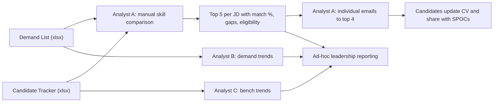
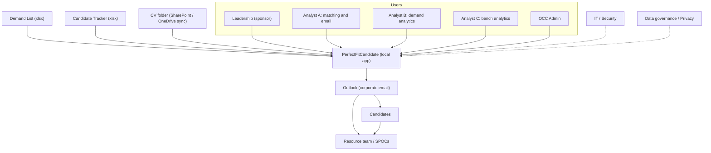

# PerfectFitCandidate (PFC) — Business Requirements Document (BRD)

| Item | Value |
|---|---|
| Document | Business Requirements Document (BRD) |
| Product | PerfectFitCandidate (PFC) — bench-to-demand matching and analytics |
| Version | 1.0 |
| Status | Draft |
| Source of truth | [REQUIREMENTS_BASELINE.md](REQUIREMENTS_BASELINE.md) (REQ-\*, KPI-\*, NFR-\*, decision log §16, open items §17) |
| Original inputs | [Project brief (docx)](reference/Project-PerfectFitCandidate.docx), [DL/CT metadata (xlsx)](reference/DL-CT-Metadata.xlsx), [Application design sketch (png)](reference/Application-Design.png) |
| Related documents | [FDD.md](FDD.md), [TDD.md](TDD.md), [ARCHITECTURE.md](ARCHITECTURE.md), [WORKFLOW.md](WORKFLOW.md), [GUI_OCC_DESIGN.md](GUI_OCC_DESIGN.md), [FEASIBILITY.md](FEASIBILITY.md), [PHASES.md](PHASES.md), [DASHBOARD_RESEARCH.md](DASHBOARD_RESEARCH.md) |

> This BRD describes **what** the business needs and **why**. Functional behaviour is specified in [FDD.md](FDD.md), technical design in [TDD.md](TDD.md) / [ARCHITECTURE.md](ARCHITECTURE.md), and delivery sequencing in [PHASES.md](PHASES.md). Where this document and the baseline differ, [REQUIREMENTS_BASELINE.md](REQUIREMENTS_BASELINE.md) prevails.

---

## Table of contents

1. [Executive summary](#1-executive-summary)
2. [Business problem and current process](#2-business-problem-and-current-process)
3. [Business objectives](#3-business-objectives)
4. [Stakeholders and RACI](#4-stakeholders-and-raci)
5. [Scope](#5-scope)
6. [Business requirements](#6-business-requirements)
7. [Business rules](#7-business-rules)
8. [Success metrics and KPIs](#8-success-metrics-and-kpis)
9. [Assumptions, constraints and dependencies](#9-assumptions-constraints-and-dependencies)
10. [Risks and mitigations](#10-risks-and-mitigations)
11. [Benefits](#11-benefits)
12. [Open questions](#12-open-questions)
13. [Glossary](#13-glossary)
14. [Approval and sign-off](#14-approval-and-sign-off)

---

## 1. Executive summary

The bench management team currently matches **bench resources** to **open demands** (job requisitions) by hand, comparing two Excel workbooks — the **Demand List (DL)** and the **Candidate Tracker (CT)**, also called Bench Tracker / ActivityTracker — and then emailing shortlisted people. The process is slow, person-dependent and hard to audit.

**PerfectFitCandidate (PFC)** is an internal, local-first web application for ~5 named users (leadership and analysts) that:

- ingests the latest DL and CT workbooks (and, where available, candidate CVs from a synced SharePoint/OneDrive folder);
- applies the agreed **eligibility, grade and location rules** and an **explainable 0–100 % weighted score** (skills/experience/domain 70, grade 10, location 5, Bench Start Date 5, Bench End Date 5, Bench Status 5);
- produces a **ranked top-5 shortlist per requisition** with match band, matching evidence, gaps/checks and eligibility evidence for **human review**;
- drafts tailored candidate emails that are sent via Outlook **only after explicit per-candidate approval**;
- provides demand, bench and match analytics dashboards for leadership and analysts.

PFC runs as a **portable ZIP** on a locked-down **Windows 11 Pro** corporate laptop with **no admin rights**, mostly **offline**, using a **local LLM (llama.cpp)** so CV content stays on the device (REQ-PKG-01, REQ-LLM-01, NFR-02, NFR-04).

The **primary success metric is auto-match accuracy** (KPI-01): how well the system's top-5 shortlist agrees with the shortlist an experienced analyst would confirm. PFC's output is always a shortlist for human review — **never an automated staffing or selection decision** (REQ-SCR-05).

Delivery is phased (see [PHASES.md](PHASES.md)): Phase 0 feasibility spike on a real corporate laptop, Phase 1 MVP (manual upload, matching and scores, email approval, professional dashboard, authentication), Phase 2 (automation and reporting), Phase 3 (external LLMs with PII protection, advanced OCC, licensing, metadata sync).

## 2. Business problem and current process

### 2.1 Current (as-is) manual process

The current process is run by three analyst personas using Excel (source: [project brief](reference/Project-PerfectFitCandidate.docx)):

| Persona | Current activity | Pain points |
|---|---|---|
| **Analyst A** — matching and outreach | Receives the DL (multiple JDs, each with a unique `Code Requisition`) and maintains the CT (people on bench or expected within ~12 weeks; skills only, not full profiles). Manually compares every eligible candidate's skills with every JD, picks the **top 5** per JD with a match %, gaps/checks and eligibility evidence, then emails the **top 4** candidates per JD asking them to tailor their CV to the attached JD and share it with two SPOCs. | O(demands × candidates) manual comparisons (100–500 × 100–500); inconsistent scoring between analysts; synonyms and spelling variants missed (e.g. `DataBricks`, `Bussiness Analysis`); eligibility rules applied inconsistently; emails written one by one; no record of who was contacted for which demand. |
| **Analyst B** — demand analytics | Analyses the DL for trends, e.g. top 5 skills in demand, top 3 accounts by JD count. | Manual pivots repeated for each new DL; no history. |
| **Analyst C** — bench analytics | Analyses the CT for trends, e.g. top 5 skills in the pool, grade histogram, bench timeline (bench start → end). | Manual charts; CT quality issues (header offsets, text dates, formulas) handled by hand each time. |

### 2.2 Problem statement

Matching quality and speed depend on individual analyst effort and memory. There is no consistent, explainable, auditable application of the eligibility, grade and location rules; no reusable skill-synonym knowledge; no tracking of candidate outreach; and analytics are rebuilt manually for every new DL/CT. As a result, suitable bench resources can be missed, outreach can exceed the target 24-hour turnaround, and leadership lacks a timely, trustworthy view of demand versus bench supply.

### 2.3 Future (to-be) process — summary

Analysts upload the latest DL/CT; PFC normalises and de-duplicates them, applies eligibility rules, analyses each JD (with analyst confirmation), scores eligible candidates and presents an explainable top-5 shortlist. Analyst A reviews the shortlist, edits LLM-drafted emails and approves each send; PFC tracks sent status. Analysts B and C, and leadership, use the analytics dashboards. The OCC Admin governs reference data, scoring templates and settings. Detailed flows are in [WORKFLOW.md](WORKFLOW.md).

## 3. Business objectives

| ID | Objective | Measured by |
|---|---|---|
| OBJ-01 | Improve the **accuracy and consistency** of bench-to-demand matching by applying one agreed, explainable rule set and score model. | KPI-01 |
| OBJ-02 | **Reduce analyst effort** from DL/CT receipt to a reviewed shortlist. | KPI-02 |
| OBJ-03 | Contact suitable candidates **within 24 hours** of demand upload, with human approval of every email. | KPI-03 |
| OBJ-04 | Increase the share of open demands with at least one credible (Strong or Potential) internal match. | KPI-04 |
| OBJ-05 | Make **data quality** issues in DL/CT visible and measurable so they can be fixed at source. | KPI-05 |
| OBJ-06 | Give leadership and analysts a **single, professional dashboard** for demand, bench and match analytics. | Adoption and UAT feedback |
| OBJ-07 | Keep candidate personal data **local and protected**, and run within corporate laptop constraints (no admin rights, mostly offline). | Feasibility and security sign-off |

## 4. Stakeholders and RACI

### 4.1 Stakeholders

| Stakeholder | Description | Interest / role in PFC |
|---|---|---|
| Leadership (sponsor) | Bench/resource management leadership; sponsor and dashboard consumer | Funds and prioritises; consumes analytics; approves KPI targets and go-live |
| Analyst A | Matching and candidate outreach (Analyst role) | Primary user of matching, shortlist review and email approval |
| Analyst B | Demand analytics (Analyst role) | Uses demand dashboards; uploads DL |
| Analyst C | Bench analytics (Analyst role) | Uses bench dashboards; uploads CT |
| OCC Admin | Object Control Center administrator (Admin role) | Approves/modifies DL and CT entries; maintains synonyms, scoring template, resource-team list, internal domains, approved models, users and settings (REQ-ROLE-03) |
| Resource team / SPOCs | Resourcing contacts copied on candidate emails; `<SPOC-1>` / `<SPOC-2>` receive updated CVs | Receive CC emails and tailored CVs; follow up with candidates |
| Candidates (bench resources) | People listed in the CT; data subjects | Receive outreach emails; update CVs; their personal data is processed |
| Demand owners / account teams | `Owner` in the DL | Indirect beneficiaries; receive better-fitting profiles via SPOCs |
| IT / Security | Endpoint, execution-policy and network owners | Approve portable execution, localhost binding, AV/EDR acceptance, Outlook automation |
| Data governance / Privacy | Data protection, HR data policy | Approve CV processing, retention, masking and any external LLM use |
| Delivery team | Product owner, developers, testers | Build, test and support PFC |

### 4.2 RACI

R = Responsible, A = Accountable, C = Consulted, I = Informed.

| Activity | Leadership | Analyst A | Analyst B | Analyst C | OCC Admin | Resource team / SPOCs | Candidates | IT / Security | Data gov. / Privacy |
|---|---|---|---|---|---|---|---|---|---|
| Upload latest DL / CT (REQ-ING-01) | I | R | R | R | A | I | – | – | – |
| Approve / modify existing DL and CT entries (REQ-ROLE-03, REQ-ING-03) | I | C | C | C | A/R | – | – | – | – |
| Configure CV folder and sync CVs (REQ-IN-20, REQ-IN-21) | – | R | – | C | A | C | – | C | C |
| Analyze JD and confirm requirements (REQ-MAT-02) | – | A/R | C | – | C | – | – | – | – |
| Review shortlist and record overrides (REQ-MAT-09) | I | A/R | – | – | C | C | – | – | – |
| Approve and send candidate emails (REQ-EML-01) | I | A/R | – | – | C | I | I | – | – |
| Update CV against JD and share with SPOCs | – | I | – | – | – | A | R | – | – |
| Demand analytics (REQ-OUT-05) | I | – | A/R | – | – | – | – | – | – |
| Bench analytics (REQ-OUT-06) | I | – | – | A/R | – | I | – | – | – |
| Leadership dashboard review (REQ-OUT-04, REQ-OUT-07) | A | C | C | C | C | – | – | – | – |
| Maintain synonyms, scoring template, status priorities (REQ-MAT-05, REQ-SCR-01, REQ-ELIG-03) | C | C | – | – | A/R | – | – | – | – |
| Maintain resource-team list and email template (REQ-EML-03, REQ-EML-05) | I | C | – | – | A/R | C | – | – | – |
| Manage users and passwords (REQ-AUTH-01..04) | I | – | – | – | A/R | – | – | C | – |
| Approve portable execution / Outlook automation (REQ-PKG-05) | A | – | – | – | C | – | – | R | C |
| Approve CV processing, retention, external LLM use (O-06, REQ-LLM-05) | A | – | – | – | C | – | I | C | R |
| Agree KPI-01 target and accept UAT | A | R | C | C | R | C | – | – | – |

## 5. Scope

### 5.1 In scope (all phases)

| Area | In scope | Phase (see [PHASES.md](PHASES.md)) |
|---|---|---|
| Ingestion | Manual GUI upload of DL and CT `.xlsx` with header detection, normalisation, de-duplication by unique key, upload preview and ingestion log | 1 |
| CVs | Configurable resume folder, per-candidate and global Sync, extraction of skills/experience, missing-CV tolerance, basic CV versioning | 1 (comparison in 2) |
| Matching | Eligibility rules, ±1 grade rule, location assessment, Analyze JD → Confirm & Start, hybrid semantic + keyword/synonym matching, 70/10/5/5/5/5 score, bands, top-5 per requisition, explainability, overrides, audit | 1 |
| Outreach | LLM-drafted, editable emails; per-profile approval; Outlook COM sending; resource-team CC; sent-flag tracking | 1 (SMTP and calendar follow-ups in 2) |
| Analytics | Header summary, demand analytics, bench analytics, match/communication analytics, filters, CSV/Excel export | 1 (PDF reports in 2) |
| Governance | Admin + Analyst roles, login, OCC section, audit log, email/phone masking, local-only binding | 1 |
| Automation | Synced-folder auto-pickup for DL/CT (placeholder config in 1), calendar follow-ups, chat-with-data, manual archival and housekeeping, internal/external classification, SMTP | 2 |
| Extensions | External LLM providers with PII masking/encryption and smart fallback, scoring templates and model benchmark lab in OCC, archival automation, per-user ZIP + signed device licence, OneDrive metadata sync packages | 3 |
| Packaging | Portable ZIP for Windows 11 Pro, embedded Python, llama.cpp, default model, launcher, no admin rights | 1 (validated in 0) |

### 5.2 Out of scope

| Item | Rationale |
|---|---|
| Automated hiring, staffing or selection decisions | PFC produces a shortlist for human review only (REQ-SCR-05). |
| Sending any email without explicit human approval | Per-profile approval is mandatory (REQ-EML-01). |
| Parsing or interpreting candidate email replies | Only sent-flag tracking is required (REQ-EML-06). |
| A central / shared server database in Phase 1 | Single instance per user, local SQLite (REQ-PKG-04, D-04); central metadata exchange only via approved OneDrive packages in Phase 3. |
| Constructing, inferring or correcting email addresses, or inventing skills, grades, locations or experience | Values are copied exactly from source (REQ-IN-14, REQ-MAT-06). |
| Using Available Capacity to determine availability | It indicates business-development capacity only (REQ-ELIG-06). |
| Editing the source DL/CT workbooks or writing back to HR/RMS systems | PFC reads source files; corrections are held in PFC and audited. |
| Predicting job performance or interview success | Scores are relative matching metrics (REQ-SCR-05). |
| Sending original CVs or raw CV text off the device | Local-first privacy principle (NFR-04); external LLM calls only after PII masking in Phase 3 (REQ-LLM-05). |
| Mobile apps, multi-tenant or internet-facing hosting | Localhost-only, single user per instance (REQ-AUTH-07). |
| Installers requiring admin rights (e.g. Ollama) | Locked-down laptop constraint (REQ-PKG-03). |

## 6. Business requirements

Priority uses MoSCoW (M/S/C) consistent with the baseline. Phase refers to [PHASES.md](PHASES.md).

| ID | Business requirement | Traces to | Pri | Phase |
|---|---|---|---|---|
| BR-01 | The business needs two system roles — **Admin (OCC)** and **Analyst** — with Analyst personas A, B and C sharing the Analyst role; analysts cannot change weights, internal domains or admin settings. | REQ-ROLE-01, REQ-ROLE-02, REQ-ROLE-04 | M | 1 |
| BR-02 | An OCC Admin must be able to approve or modify DL and CT entries and maintain reference data (resource-team list, synonyms, scoring template, internal domains, approved models, users, settings). | REQ-ROLE-03, REQ-ING-03 | M | 1 |
| BR-03 | Any analyst must be able to upload the latest DL and CT `.xlsx` as received, without reformatting them first (variable sheet names, offset headers, blank first header, text dates, formulas, mis-encoded bullets). | REQ-ING-01, REQ-IN-01, REQ-IN-03, REQ-IN-10, REQ-IN-12, REQ-IN-13 | M | 1 |
| BR-04 | Re-uploads must replace existing entries using the business keys (`Code Requisition` for DL; `ShortName` + `Email Address` for CT), with a preview of new/updated/unchanged/rejected rows and a log of every upload. | REQ-IN-02, REQ-IN-11, REQ-ING-02, REQ-ING-06 | M | 1 |
| BR-05 | Source values (requisition ID, dates, account, role, grade, email) must be reproduced exactly; emails are never constructed or corrected, and nothing is invented. | REQ-IN-14, REQ-OUT-02, REQ-MAT-06 | M | 1 |
| BR-06 | Analysts must be able to point PFC at a synced CV folder and sync CVs per candidate or for a selected set; a missing CV must not block matching. | REQ-IN-20, REQ-IN-21, REQ-IN-22, REQ-ING-05 | M | 1 |
| BR-07 | Candidate identity details must be extracted from CVs where available, with an "Incomplete Candidate Information" path and human confirmation of ambiguous identity matches; multiple CV versions per candidate are supported. | REQ-IN-23, REQ-IN-24, REQ-IN-25 | M/S | 1 (comparison 2) |
| BR-08 | Only **eligible** bench resources are matched, applying the agreed exclusions and status priority order, with excluded people listed with their reason. | REQ-ELIG-01, REQ-ELIG-02, REQ-ELIG-03, REQ-ELIG-07 | M | 1 |
| BR-09 | People who are allocated, proposed elsewhere or have a CV with a client remain eligible but must be flagged; a blank Bench End Date alone is not clearance; Available Capacity is display-only. | REQ-ELIG-04, REQ-ELIG-05, REQ-ELIG-06 | M | 1 |
| BR-10 | Analysts must review and confirm the requirements extracted from each JD before scoring starts (Analyze JD → Confirm & Start), individually or in bulk. | REQ-MAT-02 | M | 1 |
| BR-11 | Matching must combine semantic similarity with exact keyword and synonym matching, using an OCC-maintained skill-synonym tracker, and reuse previously extracted CVs. | REQ-MAT-01, REQ-MAT-05, REQ-MAT-07, REQ-LLM-07 | M | 1 |
| BR-12 | Each demand must receive a ranked shortlist (normally top 5) with a 0–100 % score using the agreed weights, grade rule, location assessment and bands; Weak matches appear only when no strong candidates exist. | REQ-MAT-03, REQ-MAT-04, REQ-GRD-01, REQ-GRD-02, REQ-LOC-01, REQ-SCR-01, REQ-SCR-02 | M | 1 |
| BR-13 | Every score must be **explainable and reproducible**: per-component breakdown, evidence, distinct flagging of missing mandatory criteria, and persisted model/template/JD/CV versions. | REQ-SCR-03, REQ-SCR-04, REQ-MAT-08, NFR-05 | M | 1 |
| BR-14 | Analysts must be able to override results (pin/unpin, exclude, adjust band) with an audit trail; scores are positioned as relative metrics, not predictions. | REQ-MAT-09, REQ-SCR-05 | S/M | 1 |
| BR-15 | The match results view must show the agreed columns, with masked email immediately after the person's name, filterable grade/location columns and a per-run quality-check panel. | REQ-OUT-01, REQ-OUT-03, REQ-MAT-10, REQ-OUT-08, REQ-OUT-10 | M | 1 |
| BR-16 | Leadership and analysts need a professional dashboard: header summary, demand analytics (Analyst B), bench analytics (Analyst C) and match/communication analytics. | REQ-OUT-04, REQ-OUT-05, REQ-OUT-06, REQ-OUT-07, REQ-OUT-11, NFR-06 | M | 1 (extended charts 2) |
| BR-17 | Results must be exportable to CSV/Excel (Phase 1) and dashboards/results downloadable as PDF reports (Phase 2). | REQ-OUT-09 | S | 1 / 2 |
| BR-18 | Candidate outreach must be human-approved per candidate–demand pair, using an editable LLM-drafted email based on an editable template, sent via Outlook with the resource-team list in CC. | REQ-EML-01, REQ-EML-02, REQ-EML-03, REQ-EML-04, REQ-EML-05 | M | 1 (SMTP 2) |
| BR-19 | Outreach status must be tracked per candidate–demand (Draft → Approved → Sent / Failed) without reply parsing, duplicates prevented, and the 24 h turnaround measured. | REQ-EML-06, REQ-EML-07 | M/S | 1 |
| BR-20 | Analysts need Outlook calendar follow-up reminders after sending. | REQ-EML-08 | S | 2 |
| BR-21 | AI features must run on a **local** model by default within laptop limits; scoring must be deterministic and not depend on free-form LLM output; analysts choose from an admin-approved model list. | REQ-LLM-01, REQ-LLM-02, REQ-LLM-06, NFR-03 | M | 1 (chat 2, lab 3) |
| BR-22 | External LLM providers may be used only with user-supplied tokens, after **PII masking and encryption**, with smart fallback to the local model. | REQ-LLM-03, REQ-LLM-04, REQ-LLM-05, NFR-04 | M | 3 (config placeholder 1) |
| BR-23 | Access must be protected by login (role dropdown, corporate email + admin-issued password, strong admin password, no default admin password), with salted hashes, lockout, session timeout, local-only binding and a full audit log. | REQ-AUTH-01, REQ-AUTH-02, REQ-AUTH-03, REQ-AUTH-04, REQ-AUTH-05, REQ-AUTH-07 | M | 1 |
| BR-24 | Sensitive local data and provider tokens must be protected at rest where feasible. | REQ-AUTH-06 | S | 1 |
| BR-25 | DL and CT should be picked up automatically from a configured synced folder (placeholder configuration in Phase 1, implementation in Phase 2). | REQ-ING-04 | M/S | 1 / 2 |
| BR-26 | Candidates should be classified Internal / External / Unknown from an admin-maintained internal-domain allowlist, with audited override. | REQ-CLS-01, REQ-CLS-02 | S | 2 |
| BR-27 | Closed demands and off-bench resources must be archivable (manual with preview in Phase 2, automated in Phase 3), with housekeeping of logs, temp files and vectors. | REQ-ARC-01, REQ-ARC-02, REQ-ARC-03, REQ-ARC-04 | M/S/C | 2 / 3 |
| BR-28 | PFC must run from a **portable ZIP** on a locked-down Windows 11 Pro laptop with no admin rights, one instance per user, upgradeable without data loss; feasibility must be proven on a real corporate laptop first. | REQ-PKG-01, REQ-PKG-02, REQ-PKG-03, REQ-PKG-04, REQ-PKG-05, NFR-02 | M | 0 / 1 |
| BR-29 | Distribution should be controlled through per-user ZIPs and signed, single-user, single-device licences (default 30 days). | REQ-AUTH-08 | S | 3 |
| BR-30 | Full re-matching of 500 × 500 should complete within minutes and dashboard interactions within 2 s on target hardware; configuration and integrations should be pluggable. | NFR-01, NFR-07 | M | 1 |

## 7. Business rules

All rules below restate the baseline; the baseline section is the authoritative definition.

### 7.1 Eligibility (REQ-ELIG-01..07, D-01)

| Rule | Statement |
|---|---|
| BRL-01 | A person is matched only when **all** hold: Bench Status is not excluded; Group ≠ `Not on Bench`; Bench End Date is **blank**; Grade is recorded; Skills are sufficient for an assessment. |
| BRL-02 | **Excluded statuses**: `Selected`, `Unknown`, `CV with Client - Sold - Pending Allocation`. Excluded people are listed in an "Excluded from matching" view with the reason. |
| BRL-03 | Eligible statuses in **priority order** (ranking tie-breaks and ordering): 1 `Available` → 2 `Overall upskilling (New bench)` → 3 `CV with client - Demand Proposed` / `CV with client - Proactive Proposed` → 4 `Expected on Bench Soon` (available from Bench Start Date) → 5 `Status - x` → 6 `Status - y` (placeholders). List and priorities are OCC-configurable. |
| BRL-04 | Allocated / proposed / CV-with-client people stay eligible but are flagged under Gaps / Checks / Eligibility Evidence. A blank Bench End Date alone is not confirmation that the person can be submitted without review. |
| BRL-05 | **Available Capacity is not used** to determine availability; it is displayed only. |

### 7.2 Grade (REQ-GRD-01, REQ-GRD-02)

| Rule | Statement |
|---|---|
| BRL-06 | Grade sequence `A3 < A4 < B1 < B2 < C1 < C2 < D1 < D2`. Exact grade = 1st priority; **±1 grade** = 2nd priority; more than one grade away = **excluded** (e.g. D1 demand → C2, D1, D2). |
| BRL-07 | A strong adjacent-grade candidate must not be automatically rejected or materially downgraded; skills remain dominant and may outrank a weaker exact-grade candidate. |

### 7.3 Location (§6.3, REQ-LOC-01)

| Rule | Statement |
|---|---|
| BRL-08 | Location is classified Aligned (5), Remote/unspecified (5), Potential travel (3) or Location check (1) points out of 5. |
| BRL-09 | Location influences ranking but never auto-excludes; a mandatory onsite requirement that cannot be confirmed is recorded under Gaps / Checks. Missing demand location is shown as "Unspecified". |

### 7.4 Scoring weights (§6.4, REQ-SCR-01, D-02, D-07)

| Component | Weight | Rule (template default, admin-configurable) |
|---|---|---|
| Skills, experience and domain alignment | **70** | Hybrid of mandatory-skill coverage, preferred-skill coverage and semantic similarity using the synonym tracker (sub-weights: open item O-04) |
| Grade alignment | **10** | Exact = 10; ±1 grade = reduced (default 7); > 1 grade = excluded |
| Location alignment | **5** | Per BRL-08 |
| Bench Start Date | **5** | Full when available on or before Position Start Date; reduced as the gap grows |
| Bench End Date | **5** | Full when blank (constant for eligible people) |
| Bench Status | **5** | Default binary: `Available` = 5, otherwise 0; switch `status_score_mode = binary \| tiered` |
| Available Capacity, Tracker, Group, Group Owner | 0 | Not scored |

BRL-10: Weights are held in an **admin-only, versioned scoring template**; changing it creates a new version and previous results are kept (REQ-SCR-01, REQ-MAT-08).

BRL-11: Missing mandatory criteria are flagged distinctly; a high aggregate score must not hide an eligibility gap (REQ-SCR-03).

### 7.5 Match bands and shortlist (REQ-SCR-02, REQ-MAT-03, REQ-MAT-04)

| Band | Score |
|---|---|
| Strong | ≥ 90 % |
| Potential | 70–89 % |
| Avg. | 61–69 % |
| Weak | < 61 % (60–61 boundary: O-03, proposed 60.x = Weak) |
| Insufficient data | Bench data cannot support a reliable assessment |

BRL-12: Normally the **top 5** people per requisition, one row per requisition–person pair (a person may appear under several requisitions). Candidates below 60 % are included only when no strong candidates exist and the person has relevant transferable experience, labelled Weak Match.

### 7.6 Email approval (REQ-EML-01..07)

| Rule | Statement |
|---|---|
| BRL-13 | Nothing is sent without explicit **per-profile approval** for each candidate–demand email. The top 4 candidates per JD are pre-suggested (O-07); the analyst approves each. |
| BRL-14 | Email body is LLM-drafted from the editable template and is editable before approval; it includes match analysis, score/band, gaps, CV improvement pointers and the request to share the updated CV with `<SPOC-1>` and `<SPOC-2>`. |
| BRL-15 | To = candidate (email exactly as in CT); CC = admin-defined resource-team list. |
| BRL-16 | Status per pair: Draft → Approved → Sent / Failed, with timestamp and sender; duplicate sends prevented unless explicitly re-sent; replies are not parsed. |

### 7.7 Data handling (REQ-OUT-03, REQ-IN-14, NFR-04)

| Rule | Statement |
|---|---|
| BRL-17 | Email masked by default (6 characters after the 2nd position, e.g. `Al******der@capgemini.com`); phone masked; unmasking is authorised and audit-logged. Masking is a presentation control, not encryption. |
| BRL-18 | CV content and inference stay local by default; external calls only after PII masking + encryption and explicit opt-in (Phase 3). |

## 8. Success metrics and KPIs

KPI IDs match [REQUIREMENTS_BASELINE.md §14](REQUIREMENTS_BASELINE.md#14-success-metrics). Baselines are to be measured before or during Phase 1; targets are **placeholders** to be agreed by Leadership at Phase 1 UAT.

| ID | KPI | Definition | Measurement method | Baseline | Target |
|---|---|---|---|---|---|
| **KPI-01** | **Auto-match accuracy (primary)** | Agreement between the system's top 5 and the analyst-confirmed shortlist, reported as **hit-rate@5** and **precision@5**. | See §8.1. | N/A (new capability) | TBD at Phase 1 UAT (placeholder: hit-rate@5 ≥ [x] %, precision@5 ≥ [y] %) |
| KPI-02 | Analyst effort | Elapsed analyst time from DL/CT upload to a reviewed shortlist, per DL cycle and per demand. | Time-and-motion on the current Excel process for at least one DL cycle (baseline); PFC timestamps (upload → Confirm & Start → shortlist reviewed) plus analyst log during UAT and pilot. | [to be measured] h per cycle | [x] % reduction |
| KPI-03 | Email turnaround | % of approved candidates emailed within **24 h** of demand upload. | PFC ingestion timestamp of the requisition vs Sent timestamp per pair (REQ-EML-06, REQ-EML-07). | [to be measured from Outlook sent items] | ≥ [x] % |
| KPI-04 | Match coverage | % of open demands with ≥ 1 Strong or Potential match. | Computed per scoring run from persisted results (REQ-OUT-07). | [first PFC run] | Trend monitored; [x] % |
| KPI-05 | Data quality | % of CT rows with grade, skills and valid email; parse error rate on upload. | Upload preview and ingestion log counts (REQ-ING-02, REQ-ING-06); validation panel (REQ-OUT-10). | [first upload] | ≥ [x] % complete rows; parse errors ≤ [y] % |

### 8.1 KPI-01 measurement method (proposed)

1. **Labelled sample.** Select a sample of demands from a real DL (proposed ≥ 30 requisitions, stratified across BU, grade and account; size to be agreed — see §12). Use the CT snapshot that was current for that DL.
2. **Blind ground truth.** Analyst A (ideally with a second analyst for a subset) produces the shortlist they would confirm for each sampled demand **without seeing PFC output**, applying the same business rules (§7). Where two analysts label, record their agreement as a reference ceiling.
3. **System run.** Run PFC on the same DL/CT/CV snapshot with the released scoring template; record template, model and embedding versions (REQ-MAT-08).
4. **Metrics.** For each demand *d*, with *S(d)* = system top 5 and *G(d)* = analyst-confirmed shortlist:
   - hit-rate@5 = share of demands where |S(d) ∩ G(d)| ≥ 1;
   - precision@5 = mean over demands of |S(d) ∩ G(d)| / |S(d)|.
   Demands where the analyst finds no suitable candidate are reported separately (agreement on "no suitable candidate", REQ-OUT-04).
5. **Tuning and re-measurement.** Skills sub-weights (O-04) and synonyms may be tuned on part of the sample; the reported KPI uses a **held-out** part. Re-measure after each template change and periodically during the pilot.
6. **Sign-off.** Leadership agrees the target at Phase 1 UAT and accepts the measured value as the go-live baseline.

## 9. Assumptions, constraints and dependencies

### 9.1 Assumptions

| ID | Assumption |
|---|---|
| A-01 | DL and CT continue to be provided as `.xlsx` with the fields described in the baseline §3; layout variations are limited to those listed (variable sheet name, header offset, text dates, formulas). |
| A-02 | The CT `Skills` column is the minimum matching input; CVs improve but are not required for matching (REQ-IN-22). |
| A-03 | ~5 named users, each running their own instance; data volume 100–500 demands and 100–500 resources at a time. |
| A-04 | Users have Outlook desktop installed and signed in on the same laptop, so COM automation is possible (to be confirmed in Phase 0). |
| A-05 | CVs are available as PDF/DOCX in a SharePoint folder synced locally via the OneDrive client or a mapped folder. |
| A-06 | Target hardware: 16 GB RAM, CPU-only inference (integrated GPU treated as CPU). |
| A-07 | Analysts will invest time to label a KPI-01 sample during Phase 1 UAT. |

### 9.2 Constraints

| ID | Constraint | Source |
|---|---|---|
| C-01 | Locked-down **Windows 11 Pro** corporate laptop, approved-software-only, **no admin rights**, no installer. | REQ-PKG-01 |
| C-02 | **Mostly offline**; core features must work without network. | NFR-02 |
| C-03 | Local server binds to `127.0.0.1` only; single instance per user. | REQ-AUTH-07, REQ-PKG-04 |
| C-04 | Model and app must fit in 16 GB RAM alongside Outlook/Teams (target ≤ 6 GB for the model process). | NFR-03, REQ-LLM-01 |
| C-05 | Stack: Python FastAPI, TypeScript/React, CSS, shell/batch, SQLite, sqlite-vec or Qdrant, llama.cpp, Outlook COM. | Baseline §13, D-04 |
| C-06 | No central database in Phase 1; no originals or raw CV text leave the device. | D-04, NFR-04 |
| C-07 | Model licences must permit internal distribution. | REQ-LLM-06 |

### 9.3 Dependencies

| ID | Dependency | Needed by |
|---|---|---|
| DEP-01 | IT/Security approval for running portable executables (embedded Python, llama.cpp), localhost binding and AV/EDR acceptance — validated in [FEASIBILITY.md](FEASIBILITY.md). | Phase 0 exit |
| DEP-02 | Data governance / privacy approval for local CV processing, retention and outreach emails (O-06). | Phase 1 pilot |
| DEP-03 | Outlook COM availability and policy acceptance; SMTP details if used. | Phase 1 (COM), Phase 2 (SMTP) |
| DEP-04 | Access to a representative DL, CT and CV set for development and KPI-01 labelling. | Phase 1 |
| DEP-05 | SPOC names, resource-team email list and email template wording from the business. | Phase 1 |
| DEP-06 | OneDrive sync client and SharePoint folder permissions for CVs (and later DL/CT auto-pickup and metadata packages). | Phase 1 / 2 / 3 |
| DEP-07 | Approval to use external LLM providers and user tokens. | Phase 3 |

## 10. Risks and mitigations

| ID | Risk | Likelihood | Impact | Mitigation | Owner |
|---|---|---|---|---|---|
| R-01 | **Privacy / PII**: CVs and CT contain personal data; inappropriate processing, retention or disclosure. | Medium | High | Local-first processing (NFR-04); email/phone masking with audited unmasking (REQ-OUT-03); encryption at rest where feasible (REQ-AUTH-06); retention and archival rules (REQ-ARC-*); external LLM only after PII masking + encryption (REQ-LLM-05); data-governance sign-off before pilot (O-06). | Data gov. / Privacy |
| R-02 | **Corporate execution policy** blocks unsigned portable executables, scripts or localhost servers. | Medium | High | Phase 0 feasibility spike on a real laptop (REQ-PKG-05); engage IT early; fallback options (signed launcher, allow-listing request) documented in [FEASIBILITY.md](FEASIBILITY.md). | IT / Security |
| R-03 | **LLM accuracy and speed on CPU**: small local model extracts JD/CV requirements poorly or slowly. | Medium | High | Scoring is deterministic (REQ-LLM-02); analyst confirms extracted JD requirements (REQ-MAT-02); hybrid keyword + synonym matching (REQ-MAT-01, REQ-MAT-05); model benchmarking (O-05, REQ-LLM-06); LLM not used per pair (NFR-01). | Delivery team |
| R-04 | **Data quality in CT/DL** (missing grades/skills, misspellings, text dates, formulas, inconsistent IDs). | High | Medium | Robust parsing (REQ-IN-10..13); upload preview and validation warnings (REQ-ING-02); synonym tracker; "Insufficient data" band; data-quality KPI-05 and header summary (REQ-OUT-04). | Analysts / OCC Admin |
| R-05 | **Outlook COM unavailable** or blocked by policy / new Outlook client. | Medium | Medium | Validate in Phase 0; drafts still produced and copyable; optional SMTP transport in Phase 2 (REQ-EML-04). | IT / Delivery team |
| R-06 | **Over-reliance on scores** — users treat the shortlist as a decision. | Medium | High | Human approval gates (REQ-EML-01); "relative metric" wording (REQ-SCR-05); visible gaps and eligibility evidence (REQ-SCR-03). | Leadership |
| R-07 | **KPI-01 cannot be measured** credibly (no labelled sample, analyst time). | Medium | Medium | Plan labelling in Phase 1 UAT (§8.1); keep sample small but stratified; leadership sponsorship. | Leadership / Analyst A |
| R-08 | **Hardware limits** (16 GB RAM shared with Outlook/Teams) cause slowness. | Medium | Medium | Quantized models, cached embeddings, footprint targets (NFR-03); benchmark in Phase 0/1. | Delivery team |
| R-09 | **Email deliverability / accidental sends** to wrong person. | Low | High | Emails copied exactly from CT (REQ-IN-14); per-pair approval and duplicate-send prevention (REQ-EML-06); audit log. | Analyst A |
| R-10 | **Local data loss** (single-user laptop instance). | Medium | Medium | Backup and housekeeping (REQ-ARC-03); upgrade keeps data folder (REQ-PKG-04). | Users / OCC Admin |
| R-11 | **Inconsistent data across 5 independent instances** (no central DB in Phase 1). | Medium | Medium | Clear ownership of uploads; OCC approval; Phase 3 OneDrive metadata sync packages. | OCC Admin |

## 11. Benefits

| Benefit | Type | Linked objective / KPI |
|---|---|---|
| Faster shortlist production for 100–500 demands, freeing analyst time for judgment work | Efficiency | OBJ-02, KPI-02 |
| Consistent, explainable application of eligibility, grade and location rules | Quality / governance | OBJ-01, KPI-01 |
| Fewer missed matches through semantic + synonym matching | Effectiveness | OBJ-01, OBJ-04, KPI-04 |
| Faster, more tailored candidate outreach within 24 h, with a record of who was contacted | Responsiveness | OBJ-03, KPI-03 |
| Leadership visibility of demand vs bench supply, skills trends and coverage gaps | Decision support | OBJ-06 |
| Visible, measurable data-quality issues in DL/CT | Data quality | OBJ-05, KPI-05 |
| Audit trail of scoring runs, overrides, unmasking and emails | Compliance | OBJ-07 |
| Personal data stays on the device; no new server infrastructure | Privacy / cost | OBJ-07 |

## 12. Open questions

Baseline open items O-01 to O-07 ([REQUIREMENTS_BASELINE.md §17](REQUIREMENTS_BASELINE.md#17-open-items)) apply unchanged. Additional business questions raised while writing this BRD (no decision is taken here):

| # | Question | Proposed handling |
|---|---|---|
| BQ-01 | Which system role do **leadership** users get? The baseline defines only Admin and Analyst. | Assume Analyst role (read and analytics) unless leadership decides otherwise; confirm with sponsor. |
| BQ-02 | KPI-01 sample size, stratification and the number of labelling analysts. | Proposed ≥ 30 requisitions; agree at Phase 1 planning. |
| BQ-03 | KPI-01 handling when fewer than 5 eligible candidates exist for a demand (precision@5 denominator). | Proposed: divide by the number of candidates the system actually returned for that demand (at most 5); confirm with leadership. |
| BQ-04 | KPI-01, KPI-02, KPI-03, KPI-05 numeric targets. | Agreed by leadership at Phase 1 UAT (baseline KPI-01). |
| BQ-05 | Is the 24 h turnaround measured from DL upload into PFC or from DL receipt by the business? | Baseline says "demand upload"; measure from PFC ingestion timestamp. |
| BQ-06 | Does each analyst upload their own DL/CT copy, or is one analyst the designated uploader per cycle (given separate local instances)? | Define in [WORKFLOW.md](WORKFLOW.md) / pilot operating model. |
| BQ-07 | Is a privacy notice or other communication to candidates required for CV processing and outreach? | Raise with data governance under O-06. |
| BQ-08 | Retention period for archived demands, resources, CVs and email history. | Configurable (REQ-ARC-03); value set by data governance. |

## 13. Glossary

| Term | Meaning |
|---|---|
| DL | Demand List — `.xlsx` of open requisitions/JDs |
| CT | Candidate Tracker — same file as Bench Tracker / ActivityTracker |
| JD | Job description (DL `JD` field) |
| OCC | Object Control Center — admin-only section of the PFC GUI |
| SPOC | Single point of contact receiving updated CVs |
| Bench | People not currently allocated to project work, or expected to be soon |
| Hit-rate@5 / precision@5 | KPI-01 measures (§8.1) |
| RG1–RG5 | Readiness groups in the CT `Group` column |

## 14. Approval and sign-off

| Role | Name | Decision (Approve / Approve with comments / Reject) | Signature | Date |
|---|---|---|---|---|
| Business sponsor (Leadership) | | | | |
| Product owner | | | | |
| Analyst A representative | | | | |
| Analyst B representative | | | | |
| Analyst C representative | | | | |
| OCC Admin | | | | |
| IT / Security | | | | |
| Data governance / Privacy | | | | |

| Version | Date | Author | Change |
|---|---|---|---|
| 1.0 | 2026-11-05 | Devin (draft for review) | Initial draft aligned to REQUIREMENTS_BASELINE v1.0 |
