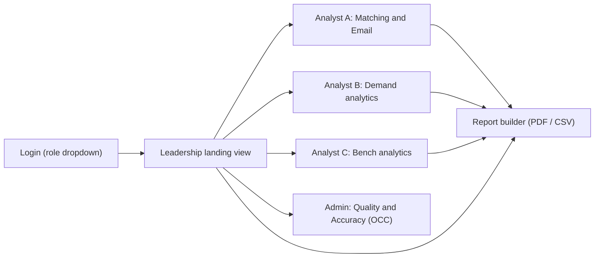
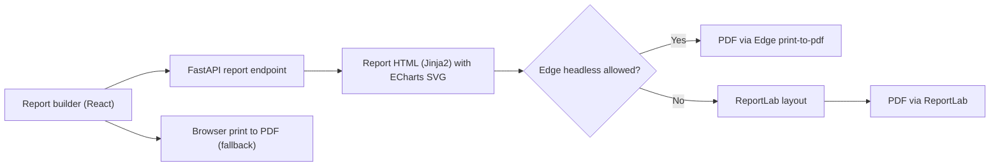

# PerfectFitCandidate (PFC) — Dashboard & Reporting Research

| Item | Value |
|---|---|
| Document | Research and recommendation: dashboard charts, layout, PDF report, React charting library and PDF generation |
| Version | 1.0 |
| Status | Draft |
| Source of truth | [REQUIREMENTS_BASELINE.md](REQUIREMENTS_BASELINE.md) (REQ-OUT-01..11, REQ-EML-06/07, REQ-ELIG-01..07, REQ-SCR-02, REQ-CLS-02, KPI-01..05, NFR-01/02/06) |
| Related documents | [BRD.md](BRD.md) · [FDD.md](FDD.md) · [TDD.md](TDD.md) · [ARCHITECTURE.md](ARCHITECTURE.md) · [WORKFLOW.md](WORKFLOW.md) · [GUI_OCC_DESIGN.md](GUI_OCC_DESIGN.md) · [FEASIBILITY.md](FEASIBILITY.md) · [PHASES.md](PHASES.md) |
| Research date | November 2026 (library versions / sizes as published at that date) |

> Sourced statements carry `[R-nn]` references to [§10 Sources](#10-sources). **Measured** = measured by the author. **Assumption** = not verified; confirm during Phase 1 design/UAT. Field names refer to the DL / CT columns in the baseline §3; derived tables (`match_result`, `email_log`, `ingestion_run`, `extracted_skill`) are logical names — the physical schema is owned by [TDD.md](TDD.md).

## Table of contents

1. [Summary of recommendations](#1-summary-of-recommendations)
2. [Research: dashboard best practices applied to PFC](#2-research-dashboard-best-practices-applied-to-pfc)
3. [Data available to the dashboard](#3-data-available-to-the-dashboard)
4. [Chart catalogue](#4-chart-catalogue)
5. [Dashboard layout](#5-dashboard-layout)
6. [PDF report contents](#6-pdf-report-contents)
7. [React charting libraries](#7-react-charting-libraries)
8. [PDF generation options](#8-pdf-generation-options)
9. [Open questions](#9-open-questions)
10. [Sources](#10-sources)

---

## 1. Summary of recommendations

- **Charts:** keep all baseline charts (REQ-OUT-04..07) and add 17 research-backed charts, most importantly a **skill supply-vs-demand gap heatmap**, a **demand-grade × bench-grade matrix** (visualises the ±1 grade rule, REQ-GRD-01), a **shortlist funnel** (matched → reviewed → approved → sent), an **unmatched demands list**, a **match-score distribution**, a **data-quality scorecard** and **auto-match accuracy tracking** (KPI-01, the primary success metric). See [§4](#4-chart-catalogue).
- **Layout:** a **Leadership landing view** (KPI strip + 6 tiles, one screen) and three **Analyst workspaces** (A — Matching & Email, B — Demand, C — Bench) plus an **Admin / OCC quality view**, all sharing the global filter bar required by REQ-OUT-08. See [§5](#5-dashboard-layout).
- **Library:** **Apache ECharts** (Apache-2.0) via a thin React wrapper — the only candidate that natively covers every required type (heatmap, bubble, doughnut, funnel, gauge, sankey, calendar, treemap) *and* renders SVG on the server for the PDF. Recharts is the lightweight runner-up. See [§7](#7-react-charting-libraries).
- **PDF (Phase 2, REQ-OUT-09):** server-side HTML report rendered with ECharts SVG and printed by the **locally installed Microsoft Edge in headless mode** (`--print-to-pdf`) — no new binaries; fallback **ReportLab** (pure-Python wheel) and the always-available browser *Print → Save as PDF*. **WeasyPrint is not recommended** on Windows (needs Pango via MSYS2 or a standalone EXE that its own docs say is regularly flagged by antivirus). See [§8](#8-pdf-generation-options).

## 2. Research: dashboard best practices applied to PFC

| Practice | Source | Application in PFC |
|---|---|---|
| Design for the **audience**: what decisions they make and which key metrics they need; make the most important information stand out, keep it uncluttered | Power BI dashboard design tips [R-01] | Separate Leadership landing view from Analyst workspaces; KPI strip top-left. |
| **Operational vs analytical** dashboards: operational = glanceable status for action, analytical = exploration | NN/g "Dashboards: making charts and graphs easier to understand" [R-02] | Leadership/Analyst A = operational (today's coverage, unmatched, pending emails); Analyst B/C = analytical (trends, distributions). |
| Prefer **linear (position/length) encodings** over area/angle for accurate comparison; use colour/shape/grouping for categories | NN/g [R-02] | Bars for rankings (top skills/accounts); doughnut only for the single Match % indicator mandated by REQ-OUT-01 and for ≤ 5 part-to-whole categories. |
| HR dashboards combine **headcount, recruitment and time-based metrics** (e.g. time to hire) and make **problem areas transparent** | AIHR HR dashboard guide [R-03] | Time-to-shortlist / time-to-email trend (KPI-02/03), unmatched demands list, bench aging. |
| Resource-management dashboards track **utilisation vs capacity** and use a context-specific target range rather than a universal benchmark | Float — resource utilisation [R-04] | Bench aging and bench-status distribution; coverage target agreed in UAT, not hard-coded. |
| Recommendation quality is measured with **precision@k** | Wikipedia — evaluation measures (IR) [R-05] | KPI-01 auto-match accuracy as hit-rate@5 / precision@5 vs analyst-confirmed shortlist. |
| Text contrast ≥ **4.5:1** (3:1 large text) | WCAG 2.2 SC 1.4.3 [R-06] | NFR-06: chart labels/legends meet contrast; never encode meaning by colour alone (add labels/patterns). |

## 3. Data available to the dashboard

| Source | Fields used (baseline names) |
|---|---|
| **DL** (demand) | Code Requisition, Position Start Date, Account Name, Code Local Grade, Demand Request Name, Region, BU, Owner, JD → `extracted_skill` (mandatory/preferred skills, domain, onsite flag; REQ-MAT-02) |
| **CT** (bench) | ShortName, Email Address (masked), Grade, Location, Bench Status, Skills, Available Capacity (display only, REQ-ELIG-06), Bench Start Date, Bench End Date, Tracker, Group (RG1–RG5 / Not on Bench), Group Owner; derived: eligibility + exclusion reason (REQ-ELIG-01..07), candidate type (REQ-CLS-02, Phase 2) |
| **match_result** | run id, requisition, person, rank, Match %, component scores (skills 70 / grade 10 / location 5 / bench start 5 / bench end 5 / status 5), Match Band, Location Assessment, evidence, gaps/checks, eligibility evidence, override flag, analyst-confirmed flag, timestamps (REQ-MAT-03/08/09) |
| **email_log** | requisition, person, status Draft → Approved → Sent / Failed, approver, sender, timestamps (REQ-EML-06) |
| **ingestion_run** | file, hash, user, timestamp, rows read/new/updated/unchanged/rejected, parse errors (REQ-ING-02/06) |

## 4. Chart catalogue

Personas: **L** = Leadership, **A/B/C** = Analyst personas, **Adm** = OCC Admin. Priority MoSCoW. All charts honour the global filters of REQ-OUT-08 (BU, region, account, grade, location, band, status, candidate type, incomplete identity, mandatory-skill status, score range) unless noted, and every chart supports **click-to-drill** into the underlying rows (Assumption — confirm in [GUI_OCC_DESIGN.md](GUI_OCC_DESIGN.md)).

### 4.1 Baseline charts (from REQ-OUT-04..07 and the brief)

| ID | Chart | Question it answers | Persona | Data fields | Chart type | Interactions / filters | Pri | Phase |
|---|---|---|---|---|---|---|---|---|
| DB-01 | **Summary KPI strip** (REQ-OUT-04) | How big is today's exercise and how healthy is it? | L, A, B, C | count(DL requisitions assessed); count(match_result rows); count(requisitions with no Strong/Potential/Avg match); data-quality limitations (from DB-23); + eligible bench count, coverage % (KPI-04), % emailed ≤ 24 h (KPI-03) | KPI cards with delta vs previous run | Click → drill list; run selector | M | 1 |
| DB-02 | Open demands by BU / Region (REQ-OUT-05) | Where is demand concentrated? | L, B | BU, Region, Code Requisition | Stacked horizontal bar (BU stacked by Region) | Toggle BU ↔ Region; filter account/grade | M | 1 |
| DB-03 | Top 5 skills in demand (REQ-OUT-05) | Which skills do open JDs ask for most? | L, B | `extracted_skill` (normalised via synonym tracker REQ-MAT-05), mandatory/preferred flag | Ranked horizontal bar (mandatory vs preferred split) | Top N selector (5/10/20); filter BU/account | M | 1 |
| DB-04 | Top 3 accounts by JD count (REQ-OUT-05) | Which clients drive demand? | L, B | Account Name, Code Requisition | Ranked bar / leaderboard | Top N selector; drill to requisitions | M | 1 |
| DB-05 | Demand start-date pipeline (REQ-OUT-05) | When are roles due to start; which are already past start date? | L, B, A | Position Start Date, Code Local Grade, match coverage per requisition | Weekly column chart (next 12 weeks + "overdue" bucket), stacked by coverage (covered / not covered) | Week range; filter BU/grade | M | 1 |
| DB-06 | Top 5 skills in pool (REQ-OUT-06) | Which skills does the bench have most? | L, C | CT Skills (normalised), eligibility | Ranked horizontal bar (eligible vs excluded) | Top N; filter grade/location/status | M | 1 |
| DB-07 | Grade histogram (REQ-OUT-06) | How is the bench distributed across A3–D2? | C, L | CT Grade (ordered A3 → D2), eligibility | Column histogram, demand grade overlay line | Filter status/group/location | M | 1 |
| DB-08 | Bench timeline bubble (REQ-OUT-06) | Who has been on bench how long, and who is arriving soon? | C, L | ShortName, Bench Start Date, Bench End Date or today, Grade, Bench Status | Bubble/scatter: x = Bench Start Date, y = Grade (jittered), size = days on bench, shape/label = status | Hover = person card (masked email); filter status/RG; brush date range | M | 1 |
| DB-09 | Bench aging (REQ-OUT-06) | How many eligible people are ageing on bench? | L, C | Bench Start Date → today; eligibility | Bucketed column (0–2, 2–4, 4–8, 8–12, > 12 weeks) | Filter grade/location | M | 1 |
| DB-10 | Bench status distribution (REQ-OUT-06) | What is the state of the bench pipeline? | C, L | Bench Status (priority order REQ-ELIG-03), eligible vs excluded (REQ-ELIG-02) | Horizontal bar ordered by status priority, excluded statuses visually separated | Click → list | M | 1 |
| DB-11 | Match coverage (REQ-OUT-07, KPI-04) | What share of open demands has ≥ 1 Strong or Potential match? | L, A | match_result Match Band per requisition | Gauge or 100 % bar + breakdown by BU | Filter BU/grade/account | S | 1 |
| DB-12 | Band distribution (REQ-OUT-07) | How good are today's matches? | A, L | Match Band (Strong ≥ 90 / Potential 70–89 / Avg 61–69 / Weak < 61 / Insufficient data — REQ-SCR-02) | Column chart in band order | Filter by rank (top 1 / top 5) | S | 1 |
| DB-13 | Email status counts (REQ-OUT-07, REQ-EML-06) | How many candidate emails are drafted, approved, sent, failed? | A, L | email_log status, timestamps | Stacked bar per day / status counters | Filter sender/date | S | 1 |

### 4.2 Recommended additional charts

| ID | Chart | Question it answers | Persona | Data fields | Chart type | Interactions / filters | Pri | Phase |
|---|---|---|---|---|---|---|---|---|
| DB-14 | **Demand-grade × bench-grade matrix** | Do we have people in the eligible grade window (exact and ±1, REQ-GRD-01) for each demand grade? | L, A, B, C | DL Code Local Grade; CT Grade (eligible only) | 8 × 8 heatmap, diagonal = exact, off-diagonal ±1 outlined, cells = counts | Click cell → people/demands; filter BU/location | S | 1 |
| DB-15 | **Skill supply-vs-demand gap heatmap** | Which skills are short or surplus? | L, B, C | demand count per normalised skill vs eligible bench count per skill; gap = supply − demand | Heatmap (skills × BU) or diverging bar (gap per skill) | Top N skills; mandatory only toggle | S | 1 |
| DB-16 | **Match-score distribution** | Is the score spread sensible; are many candidates near band thresholds? | A, Adm | Match % (all scored pairs or top 5), band thresholds 61/70/90 | Histogram with threshold markers | Filter BU/grade; top-5 vs all | S | 1 |
| DB-17 | **Shortlist funnel** | Where does the process stall: matched → reviewed → approved → emailed? | L, A | requisitions with ≥ 1 match; analyst-reviewed; email Approved; email Sent | Funnel | Date range; filter BU | S | 1 |
| DB-18 | **Unmatched demands list** | Which roles have no suitable candidate and why? (drill of REQ-OUT-04) | L, A, B | requisitions with no Strong/Potential/Avg; reason codes: no person in grade window, mandatory-skill gap, insufficient data, all candidates excluded | Sortable table with reason chips + start date | Sort by start date; export CSV | M | 1 |
| DB-19 | **Time-to-shortlist / time-to-email trend** | Are we meeting the 24 h turnaround (REQ-EML-07, KPI-02/03)? | L, A | ingestion_run timestamp (DL upload) → first analyst confirmation → email Sent timestamp | Line (median hours per week) + % within 24 h bar | Week range; per analyst | S | 1 |
| DB-20 | **Readiness group breakdown (RG1–RG5)** | How is the bench spread across readiness groups and owners? | C, Adm | Group, Group Owner, Bench Status | Stacked bar (RG × status) | Filter owner | C | 1 |
| DB-21 | **Location heatmap** | Do demand locations line up with person locations? | A, B, C | DL Region; CT Location (multi-valued split, e.g. "Edinburgh/Glasgow"); Location Assessment | Matrix heatmap (demand region × person location) — no geo map (offline, no tile server) | Filter grade/BU | C | 2 |
| DB-22 | **Skills co-occurrence** | Which skills are requested together (helps synonym tracker and upskilling)? | B, Adm | pairwise co-occurrence of normalised skills in JDs | Heatmap (top 15 × 15) or chord | Top N; BU filter | C | 2 |
| DB-23 | **Data-quality scorecard** (REQ-OUT-04/10, KPI-05) | Can we trust today's data? | Adm, A, L (summary) | % CT rows with grade, skills, valid email; unparseable dates (REQ-IN-12); duplicate keys replaced (REQ-IN-02/11); non-standard requisition IDs (O-02); rejected rows; validation-panel checks (REQ-OUT-10) | Scorecard tiles with pass/warn/fail + trend sparkline per upload | Click → offending rows | S | 1 |
| DB-24 | **Upskilling candidates vs demand skills** | Which "Overall upskilling (New bench)" people are closest to in-demand skills? | C, L | Bench Status = Overall upskilling; their skills vs DB-15 shortage skills; best Match % | Ranked table + small bar of missing skills | Filter skill | C | 2 |
| DB-25 | **Auto-match accuracy tracking** (KPI-01) | Is the engine getting better; where does it disagree with analysts? | Adm, L | analyst-confirmed shortlist vs system top 5 → hit-rate@5, precision@5 per run / BU / scoring-template version | Line per run + table by BU; template version annotations | Filter template version, BU | M | 1 |
| DB-26 | **Excluded-from-matching breakdown** (REQ-ELIG-07) | Why are people excluded? | C, Adm | exclusion reason: Selected / Unknown / CV with Client - Sold - Pending Allocation / Group "Not on Bench" / Bench End Date filled / no grade / insufficient skills | Horizontal bar by reason | Click → list | S | 1 |
| DB-27 | **Candidate type split** (REQ-CLS-02) | Internal vs External vs Unknown share of candidates / matches | L, A | candidate type | Doughnut (3 categories) | Filter band | S | 2 |
| DB-28 | **Candidate contention** | Which people are top-matched to many requisitions (risk of double proposal)? | A | count of requisitions per person where band ∈ {Strong, Potential} | Ranked bar + drill to requisitions | Band threshold | C | 1 |
| DB-29 | **Demand aging** | How long have demands been open since first upload; how many are past start date without a match? | L, B | first-seen timestamp per Code Requisition (ingestion_run), Position Start Date | Bucketed column | Filter BU/account | S | 1 |
| DB-30 | **Override rate** (REQ-MAT-09) | How often do analysts override ranking / bands? Signals tuning needs (O-04) | Adm | overrides per run, by type | Column per run | Filter analyst/template | C | 2 |

Notes:

- **Available Capacity is never used as an availability measure** on any chart (REQ-ELIG-06); it may appear only as a display attribute in drill-downs.
- Emails are **masked** in all chart tooltips and drill tables by default (REQ-OUT-03).
- DB-25 requires capturing an "analyst-confirmed" flag per shortlisted person from Phase 1, otherwise KPI-01 cannot be measured.

## 5. Dashboard layout

### 5.1 Navigation

All views share one **global filter bar** (REQ-OUT-08) and a **run selector** (which DL/CT snapshot and scoring-template version). Analysts can open every view (single Analyst role, REQ-ROLE-02); the persona views are default landing tabs, not permissions. The Admin view is visible only to the Admin role (REQ-ROLE-03).

### 5.2 Leadership landing view (one screen, 1920 × 1080 target — Assumption)

| Row | Left | Centre | Right |
|---|---|---|---|
| 1 | DB-01 KPI strip (full width): requisitions assessed · role-person combinations · roles with no suitable candidate · eligible bench · coverage % · emailed ≤ 24 h · data-quality status |
| 2 | DB-11 Match coverage by BU | DB-05 Demand start-date pipeline | DB-17 Shortlist funnel |
| 3 | DB-15 Supply-vs-demand gap (top 10 skills) | DB-14 Grade matrix | DB-09 Bench aging |
| 4 | DB-18 Unmatched demands (top 10, link to full list) — full width |

### 5.3 Analyst workspaces

| View | Default content | Primary actions |
|---|---|---|
| **A — Matching & Email** | Match results table (REQ-OUT-01, doughnut per Match %); DB-12, DB-16, DB-13, DB-17, DB-28, DB-18; validation panel (REQ-OUT-10) | Analyze JD → Confirm & Start; per-profile Approve email; export CSV |
| **B — Demand analytics** | DB-02, DB-03, DB-04, DB-05, DB-15, DB-29, DB-22 (P2), DB-21 (P2) | Drill to requisition; export |
| **C — Bench analytics** | DB-06, DB-07, DB-08, DB-09, DB-10, DB-20, DB-26, DB-24 (P2) | Drill to person; per-candidate Sync CV |
| **Admin — Quality & Accuracy** | DB-23, DB-25, DB-26, DB-30 (P2), ingestion history | Approve/modify DL/CT entries; tune template (new version) |

## 6. PDF report contents

PDF download is **Phase 2** (REQ-OUT-09); CSV/Excel export of match results is Phase 1.

| # | Section | Content | Charts |
|---|---|---|---|
| 1 | Cover | Report title, run date/time, user, DL/CT file names + hashes (REQ-ING-06), scoring-template and model versions (REQ-MAT-08), filters applied | — |
| 2 | Executive summary | KPI strip values with deltas; 3–5 auto-generated bullet insights (LLM-drafted, editable before export — Assumption) | DB-01, DB-11, DB-17 |
| 3 | Demand analytics | Demand by BU/region, top skills, top accounts, start-date pipeline | DB-02..05, DB-15 |
| 4 | Bench analytics | Top pool skills, grade histogram, bench timeline, aging, status | DB-06..10, DB-14 |
| 5 | Match results | Per requisition: top 5 rows with Match %, band, location assessment, evidence, gaps/checks, eligibility evidence; **emails masked** | DB-12, DB-16 |
| 6 | Unmatched demands | DB-18 table with reasons | DB-18 |
| 7 | Communication | Email status, turnaround vs 24 h target | DB-13, DB-19 |
| 8 | Data quality & method | DB-23 scorecard; validation-panel results (REQ-OUT-10); scoring method summary (70/10/5/5/5/5, ±1 grade rule, bands); **disclaimer: shortlist for human review, not an automated staffing decision; scores are relative metrics (REQ-SCR-05)** | DB-23 |

Report templates: *Leadership summary* (sections 1, 2, 3–4 condensed, 6, 8), *Full analytics* (all), *Requisition pack* (1, 5 for selected requisitions).

## 7. React charting libraries

Versions, licences and sizes: npm registry and Bundlephobia (**Measured**, minified / gzipped of the package's default entry) [R-07][R-08]. All libraries are npm packages bundled at build time — **no CDN or network needed at runtime** (NFR-02).

| Library | Version | Licence | Size min / gz | Rendering | Bubble | Heatmap | Doughnut | Funnel / gauge | Other notable | Server-side SVG for PDF | Notes |
|---|---|---|---|---|---|---|---|---|---|---|---|
| **Apache ECharts** (+ `echarts-for-react` 3.0.6, MIT, 3 KB gz) | 6.1.0 | Apache-2.0 | 1,089 KB / 359 KB (full); smaller with `echarts/core` tree-shaking [R-10] | Canvas + SVG [R-09] | ✔ (scatter `symbolSize`) | ✔ native [R-09] | ✔ | ✔ / ✔ | treemap, sunburst, sankey, graph, calendar, boxplot, parallel [R-09] | ✔ `ssr: true` + `renderToSVGString()` [R-11] | Rich interactions (dataZoom, brush, tooltip), ARIA support |
| **Recharts** | 3.10.1 | MIT | 548 KB / 146 KB | SVG [R-12] | ✔ (ScatterChart + ZAxis) | ✖ (custom) | ✔ | ✔ Funnel / ◐ RadialBar | Treemap, Sankey | ◐ via React SSR (Assumption) | Very React-idiomatic, simple |
| **Nivo** (`@nivo/core` + per-chart pkgs) | 0.99.0 | MIT | core 175 / 61 KB; `@nivo/heatmap` 151 / 48 KB | SVG / HTML / Canvas [R-13] | ✔ ScatterPlot / SwarmPlot | ✔ HeatMap | ✔ Pie | ✔ Funnel / ◐ | Calendar, TimeRange, Chord, Sankey, Waffle [R-13] | ✔ (SVG components; Assumption) | Beautiful defaults; many packages to manage |
| **Chart.js** (+ `react-chartjs-2`) | 4.6.1 | MIT | 200 KB / 68 KB | Canvas | ✔ native Bubble [R-14] | ◐ plugin `chartjs-chart-matrix` [R-15] | ✔ | ◐ plugins | Mixed charts, polar area | ✖ (canvas; needs node-canvas) | Small, simple; heatmap via plugin |
| **Plotly.js** (`plotly.js-dist-min` + `react-plotly.js`) | 4.2.0 | MIT | 4,543 KB / 1,376 KB | SVG + WebGL | ✔ | ✔ | ✔ | ✔ / ✔ | Scientific charts, 3D | ◐ (needs Kaleido) | Heaviest; analytics-tool look |
| **visx** (Airbnb) | 4.0.0 | MIT | full 619 / 158 KB; `@visx/xychart` 148 / 49 KB | SVG | build-your-own | build-your-own | build-your-own | build-your-own | Low-level D3 primitives [R-16] | ✔ (React SVG) | Maximum control, most effort |

**Recommendation: Apache ECharts** (with `echarts/core` tree-shaking and a small typed React wrapper or `echarts-for-react`).

1. Only candidate with **native** coverage of every chart in §4 (heatmaps DB-14/15/21/22, bubble DB-08, doughnut for Match % REQ-OUT-01, funnel DB-17, gauge DB-11, calendar/timeline).
2. **Same chart options render in the browser and on the server as SVG** [R-11] → PDF report charts are identical to the dashboard (§8).
3. Canvas renderer keeps 500 × 500 scatter/histograms fast (NFR-01 "< 2 s") [R-09]; Apache-2.0 licence is enterprise-friendly.
4. Bundle size is irrelevant for a local app served from disk (Assumption: no slow network path), and is reduced by tree-shaking anyway.

Runner-up: **Recharts** if the team prefers JSX-declarative charts and accepts custom heatmaps. Avoid Plotly (size) and visx (effort) for Phase 1. Use one library to keep theming and accessibility consistent.

## 8. PDF generation options

Constraints from [FEASIBILITY.md](FEASIBILITY.md): no admin, no new unsigned executables if avoidable, offline, AV/EDR friction.

| Option | Where | Fidelity | Offline / no-admin fit | AV / allowlist risk | Licence | Verdict |
|---|---|---|---|---|---|---|
| Browser **Print → Save as PDF** with print CSS | Client | High (same HTML) | ✔ no dependency | ✔ none | — | **Phase 1 interim / always-available fallback** |
| **jsPDF + html2canvas** | Client | Medium (rasterised screenshots, blurry text) | ✔ | ✔ | MIT / MIT (jsPDF 4.2.1, 127 KB gz; html2canvas 1.4.1, 45 KB gz — Measured [R-08]) | Not recommended (quality, accessibility) |
| **@react-pdf/renderer** | Client or Node | High vector, but layout must be re-implemented in its primitives | ✔ | ✔ | MIT (4.9.0, 432 KB gz — Measured [R-08]) | Possible; duplicates layout work |
| **Microsoft Edge headless `--print-to-pdf`** (Chromium headless mode [R-17]) driven by FastAPI on a server-rendered report page with ECharts SVG | Server (local) | High (Chromium print engine) | ✔ Edge ships with Windows 11; no download | ✔ uses an already-approved binary (Assumption — confirm Edge headless not blocked by policy) | — | **Recommended (Phase 2)** |
| **Playwright for Python** with `channel="msedge"` | Server (local) | High | ◐ wheel bundles a Node driver; branded-channel use avoids downloading Chromium [R-18] | ◐ extra `node.exe` inside wheel to allowlist (Assumption) | Apache-2.0 (1.64.1) [R-19] | Alternative if Edge CLI flags are insufficient (headers/footers, waits) |
| **WeasyPrint** | Server | High (HTML/CSS) | ✖ on Windows needs Pango via MSYS2, or the standalone executable [R-20] | ✖ docs warn the Windows executable is "regularly marked as malware by different antivirus companies" [R-20] | BSD (v70.0) | Not recommended |
| **ReportLab** | Server | High vector; programmatic layout; charts embedded as SVG→drawing or PNG | ✔ pure-Python wheel (+ C accelerators), no external binaries | ✔ | BSD (5.1.0) [R-21] | **Fallback** if Edge headless is blocked |
| xhtml2pdf | Server | Low–medium (limited CSS) | ✔ pure Python | ✔ | Apache-2.0 (0.2.28) [R-22] | Fallback for simple tables only |

Implementation notes (for [TDD.md](TDD.md)): render charts server-side with ECharts SSR (requires a JS runtime — either reuse the browser to post SVG strings to the backend, or run ECharts in headless Edge itself; Assumption — decide in TDD); embed fonts locally; masked emails only (REQ-OUT-03); record report generation in the audit log (REQ-AUTH-05).

## 9. Open questions

| # | Question | Proposed default |
|---|---|---|
| DQ-01 | Should the PDF ever include unmasked emails (e.g. for an authorised recipient)? Baseline masks in GUI by default (REQ-OUT-03) but is silent on exports. | Always masked in PDF; CSV export follows the user's current unmask state and is audit-logged. |
| DQ-02 | Definition of "analyst-confirmed shortlist" for KPI-01 (approved email? explicit tick?). | Explicit "confirm" tick per row; email approval implies confirmation. |
| DQ-03 | Coverage definition: does **Avg. Match** count toward "suitable candidate" in REQ-OUT-04 vs KPI-04 (Strong/Potential only)? | KPI-04 = Strong/Potential; "no suitable candidate" = no Strong/Potential/Avg (as used in DB-01/DB-18). |
| DQ-04 | Target screen resolution and whether Leadership wants a printable one-page summary. | 1920 × 1080; *Leadership summary* PDF template. |
| DQ-05 | Is Microsoft Edge headless permitted by policy on the target laptops? | Test in Phase 0 (add to FEASIBILITY F-tests); ReportLab fallback. |
| DQ-06 | Do skill-gap charts use mandatory skills only, or mandatory + preferred? | Toggle; default mandatory only. |
| DQ-07 | Bench aging bucket boundaries and demand-pipeline horizon (12 weeks per brief?). | Buckets 0–2/2–4/4–8/8–12/> 12 weeks; 12-week horizon. |

## 10. Sources

| Ref | Source |
|---|---|
| R-01 | Microsoft Learn — Tips for designing a great Power BI dashboard: https://learn.microsoft.com/en-us/power-bi/create-reports/service-dashboards-design-tips |
| R-02 | Nielsen Norman Group — Dashboards: Making Charts and Graphs Easier to Understand: https://www.nngroup.com/articles/dashboards-preattentive/ |
| R-03 | AIHR — HR Dashboard: Examples, Metrics and a How-To: https://www.aihr.com/blog/hr-dashboard/ |
| R-04 | Float — What is resource utilization? https://www.float.com/resources/resource-utilization |
| R-05 | Wikipedia — Evaluation measures (information retrieval), Precision at k: https://en.wikipedia.org/wiki/Evaluation_measures_(information_retrieval) |
| R-06 | W3C — Understanding WCAG 2.2 SC 1.4.3 Contrast (Minimum): https://www.w3.org/WAI/WCAG22/Understanding/contrast-minimum.html |
| R-07 | npm registry (versions/licences): https://www.npmjs.com/package/echarts · https://www.npmjs.com/package/recharts · https://www.npmjs.com/package/@nivo/core · https://www.npmjs.com/package/chart.js · https://www.npmjs.com/package/plotly.js · https://www.npmjs.com/package/@visx/visx |
| R-08 | Bundlephobia (sizes): https://bundlephobia.com/package/echarts · https://bundlephobia.com/package/recharts · https://bundlephobia.com/package/@nivo/core · https://bundlephobia.com/package/chart.js · https://bundlephobia.com/package/plotly.js-dist-min · https://bundlephobia.com/package/@visx/visx · https://bundlephobia.com/package/@react-pdf/renderer · https://bundlephobia.com/package/jspdf |
| R-09 | Apache ECharts — Features: https://echarts.apache.org/en/feature.html |
| R-10 | Apache ECharts handbook — Import / shrinking bundle size: https://echarts.apache.org/handbook/en/basics/import/ |
| R-11 | Apache ECharts handbook — Server-side rendering: https://echarts.apache.org/handbook/en/how-to/cross-platform/server/ |
| R-12 | Recharts GitHub README: https://github.com/recharts/recharts |
| R-13 | Nivo components: https://nivo.rocks/components/ |
| R-14 | Chart.js — Bubble chart: https://www.chartjs.org/docs/latest/charts/bubble.html |
| R-15 | chartjs-chart-matrix: https://github.com/kurkle/chartjs-chart-matrix |
| R-16 | visx GitHub README: https://github.com/airbnb/visx |
| R-17 | Chrome for Developers — Headless mode: https://developer.chrome.com/docs/chromium/headless |
| R-18 | Playwright Python — Browsers (branded channels incl. `msedge`): https://playwright.dev/python/docs/browsers |
| R-19 | PyPI — playwright: https://pypi.org/project/playwright/ |
| R-20 | WeasyPrint — First steps (Windows installation and antivirus warning): https://doc.courtbouillon.org/weasyprint/stable/first_steps.html |
| R-21 | PyPI — reportlab: https://pypi.org/project/reportlab/ |
| R-22 | PyPI — xhtml2pdf: https://pypi.org/project/xhtml2pdf/ |
