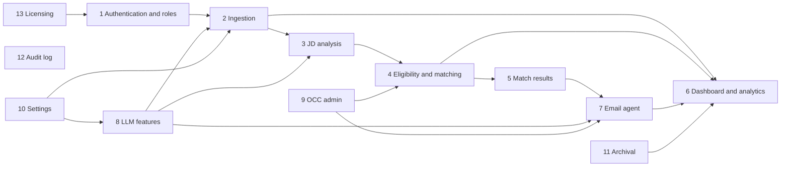
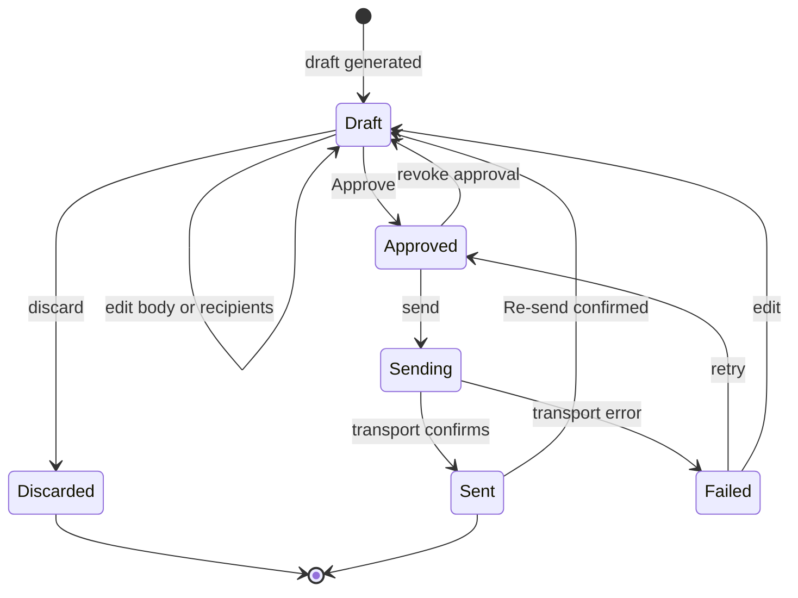
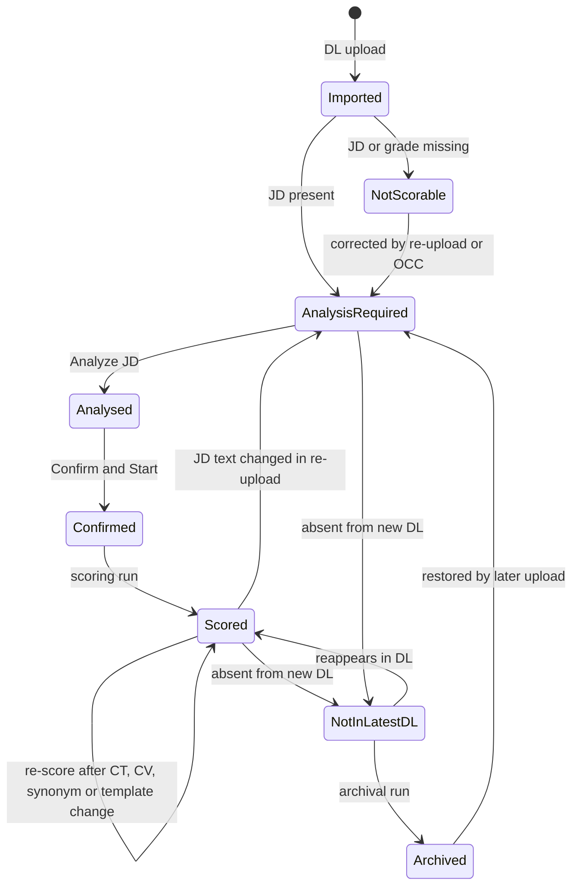
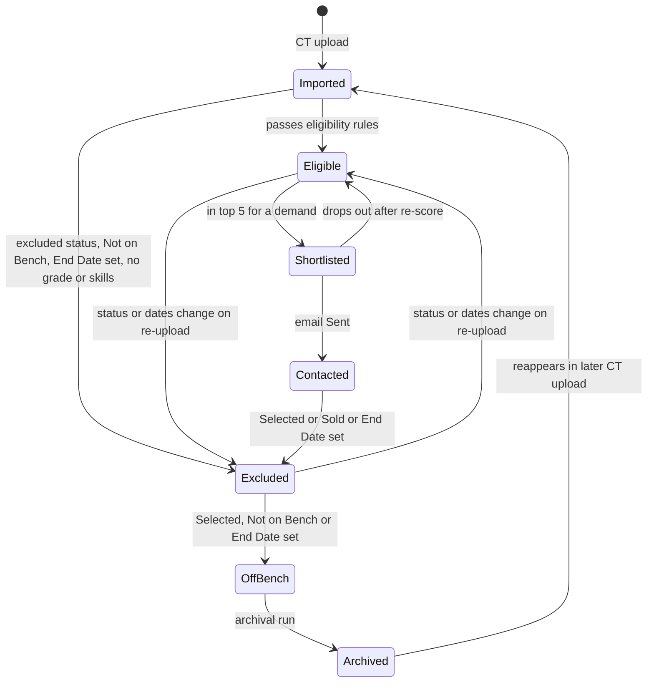

# PerfectFitCandidate (PFC) — Functional Design Document

| Item | Value |
|---|---|
| Document | Functional Design Document (FDD) |
| Version | 1.0 |
| Status | Draft |
| Source of truth | [REQUIREMENTS_BASELINE.md](REQUIREMENTS_BASELINE.md) (REQ-* IDs, decision log §16, open items §17) |
| Related documents | [BRD.md](BRD.md) · [TDD.md](TDD.md) · [ARCHITECTURE.md](ARCHITECTURE.md) · [WORKFLOW.md](WORKFLOW.md) · [GUI_OCC_DESIGN.md](GUI_OCC_DESIGN.md) · [FEASIBILITY.md](FEASIBILITY.md) · [PHASES.md](PHASES.md) · [DASHBOARD_RESEARCH.md](DASHBOARD_RESEARCH.md) |
| Reference inputs | [reference/Project-PerfectFitCandidate.docx](reference/Project-PerfectFitCandidate.docx) · [reference/DL-CT-Metadata.xlsx](reference/DL-CT-Metadata.xlsx) · [reference/Application-Design.png](reference/Application-Design.png) |

## Table of contents

- [0. Introduction](#0-introduction)
- [1. Authentication and roles](#1-authentication-and-roles)
- [2. Ingestion — DL, CT and resumes](#2-ingestion--dl-ct-and-resumes)
- [3. JD analysis](#3-jd-analysis)
- [4. Eligibility and matching](#4-eligibility-and-matching)
- [5. Match results and filters](#5-match-results-and-filters)
- [6. Dashboard and analytics](#6-dashboard-and-analytics)
- [7. Email agent](#7-email-agent)
- [8. LLM features](#8-llm-features)
- [9. OCC admin functions](#9-occ-admin-functions)
- [10. Settings (analyst level)](#10-settings-analyst-level)
- [11. Archival and housekeeping](#11-archival-and-housekeeping)
- [12. Audit log](#12-audit-log)
- [13. Licensing (Phase 3)](#13-licensing-phase-3)
- [14. Worked scoring example (illustrative)](#14-worked-scoring-example-illustrative)
- [15. Record lifecycles](#15-record-lifecycles)
- [16. Requirement traceability summary](#16-requirement-traceability-summary)
- [17. Open questions](#17-open-questions)

---

## 0. Introduction

### 0.1 Purpose and scope

This FDD describes **what** PFC does from a functional point of view: the behaviour of every feature area, the rules it applies, the inputs and outputs, validations and error handling, and where it surfaces in the GUI. **How** it is built (schemas, APIs, libraries, packaging) is defined in [TDD.md](TDD.md) and [ARCHITECTURE.md](ARCHITECTURE.md). The end-to-end process view is in [WORKFLOW.md](WORKFLOW.md); screen layouts are in [GUI_OCC_DESIGN.md](GUI_OCC_DESIGN.md).

PFC produces a **ranked shortlist for human review**. It never makes an automated staffing or selection decision (baseline §1, REQ-SCR-05).

### 0.2 Conventions

| Convention | Meaning |
|---|---|
| `FR-<AREA>-NN` | Functional rule defined in this FDD. Every FR traces to one or more `REQ-*` IDs from the baseline. |
| Phase | 1 = MVP, 2 = automation and reporting, 3 = external LLMs, advanced OCC, licensing (see [PHASES.md](PHASES.md)). |
| "Configurable" | Value held in versioned configuration; who may change it is stated (Admin via OCC, or Analyst via Settings). |
| "Proposed default" | A functional default not fixed by the baseline; listed again in [§17 Open questions](#17-open-questions) for confirmation. |
| DL / CT | Demand List / Candidate (Bench, Activity) Tracker — CT, "Bench Tracker" and "ActivityTracker" are the same file (baseline §3.2). |

### 0.3 Actors

| Actor | Description | System role |
|---|---|---|
| Analyst A | Matches bench candidates to JDs, reviews top 5, approves and sends candidate emails | Analyst |
| Analyst B | Demand-list analytics (skills in demand, accounts, BU/region pipeline) | Analyst |
| Analyst C | Bench analytics (skills in pool, grade histogram, bench timeline, aging) | Analyst |
| OCC Admin | Object Control Center — full privileges: DL/CT entry approval, synonyms, scoring template, resource-team list, domains, models, users, status list | Admin |
| System | PFC backend (FastAPI), scoring engine, vector store, local LLM (llama.cpp) | — |
| Outlook | Local Outlook client driven via COM for sending and calendar follow-ups | External |
| Candidate | Bench resource receiving the email; no system access | External |

### 0.4 Feature-area overview

---

## 1. Authentication and roles

**Purpose.** Restrict the local application to named users and separate Analyst and Admin (OCC) capabilities.
**Actors.** Analyst, OCC Admin, System. **Phase.** 1.
**Preconditions.** Application started from the portable ZIP via the launcher; local server bound to `127.0.0.1` (REQ-AUTH-07). On first run no admin exists.
**UI touchpoints.** Login screen, first-run admin setup, Settings → Password, OCC → Users ([GUI_OCC_DESIGN.md](GUI_OCC_DESIGN.md)).

### 1.1 Functional rules

| FR | Rule | Traces to |
|---|---|---|
| FR-AUTH-01 | The login screen shows a **role dropdown** (Admin / Analyst), a user identifier field and a password field. | REQ-AUTH-01 |
| FR-AUTH-02 | **Analyst** identifier is the corporate email address; the password is the one issued by the OCC Admin when the user was created. | REQ-AUTH-02 |
| FR-AUTH-03 | Authentication succeeds only if the account exists, is active, holds the role selected in the dropdown and the password verifies. Any failure returns the same generic message ("Invalid credentials or role") so the response does not reveal which part failed. | REQ-AUTH-01, REQ-AUTH-04 |
| FR-AUTH-04 | **First-run admin setup**: when no Admin account exists, the app shows a one-time setup page to create the Admin identifier and a strong password. No default admin password is shipped in the ZIP. | REQ-AUTH-03, REQ-PKG-02 |
| FR-AUTH-05 | **Admin password policy** is enforced at setup and on change (proposed default: ≥ 12 characters with upper case, lower case, digit and symbol; must differ from the previous password). | REQ-AUTH-03 |
| FR-AUTH-06 | Any logged-in user can **change their own password** in Settings by supplying the current password and the new password twice. Analyst passwords follow a basic policy (proposed default ≥ 10 characters). | REQ-AUTH-02, REQ-AUTH-03 |
| FR-AUTH-07 | **Lockout**: after N consecutive failed attempts for an account the account is locked for T minutes (proposed default N = 5, T = 15). The Admin can unlock an analyst account in OCC → Users. | REQ-AUTH-04 |
| FR-AUTH-08 | **Session timeout** after a configurable idle period (proposed default 30 minutes); the user is returned to the login screen and unsaved edits are kept as drafts where the screen supports it (JD requirement edits, email drafts). | REQ-AUTH-04 |
| FR-AUTH-09 | Passwords are stored only as salted slow hashes; they are never logged, displayed or exported. | REQ-AUTH-04 |
| FR-AUTH-10 | Role capabilities follow the capability matrix (baseline §2). Analysts cannot reach OCC screens or change scoring weights, internal domains or admin settings; such API calls are rejected and audited. | REQ-ROLE-01..04 |
| FR-AUTH-11 | Logins (success and failure), lockouts, unlocks and password changes are written to the audit log. | REQ-AUTH-05 |
| FR-AUTH-12 | Admin password reset of an analyst issues a new admin-provided password; the analyst is prompted to change it at next login (proposed). | REQ-AUTH-02 |

### 1.2 Inputs / outputs

| Input | Output |
|---|---|
| Role, identifier, password | Authenticated session (role-scoped), or generic error |
| Current + new password | Updated hash, audit event |
| Admin: create / disable / unlock / reset user | User record change, audit event |

### 1.3 Validations and error handling

| Condition | Behaviour |
|---|---|
| Wrong password / role mismatch / unknown user | Generic error; failure counter incremented (for known accounts) |
| Account locked | Message "Account temporarily locked"; remaining time not disclosed for unknown accounts |
| Disabled account | Generic error |
| Weak new password | Inline policy message listing unmet rules |
| Second app instance started | Launcher refuses (single-instance lock, REQ-PKG-04) and opens the existing session in the browser |

---

## 2. Ingestion — DL, CT and resumes

**Purpose.** Load the latest Demand List and Candidate Tracker, keep one current row per key, attach resumes, and make the data available for matching and analytics.
**Actors.** Analyst (any persona), OCC Admin, System. **Phase.** 1 (manual upload, resume sync, basic CV versions); 2 (auto-pickup, CV version comparison).
**Preconditions.** User logged in. For resume sync: resume folder configured in Settings (REQ-ING-05).
**UI touchpoints.** Upload page (DL / CT tabs with preview), Candidates page (per-candidate Sync, global Sync, Incomplete Candidate Information prompt), Settings → Data sources ([GUI_OCC_DESIGN.md](GUI_OCC_DESIGN.md)).

### 2.1 DL and CT manual upload

| FR | Rule | Traces to |
|---|---|---|
| FR-ING-01 | Upload accepts `.xlsx` only, separately for DL and CT. Manual upload is the default ingestion mode. | REQ-ING-01 |
| FR-ING-02 | **Sheet detection**: the sheet name is ignored. The importer scans every sheet and selects the one whose header row contains the required columns for the chosen file type. If several qualify, the first qualifying sheet is used and a warning lists the others. | REQ-IN-01 |
| FR-ING-03 | **Header-row detection**: the importer scans the top rows (proposed: first 20) for the row with the best match to known column names (case-insensitive, trimmed, ignoring suffixes such as "(comma separated)" and "(Y/N)"). Title rows above it (e.g. "Bench Team – Front Sheet") are skipped. | REQ-IN-10 |
| FR-ING-04 | **Blank first header in CT**: if the first column header is blank and the remaining headers match the CT, the first column is mapped to `ShortName`. | REQ-IN-10 |
| FR-ING-05 | **End of data**: reading stops at the last row containing a key value; trailing empty or whitespace-only rows (e.g. a row with only `' '` in Email Address) are ignored and counted as "skipped blank". Workbook-reported dimensions (the sample DL reports > 1 M rows due to formatting) are not trusted. | REQ-ING-02, KPI-05 |
| FR-ING-06 | **Dedupe / replace keys**: DL key = `Code Requisition`; CT key = `ShortName` + `Email Address` (compared trimmed and case-insensitively for matching; stored exactly as in the file). An incoming row with an existing key **replaces** the stored row; duplicates within one file keep the **last** occurrence and report the others. | REQ-IN-02, REQ-IN-11 |
| FR-ING-07 | **Date parsing**: native Excel dates are read as dates. Text dates are parsed day-first (UK), with an optional leading weekday, e.g. `Wed 4/11/2026` → 4 Nov 2026, `Mon 16/11/2026` → 16 Nov 2026. If a weekday is present and does not match the parsed date, the value is accepted with a warning. Unparseable values are stored as NULL and flagged. | REQ-IN-12 |
| FR-ING-08 | **Formula cells** (`Tracker`, `Group Owner`): the cached value is read; formulas are never executed. For `HYPERLINK` the link target and link text are stored. If no cached value exists (e.g. an `INDEX/MATCH` against an external workbook), the field is stored as NULL with a "formula without cached value" warning. | REQ-IN-13 |
| FR-ING-09 | **Text normalisation** of JD: strip markdown code fences, normalise bullets including mis-encoded `?` bullets, collapse whitespace; keep the original text for audit and display. | REQ-IN-03 |
| FR-ING-10 | **Value copying**: requisition ID, account, role, grade and email are stored exactly as in the source (only surrounding whitespace trimmed for comparison). An email address is never constructed, inferred or corrected. | REQ-IN-14, REQ-OUT-02 |
| FR-ING-11 | **Skills list**: split on commas; empty tokens (e.g. `Data Analysis, , Project Manger`) are dropped; original spelling is retained and the synonym tracker is applied at matching time, not at import. | REQ-MAT-05, REQ-MAT-06 |
| FR-ING-12 | **Preview before commit**: rows read, new / updated / unchanged / rejected / skipped-blank counts and the list of warnings and errors are shown. The user commits or cancels. | REQ-ING-02 |
| FR-ING-13 | **Immediate effect**: committed changes are applied immediately for matching and analytics; affected demands/candidates are marked for incremental re-scoring. OCC can later approve or modify any entry (see §9). | REQ-ING-03, REQ-MAT-07 |
| FR-ING-14 | **Ingestion run record**: file name, SHA-256 hash, user, timestamp, file type, counts and messages. Re-uploading a file with an identical hash is a no-op and reported as such. | REQ-ING-06 |
| FR-ING-15 | **JD versioning**: when a replaced DL row has a changed JD text, a new JD version is created; any previously confirmed requirements remain attached to the old version and the demand returns to "JD analysis required" (§3). | REQ-MAT-08 |
| FR-ING-16 | **Demand absent from latest DL**: a demand present in the DB but not in a newly uploaded full DL is **not deleted**; it is flagged "Not in latest DL" and becomes an archival candidate (§11). | REQ-ARC-01 |

#### Field validations

| File | Field | Validation | Severity |
|---|---|---|---|
| DL | Code Requisition | Required; format `T1XXXX`/`T2XXXX` checked | Missing = reject row; format mismatch = warning (O-02) |
| DL | Position Start Date | Date per FR-ING-07; past dates allowed | Unparseable = warning, stored NULL |
| DL | Code Local Grade | Member of OCC grade list (A3–D2 shipped) | Unknown grade = warning; demand cannot be scored until fixed |
| DL | Region | Free text | Blank → Role Location "Unspecified" |
| DL | JD | Required for scoring | Blank = warning; demand cannot be analysed |
| CT | ShortName + Email Address | Both present for a full key | Missing email → row kept, key falls back to ShortName + internal ID, flagged "Incomplete identity" (see §2.4) |
| CT | Email Address | Syntactic check only | Invalid syntax = warning; value kept as-is (never corrected) |
| CT | Grade | Member of grade list | Missing = person ineligible (REQ-ELIG-01) |
| CT | Bench Status | Member of OCC status list | Unknown value = warning; treated as `Unknown` (excluded) until mapped in OCC |
| CT | Skills | At least one non-empty token | Empty = ineligible ("Insufficient skills recorded") |
| CT | Available Capacity | Yes/Y, No/N, N/A, Unknown | Display only; never used for availability (REQ-ELIG-06) |
| CT | Bench Start / End Date | Date per FR-ING-07 | Unparseable End Date = warning; person treated as **not eligible** pending review (cannot confirm blank) |
| CT | Group | RG1–RG5 or `Not on Bench` | Unknown = warning |
| Both | Location | Trimmed (e.g. `London ` → `London`); multi-location values such as `Edinburgh/Glasgow` split on `/` | — |

### 2.2 Auto-sync placeholder configuration

| FR | Rule | Traces to |
|---|---|---|
| FR-ING-20 | Settings provides, separately for DL and CT: enable flag (default **off**), watch path (mapped drive / OneDrive-synced folder), file pattern (e.g. `Demand*.xlsx`), polling interval. In Phase 1 the configuration is saved and validated (path exists, readable) but auto-pickup is not active. | REQ-ING-04 |
| FR-ING-21 | Phase 2: when enabled, a new or changed file matching the pattern (by hash) is ingested through the same pipeline as a manual upload. Because there is no interactive preview, rows with errors are rejected, warnings are accepted, and a notification with the preview summary is shown to the configuring user. | REQ-ING-04 |

### 2.3 Resume folder and Sync

| FR | Rule | Traces to |
|---|---|---|
| FR-ING-30 | The resume folder path (SharePoint folder synced locally via OneDrive, or a mapped folder) is configured in Settings. Supported files: PDF and DOCX. | REQ-IN-20, REQ-ING-05 |
| FR-ING-31 | **Per-candidate Sync**: locates the candidate's CV(s) in the folder, extracts text and structured facts (name, emails, phone, skills, experience, qualifications, projects, evidence) using the local LLM plus deterministic parsers, stores them as a CV version and indexes embeddings. | REQ-IN-21, REQ-IN-23, REQ-MAT-01 |
| FR-ING-32 | **CV lookup order** (proposed default, configurable): (1) file name contains the CT `ShortName`; (2) file name contains the email local part; (3) extracted CV email equals the CT email. One match → linked; several → "Ambiguous CV match" prompt for human confirmation; none → "CV not found". | REQ-IN-25 |
| FR-ING-33 | **Global Sync** syncs all manually selected candidates; the button is **disabled until at least one candidate is selected**. Progress is shown per candidate; failures do not stop the batch. | REQ-IN-21 |
| FR-ING-34 | **Missing resume is not a blocker**: the candidate is matched on CT skills; "CV not found" is added under Gaps / Checks. | REQ-IN-22 |
| FR-ING-35 | A CV file whose hash is unchanged since the last sync is not re-extracted (reuse across JDs). | REQ-MAT-07 |

### 2.4 Incomplete Candidate Information

| FR | Rule | Traces to |
|---|---|---|
| FR-ING-40 | If name or email cannot be determined (from CT or CV), the "Incomplete Candidate Information" prompt offers: **Manual entry**, **Generate internal ID and continue** (default), **Review later**. | REQ-IN-23 |
| FR-ING-41 | Missing phone is a warning only. Missing values are stored as NULL — never invented. | REQ-IN-23, REQ-MAT-06 |
| FR-ING-42 | "Review later" items appear in an Incomplete identity worklist and as a filter on results (REQ-OUT-08). Candidates without email cannot be emailed (§7). | REQ-IN-23, REQ-OUT-08 |

### 2.5 CV versions

| FR | Rule | Traces to |
|---|---|---|
| FR-ING-50 | Candidate ID and Resume (CV) ID are separate; one candidate may have many CV versions. | REQ-IN-24 |
| FR-ING-51 | Each CV version is scored independently; facts in one version never improve another version's score. Ranking shows each person once using the highest-scoring CV; drill-down lists all versions with latest and best score. | REQ-IN-24 |
| FR-ING-52 | Phase 2: side-by-side CV version comparison (skills added/removed, score delta per demand). | REQ-IN-24 |

### 2.6 Outputs and error handling

| Condition | Behaviour |
|---|---|
| Not an `.xlsx` / corrupt / password-protected workbook | Rejected before preview with a clear message; run recorded as failed |
| No sheet with recognisable headers | Rejected: "Required columns not found" with the list of missing columns |
| Required column missing | Rejected; list of found vs expected headers shown |
| Identical file hash | No-op, "File already imported on <date> by <user>" |
| Resume folder not reachable (OneDrive offline) | Sync disabled with message; CT-only matching continues |
| CV unreadable (scanned image, encrypted PDF) | CV version stored with status "Extraction failed"; Gaps / Checks "CV unreadable" |

---

## 3. JD analysis

**Purpose.** Turn free-text JDs into confirmed, structured requirements before any scoring.
**Actors.** Analyst A (primary), OCC Admin, System (local LLM). **Phase.** 1.
**Preconditions.** Demand ingested with non-empty JD and a valid grade.
**UI touchpoints.** Demands list (status column, "Analyze JD", "Analyze all new"), JD review/edit panel, "Confirm & Start" ([GUI_OCC_DESIGN.md](GUI_OCC_DESIGN.md)).

| FR | Rule | Traces to |
|---|---|---|
| FR-JDA-01 | Extraction never starts automatically. The user clicks **Analyze JD** (single) or **Analyze all new demands** (bulk). | REQ-MAT-02 |
| FR-JDA-02 | The local LLM extracts: mandatory skills, preferred skills, experience (years/areas), qualifications, domain, location and any **mandatory onsite** requirement, each with the supporting JD text snippet as evidence. Output is validated against a fixed structured schema; invalid output is retried once, then shown as "Extraction incomplete — edit manually". | REQ-MAT-02, REQ-LLM-02, REQ-LOC-01 |
| FR-JDA-03 | The review panel lets the user add, remove, re-classify (mandatory ↔ preferred) and edit items. Admin may define default requirement sets (e.g. per role family) that pre-populate the panel. | REQ-MAT-02, baseline §2 matrix |
| FR-JDA-04 | **Confirm & Start** freezes the requirement set as a versioned "confirmed requirements" record (linked to JD version and user) and queues scoring for that demand. Bulk analysis still requires a confirmation per demand (or a multi-select confirm that shows each set). | REQ-MAT-02, REQ-MAT-08 |
| FR-JDA-05 | Editing requirements after confirmation creates a new requirements version and triggers re-scoring; previous results are retained. | REQ-MAT-08 |
| FR-JDA-06 | If the LLM is unavailable, the user can enter requirements manually and confirm; the run records "manual requirements". | REQ-LLM-04 (fallback principle) |

Demand analysis states: `JD analysis required` → `Analysed (pending confirmation)` → `Confirmed` → `Scored` (see §15).

---

## 4. Eligibility and matching

**Purpose.** Select eligible bench people for each confirmed demand and produce an explainable 0–100 % score and band.
**Actors.** System (scoring engine), Analyst A (review/override), OCC Admin (template, synonyms, status list). **Phase.** 1.
**Preconditions.** Demand in `Confirmed` state; CT loaded; scoring template active.
**UI touchpoints.** Match results grid, score breakdown drawer, Excluded-from-matching view, Quality-checks panel ([GUI_OCC_DESIGN.md](GUI_OCC_DESIGN.md)).

### 4.1 Eligibility rules

| FR | Rule | Traces to |
|---|---|---|
| FR-MAT-01 | A person is eligible only when **all** hold: Bench Status not excluded; Group ≠ `Not on Bench`; Bench End Date blank; Grade recorded; Skills sufficient (≥ 1 recognised skill token). | REQ-ELIG-01, D-01 |
| FR-MAT-02 | Excluded statuses: `Selected`, `Unknown`, `CV with Client - Sold - Pending Allocation` (case- and whitespace-insensitive comparison; the OCC status list holds the canonical values). | REQ-ELIG-02 |
| FR-MAT-03 | **Available Capacity is never evaluated** in eligibility or scoring; it is display-only. The quality-checks panel confirms this per run. | REQ-ELIG-06, REQ-OUT-10 |
| FR-MAT-04 | Every excluded person appears in "Excluded from matching" with **all** applicable reasons (e.g. JagmohanD: Status `Selected`; Group `Not on Bench`; Bench End Date 16 Nov 2026). | REQ-ELIG-07 |
| FR-MAT-05 | People with a status implying a CV with a client or proposal elsewhere (`CV with client - Demand Proposed`, `CV with client - Proactive Proposed`) remain eligible but always carry an Eligibility Evidence caveat and a Gaps / Checks entry. | REQ-ELIG-04 |
| FR-MAT-06 | A blank Bench End Date is recorded as eligibility evidence but never as confirmation that the person can be submitted; every Eligibility Evidence text includes "subject to review". | REQ-ELIG-05 |
| FR-MAT-07 | `Expected on Bench Soon` people are eligible; their availability is taken from Bench Start Date and feeds the Bench Start Date component. | REQ-ELIG-03 |

### 4.2 Status priority

Eligible statuses are ordered (OCC-configurable list, REQ-ELIG-03):

| Priority | Status |
|---|---|
| 1 | Available |
| 2 | Overall upskilling (New bench) |
| 3 | CV with client - Demand Proposed / CV with client - Proactive Proposed |
| 4 | Expected on Bench Soon |
| 5 | Status - x (placeholder) |
| 6 | Status - y (placeholder) |

| FR | Rule | Traces to |
|---|---|---|
| FR-MAT-10 | Status priority is used for ordering and **tie-breaks** (equal Match %): lower priority number first, then exact grade before adjacent grade, then earlier Bench Start Date, then ShortName alphabetical. | REQ-ELIG-03, REQ-GRD-01 |
| FR-MAT-11 | Status contributes to the score only through the Bench Status component (§4.5, `status_score_mode`). | REQ-SCR-01, D-07 |

### 4.3 Grade rule (±1)

| FR | Rule | Traces to |
|---|---|---|
| FR-MAT-20 | Grade sequence `A3 < A4 < B1 < B2 < C1 < C2 < D1 < D2` (OCC-configurable list). Allowed grades for a demand = exact, one below, one above. More than one step away → excluded with reason "Grade outside ±1". Examples: D1 → C2, D1, D2; C2 → C1, C2, D1; C1 → B2, C1, C2. At the ends of the sequence only one neighbour exists. | REQ-GRD-01 |
| FR-MAT-21 | Exact grade = full grade points (10); ±1 = reduced points (template default 7). An adjacent-grade person is never auto-rejected; skills dominate, so an adjacent-grade candidate may outrank an exact-grade one. Gaps / Checks records "Adjacent grade (C2 vs C1) — confirm". | REQ-GRD-02 |
| FR-MAT-22 | Demand or person with an unknown grade: person ineligible (no grade) / demand not scorable (flagged in data-quality summary). | REQ-ELIG-01, REQ-OUT-04 |

### 4.4 Location classification

| FR | Rule | Traces to |
|---|---|---|
| FR-MAT-30 | Each pair is classified: **Aligned** (5) — same location, or any of the person's `/`-separated locations equals the demand location, or both are in an OCC-defined equivalence group; **Remote/unspecified** (5) — demand Region blank or JD indicates remote; **Potential travel** (3) — different locations within an OCC-defined travel region; **Location check** (1) — otherwise. | REQ-LOC-01, baseline §6.3 |
| FR-MAT-31 | Location never excludes. If the JD has a mandatory onsite requirement and compatibility cannot be confirmed, Gaps / Checks records "Onsite requirement at <location> — confirm". | REQ-LOC-01 |
| FR-MAT-32 | Role Location shows "Unspecified" when the demand has no Region. | REQ-OUT-01 |

### 4.5 Hybrid matching and score model

**Hybrid matching (skills component).**

| FR | Rule | Traces to |
|---|---|---|
| FR-MAT-40 | **Keyword match**: each confirmed requirement is matched against the person's CT skill tokens and CV-extracted skills after case/whitespace normalisation. | REQ-MAT-01 |
| FR-MAT-41 | **Synonym match**: the OCC synonym tracker expands both sides (e.g. `DataBricks` ↔ `Databricks`; `Bussiness Analysis` ↔ `Business Analysis` ↔ `BA`; `Pyspark` ↔ `Spark`). A synonym hit counts as a match and is shown as such in evidence ("Spark via synonym Pyspark"). | REQ-MAT-05 |
| FR-MAT-42 | **Vector (semantic) match**: JD chunks and CV/CT-skill chunks are embedded locally; cosine similarity yields a semantic similarity 0–1 per pair. Embedding model version is stored with every vector. | REQ-MAT-01, REQ-LLM-07 |
| FR-MAT-43 | **Partial credit** only where the evidence is related but not explicit (e.g. "Data Warehousing" for "ETL/ELT"); it is labelled "partial — requires validation". Absence of a skill is reported as "not recorded", never as proof of absence. | REQ-MAT-06 |
| FR-MAT-44 | Skills points = 70 × (w_m × mandatory coverage + w_p × preferred coverage + w_s × semantic similarity), with sub-weights from the scoring template (O-04; illustrative default used in §14: w_m 0.60, w_p 0.15, w_s 0.25). | REQ-SCR-01, O-04 |
| FR-MAT-45 | Missing **mandatory** requirements are listed distinctly in Gaps / Checks and flagged with a "Mandatory gap" indicator regardless of the aggregate score. | REQ-SCR-03 |

**Score components (template defaults, admin-only, versioned — REQ-SCR-01, D-02).**

| Component | Max | Rule |
|---|---|---|
| Skills, experience and domain | 70 | FR-MAT-44 |
| Grade alignment | 10 | Exact 10; ±1 → 7; > 1 → excluded |
| Location alignment | 5 | Aligned 5 / Remote-unspecified 5 / Potential travel 3 / Location check 1 |
| Bench Start Date | 5 | 5 if Bench Start Date ≤ Position Start Date (or person already on bench); reduced by a template-defined decay as the gap grows (proposed default −1 per full 7 days late, floor 0) |
| Bench End Date | 5 | 5 when blank (always for eligible people) |
| Bench Status | 5 | `status_score_mode = binary` (default): Available 5, otherwise 0. `tiered`: points by priority (proposed default P1 5, P2 4, P3 3, P4 2, P5 1, P6 0) |
| Available Capacity, Tracker, Group, Group Owner | 0 | Not scored |

| FR | Rule | Traces to |
|---|---|---|
| FR-MAT-50 | Match % = sum of components, rounded to one decimal for display; stored unrounded. | REQ-MAT-03 |
| FR-MAT-51 | `status_score_mode` is an OCC template setting (`binary` default, `tiered` optional); switching creates a new template version and re-scores. | D-07, REQ-MAT-08 |
| FR-MAT-52 | The score breakdown per component, plus matched / partial / not-recorded requirements, is visible for every row. | REQ-SCR-04 |

### 4.6 Bands, top 5 and weak-match rule

| Band | Rule |
|---|---|
| Strong | ≥ 90 % |
| Potential | 70 – 89 % (i.e. ≥ 70 and < 90) |
| Avg. | 61 – 69 % (i.e. ≥ 61 and < 70) |
| Weak | < 61 % (60.x is Weak, O-03) |
| Insufficient data | Assigned instead of a numeric band when bench data cannot support a reliable assessment (e.g. ≤ 1 skill token and no CV, or no confirmed mandatory requirements could be evaluated) |

| FR | Rule | Traces to |
|---|---|---|
| FR-MAT-60 | Shortlist per requisition = up to **5** eligible people, ordered by Match % then FR-MAT-10 tie-breaks; one row per requisition–person pair; a person may appear under several requisitions. | REQ-MAT-03 |
| FR-MAT-61 | Persons below 60 % are included only if (a) the requisition has no Strong candidate **and** (b) the person has relevant transferable experience (≥ 1 mandatory requirement matched or partially matched). They are labelled **Weak Match**. | REQ-MAT-04 |
| FR-MAT-62 | Requisitions with no eligible or qualifying person are counted as "no suitable candidate" in the dashboard header and listed with the reason. | REQ-OUT-04 |
| FR-MAT-63 | Each run stores LLM model/version, embedding model, template version, JD version, requirements version, CV version(s), timestamps and evidence. | REQ-MAT-08 |
| FR-MAT-64 | Re-scoring is incremental: only demands/persons whose DL row, CT row, CV, requirements, synonyms or template changed are re-scored. | REQ-MAT-07, NFR-01 |
| FR-MAT-65 | The engine never invents candidates, emails, skills, grades, locations or experience; every evidence string cites the source (CT Skills, CV version, JD snippet). | REQ-MAT-06 |

### 4.7 Overrides

| FR | Rule | Traces to |
|---|---|---|
| FR-MAT-70 | Analyst/Admin may **pin** (force into shortlist), **unpin**, **exclude** (with reason) or **adjust band** for a pair. The computed score is never altered; the override is shown alongside it with user, timestamp and mandatory comment. | REQ-MAT-09 |
| FR-MAT-71 | Overrides survive re-scoring of the same demand unless the underlying JD/requirements version changes, in which case they are shown as "override from previous version — re-confirm". | REQ-MAT-09, REQ-MAT-08 |
| FR-MAT-72 | Pinning cannot bring an ineligible person into the shortlist (eligibility gates are hard). | REQ-ELIG-01 |

### 4.8 Quality checks panel

Per run, PFC evaluates and shows pass/fail for each check of REQ-OUT-10: every included person has blank Bench End Date; Available Capacity not used; every person within ±1 grade; every email copied unchanged from CT (hash comparison with the CT row); masked email column immediately follows Potential Person; every row has Matching Evidence and Gaps / Checks; Match % is percentage-formatted; Start Date uses one consistent format. A failing check blocks email approval for the affected rows (FR-EML-12).

---

## 5. Match results and filters

**Purpose.** Present the shortlist in the exact column layout required and allow filtering and drill-down.
**Actors.** Analyst A, OCC Admin. **Phase.** 1.
**UI touchpoints.** Match results grid, row drawer (breakdown, CV versions), Show details / Hide control ([GUI_OCC_DESIGN.md](GUI_OCC_DESIGN.md)).

### 5.1 Columns (exact order, REQ-OUT-01)

| # | Column | Source / rule |
|---|---|---|
| 1 | Requisition | DL `Code Requisition`, copied exactly |
| 2 | Start Date | DL `Position Start Date`, genuine date, single format (proposed `DD MMM YYYY`) |
| 3 | Account | DL `Account Name` |
| 4 | Role | DL `Demand Request Name` |
| 5 | Demand Grade | DL `Code Local Grade` |
| 6 | Role Location | DL `Region`, or "Unspecified" |
| 7 | Potential Person | CT `ShortName` (or CV-extracted name where available) |
| 8 | Person Email | CT `Email Address`, **masked**, immediately after Potential Person |
| 9 | Person Grade | CT `Grade` |
| 10 | Person Location | CT `Location` |
| 11 | Match % | Percentage with doughnut indicator |
| 12 | Match Band | Strong / Potential / Avg. / Weak / Insufficient data |
| 13 | Location Assessment | Aligned / Potential travel / Remote/unspecified / Location check |
| 14 | Matching Evidence | Concise list of aligned skills/experience with source |
| 15 | Gaps / Checks | Missing mandatory skills, adjacent grade, location/onsite, availability conflicts, CV not found, incomplete info, items to validate |
| 16 | Eligibility Evidence | Blank Bench End Date, grade within range, relevant skills, status caveat, "subject to review" |

Grade and location are filterable columns in addition to being score components (REQ-MAT-10).

### 5.2 Masking

| FR | Rule | Traces to |
|---|---|---|
| FR-RES-01 | Email is masked by default: in the local part, the **6 characters after the 2nd position** are replaced by `*`; the domain is shown. Example: `AmitSharma@capgemini.com` → `Am******ma@capgemini.com`. If the local part has ≤ 8 characters, every character after position 2 is masked (proposed). Phone numbers are masked except the last 2 digits (proposed). | REQ-OUT-03 |
| FR-RES-02 | **Show details / Hide** reveals the full email/phone for the row to authorised users (Analyst and Admin); every unmask is audit-logged with user, record and timestamp; the value re-masks on Hide, navigation or session timeout. | REQ-OUT-03, REQ-AUTH-05 |
| FR-RES-03 | Exports (CSV/PDF) contain masked values unless the exporting user explicitly selects "include unmasked contact details" — that choice is audit-logged. | REQ-OUT-03, REQ-AUTH-05 |
| FR-RES-04 | Masking is a presentation control, not encryption; the UI states this in the help tooltip. | REQ-OUT-03 |

### 5.3 Filters

BU, region, account, grade (demand and person), location / location assessment, band, bench status, candidate type (Internal / External / Unknown — Phase 2 classification, REQ-CLS-02), incomplete identity, mandatory-skill status (all met / gaps), score range, email status (REQ-OUT-08). Filters combine with AND; the active filter set is shown as removable chips and applies to exports.

---

## 6. Dashboard and analytics

**Purpose.** Give leadership and Analysts B and C an at-a-glance view of demand, bench and matching.
**Actors.** All analysts, OCC Admin. **Phase.** 1 (dashboards, CSV); 2 (PDF reports, extended charts).
**UI touchpoints.** Dashboard (summary header, Demand / Bench / Match tabs), Export menu ([GUI_OCC_DESIGN.md](GUI_OCC_DESIGN.md), chart catalogue in [DASHBOARD_RESEARCH.md](DASHBOARD_RESEARCH.md)).

| FR | Rule | Traces to |
|---|---|---|
| FR-DSH-01 | **Summary header**: number of requisitions assessed; number of role-to-person combinations; number of roles with no suitable candidate; material data-quality limitations in DL/CT (e.g. unparsed dates, formulas without cached values, invalid emails, unknown grades/statuses, empty skills). Each figure links to the underlying list. | REQ-OUT-04 |
| FR-DSH-02 | **Demand analytics** (Analyst B): top 5 skills in demand (from confirmed requirements, synonym-normalised), top 3 accounts by JD count, open demands by BU / region, demand start-date pipeline. | REQ-OUT-05 |
| FR-DSH-03 | **Bench analytics** (Analyst C): top 5 skills in pool (synonym-normalised), grade histogram, bench timeline bubble (Bench Start → End or today), bench aging, status distribution. Analytics use all CT rows with an eligibility filter toggle. | REQ-OUT-06 |
| FR-DSH-04 | **Match / communication analytics**: match coverage (demands with ≥ 1 Strong or Potential), band distribution, email status counts, 24 h turnaround KPI. | REQ-OUT-07, REQ-EML-07, KPI-03, KPI-04 |
| FR-DSH-05 | Global filters (§5.3) apply to all tabs; charts redraw within 2 s for the target volumes. | REQ-OUT-08, NFR-01 |
| FR-DSH-06 | **CSV/Excel export** of match results (Phase 1) and **PDF report** of dashboard + match results (Phase 2) with header (generated by, date, filters, template version) and masked contacts by default. | REQ-OUT-09 |
| FR-DSH-07 | Professional look with icons/indicators (Could have). | REQ-OUT-11, NFR-06 |

---

## 7. Email agent

**Purpose.** Send each shortlisted candidate a tailored, human-approved email asking them to update their CV against the JD.
**Actors.** Analyst A, OCC Admin, System (LLM drafting), Outlook, Candidate. **Phase.** 1 (Outlook COM, approval, sent flag); 2 (SMTP, calendar follow-ups).
**Preconditions.** Demand scored; candidate has an email copied from CT; quality checks passed for the row; Outlook available (COM) or SMTP configured.
**UI touchpoints.** Match results "Draft email" / "Approve" per row, email editor, Email tracker ([GUI_OCC_DESIGN.md](GUI_OCC_DESIGN.md)).

### 7.1 Functional rules

| FR | Rule | Traces to |
|---|---|---|
| FR-EML-01 | **Per-profile approve**: every candidate–demand email needs its own explicit Approve click; there is no bulk send without per-row approval. The top 4 of each shortlist are **pre-selected** for drafting (O-07); the analyst may change the selection. | REQ-EML-01 |
| FR-EML-02 | **LLM-drafted rich body**: match analysis, Match % and band, low-score gaps, CV/profile improvement pointers tailored to the JD, request to update the CV against the attached JD and share with `<SPOC-1>` and `<SPOC-2>`. The draft is fully editable before approval. | REQ-EML-02 |
| FR-EML-03 | **Default template** shipped in the ZIP and editable (by Admin in OCC for the default; by the analyst per email): placeholders `{candidate_name}`, `{requisition}`, `{role}`, `{match_pct}`, `{gaps}`, `{pointers}`, `{spoc_1}`, `{spoc_2}`. The LLM fills `{gaps}`/`{pointers}`; other placeholders come from data. Unresolved placeholders block approval. | REQ-EML-03 |
| FR-EML-04 | **Attachment**: the JD (rendered from the DL JD text to a document) is attached. | REQ-EML-02 |
| FR-EML-05 | **Recipients**: To = candidate email from CT (never constructed); CC = admin-defined **resource-team list** (OCC). The analyst sees but cannot remove mandatory CC entries (proposed). | REQ-EML-05, REQ-IN-14 |
| FR-EML-06 | **Transport**: Outlook COM (primary) sends from the logged-in Outlook profile; SMTP (Phase 2) configurable as alternative. Transport is selected in Settings. | REQ-EML-04 |
| FR-EML-07 | **Sent-flag state machine** per candidate–demand: Draft → Approved → Sent / Failed (diagram below), with timestamp and sender for each transition. No reply parsing. | REQ-EML-06 |
| FR-EML-08 | **Duplicate-send prevention**: a pair in `Sent` cannot be sent again unless the user chooses **Re-send** and confirms a warning showing the previous send date; a re-send creates a new attempt record linked to the same pair. Approve and Send actions are idempotent (double click = single send). | REQ-EML-06 |
| FR-EML-09 | **24 h turnaround KPI**: elapsed time from the demand's first ingestion to `Sent` is recorded; pairs approaching 24 h without being sent are highlighted. | REQ-EML-07, KPI-03 |
| FR-EML-10 | **Calendar follow-up** (Phase 2): after a successful send, optionally create an Outlook calendar reminder/meeting at send + N business days (default 2) titled with requisition and candidate. | REQ-EML-08 |
| FR-EML-11 | Approvals, sends, failures and re-sends are audit-logged. | REQ-AUTH-05 |
| FR-EML-12 | Approval is blocked when: no candidate email; row fails a quality check; candidate excluded/ineligible; unresolved placeholder; demand marked "Not in latest DL" (warning with override). | REQ-OUT-10, REQ-IN-14 |

### 7.2 Email status state machine

`Sending` is a transient internal state used to prevent duplicate sends; the user-visible statuses are those of REQ-EML-06 (Draft, Approved, Sent, Failed) plus Discarded.

### 7.3 Error handling

| Condition | Behaviour |
|---|---|
| Outlook not running / COM unavailable | Email stays `Approved`; message "Outlook unavailable — start Outlook and retry"; SMTP offered if configured |
| Outlook security prompt / user cancels | `Failed` with reason; retry available |
| LLM unavailable during drafting | Default template filled with data placeholders; `{gaps}`/`{pointers}` populated from the deterministic Gaps / Checks text; user notified |
| Candidate email missing or invalid | Draft not created; row shows "No email — cannot contact" |

---

## 8. LLM features

**Purpose.** Use a local LLM for language tasks while keeping scoring deterministic.
**Actors.** System, all users, OCC Admin (approved models). **Phase.** 1 (local llama.cpp; JD/CV parsing, summaries, email drafting; provider config placeholder); 2 (chat-with-data); 3 (external providers, PII masking/encryption, smart fallback, model benchmark lab).
**UI touchpoints.** Settings → LLM, OCC → Approved models, Chat panel (Phase 2), provider indicator in status bar ([GUI_OCC_DESIGN.md](GUI_OCC_DESIGN.md)).

| FR | Rule | Traces to |
|---|---|---|
| FR-LLM-01 | **Local default**: llama.cpp with one active quantized model; the active model is chosen by the user from the admin-approved list, showing approximate disk/RAM. | REQ-LLM-01, REQ-LLM-06 |
| FR-LLM-02 | **Tasks**: JD parsing (§3), CV parsing (§2.3), candidate/demand summaries, email drafting (§7), chat-with-data (Phase 2). Scoring never depends on free-form LLM output; LLM outputs used in scoring (extracted requirements/skills) are structured and human-confirmed (JD) or evidence-linked (CV). | REQ-LLM-02 |
| FR-LLM-03 | **Chat-with-data** (Phase 2): natural-language questions over the local DB (e.g. "which C1 data engineers are available before 1 Dec?"); answers are read-only, cite the records used and respect masking. | REQ-LLM-02 |
| FR-LLM-04 | **Provider settings**: list of providers (Local, plus external such as Devin, OpenAI/ChatGPT) with user-supplied token, endpoint and API version, enabled flag and order. Phase 1 stores this configuration only (external calls disabled). Tokens are stored encrypted. | REQ-LLM-03, REQ-AUTH-06 |
| FR-LLM-05 | **Smart fallback** (Phase 3): on version conflict, auth failure, rate limit or timeout → retry with a compatible API version where possible → next configured provider → local model. The UI shows which provider served each request. | REQ-LLM-04 |
| FR-LLM-06 | **PII masking + encryption** (Phase 3): before any external call, names, emails, phones and identifiers are replaced by reversible tokens; payloads use TLS; cached requests/responses are encrypted at rest; re-identification happens only locally. External calls require explicit opt-in per user. | REQ-LLM-05, NFR-04 |
| FR-LLM-07 | Each LLM call records task, provider, model/version, duration and (for external calls) the masked-payload hash in the audit log. | REQ-AUTH-05, REQ-MAT-08 |
| FR-LLM-08 | **Local LLM unavailable** (model missing, out of memory): JD analysis falls back to manual entry, CV sync stores text-only with deterministic skill extraction, email uses the default template; the user is notified. | REQ-LLM-04 (principle) |
| FR-LLM-09 | Local embedding model (CPU-friendly) is separate from the chat model; its version is stored with each vector; changing it triggers re-indexing. | REQ-LLM-07 |

---

## 9. OCC admin functions

**Purpose.** Admin-only control of reference data, configuration and governance.
**Actors.** OCC Admin. **Phase.** 1 unless stated.
**Preconditions.** Logged in with the Admin role.
**UI touchpoints.** OCC section inside the main GUI (visible only to Admin) — see [GUI_OCC_DESIGN.md](GUI_OCC_DESIGN.md).

| FR | Function | Rule | Phase | Traces to |
|---|---|---|---|---|
| FR-OCC-01 | Approve / modify DL & CT entries | Review queue of entries changed by uploads since last approval; Admin approves, edits fields (with reason) or reverts to the previous version. Edits are audit-logged with before/after values and trigger re-scoring. Uploaded changes are already effective before approval (REQ-ING-03). | 1 | REQ-ROLE-03, REQ-ING-03 |
| FR-OCC-02 | Synonym tracker | Groups of equivalent terms (seeded with REQ-MAT-05 examples); system proposes new candidate synonyms from frequent unmatched tokens (e.g. `Project Manger`); Admin accepts/rejects. Changes version the tracker and trigger re-scoring. | 1 | REQ-MAT-05 |
| FR-OCC-03 | Scoring template | Edit component weights (must total 100), grade adjacent points, location points, Bench Start decay, skills sub-weights, `status_score_mode`. Saving creates a new version; previous results are kept. Phase 3: multiple role-specific templates. | 1 / 3 | REQ-SCR-01, REQ-MAT-08, D-07 |
| FR-OCC-04 | Resource-team list | Maintain CC recipients (name, email, active). | 1 | REQ-EML-05 |
| FR-OCC-05 | Internal email domains | Exact-match allowlist; `@capgemini.com` input normalised to `capgemini.com`; changes re-evaluate classification. | 2 | REQ-CLS-01, REQ-CLS-02 |
| FR-OCC-06 | Approved models | Phase 1: static list shipped in the ZIP (name, file, disk, RAM, licence). Phase 3: model benchmark lab (extraction accuracy, latency, RAM) and publishing. | 1 / 3 | REQ-LLM-06 |
| FR-OCC-07 | Users | Create analyst (email, display name, initial password), disable, unlock, reset password; change own admin password. | 1 | REQ-AUTH-02, REQ-AUTH-03 |
| FR-OCC-08 | Status list | Maintain bench statuses: canonical name, eligible/excluded flag, priority, tiered points. Placeholders `Status - x`, `Status - y` editable. | 1 | REQ-ELIG-02, REQ-ELIG-03 |
| FR-OCC-09 | Grade list and location groups | Maintain grade sequence (A3–D2 shipped, O-01) and location equivalence / travel-region groups used in FR-MAT-30. | 1 | REQ-GRD-01, REQ-LOC-01 |
| FR-OCC-10 | Default email template and SPOCs | Edit the shipped default template and default SPOC-1/SPOC-2 values. | 1 | REQ-EML-03 |
| FR-OCC-11 | Candidate classification override | Audited manual Internal/External/Unknown override. | 2 | REQ-CLS-02 |
| FR-OCC-12 | Archival | Manual trigger with preview (§11). | 2 | REQ-ARC-02 |
| FR-OCC-13 | Licensing and ZIP generation | §13. | 3 | REQ-AUTH-08 |

All OCC changes are audit-logged (REQ-AUTH-05).

---

## 10. Settings (analyst level)

**Purpose.** Per-user preferences that do not affect scoring governance.
**Actors.** Analyst, OCC Admin (own settings). **Phase.** 1 unless stated.
**UI touchpoints.** Settings page ([GUI_OCC_DESIGN.md](GUI_OCC_DESIGN.md)).

| FR | Setting | Rule | Phase | Traces to |
|---|---|---|---|---|
| FR-SET-01 | Password | Change own password (FR-AUTH-06). | 1 | REQ-AUTH-02 |
| FR-SET-02 | Resume folder path | Path validated (exists, readable); shows file count found. | 1 | REQ-ING-05 |
| FR-SET-03 | Auto-sync (DL, CT) | Placeholder config (FR-ING-20); active in Phase 2. | 1 / 2 | REQ-ING-04 |
| FR-SET-04 | Active LLM model | Select from approved list. | 1 | REQ-LLM-06 |
| FR-SET-05 | External LLM providers | Token/endpoint/order placeholders (Phase 1), active Phase 3 with explicit opt-in. | 1 / 3 | REQ-LLM-03 |
| FR-SET-06 | Email transport | Outlook COM (default) or SMTP (Phase 2: host, port, TLS, account). | 1 / 2 | REQ-EML-04 |
| FR-SET-07 | Follow-up offset | Business days after send for calendar follow-up (default 2), on/off. | 2 | REQ-EML-08 |
| FR-SET-08 | Display | Date display format (single app-wide format), theme. | 1 | REQ-OUT-02, NFR-06 |

Analysts cannot change scoring weights, internal domains or admin settings (REQ-ROLE-04).

---

## 11. Archival and housekeeping

**Purpose.** Keep active views focused on current demands and bench while retaining history.
**Actors.** OCC Admin, System. **Phase.** 2 (manual); 3 (automation).
**UI touchpoints.** OCC → Archival (preview, run), Archive search ([GUI_OCC_DESIGN.md](GUI_OCC_DESIGN.md)).

| FR | Rule | Traces to |
|---|---|---|
| FR-ARC-01 | Archive candidates: demands **not in latest DL** or marked closed; resources **off bench** (Status `Selected`, Group `Not on Bench`, or Bench End Date set). Their match, override and email history moves with them. | REQ-ARC-01 |
| FR-ARC-02 | **Manual trigger with preview**: the preview lists every record to be archived with the reason and counts; the Admin can deselect items before confirming. | REQ-ARC-02 |
| FR-ARC-03 | Archived records leave active views and dashboards (unless "include archived" is toggled) but remain searchable and exportable. | REQ-ARC-02 |
| FR-ARC-04 | A record that reappears in a later upload (same key) is restored from archive as a new version, preserving history. | REQ-IN-02, REQ-IN-11 |
| FR-ARC-05 | **Housekeeping**: purge temp files and old logs past retention, remove orphaned vectors, DB vacuum and backup. Retention periods configurable (proposed defaults: logs 90 days, temp 7 days, backups last 5). Audit log entries are not purged by housekeeping. | REQ-ARC-03 |
| FR-ARC-06 | Phase 3: scheduled archival and housekeeping with the same preview available as a report. | REQ-ARC-04 |
| FR-ARC-07 | Each archival/housekeeping run is audit-logged with counts. | REQ-AUTH-05 |

---

## 12. Audit log

**Purpose.** Accountability and reproducibility.
**Actors.** System (writes), OCC Admin (views/exports). **Phase.** 1.

| FR | Rule | Traces to |
|---|---|---|
| FR-AUD-01 | Events recorded: login success/failure, lockout/unlock, password change; unmask (Show details); OCC changes (entries, synonyms, templates, lists, users, models, domains); ingestion runs; overrides; email draft/approve/send/fail/re-send; archival and housekeeping; settings changes; external LLM calls. | REQ-AUTH-05 |
| FR-AUD-02 | Each event: timestamp, user, role, event type, object reference, before/after (where applicable), outcome. Secrets and passwords are never recorded; contact details are recorded masked. | REQ-AUTH-05, REQ-AUTH-06 |
| FR-AUD-03 | The log is append-only through the application; Admin can view, filter and export it; Analysts can view their own events (proposed). | REQ-AUTH-05 |
| FR-AUD-04 | Scoring runs are reproducible from stored versions (FR-MAT-63). | NFR-05, REQ-MAT-08 |

---

## 13. Licensing (Phase 3)

**Purpose.** Bind each distributed package to one authorised user and device.
**Actors.** OCC Admin, Analyst. **Phase.** 3.
**UI touchpoints.** OCC → Licensing; activation screen on first launch ([GUI_OCC_DESIGN.md](GUI_OCC_DESIGN.md)).

| FR | Rule | Traces to |
|---|---|---|
| FR-LIC-01 | Admin enters user identity (name, corporate email), selects permissions and clicks **Generate User ZIP**; the personalised ZIP is downloadable immediately; the device is not yet registered. | REQ-AUTH-08 |
| FR-LIC-02 | On first launch the app produces a **device activation request**; the Admin verifies the identity via a trusted channel (Teams/Outlook) and issues an admin-signed, single-user, single-device licence (default 30 days, configurable); the user imports it. | REQ-AUTH-08 |
| FR-LIC-03 | The licence binds user, device, issue/expiry dates, package ID and feature policy and is verified with a public key embedded in the app; no private keys or admin secrets ship in the ZIP. Forwarding the ZIP alone gives no access. | REQ-AUTH-08 |
| FR-LIC-04 | On expiry the app shows a renewal screen; data remains on disk but features are locked until a new licence is imported. Admin can re-issue with custom duration. | REQ-AUTH-08 |
| FR-LIC-05 | Activation, validation failures and renewals are audit-logged. | REQ-AUTH-05 |

Phase 3 also adds **OneDrive metadata sync packages** (encrypted, incremental, approved structured metadata only — never original CVs or raw text), detailed in [TDD.md](TDD.md) and [PHASES.md](PHASES.md).

---

## 14. Worked scoring example (illustrative)

> **All numbers in this section are illustrative.** They use the template defaults described in §4.5, the proposed skills sub-weights (O-04) and a hypothetical semantic similarity. Real values depend on the confirmed requirements, synonym tracker, embedding model and the template approved in Phase 1 UAT.

### 14.1 Demand

| Field | Value (from `DL-CT-Metadata.xlsx`) |
|---|---|
| Requisition | IDFNE323 (format warning: not `T1/T2XXXX`, O-02) |
| Start Date | 16 Nov 2026 |
| Account | X.COM |
| Role | TC14_Data Engineer_UK_Manchester_C1_BUK |
| Demand Grade | C1 → allowed B2, C1, C2 |
| Role Location | Manchester |

Illustrative **confirmed requirements** after Analyze JD and analyst review:

| Type | ID | Requirement |
|---|---|---|
| Mandatory | M1 | Data engineering / data pipeline development |
| Mandatory | M2 | Python |
| Mandatory | M3 | SQL |
| Mandatory | M4 | Spark (or similar processing technology) |
| Mandatory | M5 | ETL/ELT pipelines and enterprise integration |
| Preferred | P1 | Cloud data services, preferably AWS |
| Preferred | P2 | Agile delivery |
| Preferred | P3 | Structured and unstructured data at scale |
| Preferred | P4 | Data quality, reliability, security |

### 14.2 Eligibility filter

| Person | Grade | Status | Group | Bench End | Result |
|---|---|---|---|---|---|
| AlexB | D1 | Overall upskilling (New bench) | RG1 | blank | **Excluded** — grade D1 is two steps above C1 |
| AmitS | C2 | Overall upskilling (New bench) | RG1 | blank | Eligible (adjacent grade) |
| RutujaK | C1 | Available | RG4 | blank | Eligible (exact grade) |
| ShanthiM | D2 | CV with client - Demand Proposed | RG3 | blank | **Excluded** — grade D2 is three steps above C1 |
| JagmohanD | C1 | Selected | Not on Bench | 16 Nov 2026 | **Excluded** — status `Selected`; Group `Not on Bench`; Bench End Date filled |
| YesG | C2 | CV with client - Proactive Proposed | RG2 | blank | Eligible (adjacent grade) with CV-with-client caveat |

Available Capacity (Y for most, N for JagmohanD) was **not** used.

### 14.3 Skills component (max 70)

Coverage scoring: match = 1, partial = 0.5, not recorded = 0. Skills = 70 × (0.60 × mandatory + 0.15 × preferred + 0.25 × semantic).

| Person | M1 | M2 | M3 | M4 | M5 | Mandatory cov. | Preferred cov. | Semantic (hyp.) | Skills points |
|---|---|---|---|---|---|---|---|---|---|
| AmitS | 1 (Data Engineer) | 0.5 (PySpark implies Python — validate) | 1 (SQL) | 1 (Spark via synonym Pyspark) | 0 | 3.5/5 = 0.70 | P1 0.5 (Azure, not AWS) → 0.5/4 = 0.125 | 0.82 | 70 × (0.42 + 0.019 + 0.205) = **45.1** |
| RutujaK | 0 | 1 (Python) | 1 (SQL) | 0 | 0 | 2/5 = 0.40 | P2 0.5 (JIRA suggests Agile — validate) → 0.125 | 0.55 | 70 × (0.24 + 0.019 + 0.138) = **27.7** |
| YesG | 0.5 (Data Architect / DWH related) | 0 | 1 (SQL) | 0.5 (DataBricks — Spark platform, validate) | 0.5 (Data Warehousing) | 2.5/5 = 0.50 | 0/4 = 0 | 0.70 | 70 × (0.30 + 0 + 0.175) = **33.3** |

### 14.4 Full score

| Component (max) | AmitS | RutujaK | YesG |
|---|---|---|---|
| Skills (70) | 45.1 | 27.7 | 33.3 |
| Grade (10) | 7 (C2, ±1) | 10 (exact) | 7 (C2, ±1) |
| Location (5) | 1 — London vs Manchester: Location check | 3 — Liverpool vs Manchester: Potential travel (assumes an OCC North-West travel region) | 1 — Northampton vs Manchester: Location check |
| Bench Start Date (5) | 5 (24 Aug 2026 ≤ 16 Nov 2026) | 5 (`Wed 4/11/2026` → 4 Nov 2026 ≤ 16 Nov 2026) | 5 (19 Oct 2026 ≤ 16 Nov 2026) |
| Bench End Date (5) | 5 (blank) | 5 (blank) | 5 (blank) |
| Bench Status (5), `binary` | 0 | 5 (Available) | 0 |
| **Match %** (`binary`) | **63.1 % — Avg.** | **55.7 % — Weak** | **51.3 % — Weak** |
| Match % if `tiered` (P2 = 4, P1 = 5, P3 = 3) | 67.1 % — Avg. | 55.7 % — Weak | 54.3 % — Weak |

### 14.5 Shortlist outcome

| Rank | Person | Email (masked) | Band | Why included | Gaps / Checks (excerpt) | Eligibility Evidence (excerpt) |
|---|---|---|---|---|---|---|
| 1 | AmitS | `Am******ma@capgemini.com` | Avg. | ≥ 60 % | ETL/ELT not recorded; Python only via PySpark; Azure not AWS; adjacent grade C2; London vs Manchester — confirm location | Bench End Date blank; grade C2 within ±1 of C1; Overall upskilling (priority 2); subject to review |
| 2 | RutujaK | `ru******harade@capgemini.com` | Weak Match | < 60 %, no Strong candidate, transferable (Python, SQL) | Data engineering, Spark, ETL/ELT not recorded; Liverpool vs Manchester — confirm travel | Bench End Date blank; exact grade; Available; subject to review |
| 3 | YesG | `ye******ole@capgemini.com` | Weak Match | < 60 %, no Strong candidate, transferable (SQL, DWH) | Python not recorded; Spark/ETL partial; CV with client — Proactive Proposed; Northampton vs Manchester | Bench End Date blank; grade C2 within ±1; **CV with client caveat**; subject to review |

Observations: (1) AmitS (adjacent grade) outranks RutujaK (exact grade) because skills dominate (REQ-GRD-02). (2) Only three eligible people exist, so the shortlist has three rows. (3) Under KPI-04 this demand has **no** Strong/Potential match, so it counts against match coverage, but it is not a "no suitable candidate" role because a shortlist exists. (4) Data-quality summary for this upload would report: four requisition IDs not in `T1/T2XXXX` format; text dates parsed for RutujaK, ShanthiM, JagmohanD; AlexB Group Owner formula read from cached value or flagged; one blank trailing CT row skipped; empty skill token in ShanthiM; trailing space in AmitS location; mis-encoded `?` bullets in ABCD123's JD.

---

## 15. Record lifecycles

### 15.1 Demand record

### 15.2 Resource (bench person) record

Resume (CV) sync is orthogonal: a resource in any active state can have CV status `Not synced`, `Synced`, `CV not found`, `Ambiguous` or `Extraction failed`.

---

## 16. Requirement traceability summary

| Baseline area | REQ IDs | FDD section / FRs |
|---|---|---|
| Roles | REQ-ROLE-01..04 | §1 FR-AUTH-10, §9, §10 |
| Inputs DL/CT/CV | REQ-IN-01..03, 10..14, 20..25 | §2 FR-ING-01..52 |
| Eligibility | REQ-ELIG-01..07 | §4.1–4.2 FR-MAT-01..11 |
| Ingestion | REQ-ING-01..06 | §2 FR-ING-01..21, 30 |
| Matching | REQ-MAT-01..10 | §3, §4.5–4.7 |
| Grade / location | REQ-GRD-01..02, REQ-LOC-01 | §4.3–4.4 |
| Scoring | REQ-SCR-01..05 | §4.5–4.6, §14 |
| Output | REQ-OUT-01..11 | §4.8, §5, §6 |
| Email | REQ-EML-01..08 | §7 |
| LLM | REQ-LLM-01..07 | §3, §8 |
| Auth / security | REQ-AUTH-01..08 | §1, §5.2, §12, §13 |
| Classification | REQ-CLS-01..02 | §5.3, §9 FR-OCC-05, FR-OCC-11 |
| Archival | REQ-ARC-01..04 | §11 |
| Packaging | REQ-PKG-01..05 | §1.3 (single instance); detail in [TDD.md](TDD.md) |
| Decisions | D-01, D-02, D-07 | §4 |

---

## 17. Open questions

Items below are gaps or ambiguities found while writing this FDD; the FDD uses the stated proposed default until a decision is logged in the baseline.

| # | Question | Proposed default used in this FDD | Related |
|---|---|---|---|
| FQ-01 | Lockout threshold, lockout duration, session idle timeout. | 5 attempts / 15 min / 30 min idle | FR-AUTH-07, FR-AUTH-08, REQ-AUTH-04 |
| FQ-02 | Admin and analyst password policies; forced change of admin-provided password at first login. | Admin ≥ 12 chars with 4 classes; analyst ≥ 10 chars; forced change at first login | FR-AUTH-05, FR-AUTH-06, FR-AUTH-12 |
| FQ-03 | Can one account hold both Admin and Analyst roles, and what happens if the dropdown role differs from the account role? | One role per account; mismatch = generic login error | FR-AUTH-03 |
| FQ-04 | Single instance per user (REQ-PKG-04) vs OCC managing users, approving DL/CT entries and distributing synonyms/templates/resource-team list: how does OCC configuration reach each analyst's instance in Phases 1–2 (before OneDrive metadata sync in Phase 3)? | OCC functions act on the instance where the Admin logs in; propose a signed config export/import package — needs decision in [ARCHITECTURE.md](ARCHITECTURE.md)/[TDD.md](TDD.md) | §9, REQ-ROLE-03 |
| FQ-05 | Masking example in REQ-OUT-03 (`Al******der@capgemini.com`) does not match the stated rule "6 characters after the 2nd position", which yields `Al******er@capgemini.com` for `AlexBorder`. Also, rule for local parts ≤ 8 characters and phone masking pattern. | Apply the rule literally; short local parts mask everything after position 2; phone shows last 2 digits | FR-RES-01 |
| FQ-06 | Weak-match inclusion threshold says "below 60 %" (REQ-MAT-04) while the Weak band is "< 61 %" (O-03). Is a 60.x % person included unconditionally or subject to the weak-match rule? | Apply the weak-match rule to every Weak-band person (< 61 %) | FR-MAT-61 |
| FQ-07 | Definition of "role with no suitable candidate" in the dashboard header. | No eligible or qualifying person after rules (shortlist empty) | FR-DSH-01, FR-MAT-62 |
| FQ-08 | Bench Start Date decay rule when the person becomes available after the Position Start Date. | −1 point per full 7 days late, floor 0 (template) | §4.5 |
| FQ-09 | Points per priority when `status_score_mode = tiered`. | P1 5, P2 4, P3 3, P4 2, P5 1, P6 0 | FR-MAT-51 |
| FQ-10 | Location equivalence and travel regions (e.g. is Liverpool–Manchester "Aligned" or "Potential travel"? Is `Edinburgh/Glasgow` aligned with either city?). | OCC-maintained groups; any `/`-separated location equal to the demand location = Aligned; no groups shipped beyond exact match | FR-MAT-30, FR-OCC-09 |
| FQ-11 | Criteria for "Insufficient data" band. | ≤ 1 skill token and no CV, or no confirmed mandatory requirement evaluable | §4.6 |
| FQ-12 | Resume file naming convention in the SharePoint folder (used for CV lookup). | ShortName → email local part → extracted email | FR-ING-32 |
| FQ-13 | Whether a DL upload is always a full snapshot (so absence = closed) or can be a partial delta. | Treat as full snapshot but only flag "Not in latest DL" — never auto-close | FR-ING-16 |
| FQ-14 | Is a demand with a past Position Start Date still matched? | Yes, matched and flagged in Gaps / Checks | §2.1 |
| FQ-15 | Can analysts remove CC recipients from the resource-team list per email? | No for mandatory entries; may add extra CC | FR-EML-05 |
| FQ-16 | JD attachment format (DOCX vs PDF) for candidate email. | PDF rendered from the DL JD text | FR-EML-04 |
| FQ-17 | Retention periods for logs, temp files, backups and audit log. | Logs 90 d, temp 7 d, last 5 backups, audit retained | FR-ARC-05 |
| FQ-18 | Unparseable Bench End Date: treat as not eligible pending review, or eligible with check? | Not eligible pending review | §2.1 validations |
| FQ-19 | Analyst visibility of the audit log. | Own events only | FR-AUD-03 |
