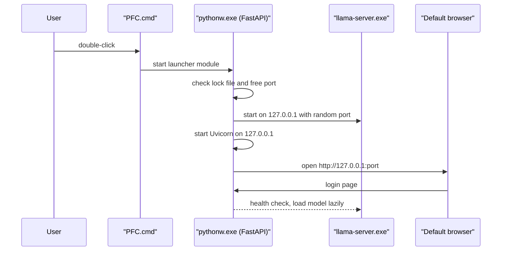
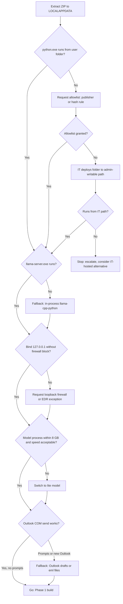

# PerfectFitCandidate (PFC) — Corporate Laptop Feasibility Study

| Item | Value |
|---|---|
| Document | Feasibility study: running PFC as a portable, offline, no-admin application on a locked-down corporate Windows 11 Pro laptop |
| Version | 1.0 |
| Status | Draft |
| Source of truth | [REQUIREMENTS_BASELINE.md](REQUIREMENTS_BASELINE.md) (REQ-PKG-01..05, REQ-LLM-01/06/07, REQ-EML-04, REQ-AUTH-07, NFR-01..04, O-05, O-06) |
| Related documents | [BRD.md](BRD.md) · [FDD.md](FDD.md) · [TDD.md](TDD.md) · [ARCHITECTURE.md](ARCHITECTURE.md) · [WORKFLOW.md](WORKFLOW.md) · [GUI_OCC_DESIGN.md](GUI_OCC_DESIGN.md) · [PHASES.md](PHASES.md) · [DASHBOARD_RESEARCH.md](DASHBOARD_RESEARCH.md) |
| Research date | November 2026 (versions and sizes quoted are those published at that date) |

> **How to read this document.** Statements backed by an official source carry a link in [§13 Sources](#13-sources) (`[S-nn]`). Numbers measured by the author are marked **Measured**. Anything not verified against a source or a measurement is marked **Assumption** and must be confirmed in the Phase 0 validation ([§10](#10-phase-0-validation-checklist-and-test-plan)).

## Table of contents

1. [Executive summary](#1-executive-summary)
2. [Target environment](#2-target-environment)
3. [Constraints analysis](#3-constraints-analysis)
4. [Distribution options](#4-distribution-options)
5. [Distribution comparison](#5-distribution-comparison)
6. [LLM runtime options](#6-llm-runtime-options)
7. [Model sizing (16 GB, CPU-only)](#7-model-sizing-16-gb-cpu-only)
8. [Recommendation](#8-recommendation)
9. [Decision tree](#9-decision-tree)
10. [Phase 0 validation checklist and test plan](#10-phase-0-validation-checklist-and-test-plan)
11. [IT / security engagement items](#11-it--security-engagement-items)
12. [Open questions](#12-open-questions)
13. [Sources](#13-sources)

---

## 1. Executive summary

- **Feasible, with conditions.** Nothing in PFC needs admin rights: an unzip-and-run bundle of the **python.org embeddable package**, vendored wheels, **llama.cpp prebuilt CPU binaries** and a **quantized GGUF model** satisfies REQ-PKG-01/02/03. The real risk is **policy**, not technology: application control (AppLocker / App Control for Business), Defender ASR "prevalence" rules and SmartScreen / Mark-of-the-Web can block unsigned executables launched from user-writable folders. These must be tested on a real corporate laptop in **Phase 0** (REQ-PKG-05) before Phase 1 build-out.
- **Recommended distribution:** portable ZIP = embedded CPython 3.13 + vendored wheels + `llama-server.exe` (CPU build, Vulkan build optional) + one bundled Q4_K_M model + nomic-embed-text-v1.5 embedding model + built React UI, launched by a `.bat` or `.cmd` only (`.cmd` execution is approved). Updated ZIP/unpacked size is an estimate to be recalculated from the selected embedding artifact and package contents; previous bge-small totals are not applicable. See [§8](#8-recommendation).
- **PFC launches exclusively via `.bat` / `.cmd` files.** No executable launcher is used.
- **Ollama** installs per-user without admin [S-10] but is an additional product (background app, auto-update, ~1.7 GB installer) that typically falls under "approved software only" — **likely not allowed** on the target estate (Assumption). It is not assumed (REQ-PKG-03).
- **LLM sizing:** a 16 GB CPU-only laptop comfortably runs 1.5–4 B parameter models at Q4_K_M. Measured on an 8-vCPU AVX2 VM: 1.5 B ≈ 48 tok/s, 3–4 B ≈ 16–24 tok/s generation. A proposed default candidate is **Qwen3-4B-Instruct-2507 Q4_K_M (Apache-2.0)** with **Qwen2.5-1.5B-Instruct (Apache-2.0)** as the lite option; the final choice stays open per **O-05** and is benchmarked in Phase 1. **Qwen2.5-3B is under a non-commercial "Qwen Research" licence** and should not be the default without legal approval.
- **AMD iGPU with 512 MB VRAM**: treat as CPU-only (REQ-LLM-01). The Vulkan build is kept optional for a Phase 0 experiment only.

## 2. Target environment

| Attribute | Target (from brief / baseline) | Implication |
|---|---|---|
| OS | Windows 11 Pro, x64, corporate-managed (Intune/GPO assumed) | Policies may be pushed by MDM even on Pro edition (Assumption — confirm with IT) |
| Rights | Standard user, **no admin**, approved-software-only | No installers, no services, no drivers, no machine-wide PATH/registry changes |
| Network | **Mostly offline**; corporate proxy when online (Assumption) | Core features run offline (NFR-02); network-backed features are available only when their active Settings flag is enabled; no runtime downloads (no pip, no model pulls) |
| RAM | 16 GB shared with Outlook, Teams, browser | Model process target ≤ 8 GB (NFR-03) |
| CPU | Modern laptop x64 CPU (AMD Ryzen assumed because of AMD iGPU) — AVX2 certain, AVX-512 on Zen 4 or newer (Assumption) | llama.cpp CPU build auto-selects an optimised kernel (see §6.1) |
| GPU | AMD integrated GPU, **512 MB dedicated VRAM** (UMA frame buffer) | GPU offload negligible → CPU inference |
| Disk | SSD, user profile (`%USERPROFILE%`, `%LOCALAPPDATA%`) writable | ≈ 3–4 GB free needed for app + model + data |
| Office | Microsoft 365 with **classic** Outlook desktop (Assumption) | Required for Outlook COM (REQ-EML-04) |
| Files | OneDrive for Business / SharePoint sync client available (Assumption) | Resume folder (REQ-IN-20) and Phase 2 auto-pickup (REQ-ING-04) |
| Browser | Microsoft Edge (Chromium) present on Windows 11 | UI host; also usable for headless PDF printing in Phase 2 (see [DASHBOARD_RESEARCH.md](DASHBOARD_RESEARCH.md)) |

## 3. Constraints analysis

| # | Constraint | What the platform does (sourced) | Risk to PFC | Mitigation in design |
|---|---|---|---|---|
| C-01 | **AppLocker** | Default rules allow executables only from the Windows and Program Files folders for standard users; they are a starter policy that admins extend [S-01]. | **High** if enforced: an EXE in `%LOCALAPPDATA%`/Downloads is blocked. | Ask IT for a **publisher rule** (signed binaries) or **hash rules**; alternatively IT deploys the unzipped folder to an admin-writable path (still "portable"). Keep the number of distinct EXEs minimal (`python.exe`/`pythonw.exe`, `llama-server.exe`). |
| C-02 | **App Control for Business (WDAC)** | Path rules are only honoured for admin-writable paths unless the runtime check is disabled; file rules can be hash- or certificate-based [S-02]. | **High** if enforced. User-profile paths will not satisfy path rules. | Same as C-01: signer or hash allowlisting. Prefer binaries already signed by a known publisher (python.org binaries — Assumption, verify with `Get-AuthenticodeSignature`). |
| C-03 | **SmartScreen / Smart App Control** | SmartScreen performs reputation checks on downloaded programs and their signatures [S-03]; Smart App Control blocks unknown unsigned code but allows code signed by a Trusted-Root CA [S-04]. | **Medium**: "Windows protected your PC" prompt for unsigned EXEs, outright block if Smart App Control is enforcing. | Use only the approved `.bat` / `.cmd` launcher; sign or allow-list bundled binaries as needed; distribute via an internal channel; `Unblock` the ZIP before extraction (C-04). |
| C-04 | **Mark-of-the-Web (MotW)** on downloaded ZIPs | Downloaded files carry a `Zone.Identifier` alternate data stream (zone 3 = Internet); `Unblock-File` / the *Unblock* checkbox removes it [S-05][S-06]. Explorer propagates MotW to files extracted from a marked ZIP (Assumption — widely documented behaviour, verify). | **Medium**: every extracted `.exe`/`.bat` triggers "Open File – Security Warning" or SmartScreen. | Instruct users to *Properties → Unblock* the ZIP **before** extracting (permitted for own files); prefer delivery via a OneDrive/SharePoint *sync* folder or file share designated Local intranet [S-06]. |
| C-05 | **Defender AV / EDR** | ASR rule *"Block executable files from running unless they meet a prevalence, age, or trusted list criterion"* exists for Windows 10 1803+ [S-07]. | **High** for freshly built, low-prevalence binaries (every PyInstaller/Nuitka rebuild is a "new" file). | Ship upstream binaries that already have prevalence (python.org, llama.cpp releases) plus code-signing; request EDR allowlisting by hash/certificate. Expect first-launch scanning of the 2–3 GB model (slower first start — Assumption). |
| C-06 | **PowerShell execution policy** | Default on Windows clients is `RemoteSigned`: downloaded scripts need a trusted signature [S-08]. The policy is not a security boundary [S-08] but GPO may set `AllSigned`/`Restricted`. | **Medium** for `.ps1` launchers. | **Do not depend on PowerShell.** Launch via `.cmd`/`.bat` or a small EXE; PowerShell only for optional diagnostics. |
| C-07 | **CMD / batch restrictions** | Some estates block `cmd.exe` or script rules in AppLocker (Assumption); `.cmd` execution is approved for PFC. | **Low–Medium**. | Use the approved `.bat` / `.cmd` launcher only; if a policy blocks both, resolve with IT rather than substituting a shortcut or executable launcher. |
| C-08 | **localhost binding / firewall prompt** | Windows Firewall prompts the first time an app listens or communicates without an allow rule; for non-admins the prompt results in **block rules** whatever is chosen [S-09]. | **Low** (Assumption): binding to `127.0.0.1` only is not expected to raise a prompt and loopback traffic is not filtered by default — must be verified. | Bind FastAPI and `llama-server` to `127.0.0.1` only (REQ-AUTH-07; llama-server default host is `127.0.0.1` [S-15]). Pick a free port at start-up; never bind `0.0.0.0`. |
| C-09 | **User-writable locations** | `%LOCALAPPDATA%`, `%USERPROFILE%` are writable; Desktop/Documents are often redirected to OneDrive (Known Folder Move — Assumption). | **Medium**: SQLite DB inside a OneDrive-synced folder risks sync conflicts/corruption; Controlled Folder Access may block writes to Documents (Assumption). | Recommend extraction to `%LOCALAPPDATA%\PFC\` (not synced). Data folder sits beside the app folder (REQ-PKG-04). Detect and warn if the data folder is under a OneDrive path. |
| C-10 | **OneDrive / SharePoint sync** | Files On-Demand can leave files as cloud-only placeholders until opened [S-11]. | **Medium**: resume reads may fail offline or trigger downloads. | Treat "cloud-only and offline" as *CV not found* (REQ-IN-22) with a clear message; recommend *Always keep on this device* for the resume folder. |
| C-11 | **Outlook COM** | The Outlook **Object Model Guard** prompts when untrusted code reads addresses or sends mail; cross-process COM callers run without warnings only when antivirus is reported healthy and no restrictive programmatic-access policy is set [S-12]. The **new Outlook for Windows does not support VBA/COM add-ins** [S-13]. | **Medium–High**: security prompts per send, or COM unavailable if the user runs *new Outlook*. | Phase 0 test on the real laptop. Fallbacks: (1) create **draft** in Outlook and let the user press Send; (2) generate `.eml`/`.msg` files to open manually; (3) SMTP transport (REQ-EML-04, Phase 2) if IT permits. |
| C-12 | **Proxy / TLS inspection** | Python does not read Windows WinINET/PAC proxy settings automatically (Assumption); `truststore` lets Python use the Windows certificate store [S-14]. | **Low** in Phase 1 (offline). **Medium** in Phase 3 (external LLMs, REQ-LLM-03). | Explicit proxy setting in config; use `truststore` for corporate TLS-inspection CAs; no runtime downloads. |
| C-13 | **RAM pressure** | Outlook + Teams + Edge commonly use several GB (Assumption). | **Medium** | Default model ≤ ~5.5 GB RSS at 8 k context (see §7); lite model option; `--mlock` off; one model at a time (REQ-LLM-01). |
| C-14 | **Data processing approval** | Baseline O-06. | **High (governance)** | Raise in Phase 0 (see §11). |

## 4. Distribution options

### 4.1 (a) Python embeddable package + vendored wheels + launcher `.bat` — **recommended**

- The embeddable distribution is "a minimal package of Python suitable for embedding into larger applications"; it ships `python.exe`, `pythonw.exe`, `python3.dll`/`pythonXY.dll` and the stdlib as `.pyc` in a ZIP; **pip, Tcl/Tk and docs are not included**; a `._pth` file restricts the search path and is meant to be edited by the embedder; third-party packages should be installed by the application alongside it [S-16].
- Size: `python-3.13.9-embed-amd64.zip` = **10.9 MB**, 3.12.10 = 11.1 MB, 3.14.0 = 12.0 MB (**Measured**, HTTP Content-Length on python.org [S-17]).
- Dependencies are pre-installed at build time into `app\site-packages` (wheels for `win_amd64`, `cp313`). A representative PFC dependency set (FastAPI, Uvicorn, Pydantic, openpyxl, pandas, NumPy, pywin32, sqlite-vec, pypdf, python-docx, argon2-cffi, cryptography, RapidFuzz, Jinja2, python-multipart, ReportLab — 38 wheels incl. transitive) downloads as **53 MB** and unpacks to **≈ 161 MB** (**Measured** with `pip download --platform win_amd64 --python-version 3.13`).
- Pros: no compiler step, no self-extracting EXE, upstream signed interpreter (Assumption — verify), transparent folder that security teams can inspect and hash; upgrade = replace `app\` folder (REQ-PKG-04).
- Cons/gotchas: no pip at runtime (fine — offline); `pywin32` normally runs a post-install step to register DLLs — with the embeddable package the `pywin32_system32` folder must be put on the DLL search path by the launcher (Assumption — validate in Phase 0, test F-09); `._pth` must list `app\site-packages`; source is readable (`.py`/`.pyc`) — acceptable for an internal tool.

### 4.2 (b) PyInstaller

- **One-folder** produces a folder with an EXE + dependencies; easiest to debug, and if only code changes you can ship just the updated executable [S-18].
- **One-file**: the bootloader creates a temporary folder `_MEIxxxxxx` in the OS temp location at every start and unpacks support files there [S-18] → slower start, writes executables into `%TEMP%` (a classic AppLocker/ASR-blocked location) and is the mode most often reported as malware (e.g. issue #6754 "My --onefile exe is getting anti-Virus False positive flags and is disabled by windows", label `antivirus-false-positives`) [S-19].
- PyInstaller's own docs list "avoid anti-virus false positives that result from the wide-spread use of pre-compiled bootloaders" as a reason to rebuild the bootloader from source [S-20].
- Licence: GPLv2-or-later with a special exception allowing bundling of proprietary apps (PyPI metadata, v6.22.3) [S-21].
- Verdict: **fallback** if IT insists on "a single signed EXE". Use one-folder + code-signing + rebuilt bootloader.

### 4.3 (c) Nuitka

- Compiles Python to C; `--standalone` produces a folder, `--onefile` a single EXE; requires a C compiler on the **build** machine (Visual Studio 2022+, or Nuitka-downloaded MinGW64, which does not work with Python 3.13+ unless an experimental flag is used, or Zig) [S-22].
- Nuitka's documentation states that some antivirus vendors flag binaries compiled with default settings as malware, "a lot if you compile without additional steps", pointing to the commercial plan for mitigation without guarantees [S-23].
- Licence: AGPLv3 for Nuitka itself with an explicit exception for created binaries [S-24].
- Compile time for a FastAPI + pandas + NumPy app is long (tens of minutes — Assumption) and must be repeated per release.
- Verdict: **not recommended** for Phase 1; offers obfuscation/speed that PFC does not need.

### 4.4 (d) Other options (brief)

| Option | Notes | Fit |
|---|---|---|
| **WinPython** | Portable Python distributions; the "dot" variant is a bare portable Python 3.14 of ~18 MB; full variants are hundreds of MB [S-25]. | Viable alternative to (a), but larger and with its own EXE launchers; (a) is leaner. |
| **conda-pack** | Archives a conda env so it can be relocated; needed because conda envs are not relocatable [S-26]. | Works, but conda packages are larger and add a second package ecosystem. |
| **Briefcase (BeeWare)** | Windows output as MSI (default, WiX) or **ZIP** (`-p zip`) [S-27]. | ZIP output is usable; adds a stub EXE that needs signing; less control over layout. |
| **Tauri shell for UI** | Uses the system **WebView2**, which is preinstalled on Windows 11 [S-28]. | Nice native window, but adds a Rust-built EXE (allowlisting/signing) for little gain over the default browser. Phase 3+ option only. |
| **Electron shell** | Ships its own Chromium runtime (`electron.exe`) [S-29]. | Adds ~100+ MB and another unsigned-EXE risk (Assumption on size). Not recommended. |

## 5. Distribution comparison

Ratings: ✔ good · ◐ acceptable / conditional · ✖ poor. Sizes exclude the model (≈ 1–2.5 GB, identical in all options).

| Criterion | (a) Embedded Python + wheels + `.bat` | (b) PyInstaller one-folder | (b) PyInstaller one-file | (c) Nuitka standalone/onefile | WinPython / conda-pack | Tauri / Electron UI shell |
|---|---|---|---|---|---|---|
| No admin rights | ✔ | ✔ | ✔ | ✔ | ✔ | ✔ (Tauri needs WebView2 — present on Win 11) |
| App size (zipped, excl. model) | ≈ 90 MB (11 MB Python + 53 MB wheels + 25 MB llama.cpp) | ≈ 80–120 MB (Assumption) | ≈ 70–100 MB single EXE (Assumption) | ≈ 70–120 MB (Assumption) | 150–700 MB | + 10 MB (Tauri) / + 100 MB (Electron) on top of backend |
| Startup time | ◐ 1–3 s Python import + model load (Assumption) | ◐ similar to (a) | ✖ +unpack to `%TEMP%` every launch [S-18] | ✔ slightly faster imports | ◐ | ◐ |
| AV / EDR false-positive risk | ✔ upstream binaries with prevalence; no packer | ◐ bootloader frequently flagged [S-20] | ✖ most-reported mode [S-19] | ✖ vendor acknowledges frequent flags [S-23] | ◐ | ◐ new EXE |
| Code-signing need | `.bat` / `.cmd` launcher needs no EXE signing; optionally re-sign llama.cpp binaries | ✖ every build | ✖ every build | ✖ every build | ◐ | ✖ shell EXE must be signed |
| Allowlisting effort for IT | ✔ few, stable hashes/publishers (python, llama.cpp) | ◐ new hash each release | ✖ new hash each release + `%TEMP%` execution | ✖ new hash each release | ◐ | ◐ |
| Update ease | ✔ replace `app\` folder; data kept (REQ-PKG-04) | ✔ | ◐ replace whole EXE | ◐ | ◐ | ◐ |
| Build complexity | ✔ scripted copy + `pip install --target` | ◐ spec files, hidden imports | ◐ | ✖ C compiler, long compile | ◐ | ✖ Rust / Node toolchains |
| Source visibility | `.py`/`.pyc` readable | `.pyc` in archive | `.pyc` in archive | compiled C | readable | n/a |
| **Overall** | **Recommended** | Fallback 1 | Avoid | Fallback 2 | Alternative | Not now |

## 6. LLM runtime options

### 6.1 llama.cpp prebuilt Windows binaries — **recommended**

- Every release on GitHub publishes Windows assets. Release **b12121** (5 Nov 2026) includes `llama-b12121-bin-win-cpu-x64.zip` (**24.7 MB**), `…-win-vulkan-x64.zip` (**37.7 MB**), plus CUDA, ROCm, SYCL and OpenVINO variants [S-30] (**Measured** asset sizes).
- The CPU ZIP contains **runtime-selected CPU kernels** — `ggml-cpu-haswell.dll` (AVX2), `ggml-cpu-skylakex.dll`/`icelake`/`sapphirerapids` (AVX-512 variants), `ggml-cpu-zen4.dll`, `ggml-cpu-alderlake.dll`, `ggml-cpu-sse42.dll`, etc. — so one bundle serves AVX2 and AVX-512 laptops (**Measured**: archive listing, 64 MB unpacked).
- `llama-server.exe` exposes OpenAI-compatible chat/embeddings endpoints, schema-constrained JSON output, and **binds to 127.0.0.1 by default** [S-15] — directly usable from FastAPI for JD/CV extraction (REQ-LLM-02) and for the local embedding model (REQ-LLM-07).
- **Vulkan for the AMD iGPU:** the Vulkan backend works on AMD GPUs, but with only **512 MB dedicated VRAM** at most a few layers of a 2–3 GB model fit; on UMA iGPUs the shared memory path may still help prompt processing, but the gain is uncertain (Assumption). Decision: ship CPU build as default; keep Vulkan build as an optional Phase 0 experiment (test F-12).
- Licence: MIT (Assumption — repository LICENSE; verify at packaging time). Binaries are not Authenticode-signed (Assumption — verify with `Get-AuthenticodeSignature`) → allowlisting by hash or re-signing by Capgemini IT.

### 6.2 llama-cpp-python wheels

- Python bindings; `pip install llama-cpp-python` builds from source and needs a C compiler on Windows, but a **pre-built CPU wheel** index exists: `--extra-index-url https://abetlen.github.io/llama-cpp-python/whl/cpu` [S-31]. The index currently lists `llama_cpp_python-0.3.36-py3-none-win_amd64.whl` (**Measured**); PyPI itself only has the sdist for 0.3.36 [S-32].
- Runs **in-process inside `python.exe`** (the native code is a DLL) → **no extra EXE to allowlist**. This is the key fallback if `llama-server.exe` is blocked by AppLocker/WDAC but `python.exe` is allowed (DLL rules are rarely enforced — Assumption).
- Trade-offs: the bundled wheel lags upstream llama.cpp and may not include every CPU-variant kernel (Assumption); one model per process.

### 6.3 Ollama

- Windows installer "does not require Administrator, and installs in your home directory by default", needs ≥ 4 GB for the binaries, **runs in the background** and serves `http://localhost:11434`; a standalone `ollama-windows-amd64.zip` exists for embedding [S-10].
- Current release v0.40.14: `OllamaSetup.exe` **1,676 MB**, `ollama-windows-amd64.zip` **1,602 MB** (NVIDIA libs included), ROCm add-on 257 MB [S-33] (**Measured**).
- Likelihood on a locked-down, approved-software-only estate: **high probability of being disallowed** (Assumption): it is a separately versioned third-party product with an auto-updater and background tray process, downloads models from the internet by default, and installs an uninstaller entry under *Add or remove programs* [S-10] — the pattern approved-software policies are designed to stop. It also duplicates what llama.cpp gives us (Ollama is built on llama.cpp's GGML). **Not assumed** (REQ-PKG-03); supported only as an optional "external local provider" endpoint if a user already has it approved.

### 6.4 ONNX Runtime (GenAI)

- ONNX Runtime **generate() API** (preview) runs generative models such as Phi with ONNX Runtime [S-34]; `onnxruntime-genai` 0.19.0 publishes `win_amd64` wheels for CPython 3.11/3.12 (**Measured**, PyPI) [S-35]; `onnxruntime` 1.31.1 is MIT [S-36].
- Pros: in-process like 6.2; Microsoft-published; good for **embedding models** (e.g. bge-small ONNX).
- Cons: different model format (ONNX/INT4 exports, fewer ready-made models than GGUF), API in preview, wheel availability lags new Python versions (no cp313 wheel observed — Assumption based on listing). **Second fallback**.

### 6.5 Runtime comparison

| Runtime | No admin | Extra EXE | Model format | Windows CPU perf | Offline | Licence | Verdict |
|---|---|---|---|---|---|---|---|
| llama.cpp `llama-server.exe` | ✔ | 1 (`llama-server.exe`) | GGUF (widest choice) | ✔ multi-variant AVX2/AVX-512 kernels | ✔ | MIT (Assumption) | **Default** |
| llama-cpp-python | ✔ | 0 (in `python.exe`) | GGUF | ◐ wheel lag | ✔ | MIT [S-32] | Fallback 1 |
| ONNX Runtime GenAI | ✔ | 0 | ONNX | ◐ | ✔ | MIT [S-36] | Fallback 2 / embeddings |
| Ollama | ◐ per-user install | installer + background app | GGUF (own registry) | ✔ | ◐ pulls models online by default | MIT (Assumption) | Not assumed |

## 7. Model sizing (16 GB, CPU-only)

### 7.1 Generative models (JD/CV extraction, summaries, email drafts)

File sizes are the published GGUF sizes (bartowski / unsloth quantizations on Hugging Face) [S-37]; licences from the model cards [S-38]. **Speed and RAM are Measured** with `llama-bench` / `llama-completion` (llama.cpp b12121, CPU build, 8 threads) on an **8-vCPU Intel Xeon VM with AVX2 (no AVX-512), 31 GB RAM** — a proxy, not the target laptop. Expect a 15 W–45 W laptop CPU to land roughly **0.5–1.0×** these numbers depending on cores, power plan and thermal throttling (Assumption). "pp" = prompt processing (prefill), "tg" = token generation. RAM = peak resident set size with an 8,192-token context.

| Model (instruct) | Params | Q4_K_M file | Q5_K_M file | Peak RAM @ 8 k ctx, Q4_K_M | pp512 tok/s | tg128 tok/s | Licence | Notes |
|---|---|---|---|---|---|---|---|---|
| Llama 3.2 1B | 1.2 B | 0.81 GB | 0.91 GB | ≈ 1.5 GB (Assumption) | – | – | Llama 3.2 Community (gated) | Too weak for reliable extraction (Assumption) |
| **Qwen2.5-1.5B** | 1.5 B | **0.99 GB** | 1.13 GB | **1.8 GB** | 354 | **48** | **Apache-2.0** | **Lite option** |
| Qwen3-1.7B | 1.7 B | 1.11 GB | – | 2.7 GB | 345 | 42 | Apache-2.0 | Thinking mode must be disabled for latency |
| Gemma 2 2B | 2.6 B | 1.71 GB | 1.92 GB | 3.3 GB | 206 | 26 | Gemma Terms of Use (gated) | Licence review needed |
| Qwen2.5-3B | 3.1 B | 1.93 GB | 2.22 GB | 3.5 GB (Q5: 2.5 GB) | 167 (Q5: 181) | 23 (Q5: 20) | **Qwen Research (non-commercial)** | **Licence blocker** for internal business use without legal sign-off |
| Llama 3.2 3B | 3.2 B | 2.02 GB | 2.32 GB | 4.3 GB | 173 | 24 | Llama 3.2 Community (gated, AUP) | Acceptable with legal review |
| Phi-3.5-mini | 3.8 B | 2.39 GB | 2.82 GB | **6.8 GB** | 136 | 19 | MIT | No grouped-query attention → large KV cache; exceeds NFR-03 at 8 k ctx |
| Phi-4-mini | 3.8 B | 2.49 GB | 2.85 GB | ≈ 4 GB (Assumption, GQA) | – | – | MIT | Strong alternative default; benchmark in Phase 1 |
| **Qwen3-4B (-Instruct-2507)** | 4.0 B | **2.50 GB** | 2.89 GB | **5.4 GB** (Qwen3-4B) | 131 | **16** | **Apache-2.0** | **Proposed default candidate**; 2507 Instruct = non-thinking variant (speed measured on base Qwen3-4B, same architecture) |
| Qwen2.5-7B (reference) | 7.6 B | 4.68 GB | 5.44 GB | ≈ 6–7 GB (Assumption) | – | – | Apache-2.0 | Too slow/large for 16 GB shared laptop |

Interpretation for PFC workloads (NFR-01):

- JD extraction ≈ 1,500 prompt tokens + 400 output tokens. At the proxy speeds, Qwen3-4B ≈ 1,500/131 + 400/16 ≈ **37 s per JD**; Qwen2.5-1.5B ≈ **13 s**. 500 JDs ≈ 5 h (4 B) or 2 h (1.5 B) — acceptable only because extraction is **incremental and cached** (REQ-MAT-07) and the LLM is not called per pair (NFR-01). Bulk first-load should run in the background with progress.
- Scoring 500 × 500 pairs is deterministic + vector similarity and does not use the LLM (REQ-LLM-02) → minutes, not hours.
- Q5_K_M costs ~15 % more RAM/disk and ~15 % slower generation for a small quality gain; **Q4_K_M is the default quant**.

### 7.2 Embedding models (REQ-LLM-07)

| Model | Params | Dim | Max tokens | GGUF size | Licence | Fit |
|---|---|---|---|---|---|---|
| bge-small-en-v1.5 | 33 M | 384 | 512 | 67 MB (f16) | MIT | Alternative compact model |
| all-MiniLM-L6-v2 | 23 M | 384 | 256 (Assumption) | 21–46 MB | Apache-2.0 | Smaller/faster, lower quality (Assumption) |
| **nomic-embed-text-v1.5** | **~137 M** | **768** (Matryoshka truncation option) | **8,192** | Format-specific size to be estimated for the selected ONNX / GGUF artifact | **Apache-2.0** | **Default**; task prefixes `search_document:` / `search_query:`; ONNX Runtime default, llama.cpp GGUF alternative |
| snowflake-arctic-embed-s | 33 M | 384 | 512 (Assumption) | – | Apache-2.0 | Benchmark candidate |
| multilingual-e5-small | 118 M | 384 | 512 (Assumption) | – | MIT | Only if non-English CVs appear |

Parameters, dimensions and context from model configs / Hugging Face API [S-39]. Embedding throughput and package size for nomic-embed-text-v1.5 are estimates until benchmarked with the selected model artifact; ONNX Runtime is the default, with llama.cpp GGUF as an alternative.

## 8. Recommendation

**Self-contained portable ZIP = embedded CPython 3.13 + vendored wheels + llama.cpp CPU `llama-server.exe` + bundled Q4_K_M model + nomic-embed-text-v1.5 embedding model + built React UI, started by `PFC.cmd`.**

Justification:

1. **No admin, no installer, offline** — satisfies REQ-PKG-01/02/03 and NFR-02; nothing is downloaded at runtime.
2. **Smallest attack surface for allowlisting** — only two upstream executables (`pythonw.exe`, `llama-server.exe`); the launcher is a `.bat` / `.cmd` script, not an EXE; hashes stay stable between PFC releases because app code is data (`.py`) not a rebuilt EXE.
3. **Lowest AV/EDR friction** — no self-extracting packer, no `%TEMP%` execution, upstream binaries with existing prevalence (vs. PyInstaller one-file / Nuitka, §4).
4. **Updatable** — replace `app\`, keep `data\` (REQ-PKG-04); models are swappable files (REQ-LLM-06).
5. **Built-in fallbacks** — if `llama-server.exe` is blocked, switch to in-process llama-cpp-python; if COM is blocked, drafts/`.eml`; `.cmd` execution is approved and `.bat` is the only alternate launcher format.

### 8.1 ZIP size estimate

| Component | Zipped | Unpacked | Basis |
|---|---|---|---|
| Embedded CPython 3.13 (amd64) | 11 MB | ≈ 25 MB (Assumption) | Measured download size [S-17] |
| Vendored wheels (`site-packages`) | 53 MB | ≈ 161 MB | Measured (§4.1) |
| llama.cpp CPU build (server + DLLs) | 25 MB | ≈ 64 MB (≈ 35 MB if trimmed to server only) | Measured [S-30] |
| llama.cpp Vulkan build (optional) | 38 MB | ≈ 90 MB (Assumption) | Measured zip [S-30] |
| Generative model, Qwen3-4B-Instruct-2507 Q4_K_M | ≈ 2.45 GB (GGUF barely compresses — Assumption) | 2.50 GB | [S-37] |
| Embedding model, nomic-embed-text-v1.5 | Estimate pending selected ONNX / GGUF artifact | Estimate pending selected ONNX / GGUF artifact | New model package size is not yet measured |
| React build, templates, default config | ≈ 5 MB (Assumption) | ≈ 10 MB | — |
| **Total — standard** | **Estimate; recalculate after model artifacts are selected** | **Estimate; recalculate after model artifacts are selected** | Earlier totals used bge-small and do not apply |
| **Total — lite** (Qwen2.5-1.5B Q4_K_M) | **Estimate; recalculate after model artifacts are selected** | **Estimate; recalculate after model artifacts are selected** | Earlier totals used bge-small and do not apply |

Plus `data\` growth (SQLite + vectors + CV cache): tens to a few hundred MB for 500 + 500 records with history (Assumption). ZIPs > 4 GB need Zip64 — not reached. Recommendation: offer **standard** and **lite** ZIPs, or ship the model as a separate file the user drops into `models\` (keeps the code ZIP < 100 MB for faster updates).

### 8.2 Folder layout

```text
%LOCALAPPDATA%\PFC\                 <- recommended extraction root (not OneDrive-synced)
├─ PFC.cmd                          <- launcher: sets paths, starts pythonw, opens browser
├─ PFC-diagnostics.cmd              <- Phase 0 self-test (writes data\logs\diag.txt)
├─ app\                             <- replaced on upgrade
│  ├─ python\                       <- python-3.13.x-embed-amd64 (python313._pth edited)
│  ├─ site-packages\                <- vendored wheels (pip install --target at build time)
│  ├─ pfc\                          <- FastAPI backend source (.py)
│  ├─ web\                          <- built React/TypeScript UI (static files)
│  ├─ llama\cpu\                    <- llama-server.exe + ggml-*.dll (CPU variants)
│  ├─ llama\vulkan\                 <- optional
│  ├─ templates\                    <- default email template (REQ-EML-03), report templates
│  └─ config\defaults.toml          <- default config, scoring template v1, approved-model list
├─ models\                          <- swappable; kept on upgrade
│  ├─ qwen3-4b-instruct-2507-Q4_K_M.gguf
│  └─ nomic-embed-text-v1.5\  (selected ONNX artifact; size estimate pending)
└─ data\                            <- kept on upgrade (REQ-PKG-04)
   ├─ pfc.sqlite                    <- app DB + sqlite-vec tables
   ├─ cv-cache\  uploads\  exports\  logs\  backups\
   └─ pfc.lock                      <- single-instance lock
```

### 8.3 Start-up sequence



## 9. Decision tree

The decision tree below is the run-book for Phase 0: each node maps to a test in [§10](#10-phase-0-validation-checklist-and-test-plan).



## 10. Phase 0 validation checklist and test plan

Run on **at least two real corporate laptops** (one standard build, one with the strictest policy profile) as a standard user, using a Phase 0 "probe" ZIP that contains the real binaries plus a diagnostics script (no business data). Record results in a copy of this table.

| ID | Test | Steps | Pass criteria | Fallback if fail |
|---|---|---|---|---|
| F-01 | ZIP delivery and MotW | Download ZIP via the intended channel (SharePoint/Teams/OneDrive sync/email); check *Properties* for *Unblock*; `Get-Item -Stream Zone.Identifier` | Unblock possible, or file arrives without MotW via sync | Deliver via OneDrive sync folder / file share in Local intranet zone [S-06]; IT-side distribution |
| F-02 | Extraction | Extract to `%LOCALAPPDATA%\PFC` | ≈ 3 GB extracted, no files quarantined | Check Defender history; request exclusion/allowlist |
| F-03 | Python execution | Run `app\python\python.exe -c "print(1)"` and `pythonw.exe` | Runs, no SmartScreen/AppLocker block event (Event Viewer → AppLocker / CodeIntegrity) | Allowlist request (§11); IT path deployment |
| F-04 | Signature check | `Get-AuthenticodeSignature` on `python.exe`, `llama-server.exe` | Report signer/status (informational) | Feeds allowlisting request |
| F-05 | Launcher | Double-click `PFC.cmd` | Browser opens login page within 15 s (excluding first model load) | Use the approved `.bat` launcher if `.cmd` cannot be used |
| F-06 | PowerShell policy | `Get-ExecutionPolicy -List` | Informational (PFC must not need PowerShell) | n/a |
| F-07 | localhost bind | Start FastAPI on `127.0.0.1:<port>`; browse | Page loads; **no firewall prompt**; no EDR alert | Different port; request loopback exception; desktop-shell spike (WebView2) |
| F-08 | llama-server | Start `llama-server.exe -m model --host 127.0.0.1` | Starts; `/health` OK; no quarantine | In-process llama-cpp-python (§6.2) → ONNX Runtime (§6.4) |
| F-09 | pywin32 under embedded Python | `import win32com.client` from embedded Python | Import succeeds | Adjust DLL search path in launcher; alternative: `comtypes` (pure Python) |
| F-10 | Outlook COM | Create draft; send a test mail to self via COM | Draft created; send without Object Model Guard prompt, or with an acceptable prompt | Draft-only mode; `.eml`/`.msg` export; SMTP (Phase 2) |
| F-11 | Outlook flavour | Check whether the user runs classic or new Outlook | Classic Outlook available | Same as F-10 fallbacks [S-13] |
| F-12 | LLM performance (CPU) | `llama-bench` with default and lite model, 8 threads, AC power | Default model ≥ 8 tok/s generation and ≤ 8 GB RSS; lite ≥ 20 tok/s (proposed thresholds, agree in Phase 0) | Use lite model; reduce context to 4 k |
| F-13 | Vulkan iGPU (optional) | Run Vulkan build with `-ngl` small values | Informational: faster than CPU? stable? | Stay on CPU build |
| F-14 | Memory coexistence | Run PFC + Outlook + Teams + Edge; extract 10 JDs | No paging storm; system remains responsive; free RAM > 2 GB | Lite model; smaller context; close-on-idle for llama-server |
| F-15 | First-start AV scan | Time first and second start of llama-server with model | Second start < 15 s | Ask for model-file hash exclusion (§11) |
| F-16 | OneDrive resume folder | Point resume path to a synced SharePoint library; read a cloud-only file offline and online | Online: file hydrates and parses; offline: graceful "CV not found" | "Always keep on this device" guidance |
| F-17 | Data folder location | Detect if `data\` under OneDrive / Controlled Folder Access | Writes succeed outside synced folders | Force `%LOCALAPPDATA%` data path |
| F-18 | Proxy (Phase 3 readiness) | `python -c` HTTPS request through configured proxy with `truststore` | Succeeds | Disable external providers; local only |
| F-19 | Single instance / lock | Start PFC twice | Second start focuses existing instance | — |
| F-20 | Upgrade | Replace `app\` with new version | `data\` and `models\` preserved; DB migrates | — |

**Exit criteria for Phase 0:** F-01..F-08, F-10 or an accepted fallback, F-12 and F-14 pass on both laptops; all IT items in §11 are either approved or have an owner and date.

## 11. IT / security engagement items

| # | Item | Ask | Owner (proposed) | Blocks |
|---|---|---|---|---|
| IT-01 | **Application control allowlisting** | Publisher or hash rules for `python.exe`, `pythonw.exe`, `llama-server.exe` (+ `ggml-*.dll` if DLL rules are on) and PFC launcher; or IT-managed deployment path | Desktop engineering / EUC security | F-03, F-08 |
| IT-02 | **Code signing** | Use the corporate code-signing certificate for bundled binaries if required; launcher is `.bat` / `.cmd`, not an EXE | PKI / release engineering | C-03, C-05 |
| IT-03 | **EDR / Defender exceptions** | Allowlist the binaries by hash/cert; consider exclusion of `models\*.gguf` from on-access re-scanning after first scan; confirm ASR "prevalence" rule behaviour [S-07] | SecOps | F-15 |
| IT-04 | **Loopback listening** | Confirm `127.0.0.1` listeners are permitted for user processes | Network / EUC security | F-07 |
| IT-05 | **Outlook programmatic access** | Confirm Object Model Guard policy and whether classic Outlook stays available [S-12][S-13] | M365 / Exchange team | F-10, F-11 |
| IT-06 | **Data-processing approval (DPIA)** | Corporate approval for CV processing, Outlook automation and external LLM use is granted; no candidate privacy notice is required (O-06). Retention, PII masking and Settings active flags still apply. | Data protection officer / InfoSec | Resolved; not a Phase 1 pilot gate |
| IT-07 | **Model licence approval** | Approve licences of bundled models (Apache-2.0 / MIT preferred; Llama/Gemma terms need review; Qwen Research licence not for business use) | Legal / OSS office | Packaging |
| IT-08 | **OSS component review** | SBOM of wheels + llama.cpp + React bundle (licences: MIT/BSD/Apache/PSF) | OSS office | Packaging |
| IT-09 | **Distribution channel** | Approved channel for the ZIP (SharePoint library, Software Center, file share) that avoids MotW issues | EUC | F-01 |
| IT-10 | **SAST** | Enterprise convention: SonarQube scans of PFC source before release | AppSec | Release |

## 12. Open questions

| # | Question | Proposed default |
|---|---|---|
| FQ-01 | Does the estate enforce AppLocker or App Control for Business on user-profile paths, and is DLL enforcement enabled? | Assume enforced; plan IT-01 early. |
| FQ-02 | Is *classic* Outlook guaranteed for PFC users through Phase 1–2? (new Outlook lacks COM) | Build draft/`.eml` fallback in Phase 1. |
| FQ-03 | Exact laptop CPU model(s) and core counts? (drives model default; AVX-512 availability) | Benchmark both default and lite in Phase 0. |
| FQ-04 | Is a corporate code-signing certificate available to the project? | Use `.cmd` launcher until available. |
| FQ-05 | Which model licences are acceptable to Legal (Apache-2.0/MIT only, or also Llama/Gemma community terms)? | Apache-2.0 / MIT only for the default (affects O-05). |
| FQ-06 | Acceptable ZIP size for the distribution channel (single 2.7 GB file vs. code ZIP + separate model download)? | Code ZIP + model file separately. |
| FQ-07 | Is the Vulkan backend worth shipping for the AMD iGPU? | No, unless F-13 shows a clear gain. |
| FQ-08 | Proposed performance thresholds in F-12 (≥ 8 tok/s default, ≥ 20 tok/s lite) — agree with stakeholders. | As proposed. |

## 13. Sources

| Ref | Source |
|---|---|
| S-01 | Microsoft Learn — Understanding AppLocker default rules: https://learn.microsoft.com/en-us/windows/security/application-security/application-control/app-control-for-business/applocker/understanding-applocker-default-rules |
| S-02 | Microsoft Learn — App Control for Business: select types of rules to create (user-writable file paths, file rule levels): https://learn.microsoft.com/en-us/windows/security/application-security/application-control/app-control-for-business/design/select-types-of-rules-to-create |
| S-03 | Microsoft Learn — Microsoft Defender SmartScreen overview: https://learn.microsoft.com/en-us/windows/security/operating-system-security/virus-and-threat-protection/microsoft-defender-smartscreen/ |
| S-04 | Microsoft Learn — Smart App Control overview: https://learn.microsoft.com/en-us/windows/apps/develop/smart-app-control/overview |
| S-05 | Microsoft Learn — `Unblock-File` (removes the `Zone.Identifier` stream): https://learn.microsoft.com/en-us/powershell/module/microsoft.powershell.utility/unblock-file |
| S-06 | Microsoft Learn — Macros from the internet are blocked by default (Mark of the Web, unblocking, trusted locations): https://learn.microsoft.com/en-us/microsoft-365-apps/security/internet-macros-blocked |
| S-07 | Microsoft Learn — Attack surface reduction rules reference: https://learn.microsoft.com/en-us/defender-endpoint/attack-surface-reduction-rules-reference |
| S-08 | Microsoft Learn — about_Execution_Policies: https://learn.microsoft.com/en-us/powershell/module/microsoft.powershell.core/about/about_execution_policies |
| S-09 | Microsoft Learn — Windows Firewall rules (user notification prompt behaviour): https://learn.microsoft.com/en-us/windows/security/operating-system-security/network-security/windows-firewall/rules |
| S-10 | Ollama docs — Windows: https://docs.ollama.com/windows |
| S-11 | Microsoft Learn — Set Files On-Demand states in Windows: https://learn.microsoft.com/en-us/sharepoint/files-on-demand-windows |
| S-12 | Microsoft Learn — Security behavior of the Outlook object model: https://learn.microsoft.com/en-us/office/vba/outlook/how-to/security/security-behavior-of-the-outlook-object-model |
| S-13 | Microsoft Support — Feature comparison between new Outlook and classic Outlook: https://support.microsoft.com/en-us/office/feature-comparison-between-new-outlook-and-classic-outlook-de453583-1e76-48bf-975a-2e9cd2ee16dd |
| S-14 | truststore documentation: https://truststore.readthedocs.io/en/latest/ |
| S-15 | llama.cpp server README (`--host` default `127.0.0.1`, OpenAI-compatible API): https://github.com/ggml-org/llama.cpp/blob/master/tools/server/README.md |
| S-16 | Python docs — Using Python on Windows, the embeddable package: https://docs.python.org/3/using/windows.html |
| S-17 | python.org FTP — e.g. https://www.python.org/ftp/python/3.13.9/python-3.13.9-embed-amd64.zip |
| S-18 | PyInstaller — What PyInstaller does and how it does it (one-folder / one-file): https://pyinstaller.org/en/stable/operating-mode.html |
| S-19 | PyInstaller issue #6754 (onefile antivirus false positive): https://github.com/pyinstaller/pyinstaller/issues/6754 |
| S-20 | PyInstaller — Building the bootloader: https://pyinstaller.org/en/stable/bootloader-building.html |
| S-21 | PyPI — pyinstaller: https://pypi.org/project/pyinstaller/ |
| S-22 | Nuitka user manual: https://nuitka.net/user-documentation/user-manual.html |
| S-23 | Nuitka — Common issue solutions (Windows virus scanners): https://nuitka.net/user-documentation/common-issue-solutions.html |
| S-24 | Nuitka — Download / licence: https://nuitka.net/doc/download.html |
| S-25 | WinPython: https://winpython.github.io/ |
| S-26 | conda-pack: https://conda.github.io/conda-pack/ |
| S-27 | Briefcase — Windows platform reference: https://briefcase.readthedocs.io/en/stable/reference/platforms/windows/index.html |
| S-28 | Tauri — Webview versions: https://v2.tauri.app/reference/webview-versions/ |
| S-29 | Electron — Application distribution: https://www.electronjs.org/docs/latest/tutorial/application-distribution |
| S-30 | llama.cpp releases (b12121): https://github.com/ggml-org/llama.cpp/releases |
| S-31 | llama-cpp-python README (pre-built CPU wheel index): https://github.com/abetlen/llama-cpp-python |
| S-32 | PyPI — llama-cpp-python: https://pypi.org/project/llama-cpp-python/ ; wheel index https://abetlen.github.io/llama-cpp-python/whl/cpu/llama-cpp-python/ |
| S-33 | Ollama releases: https://github.com/ollama/ollama/releases |
| S-34 | ONNX Runtime generate() API: https://onnxruntime.ai/docs/genai/ |
| S-35 | PyPI — onnxruntime-genai: https://pypi.org/project/onnxruntime-genai/ |
| S-36 | PyPI — onnxruntime: https://pypi.org/project/onnxruntime/ |
| S-37 | Hugging Face GGUF repos: https://huggingface.co/bartowski/Qwen2.5-1.5B-Instruct-GGUF · https://huggingface.co/bartowski/Qwen2.5-3B-Instruct-GGUF · https://huggingface.co/bartowski/Llama-3.2-3B-Instruct-GGUF · https://huggingface.co/bartowski/Phi-3.5-mini-instruct-GGUF · https://huggingface.co/bartowski/gemma-2-2b-it-GGUF · https://huggingface.co/bartowski/Qwen_Qwen3-4B-Instruct-2507-GGUF · https://huggingface.co/bartowski/microsoft_Phi-4-mini-instruct-GGUF · https://huggingface.co/unsloth/Qwen3-1.7B-GGUF · https://huggingface.co/CompendiumLabs/bge-small-en-v1.5-gguf · https://huggingface.co/nomic-ai/nomic-embed-text-v1.5-GGUF |
| S-38 | Model cards (licences): https://huggingface.co/Qwen/Qwen2.5-1.5B-Instruct · https://huggingface.co/Qwen/Qwen2.5-3B-Instruct · https://huggingface.co/Qwen/Qwen3-4B-Instruct-2507 · https://huggingface.co/meta-llama/Llama-3.2-3B-Instruct · https://huggingface.co/microsoft/Phi-3.5-mini-instruct · https://huggingface.co/microsoft/Phi-4-mini-instruct · https://huggingface.co/google/gemma-2-2b-it |
| S-39 | Embedding model cards: https://huggingface.co/BAAI/bge-small-en-v1.5 · https://huggingface.co/nomic-ai/nomic-embed-text-v1.5 · https://huggingface.co/sentence-transformers/all-MiniLM-L6-v2 · https://huggingface.co/Snowflake/snowflake-arctic-embed-s · https://huggingface.co/intfloat/multilingual-e5-small |
