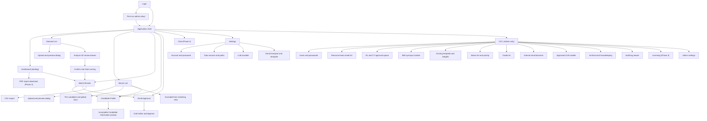
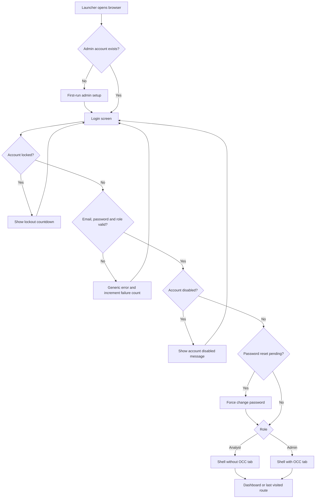
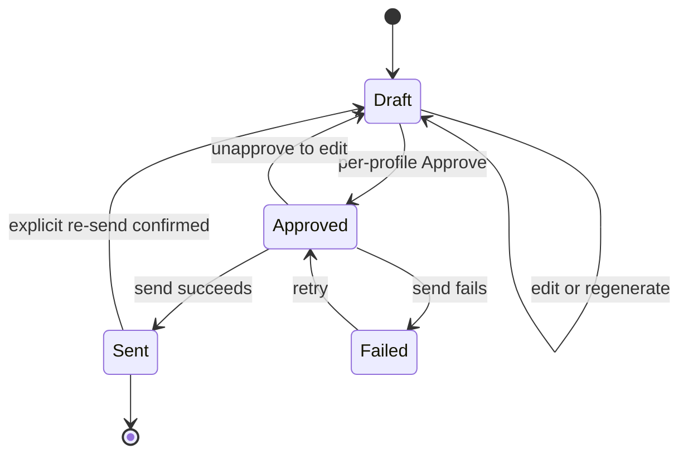
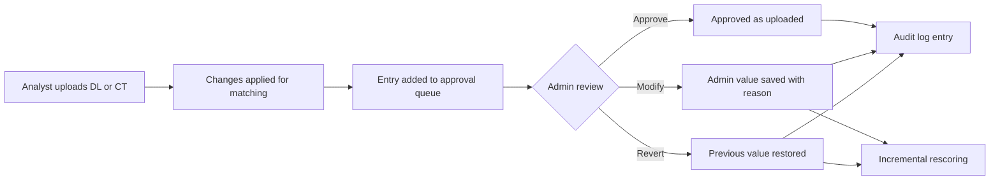
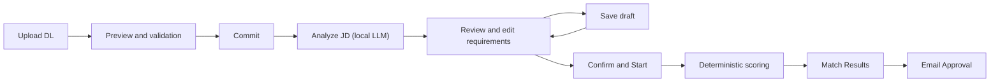

# PerfectFitCandidate (PFC) — Web GUI and OCC Design

| Item | Value |
|---|---|
| Document | Web GUI and OCC (Object Control Center) design |
| Version | 1.0 |
| Status | Draft |
| Source of truth | [REQUIREMENTS_BASELINE.md](REQUIREMENTS_BASELINE.md) (requirement IDs `REQ-*`, decision log §16, open items §17) |
| Related documents | [BRD.md](BRD.md) · [FDD.md](FDD.md) · [TDD.md](TDD.md) · [ARCHITECTURE.md](ARCHITECTURE.md) · [WORKFLOW.md](WORKFLOW.md) · [FEASIBILITY.md](FEASIBILITY.md) · [PHASES.md](PHASES.md) · [DASHBOARD_RESEARCH.md](DASHBOARD_RESEARCH.md) |
| Reference inputs | [reference/Application-Design.png](reference/Application-Design.png) · [reference/Project-PerfectFitCandidate.docx](reference/Project-PerfectFitCandidate.docx) · [reference/DL-CT-Metadata.xlsx](reference/DL-CT-Metadata.xlsx) |
| Audience | Product owner, UX/UI designers, frontend (TypeScript/React) and backend (FastAPI) developers, testers |

> This document describes **what the user sees and does**. Data model, APIs and algorithms are in [TDD.md](TDD.md); functional rules are in [FDD.md](FDD.md); the end-to-end process is in [WORKFLOW.md](WORKFLOW.md). Where this document restates a rule it cites the baseline requirement ID; the baseline wins on any conflict.

---

## Table of contents

1. [Purpose and scope](#1-purpose-and-scope)
2. [Design principles](#2-design-principles)
3. [Design system](#3-design-system)
4. [Information architecture](#4-information-architecture)
5. [Role-visibility matrix](#5-role-visibility-matrix)
6. [Application shell](#6-application-shell)
7. [Login and authentication screens](#7-login-and-authentication-screens)
8. [Dashboard (landing)](#8-dashboard-landing)
9. [Demand List](#9-demand-list)
10. [Bench List](#10-bench-list)
11. [Match Results](#11-match-results)
12. [Candidate Profile](#12-candidate-profile)
13. [Email Approval](#13-email-approval)
14. [Chat (Phase 2)](#14-chat-phase-2)
15. [Settings](#15-settings)
16. [OCC — Object Control Center (Admin only)](#16-occ--object-control-center-admin-only)
17. [Cross-cutting UI patterns](#17-cross-cutting-ui-patterns)
18. [Phase mapping of GUI features](#18-phase-mapping-of-gui-features)
19. [Requirement traceability](#19-requirement-traceability)
20. [Open questions](#20-open-questions)

---

## 1. Purpose and scope

PFC is a single local web GUI ("Interactive Demand-Resource Analytics" in the [design sketch](reference/Application-Design.png)) served by the bundled FastAPI backend on `127.0.0.1` (REQ-AUTH-07) and opened in the user's default browser by the launcher (REQ-PKG-03). One GUI serves all analytics, reports, matching, communication and email; the **OCC** is a special admin-only section inside the same GUI (REQ-ROLE-03).

In scope:

- Visual language and design system (typography, spacing, colour tokens, icons, accessibility).
- Application shell, navigation and role-based visibility.
- Login, first-run admin setup, lockout and session states.
- Screen-by-screen design for every left-panel tab and every OCC sub-section: purpose, layout, wireframe, components, interactions, empty/loading/error states, role visibility and delivery phase.

Out of scope: pixel-perfect visual mock-ups, API contracts, database schema and scoring algorithm internals (see [TDD.md](TDD.md) and [FDD.md](FDD.md)).

Users: ~5 named users — **Analyst** role (personas A: matching and candidate email; B: demand analytics; C: bench analytics) and **Admin** role (OCC Admin), see REQ-ROLE-01/02. Data volume: 100–500 demands and 100–500 resources at a time — the GUI is designed for **dense, scannable tables** rather than infinite-scroll feeds.

Overriding product rule surfaced everywhere in the UI: results are **a ranked shortlist for human review, never an automated staffing or selection decision** (REQ-SCR-05, product summary §1).

---

## 2. Design principles

| # | Principle | What it means in the GUI |
|---|---|---|
| P-01 | **Professional, modern enterprise look** | Calm light theme, generous white space, card-based dashboard, consistent iconography, no decorative clutter. Icons, indicators and subtle illustrations for empty states satisfy REQ-OUT-11 without distracting from data. |
| P-02 | **Explainability first** | Every score can be expanded into its component breakdown (70/10/5/5/5/5), matching evidence, gaps/checks and eligibility evidence (REQ-SCR-04, REQ-OUT-01). A number is never shown without a path to "why". |
| P-03 | **Human in the loop** | Nothing irreversible happens without an explicit, per-item action: JD requirements are confirmed before scoring (REQ-MAT-02); each email is approved per profile (REQ-EML-01); archival shows a preview (REQ-ARC-02). |
| P-04 | **Truthful data** | Values are displayed exactly as copied from the DL/CT (REQ-OUT-02, REQ-IN-14). Missing data is shown as "Not recorded" or "Requires validation", never as an invented value or as proof of absence (REQ-MAT-06). |
| P-05 | **Privacy by default** | Email and phone are masked by default with an audited Show/Hide control (REQ-OUT-03). Masking is described in the UI as a presentation control, not security. |
| P-06 | **Status is visible** | Data freshness (last DL/CT upload), resume-folder reachability, model status and background jobs are always visible in the top bar. |
| P-07 | **Gaps never hidden** | Missing mandatory skills, eligibility caveats (REQ-ELIG-04) and adjacent-grade considerations are shown with their own chips; a high Match % never hides a gap (REQ-SCR-03). |
| P-08 | **Offline-first** | Every core screen works with no network (NFR-02). Network-dependent actions (Outlook send, SharePoint/OneDrive sync, external LLM) show clear offline states instead of failing silently. |
| P-09 | **Fast and predictable** | Dashboard and table interactions target < 2 s (NFR-01); long jobs (embedding, scoring, sync) run in the background with progress and never block navigation. |
| P-10 | **Accessible** | WCAG 2.1 AA: contrast, keyboard operation, focus visibility, screen-reader labels and no colour-only meaning (NFR-06). |
| P-11 | **Role-appropriate** | Analysts see only what they can act on; admin-only controls are absent (not merely disabled) for Analysts, except where seeing a read-only value aids understanding (e.g. the active scoring-template version). |

---

## 3. Design system

### 3.1 Foundations

The design system is implemented as a small in-repo component library on top of React (TypeScript) and plain CSS custom properties (design tokens). The component framework choice (e.g. an accessible headless library plus own styles) is a [TDD.md](TDD.md) decision; this section defines the **visual contract** any implementation must honour.

### 3.2 Typography

| Token | Use | Specification (indicative) |
|---|---|---|
| `font-family-base` | All UI text | System UI stack available offline on Windows 11 (Segoe UI first, then generic sans-serif). No web-font download (offline, locked-down laptop). |
| `font-family-mono` | IDs, code fences inside JDs, audit payloads | Cascadia Mono / Consolas, then generic monospace. |
| `font-size-xs` | Table meta, chip text | 12 px |
| `font-size-sm` | Table body, form help | 13–14 px |
| `font-size-md` | Body text, form inputs | 14–15 px |
| `font-size-lg` | Card titles, dialog titles | 18 px |
| `font-size-xl` | Page titles | 22–24 px |
| `font-size-kpi` | KPI tile numbers | 28–32 px, tabular figures |
| `font-weight-regular / medium / semibold` | Body / labels / headings | 400 / 500 / 600 |
| `line-height-tight / base` | Headings / body | 1.25 / 1.5 |

Numbers in tables and KPIs use **tabular (monospaced) figures** so columns align. Dates use one consistent format across the GUI and exports (REQ-OUT-02, REQ-OUT-10), proposed `DD MMM YYYY` (e.g. `04 Nov 2026`), UK day-first semantics.

### 3.3 Spacing, layout and shape

| Token | Value (indicative) | Use |
|---|---|---|
| `space-1 … space-8` | 4, 8, 12, 16, 24, 32, 48, 64 px | 4 px base grid for all padding/margins |
| `radius-sm / md / lg` | 4 / 8 / 12 px | Inputs and chips / cards and dialogs / large panels |
| `elevation-1 / 2 / 3` | Subtle, medium, strong shadow | Cards / dropdowns and drawers / modal dialogs |
| `layout-left-panel` | 240 px expanded, 64 px collapsed (icon-only) | Left navigation panel |
| `layout-top-bar` | 56 px | Top bar |
| `layout-content-max` | Fluid; minimum supported viewport 1366 × 768 | Typical corporate laptop resolution |
| `density` | Comfortable (default) or Compact (user setting) | Compact reduces table row height for 500-row tables |

### 3.4 Colour tokens (light theme)

Colours are described in words with indicative values; final values must pass WCAG AA contrast (≥ 4.5:1 for normal text, ≥ 3:1 for large text and UI component boundaries). **Colour is never the only carrier of meaning** — every semantic colour is paired with an icon and a text label.

| Token | Description | Indicative value |
|---|---|---|
| `color-bg-app` | Cool grey page background in the premium-feel CSS design system | `#E6E6EB` |
| `color-bg-surface` | White card/panel surface | `#FFFFFF` |
| `color-bg-subtle` | Light grey for table header, zebra rows, read-only fields | `#EEF1F5` |
| `color-border` | Soft grey divider and input border | `#D0D5DD` |
| `color-text-primary` | Near-black body text | `#1D2939` |
| `color-text-secondary` | Mid-grey secondary text | `#475467` |
| `color-text-disabled` | Light grey disabled text (with additional disabled cursor/state) | `#98A2B3` |
| `color-primary` | Deep corporate blue for primary actions, active nav item, links | `#0B5CAD` |
| `color-primary-subtle` | Pale blue for selected rows and active nav background | `#E6F0FA` |
| `color-focus` | High-visibility blue focus ring (2 px, offset 2 px) | `#2E90FA` |
| `color-success` | Green for success, Sent, Eligible | `#067647` |
| `color-warning` | Amber for warnings, caveats, Avg. band | `#B54708` |
| `color-danger` | Red for errors, Failed, Excluded, destructive actions | `#B42318` |
| `color-info` | Teal/blue for informational notices | `#026AA2` |
| `color-neutral` | Grey for Unknown / Insufficient data / Draft | `#667085` |
| `color-band-strong` | Green family (Strong ≥ 90 %) | as `color-success` |
| `color-band-potential` | Blue family (Potential 70–89 %) | as `color-primary` |
| `color-band-avg` | Amber family (Avg. 61–69 %) | as `color-warning` |
| `color-band-weak` | Red-orange family (Weak < 61 %) | as `color-danger` |
| `color-band-insufficient` | Grey family (Insufficient data) | as `color-neutral` |
| `color-chart-1 … chart-8` | Categorical chart palette, colour-blind-safe, ordered | defined in TDD; paired with patterns/labels in charts |

Chip backgrounds use a pale tint of the semantic colour with the full-strength colour for text and icon, so text contrast stays above 4.5:1. A dark theme is **not** in scope for Phase 1 (light theme only); tokens are named semantically so a dark theme could be added later.

### 3.5 Iconography and imagery

- One outline icon set (24 px grid, 1.5–2 px stroke), bundled locally (no CDN). Proposed: an MIT/ISC-licensed set such as Lucide or Material Symbols (outline) — licence must permit internal distribution in the ZIP (REQ-PKG-02).
- Fixed icon meaning across the app (examples): Dashboard = grid; Demand List = briefcase; Bench List = users; Match Results = target; Candidate Profile = id-card; Email Approval = mail-check; Chat = message-square; Settings = gear; OCC = shield; Sync = refresh; Upload = upload-cloud; Mask/Unmask = eye-off / eye; Warning = triangle; Error = octagon; Info = circle-i; Locked = lock.
- Empty states use simple monochrome line illustrations (bundled SVG) with one sentence of guidance and one primary action (REQ-OUT-11 "stock imagery").
- Avatars: initials in a circle (no photos are ingested).

### 3.6 Core components

| Component | Notes |
|---|---|
| Buttons | Primary (filled blue), Secondary (outlined), Tertiary (text), Destructive (red). One primary button per view. Disabled buttons always have a tooltip explaining why (e.g. global Sync disabled "Select at least one candidate"). |
| Data table | Sticky header, sortable columns, per-column filter (text, multi-select chips, range), column visibility menu, row selection checkboxes, keyboard row navigation, pagination (50/100/250/all) or virtualised scroll for ≤ 500 rows, row expansion, CSV export of the current filtered view. |
| Chips / badges | Band chips, status chips, eligibility badge, email status chip, classification chip; icon + label + tint. |
| Match % doughnut | 32 px inline ring for tables, 96 px for profile/detail; percentage text inside or beside; `aria-label="Match 87 percent, Potential"` (REQ-OUT-01, REQ-OUT-10). |
| Score breakdown bar | Horizontal stacked bar of the six components with points earned vs. available (e.g. Skills 58/70). |
| Masked value | Displays the masked email/phone, with an eye toggle "Show" / "Hide"; each Show is audit-logged (REQ-OUT-03, REQ-AUTH-05). |
| Drawer | Right-side panel (480–720 px) for details/editing without leaving the list (Analyze JD review, evidence, CV preview). |
| Modal dialog | Confirmations, upload preview/validation, Incomplete Candidate Information prompt. Focus trapped; Esc closes unless a destructive action is in progress. |
| Toast | Non-blocking feedback (bottom-right), auto-dismiss 6 s for success, persistent for errors. |
| Progress | Determinate progress bar for jobs with known size (embedding, scoring, sync); indeterminate spinner only for < 3 s waits; skeleton loaders for tables and charts. |
| Banner | Page-level persistent notice (offline, stale data, Outlook unavailable, licence expiry in Phase 3). |
| Diff viewer | Side-by-side or inline field-level before/after (OCC approval queue, template versions). |
| Chart card | Title, subtitle with data scope, chart, "View as table" toggle (accessibility), and a kebab menu (export PNG/CSV). |

### 3.7 Accessibility (WCAG 2.1 AA)

| Area | Rule |
|---|---|
| Contrast | Text ≥ 4.5:1; large text and UI boundaries ≥ 3:1; checked for every token pairing. |
| Keyboard | Every action reachable by keyboard; visible focus ring; logical tab order; skip-to-content link; table navigation with arrow keys; shortcuts: `/` focus global search, `g d` Dashboard, `g m` Match Results (shortcuts listed in a help dialog, `?`). |
| Screen readers | Semantic landmarks (header, nav, main); ARIA labels for icon-only buttons; live regions for job progress and toasts; charts have a data-table alternative. |
| Non-colour cues | Bands, statuses and validation results always include text and icon. |
| Motion | Respect `prefers-reduced-motion`; no auto-playing animation. |
| Forms | Labels always visible (no placeholder-only labels); inline error text linked via `aria-describedby`; errors summarised at the top of long forms. |
| Zoom | Usable at 200 % browser zoom; left panel collapses to icons automatically below 1280 px width. |
| Timeouts | Session-timeout warning dialog with "Stay signed in" at least 60 s before expiry (REQ-AUTH-04). |

### 3.8 Content and formatting conventions

- Requisition IDs, ShortNames and emails are shown **exactly** as in source (REQ-OUT-02); monospaced for IDs.
- Match % shown as an integer percentage with `%` (e.g. `87 %`), never as a decimal fraction (REQ-OUT-10).
- Missing values: "Not recorded"; unparseable source values: "Unparseable: <raw value>" with a warning icon (REQ-IN-12).
- Role Location with no value: "Unspecified" (REQ-OUT-01).
- Disclaimer in Match Results and on exports/PDF: "Scores are relative matching metrics for human review, not hiring decisions." (REQ-SCR-05).

---

## 4. Information architecture

### 4.1 Left-panel tabs

| Order | Tab | Landing? | Primary persona | Phase |
|---|---|---|---|---|
| 1 | Dashboard | Yes (default after login) | All; B and C for analytics | 1 (PDF download: 2) |
| 2 | Demand List | | A, B | 1 |
| 3 | Bench List | | A, C | 1 |
| 4 | Match Results | | A | 1 |
| 5 | Candidate Profile | | A | 1 (CV comparison: 2) |
| 6 | Email Approval | | A | 1 (calendar follow-up, SMTP: 2) |
| 7 | Chat | | All | 2 |
| 8 | Settings | | All | 1 (external LLM: 3) |
| 9 | OCC | | Admin only | 1 (sub-sections phased, see §16) |

Candidate Profile is reachable both as a tab (opens a candidate search/picker, then the profile) and by clicking any person name anywhere in the app.

### 4.2 Sitemap



### 4.3 Deep links

Each screen and entity has a stable hash route so links can be shared within the same instance and used from notifications, e.g. `#/demands/T1A123`, `#/matches?req=T1A123`, `#/candidates/<candidate-id>`, `#/email?req=T1A123`, `#/occ/approvals`. Routes enforce role checks server-side; an Analyst opening an `#/occ/*` link sees "You don't have access to this area" and is offered the Dashboard.

---

## 5. Role-visibility matrix

Legend: **F** = full access, **R** = read-only, **P** = partial (see note), **—** = not visible.

| Screen / feature | Analyst | Admin | Notes |
|---|---|---|---|
| Login, change own password | F | F | REQ-AUTH-01..03 |
| First-run admin setup | — | F (once) | Only when no admin exists (REQ-AUTH-03) |
| Dashboard (KPIs, charts, filters) | F | F | REQ-OUT-04..08 |
| Dashboard leadership view | R | R | Leadership users are assigned the Analyst role |
| Dashboard PDF report download | F | F | Phase 2 (REQ-OUT-09) |
| Demand List — view, upload, Analyze JD, Confirm & Start | F | F | REQ-ING-01, REQ-MAT-02; Admin may also define default extraction settings |
| Bench List — view, upload, Sync, Show/Hide email | F | F | REQ-IN-21, REQ-OUT-03 (unmask logged) |
| Excluded-from-matching view | R | R | REQ-ELIG-08 |
| Match Results — view, filter, export CSV | F | F | REQ-OUT-01, REQ-OUT-09 |
| Match Results — overrides (pin/unpin, exclude, adjust band) | F | F | REQ-MAT-09, audit-logged |
| Candidate Profile | F | F | Incomplete-identity resolution by either role |
| Candidate classification manual override | P | F | Phase 2; proposed Analyst can request, Admin applies — see [Open questions](#20-open-questions) |
| Email Approval — edit draft, Approve, send | F | F | REQ-EML-01..06 |
| Chat | F | F | Phase 2 |
| Settings — account, paths, auto-sync placeholders, email transport, email template | F | F | REQ-AUTH-02, REQ-ING-04/05, REQ-EML-03/04 |
| Settings — choose active LLM model | P | F | Analyst chooses only from the admin-approved list (REQ-LLM-06) |
| Settings — external LLM providers and tokens | F | F | Network-backed features require their active Settings flag; external LLM live Phase 3 (NFR-02, REQ-LLM-03) |
| Active scoring-template version (display) | R | F | Shown read-only on Match Results for Analysts (REQ-ROLE-04) |
| OCC (all sub-sections) | — | F | REQ-ROLE-03; tab not rendered for Analysts |
| Audit log viewer | — | F | REQ-AUTH-05 |
| Licensing — Generate User ZIP, issue licence | — | F | Phase 3 (REQ-AUTH-08) |

Persona emphasis (all Analyst role): **A** lands on Dashboard but works mainly in Demand List → Match Results → Email Approval; **B** in Dashboard "Demand analytics" section; **C** in Dashboard "Bench analytics" section and Bench List. Personas do not change permissions; an optional per-user "default dashboard section" preference (Settings) lets B and C land on their section.

---

## 6. Application shell

**Purpose.** Persistent frame around every screen after login: identity and role, global search, data/sync status, notifications and left-panel navigation.

**Layout.** Top bar (56 px, full width) + left panel (240 px, collapsible to 64 px icons) + main content area (page title row, optional page-level banner, content) + slim footer.

```text
┌──────────────────────────────────────────────────────────────────────────────────────────┐
│ [PFC logo] PerfectFitCandidate  │ [/ Search requisitions, people, skills...  ] │ ↻ Sync ● │ [!]3 │ (OA) Olivia A. ▾ │
│                                 │                                              │ status   │     │  Analyst        │
├──────────────────┬───────────────────────────────────────────────────────────────────────┤
│ ▦ Dashboard      │ Dashboard                                   Filters ▾   [↓ PDF report] │
│ ▣ Demand List   │ ┌───────────────────────────────────────────────────────────────────┐ │
│ ☷ Bench List    │ │ ⚠ Bench data is 3 days old. Upload the latest Candidate Tracker.  │ │
│ ◎ Match Results  │ └───────────────────────────────────────────────────────────────────┘ │
│ ▤ Candidate     │                                                                       │
│    Profile       │                    (page content)                                     │
│ ✉ Email Approval │                                                                       │
│ ☰ Chat   (P2)   │                                                                       │
│ ⚙ Settings       │                                                                       │
│ ──────────────── │                                                                       │
│ ◈ OCC  (Admin)  │                                                                       │
│                  │                                                                       │
│ « Collapse       │                                                                       │
├──────────────────┴───────────────────────────────────────────────────────────────────────┤
│ v1.0.0 · Local model: <model name> · Shortlists are for human review, not hiring decisions │
└──────────────────────────────────────────────────────────────────────────────────────────┘
```

(Glyphs in wireframes only stand for icons from the bundled icon set: ◉ = Show/Hide eye toggle, ↻ = Sync, ↑ = Upload, ↓ = Download, ⚑ = Pinned, ◈ = OCC, [!] = notifications.)

### 6.1 Top bar components

| Component | Behaviour |
|---|---|
| Product mark | Logo + "PerfectFitCandidate"; click → Dashboard. |
| Global search | Shortcut `/`. Type-ahead across requisitions (Code Requisition, role title, account), people (name, ShortName — never by unmasked email), and skills (including synonyms from the tracker, REQ-MAT-05). Results grouped "Demands / People / Skills" with up to 5 each and "See all". Enter on a result opens its detail; a skill result opens Match Results/Bench List filtered by that skill. Searches local DB only (offline). |
| Sync status indicator | Single icon with a summary dot (green = all healthy, amber = attention, red = error, each with text in the popover). Popover lists: last DL upload (time, user, file), last CT upload, resume folder reachable (path, last scan), background jobs (embedding, scoring, CV sync) with progress, local LLM status (loaded / loading / not available), Outlook availability (detected / not detected), auto-sync watchers (Phase 1: "Not configured — placeholder"; Phase 2: last pickup), external provider status and last provider used (Phase 3, REQ-LLM-04). |
| Notifications bell | Count badge; panel with: job completions ("Scoring finished for 42 demands"), email send failures, Incomplete Candidate Information prompts awaiting decision, data-quality warnings from uploads, 24 h turnaround at-risk alerts (REQ-EML-07), OCC approval-queue items (Admin), licence expiry warnings (Phase 3), provider fallback notices (Phase 3). Each item deep-links to the relevant screen; "Mark all read". Stored locally per user. |
| User menu | Avatar initials, name, **role label (Admin / Analyst)**; menu: My settings, Change password, Keyboard shortcuts, About (version, model, scoring-template version), Sign out. |

### 6.2 Left panel

- Tabs in fixed order (§4.1); active tab highlighted with `color-primary-subtle` background, left accent bar and bold label (not colour alone).
- Count badges where useful: Email Approval (drafts awaiting approval), OCC (pending approval-queue items, Admin only).
- Phase-gated tabs (Chat in Phase 1) are **hidden** by feature flag rather than shown disabled, to keep the MVP clean; the feature-flag list is in [TDD.md](TDD.md).
- OCC appears below a divider, only for Admin (REQ-ROLE-03), with a shield icon and "Admin" caption.
- Collapsible to icon-only; collapsed state remembered per user; tooltips show labels when collapsed.

### 6.3 Shell states

| State | Treatment |
|---|---|
| Backend unreachable | Full-width red banner "PFC service is not responding. Restart PFC from the launcher." with Retry; content goes read-only. |
| Offline (no network) | Neutral banner only when a network action is attempted (send email, sync from SharePoint, external LLM): "You're offline — this action needs network access." Core features keep working (NFR-02). |
| Stale data | Amber banner when last DL or CT upload is older than a configurable threshold (Admin setting, proposed default 7 days). |
| Background job running | Progress shown in sync popover and as a thin progress line under the top bar; navigation remains possible. |
| Session about to expire | Modal "You'll be signed out in 60 s" with Stay signed in / Sign out (REQ-AUTH-04). |
| Second instance | Launcher lock prevents a second instance (REQ-PKG-04); if the browser opens a stale tab the shell shows "PFC is already running in another window". |

---

## 7. Login and authentication screens

**Purpose.** Authenticate a named user into the correct role (REQ-AUTH-01..04); bootstrap the first Admin without a shipped default password (REQ-AUTH-03).

### 7.1 Login screen

```text
┌──────────────────────────────────────────────────────────────┐
│                                                              │
│                [PFC logo]  PerfectFitCandidate               │
│          Bench-to-demand matching for human review           │
│                                                              │
│   ┌──────────────────────────────────────────────────────┐   │
│   │ Sign in                                              │   │
│   │                                                      │   │
│   │ Role                                                 │   │
│   │ [ Analyst                                        ▾ ] │   │
│   │                                                      │   │
│   │ Corporate email                                      │   │
│   │ [ name.surname@capgemini.com                       ] │   │
│   │                                                      │   │
│   │ Password                                             │   │
│   │ [ ••••••••••••                               ◉ ]    │   │
│   │                                                      │   │
│   │ ⚠ Caps Lock is on                                    │   │
│   │                                                      │   │
│   │ [              Sign in                             ] │   │
│   │                                                      │   │
│   │ Forgot password? Contact your PFC administrator.     │   │
│   └──────────────────────────────────────────────────────┘   │
│                                                              │
│   Local instance · 127.0.0.1 · v1.0.0                        │
└──────────────────────────────────────────────────────────────┘
```

| Component | Behaviour |
|---|---|
| Role dropdown | Options **Admin**, **Analyst** (REQ-AUTH-01). Defaults to the role used at the last successful sign-in on this instance, otherwise Analyst. |
| Corporate email | Analyst signs in with corporate email + admin-provided password (REQ-AUTH-02). Admin signs in with the admin account email created at first-run setup. Trimmed, case-insensitive comparison. |
| Password | Masked with show/hide toggle; Caps Lock warning. |
| Sign in | Disabled until all fields are filled; shows spinner while verifying. |
| Forgot password | No self-service reset (offline, no mail dependency at login). Analysts ask the OCC Admin to reset (§16.2). Admin recovery is a documented offline procedure in [TDD.md](TDD.md). |

### 7.2 First-run admin setup

Shown instead of the login screen when the local DB has **no Admin user** (fresh ZIP extraction). Nothing is pre-filled; no default password exists in the ZIP (REQ-AUTH-03).

```text
┌──────────────────────────────────────────────────────────────┐
│ Welcome to PerfectFitCandidate — first-run setup   Step 1/3  │
│──────────────────────────────────────────────────────────────│
│ Create the OCC administrator account                         │
│                                                              │
│ Full name          [                                      ]  │
│ Corporate email    [                                      ]  │
│ Password           [                                  ◉ ]   │
│ Confirm password   [                                  ◉ ]   │
│                                                              │
│ Password strength  ▮▮▮▮▯  Strong                             │
│  ✓ at least 14 characters      ✓ upper and lower case        │
│  ✓ a number                    ✗ a symbol                    │
│  ✓ not the email or name       ✓ not a common password       │
│                                                              │
│                                   [ Back ]  [ Create admin ] │
└──────────────────────────────────────────────────────────────┘
```

Steps: (1) create Admin; (2) confirm data folder location and resume folder path (optional, can be done later in Settings); (3) summary → "Go to sign in". The exact password policy (length/complexity) is defined in [TDD.md](TDD.md); the GUI shows a live checklist. After setup the screen never appears again unless the data folder is reset.

### 7.3 Error, lockout and session states

| Situation | Message (generic, no account enumeration) | Behaviour |
|---|---|---|
| Wrong email, password or role | "Email, password or role is incorrect." | Field values kept except password; focus returns to password. A role mismatch (valid Analyst credentials with "Admin" selected) gets the same generic message. |
| Account disabled by Admin | "This account is disabled. Contact your PFC administrator." | — |
| Repeated failures | After N failures: "Too many attempts. Try again in MM:SS." with countdown | Lockout per REQ-AUTH-04; N and duration are Admin settings (§16.14). Sign-in disabled during countdown. Logged in the audit log. |
| Password expired / reset by Admin | "Your password was reset. Set a new password to continue." | Forced change-password screen after successful sign-in. |
| Session timeout | "You were signed out after inactivity." | Return to login; after sign-in, user returns to the last route. |
| Backend not running | "Can't reach the PFC service. Start PFC from the launcher." | Retry button. |
| Licence invalid/expired (Phase 3) | "Licence expired on DD MMM YYYY. Request a renewal from your administrator." | Sign-in blocked for Analysts; Admin can sign in to OCC licensing only. |

### 7.4 Login and role routing



---

## 8. Dashboard (landing)

**Purpose.** Landing page after login for all users: an at-a-glance summary of the latest matching run (REQ-OUT-04), demand analytics for Analyst B (REQ-OUT-05), bench analytics for Analyst C (REQ-OUT-06), match/communication analytics (REQ-OUT-07) and the data-quality/validation panel (REQ-OUT-10). "Advanced + professional dashboard" is a Phase 1 deliverable; PDF download is Phase 2 (REQ-OUT-09).

**Layout.** Page title row with global filter bar and **PDF report** button → KPI summary header (4 primary tiles + secondary tiles) → section tabs/anchors: *Overview*, *Demand analytics*, *Bench analytics*, *Match & communication*, *Data quality* → responsive 12-column grid of chart cards (2–3 per row at 1366 px).

```text
┌──────────────────────────────────────────────────────────────────────────────────────────┐
│ Dashboard                                 Run: 04 Nov 2026 14:32 · Template v3  [↓ PDF report] │
│ Filters: [BU ▾] [Region ▾] [Account ▾] [Grade ▾] [Location ▾] [Band ▾] [Status ▾]           │
│          [Candidate type ▾ (P2)] [Incomplete identity ▾] [Mandatory skills ▾] [Score 0–100 ⇔] │
│          Active: BU = BCM ✕  Grade = C1–D1 ✕                              [Clear all] [Save view] │
├──────────────────────────────────────────────────────────────────────────────────────────┤
│ ┌──────────────────┐ ┌──────────────────┐ ┌──────────────────┐ ┌──────────────────────────┐ │
│ │ Requisitions      │ │ Role-to-person   │ │ Roles with no    │ │ Data-quality limitations │ │
│ │ assessed          │ │ combinations     │ │ suitable cand.   │ │                          │ │
│ │      128          │ │      583         │ │       14         │ │  6 issues  ⚠  View ›     │ │
│ │ of 131 open       │ │ top 5 per req.   │ │ 10.9 % of reqs › │ │ DL 2 · CT 4              │ │
│ └──────────────────┘ └──────────────────┘ └──────────────────┘ └──────────────────────────┘ │
│  Eligible bench 212 · Excluded 47 ›  · Match coverage 89 %  · Emails sent ≤24 h 92 %         │
├─ Overview │ Demand analytics │ Bench analytics │ Match & communication │ Data quality ──────┤
│ ┌───────────────────────────────┐ ┌───────────────────────────────┐ ┌─────────────────────┐ │
│ │ Open demands by BU / region   │ │ Top 5 skills in demand        │ │ Band distribution   │ │
│ │ ▇▇▇▇▇ BCM                     │ │ SQL        ▇▇▇▇▇▇▇▇ 41         │ │   ◔ doughnut        │ │
│ │ ▇▇▇ INS                       │ │ Python     ▇▇▇▇▇▇ 33           │ │ Strong 18 %         │ │
│ │ ▇▇ ...       [View as table]  │ │ ...                            │ │ Potential 46 % ...  │ │
│ └───────────────────────────────┘ └───────────────────────────────┘ └─────────────────────┘ │
│ ┌───────────────────────────────┐ ┌───────────────────────────────┐ ┌─────────────────────┐ │
│ │ Bench timeline (bubble)       │ │ Grade histogram (pool vs dem.)│ │ Email status counts │ │
│ │  ○──────○   ○───────────○     │ │ A3 A4 B1 B2 C1 C2 D1 D2        │ │ Draft 12 Appr. 4    │ │
│ │     ○───○       ○──○  today│  │ │ ▇  ▇▇ ▇▇▇ ▇▇▇▇ ▇▇▇ ▇▇ ▇ ▇       │ │ Sent 61 Failed 1    │ │
│ └───────────────────────────────┘ └───────────────────────────────┘ └─────────────────────┘ │
└──────────────────────────────────────────────────────────────────────────────────────────┘
```

### 8.1 KPI summary header

| Tile | Definition | Click-through |
|---|---|---|
| Requisitions assessed | Count of requisitions with a confirmed, scored JD in the latest run vs. open requisitions in the DL (REQ-OUT-04) | Demand List filtered "Scored" |
| Role-to-person combinations | Count of requisition–person rows produced (normally ≤ 5 per requisition, REQ-MAT-03) | Match Results |
| Roles with no suitable candidate | Requisitions with no Strong/Potential/Avg. match; Weak-only is shown separately (REQ-OUT-04) | Match Results filtered to those requisitions |
| Data-quality limitations | Count of material issues in DL/CT (missing grade/skills/email, unparseable dates, ID-format warnings, ambiguous identities, CV not found) (REQ-OUT-04, KPI-05) | Data quality section |
| Secondary strip | Eligible bench vs. excluded (REQ-ELIG-08), match coverage (KPI-04), email turnaround ≤ 24 h (KPI-03), auto-match accuracy (KPI-01) once labelled data exists | Respective views |

Exact definitions for counts (e.g. whether "no suitable candidate" includes Weak-only requisitions) follow [FDD.md](FDD.md); see [Open questions](#20-open-questions).

### 8.2 Baseline charts

The final chart catalogue, chart types and interactions are recommended in [DASHBOARD_RESEARCH.md](DASHBOARD_RESEARCH.md); the baseline set below is the minimum the GUI layout must accommodate.

| Section | Chart | Default type | Source requirement |
|---|---|---|---|
| Demand analytics | Open demands by BU / region | Grouped or stacked bar | REQ-OUT-05 |
| Demand analytics | Top 5 skills in demand (synonym-normalised) | Horizontal bar | REQ-OUT-05 |
| Demand analytics | Grade → JD count | Bar | REQ-OUT-05 |
| Demand analytics | Top 3 accounts by JD count | Horizontal bar / ranked list | REQ-OUT-05 |
| Demand analytics | Demand start-date pipeline | Column by week/month | REQ-OUT-05 |
| Demand analytics | Scrollable DL rows ordered by Position Start Date descending | Table | REQ-OUT-05 |
| Bench analytics | Top 5 skills in pool | Horizontal bar | REQ-OUT-06 |
| Bench analytics | Top 5 demanded skills vs. eligible bench supply, stacked by Available Capacity Y/N (display only) | Stacked horizontal bar | REQ-OUT-06 |
| Bench analytics | Grade histogram (bench pool, optional overlay of demand grades) | Column histogram A3 → E1 | REQ-OUT-06 |
| Bench analytics | Bench timeline bubble (bench start → end/today, bubble size = number of people or days on bench) | Bubble / range timeline | REQ-OUT-06 |
| Bench analytics | Bench aging (0–2, 2–4, 4–8, 8–12, > 12 weeks) | Column | REQ-OUT-06 |
| Bench analytics | Bench status distribution (eligible statuses in priority order + excluded) | Bar | REQ-OUT-06 |
| Bench analytics | Scrollable CT rows ordered by Bench Start Date descending | Table | REQ-OUT-06 |
| Match & communication | Match coverage (demands with ≥ 1 Strong/Potential) | Progress ring + trend | REQ-OUT-07, KPI-04 |
| Match & communication | Band distribution (Strong / Potential / Avg. / Weak / Insufficient data) | Doughnut with labels | REQ-OUT-07 |
| Match & communication | Email status counts (Draft / Approved / Sent / Failed) | Stacked bar | REQ-OUT-07, REQ-EML-06 |
| Data quality | Validation panel (REQ-OUT-10 checks, pass/fail per check) + issue list | Checklist + table | REQ-OUT-10 |

Chart-card behaviour: hover tooltip with exact values; click a bar/segment → cross-filter the dashboard (shown as an active filter chip) or drill into the corresponding list; "View as table" toggle; export PNG/CSV per card. Charts respect the global filters.

### 8.3 Global filters

Filter bar per REQ-OUT-08 / REQ-MAT-10: Code Requisition, Account Name, BU, Grade, Location, region, band, status, candidate type, incomplete identity, mandatory-skill status and score range. Active filters appear as removable chips; "Clear all"; "Save view" stores named filter presets per user (useful for personas B and C). Filters persist when navigating to Match Results via a "Carry filters" link.

### 8.4 PDF report download (Phase 2)

Button **"PDF report"** in the page header (REQ-OUT-09). Opens a small dialog: report scope (current filters / all), sections to include (KPI header, demand analytics, bench analytics, match & communication, data quality, match results table with masked emails), orientation, then **Generate**. Generation runs locally in the background; a toast with "Open" / "Show in folder" appears when done. PDFs always contain masked emails and the human-review disclaimer, and their generation is audit-logged. In Phase 1 the button is hidden; Match Results offers CSV/Excel export instead (REQ-OUT-09).

### 8.5 States

| State | Treatment |
|---|---|
| Empty (first use) | Illustration + "No data yet. Upload the Demand List and Candidate Tracker to get started." with buttons Upload DL / Upload CT. Charts not rendered. |
| Partial | DL uploaded but no CT (or vice versa): KPI tiles show "—" with "Needs Candidate Tracker"; demand charts render, bench charts show inline empty state. |
| Not yet scored | KPI tiles 1–3 show "Not scored" with link "Analyze JDs" → Demand List. |
| Loading | Skeleton tiles and chart placeholders; target < 2 s (NFR-01). |
| Error | Card-level error "Couldn't load this chart" with Retry; other cards unaffected. |
| Filter returns nothing | Each card shows "No data for the current filters" + Clear filters. |

**Role visibility:** Analyst F, Admin F. **Phase:** 1 (PDF 2; candidate-type filter 2; further charts per DASHBOARD_RESEARCH.md 1/2).

---

## 9. Demand List

**Purpose.** Upload the latest DL (REQ-ING-01), review demands, and run the explicit JD-analysis step **Analyze JD → review requirements → Confirm & Start** that precedes scoring (REQ-MAT-02). Primary personas: A (matching) and B (demand analytics).

**Layout.** Page header (title, last upload info, **Upload DL** primary button, **Analyze all new** secondary button, auto-sync placeholder chip) → filter row → demand table → right-side **JD review drawer** when a row is opened.

```text
┌──────────────────────────────────────────────────────────────────────────────────────────┐
│ Demand List      Last upload: DL_Nov.xlsx · 04 Nov 2026 09:12 · by O. Admin               │
│                                   [Auto-sync: Not configured]  [Analyze all new (9)]  [↑ Upload DL] │
├──────────────────────────────────────────────────────────────────────────────────────────┤
│ [Search…]  [BU ▾] [Region ▾] [Account ▾] [Grade ▾] [JD status ▾] [Start date ⇔]   Columns ▾ │
├──┬────────────┬────────────┬───────────────┬──────┬──────────────────────────┬────────┬────┬─────┬─────────────┬───────┬──────┤
│☐ │Code Req.   │Pos. Start  │Account        │Grade │Demand Request Name       │Region  │BU  │Owner│JD status    │Matches│Best  │
├──┼────────────┼────────────┼───────────────┼──────┼──────────────────────────┼────────┼────┼─────┼─────────────┼───────┼──────┤
│☐ │T1A123      │15 Dec 2026 │Acme Bank      │D1    │TC14_Data BA_UK_London_D1 │London  │BCM │J. Do│● Scored     │5      │Strong│
│☐ │T2B456      │02 Jan 2027 │Contoso Ins.   │C2    │Snowflake Data Engineer   │Glasgow │INS │A. Ro│◐ Analysed — │—      │—     │
│  │            │            │               │      │                          │        │    │     │  awaiting ✓ │       │      │
│☐ │ABCD123 ⚠   │20 Nov 2026 │Fabrikam       │C1    │Scrum Master              │—       │BCM │M. Li│○ Not analysed│—     │—     │
└──┴────────────┴────────────┴───────────────┴──────┴──────────────────────────┴────────┴────┴─────┴─────────────┴───────┴──────┘
  3 of 131 selected   [Analyze selected]  [View matches]                   ‹ 1 2 3 ›  100 / page
```

### 9.1 Upload and preview/validation dialog

Triggered by **Upload DL** (file picker, `.xlsx` only; drag-and-drop onto the page also accepted).

```text
┌──────────────────────────────────────────────────────────────────────┐
│ Upload Demand List — preview                                     ✕   │
│──────────────────────────────────────────────────────────────────────│
│ File: DL_Nov.xlsx · Sheet detected: "Open Demands Wk45" (by header)  │
│                                                                      │
│  Rows read 134 │ New 12 │ Updated 21 │ Unchanged 98 │ Rejected 3     │
│                                                                      │
│ Warnings (5)                                       [Download CSV]    │
│  ⚠ Row 17  Code Requisition "ABCD123" not in T1/T2XXXX format        │
│  ⚠ Row 40  JD contains mis-encoded bullets (normalised)              │
│  ⚠ Row 52  Position Start Date in the past (01 Oct 2026)             │
│ Rejected (3)                                                         │
│  ✕ Row 88  Missing Code Requisition                                  │
│  ✕ Row 101 Duplicate Code Requisition in file — newest row kept      │
│                                                                      │
│ Preview  [New ▾]                                                     │
│  Code Req. │ Account │ Grade │ Role │ Region │ BU │ Start date        │
│  T1C789    │ ...                                                     │
│                                                                      │
│                                   [ Cancel ]   [ Commit 131 rows ]   │
└──────────────────────────────────────────────────────────────────────┘
```

- Sheet located by header row, not by name (REQ-IN-01); the detected sheet name is shown for transparency.
- Counts per REQ-ING-02; key `Code Requisition`; re-uploads replace rows with the same key (REQ-IN-02).
- ID format is a **warning**, not a rejection (O-02). JD text is shown normalised in the preview (REQ-IN-03).
- Identical file (same hash) → dialog shows "This file was already imported on DD MMM YYYY — nothing to do." with only Close (REQ-ING-06).
- Commit applies changes immediately for matching (REQ-ING-03); a toast confirms and offers "Analyze new demands". Updated demands whose JD text changed are flagged "JD changed — re-analysis needed" (REQ-MAT-07).

### 9.2 Demand table

Columns follow DL field order: Code Requisition, Position Start Date, Account Name, Code Local Grade, Demand Request Name, Region, BU, Owner, plus derived columns **JD status** (Not analysed / Analysed — awaiting confirmation / Confirmed — scoring / Scored / JD changed), **Matches** (count) and **Best band**. Row click opens the JD review drawer; "View matches" opens Match Results filtered to the requisition.

### 9.3 Analyze JD → review requirements → Confirm & Start

```text
┌──────────────────────────────── JD review — T2B456 ─────────────────────────────────── ✕ ┐
│ Snowflake Data Engineer · Contoso Ins. · C2 · Glasgow · Start 02 Jan 2027                │
│ Model: <local model> · Extracted 04 Nov 2026 10:02            [Re-analyze]               │
├──────────────────────────────────────────┬───────────────────────────────────────────────┤
│ Job description (normalised, read-only)  │ Extracted requirements (editable)             │
│                                          │ Mandatory skills                              │
│ • 5+ years data engineering…             │ [Snowflake ✕] [SQL ✕] [dbt ✕] [+ Add]        │
│ • Snowflake, dbt, Airflow…               │ Preferred skills                              │
│ • Financial services desirable…          │ [Airflow ✕] [Python ✕] [+ Add]               │
│                                          │ Experience   [ 5 ] years   Qualifications [ ] │
│ Highlight: extracted terms are underlined│ Domain       [ Insurance              ]       │
│ in the JD for provenance.                │ Location     [ Glasgow ]  ☐ Mandatory onsite  │
│                                          │ Synonyms applied: dbt ↔ data build tool  ⓘ    │
│                                          │                                               │
│                                          │ ⚠ "Python" mentioned once — confirm priority  │
├──────────────────────────────────────────┴───────────────────────────────────────────────┤
│ Scoring template v3 (read-only for Analysts)      [ Save draft ]  [ Confirm & Start ▶ ]  │
└──────────────────────────────────────────────────────────────────────────────────────────┘
```

| Step | Interaction |
|---|---|
| Analyze JD | Row action or "Analyze selected"/"Analyze all new" (bulk). Local LLM extracts mandatory/preferred skills, experience, qualifications, domain, location/onsite requirement (REQ-MAT-02). Progress per demand; the user can keep working. |
| Review | Drawer shows JD left, extracted fields right. Skills as editable chips with auto-complete from the synonym tracker (REQ-MAT-05). Each extracted item links to its source text (provenance highlight). Low-confidence items carry a warning chip. |
| Confirm & Start | Locks this JD version and queues scoring (deterministic, REQ-LLM-02). Bulk analysis still needs confirmation — the drawer supports "Confirm & next" to step through all pending demands. |
| Save draft | Keeps edits without scoring; status stays "Analysed — awaiting confirmation". |
| Re-analyze | Re-runs extraction; shows a diff against current edits before replacing. |

### 9.4 States

| State | Treatment |
|---|---|
| Empty | Illustration + "No demands yet. Upload the Demand List (.xlsx)." + Upload DL. |
| Loading | Table skeleton; upload dialog shows "Reading workbook…" with determinate progress. |
| Upload error | Not an `.xlsx`, file locked by Excel, no recognisable header row → inline error in dialog with guidance ("Close the file in Excel and retry"). |
| LLM unavailable | Analyze buttons disabled with tooltip "Local model is not running — see status"; manual entry of requirements is still possible, then Confirm & Start. |
| Extraction failed | Row chip "Extraction failed" + Retry; error detail in drawer. |

**Role visibility:** Analyst F, Admin F (Admin may additionally set extraction defaults in OCC). **Phase:** 1 (auto-sync pickup 2).

---

## 10. Bench List

**Purpose.** Upload the latest Candidate Tracker (Bench Tracker / ActivityTracker — same file), see who is eligible for matching and why others are excluded, and sync resumes per candidate or for a selection (REQ-IN-10..14, REQ-IN-20..22, REQ-ELIG-01..07). Primary personas: A and C.

**Layout.** Header (last upload, **Upload CT**, global **Sync selected**, auto-sync placeholder chip) → view switch **Eligible | Excluded from matching | All** → filter row → table → candidate drawer / link to Candidate Profile.

```text
┌──────────────────────────────────────────────────────────────────────────────────────────┐
│ Bench List     Last upload: CT_Front_Sheet.xlsx · 04 Nov 2026 09:20 · by O. Admin         │
│ Resume folder: C:\Users\…\OneDrive - Capgemini\Bench CVs  ● reachable                     │
│                         [Auto-sync: Not configured]  [↻ Sync selected (0)]  [↑ Upload CT]  │
│                                                         (disabled until ≥1 selected)      │
├──────────────────────────────────────────────────────────────────────────────────────────┤
│ View: (● Eligible 212) (○ Excluded 47) (○ All 259)                                        │
│ [Search…] [Grade ▾] [Location ▾] [Status ▾] [Group ▾] [CV status ▾] [Skills ▾]  Columns ▾ │
├──┬──────────┬────────────────┬───────────────────────┬─────┬────────────────┬──────────────────────┬──────────┬────────┬──────────┬──────┬──────────┬──────────┬──────────┐
│☐ │ShortName │Name            │Email Address          │Grade│Location        │Bench Status          │Eligibility│Avail.  │Bench     │Group │Skills    │CV status │Action    │
│  │          │                │                       │     │                │                      │          │Cap. ⓘ  │Start     │      │          │          │          │
├──┼──────────┼────────────────┼───────────────────────┼─────┼────────────────┼──────────────────────┼──────────┼────────┼──────────┼──────┼──────────┼──────────┼──────────┤
│☐ │ALEXANDER │Alex Alexander  │Al********@capgemini… │C1   │Edinburgh/Glasg.│Available             │✓ Eligible│Y       │12 Oct 26 │RG2   │SQL, BA…  │✓ Synced  │[↻ Sync]  │
│  │          │                │  ◉ Show               │     │                │                      │          │        │          │      │          │ 2 CVs    │          │
│☐ │BSMITH    │Bea Smith       │Be********@capgemini.… │C2   │London          │CV with client -      │⚠ Eligible│N       │01 Sep 26 │RG1   │PM, Agile │✕ Not     │[↻ Sync]  │
│  │          │                │  ◉ Show               │     │                │ Demand Proposed      │ caveat   │        │          │      │          │  found   │          │
└──┴──────────┴────────────────┴───────────────────────┴─────┴────────────────┴──────────────────────┴──────────┴────────┴──────────┴──────┴──────────┴──────────┴──────────┘
```

### 10.1 Upload and preview/validation dialog

Same pattern as §9.1 with CT-specific rules: header row detected by known column names even if not the first row and even if the first header cell is blank (ShortName) (REQ-IN-10); key `ShortName` + `Email Address` (REQ-IN-11); both Excel dates and text dates such as `Wed 4/11/2026` parsed UK day-first, unparseable values flagged (REQ-IN-12); `Tracker` / `Group Owner` formula cells shown with cached values, never executed (REQ-IN-13). Preview adds an **Eligibility impact** line: "Eligible 212 · Excluded 47 (Selected 21, Unknown 6, Sold - Pending Allocation 8, Not on Bench 9, Bench End Date set 3)".

### 10.2 Eligibility badge and exclusion reason

| Badge | Meaning | Rule |
|---|---|---|
| ✓ **Eligible** (green) | Included in matching | REQ-ELIG-01 all conditions hold |
| ⚠ **Eligible — caveat** (amber) | Included, but flagged under Gaps / Checks / Eligibility Evidence | Allocated, proposed elsewhere or CV with client (REQ-ELIG-04) |
| ✕ **Excluded** (red) + reason | Not compared with any JD | One or more reasons below |
| ? **Insufficient data** (grey) | Missing grade or insufficient skills to assess | REQ-ELIG-01, REQ-SCR-02 |

Exclusion reasons (shown as text after the badge, multiple allowed, and in a tooltip): `Status: Selected`, `Status: Unknown`, `Status: CV with Client - Sold - Pending Allocation` (REQ-ELIG-02), `Group: Not on Bench`, `Bench End Date set (DD MMM YYYY)`, `Grade not recorded`, `Skills insufficient`. The **Excluded from matching** view (REQ-ELIG-07) lists these people with reason columns for transparency. Bench Status values are ordered in filters by the OCC-configured priority (REQ-ELIG-03).

**Available Capacity** is displayed only, with an info icon: "Indicates capacity for business-development activities. Not used to determine availability." (REQ-ELIG-06). It is never offered as an eligibility filter on this screen.

### 10.3 Sync (resumes)

| Control | Behaviour |
|---|---|
| Per-candidate **Sync** | Finds that candidate's CV(s) in the configured resume folder, extracts skills/experience and stores them (DB + vector store) (REQ-IN-21). Row shows spinner → result chip: ✓ Synced (n CVs) / ✕ Not found / ⚠ Partial (identity incomplete) / ✕ Error. |
| Row checkboxes + header "select all on page" | Manual selection of candidates. |
| Global **Sync selected (n)** | Syncs all manually selected candidates; **enabled only when ≥ 1 candidate is selected** (REQ-IN-21); disabled state has tooltip "Select at least one candidate". Confirmation shows count and estimated time; progress appears in the sync status popover. |
| CV not found | Not a blocker: candidate still matched on CT skills; "CV not found" is recorded under Gaps / Checks (REQ-IN-22). |
| Identity ambiguity / missing name or email | Raises the **Incomplete Candidate Information** prompt (§12.3) via notification and a row chip. |

### 10.4 Masked email with Show/Hide

Email displayed masked by default: first 2 characters of the local part, then one `*` for each remaining local-part character, then `@` and the domain (e.g. `Al********@capgemini.com`) (REQ-OUT-03). The eye toggle **Show** reveals the full address for that row until **Hide** or page navigation; each Show writes an audit entry (user, candidate, timestamp) (REQ-AUTH-05). Copying the email copies the exact source value (REQ-IN-14). Phone numbers, where extracted from CVs, follow the same pattern on the Candidate Profile.

### 10.5 States

| State | Treatment |
|---|---|
| Empty | "No bench data yet. Upload the Candidate Tracker (.xlsx)." + Upload CT. |
| Resume folder not configured | Inline banner "Set the resume folder in Settings to enable Sync" + link; Sync buttons disabled with tooltip. |
| Resume folder unreachable | Banner "Resume folder not reachable (OneDrive not syncing or path changed)"; Sync disabled; CT-skills matching continues. |
| Sync running | Row spinners; global progress; Sync buttons for rows in progress disabled. |
| Sync error | Row chip with error text; "Retry"; full detail in notification. |

**Role visibility:** Analyst F, Admin F. **Phase:** 1 (auto-sync pickup 2; candidate-type chip 2).

---

## 11. Match Results

**Purpose.** Review the ranked shortlist per requisition (normally top 5, one row per requisition–person combination; a person may appear under several requisitions) with explainable scores, and act on it: override, export, send to Email Approval (REQ-MAT-03, REQ-OUT-01, REQ-MAT-09).

**Layout.** Header (run info: timestamp, model, scoring-template version; **Export** menu; **Send to Email Approval**) → filter bar (shares dashboard filters) → grouping toggle **Group by requisition | Flat list** → results table with expandable rows → validation panel (collapsible, REQ-OUT-10) → disclaimer footer.

### 11.1 Column order (exact, REQ-OUT-01)

A leading utility column (selection checkbox + rank `#1…#5`) and a trailing **Actions** column are UI controls; between them the **16 data columns appear in exactly this order** in the default view and in every export:

| # | Column | Display rule |
|---|---|---|
| 1 | Requisition | Code Requisition copied exactly (monospace) |
| 2 | Start Date | Position Start Date, consistent date format |
| 3 | Account | Account Name |
| 4 | Role | Demand Request Name |
| 5 | Demand Grade | Code Local Grade — **filterable** (REQ-MAT-10) |
| 6 | Role Location | Region; "Unspecified" if blank |
| 7 | Potential Person | CT name; link to Candidate Profile; ⚠ icon if incomplete identity |
| 8 | Person Email | **Masked, immediately after Potential Person**, Show/Hide (REQ-OUT-03) |
| 9 | Person Grade | CT grade — **filterable**; "±1" chip when adjacent grade |
| 10 | Person Location | CT location — **filterable** (REQ-MAT-10) |
| 11 | Match % | Integer % + inline **doughnut** indicator |
| 12 | Match Band | Chip: Strong / Potential / Avg. / Weak / Insufficient data |
| 13 | Location Assessment | Chip: Aligned / Potential travel / Remote/unspecified / Location check |
| 14 | Matching Evidence | Concise summary, expandable |
| 15 | Gaps / Checks | Bulleted, expandable; mandatory-skill gaps first |
| 16 | Eligibility Evidence | Blank Bench End Date, grade range, skills, status caveat |

Users may hide columns for their view; they may not reorder the 16 data columns (keeps REQ-OUT-01 order consistent across users and exports).

```text
┌──────────────────────────────────────────────────────────────────────────────────────────┐
│ Match Results   Run 04 Nov 2026 14:32 · Model <local> · Template v3 · 128 reqs · 583 rows │
│ Filters: [Req ▾][Account ▾][Demand Grade ▾][Person Grade ▾][Person Location ▾][Band ▾]     │
│          [Location Assessment ▾][Mandatory skills ▾][Score ⇔][Status ▾]  Group: (●Req)(○Flat) │
│                                        [Export ▾ CSV / Excel]  [✉ Send selected to Email Approval] │
├──────────────────────────────────────────────────────────────────────────────────────────┤
│ ▾ T1A123 · TC14_Data Business Analyst_UK_London_D1_BUK · Acme Bank · D1 · London · 15 Dec 2026 │
├──┬───┬───────┬──────────┬────────┬──────┬────┬────────┬──────────┬──────────────┬───┬────────┬──────┬─────────┬─────────┬─────────┬─────────┬─────┐
│☐ │ # │Requis.│Start Date│Account │Role  │D.Gr│Role Loc│Potential │Person Email  │P. │Person  │Match │Band     │Loc.     │Matching │Gaps /   │Elig.    │ ⋯   │
│  │   │       │          │        │      │    │        │Person    │              │Gr.│Location│%     │         │Assess.  │Evidence │Checks   │Evidence │     │
├──┼───┼───────┼──────────┼────────┼──────┼────┼────────┼──────────┼──────────────┼───┼────────┼──────┼─────────┼─────────┼─────────┼─────────┼─────────┼─────┤
│☑ │#1 │T1A123 │15 Dec 26 │Acme Bk │TC14_…│D1  │London  │A. Alex.  │Al********@… │D1 │London  │◕ 93 %│✓ Strong │Aligned  │BA, SQL… │None     │Blank BED│ ⋯   │
│  │⚑ │       │          │        │      │    │        │          │ ◉            │   │        │      │         │         │ ▸ more  │         │ ▸ more  │     │
│☑ │#2 │T1A123 │15 Dec 26 │Acme Bk │TC14_…│D1  │London  │B. Smith  │Be********@…  │C2 │Glasgow │◔ 84 %│Potential│Pot. trav│PM, Agile│±1 grade;│⚠ CV with│ ⋯   │
│  │   │       │          │        │      │    │        │          │ ◉            │±1 │        │      │         │         │         │ ▸ more  │ client  │     │
├──┴───┴───────┴──────────┴────────┴──────┴────┴────────┴──────────┴──────────────┴───┴────────┴──────┴─────────┴─────────┴─────────┴─────────┴─────────┴─────┤
│ ▸ T2B456 · Snowflake Data Engineer · … (5 matches, best Potential)                        │
│ ▸ T2C900 · Scrum Master · … ⚠ No suitable candidate — 1 Weak match shown                  │
├──────────────────────────────────────────────────────────────────────────────────────────┤
│ ▸ Validation panel: 8/8 checks passed                                                    │
│ Scores are relative matching metrics for human review, not hiring decisions.            │
└──────────────────────────────────────────────────────────────────────────────────────────┘
```

### 11.2 Key components

| Component | Behaviour |
|---|---|
| Match % doughnut | Ring proportion = score; colour follows band token; percentage text alongside; screen-reader label includes band (REQ-OUT-10). |
| Band chips | Strong ≥ 90 %, Potential 70–89 %, Avg. 61–69 %, Weak < 61 %, Insufficient data (REQ-SCR-02, O-03). Weak rows appear only when no strong candidates exist and transferable experience justifies review, and carry the label "Weak Match" (REQ-MAT-04). |
| Row expansion — Evidence & gaps | Expander shows: **score breakdown** bar (Skills/experience/domain x/70, Grade x/10, Location x/5, Bench Start x/5, Bench End x/5, Bench Status x/5) (REQ-SCR-04); matched mandatory and preferred skills (with synonym used, e.g. "Bussiness Analysis → Business Analysis"); missing mandatory skills in a distinct red "Mandatory gap" block (REQ-SCR-03); semantic evidence snippets with CV/CT provenance; eligibility evidence; CV used (version, date) with link to other versions (REQ-IN-24). |
| Gaps / Checks | Missing mandatory skills, adjacent-grade consideration, location/onsite concerns (REQ-LOC-01), availability conflicts, CV not found (REQ-IN-22), incomplete information, status caveat (REQ-ELIG-04). |
| Overrides (Actions ⋯) | **Pin** (keep in shortlist), **Unpin**, **Exclude from this requisition**, **Adjust band** — each requires a reason (free text, mandatory) and is audit-logged; overridden rows show an "Overridden" chip with tooltip (who, when, why) and the original system values remain visible (REQ-MAT-09). Overrides never change the computed score. |
| Status sort/tie-break | Within equal scores, rows order by status priority (REQ-ELIG-03). |
| Export | CSV/Excel of the current filtered view with the 16 columns in REQ-OUT-01 order, masked emails, run metadata header (model, template version, timestamp) and disclaimer (REQ-OUT-09). |
| Send to Email Approval | Selected rows (default suggestion: top 4 per requisition pre-selected, O-07) create drafts in Email Approval. |
| Validation panel | REQ-OUT-10 checks with pass/fail and a link to offending rows. |
| Score history | Toggle "Show previous runs" reveals earlier scores for the same pair under older template/JD/CV versions (REQ-MAT-08). |

### 11.3 States

| State | Treatment |
|---|---|
| No run yet | "No match results yet. Analyze and confirm JDs in Demand List to start scoring." + button. |
| Scoring in progress | Progress banner "Scoring 42 demands — 60 %"; finished requisitions appear incrementally; others show skeleton rows. |
| Requisition with no suitable candidate | Group header shows "No suitable candidate" chip; Weak rows (if any) listed with Weak Match label; counts into KPI "Roles with no suitable candidate". |
| Stale results | Chip "Inputs changed since this run — rescore pending" when DL/CT/CV changed (REQ-MAT-07). |
| Error | Per-requisition error chip "Scoring failed" with Retry and log link. |

**Role visibility:** Analyst F (overrides included, audit-logged; scoring template read-only), Admin F. **Phase:** 1 (candidate-type filter 2).

---

## 12. Candidate Profile

**Purpose.** Single view of one person: CT data, CV versions, extracted skills with provenance, matches and score history, and resolution of incomplete identity (REQ-IN-23..25). Opened from any person link or via the tab (which first shows a candidate search/picker with recently viewed candidates).

**Layout.** Profile header card → tabs **Overview | CV versions | Skills & evidence | Matches & score history | Activity** → right rail with eligibility, classification and quick actions.

```text
┌──────────────────────────────────────────────────────────────────────────────────────────┐
│ ‹ Back   (AA) Alex Alexander · ALEXANDER                         [↻ Sync CV] [✉ Draft email] │
│          Al********@capgemini.com ◉ Show · Phone +44 ******89 ◉ · C1 · Edinburgh/Glasgow │
│          ✓ Eligible · Available · RG2 (Owner: J. Doe) · Internal (P2)                     │
├─ Overview │ CV versions (2) │ Skills & evidence │ Matches & score history │ Activity ──────┤
│ ┌───────────── CT data (as uploaded) ─────────────┐ ┌──────── Eligibility ───────────────┐ │
│ │ ShortName        ALEXANDER                      │ │ ✓ Status Available (priority 1)    │ │
│ │ Email Address    Al********@capgemini.com      │ │ ✓ Group RG2 (not "Not on Bench")   │ │
│ │ Grade            C1                             │ │ ✓ Bench End Date blank             │ │
│ │ Location         Edinburgh/Glasgow              │ │ ✓ Grade recorded                   │ │
│ │ Bench Status     Available                      │ │ ✓ Skills sufficient                │ │
│ │ Skills           SQL, Bussiness Analysis, …     │ │ ⓘ Blank Bench End Date is not      │ │
│ │ Available Cap. ⓘ Y (display only)               │ │   confirmation to submit (ELIG-05) │ │
│ │ Bench Start      12 Oct 2026                    │ └────────────────────────────────────┘ │
│ │ Bench End        Not recorded                   │ ┌──────── Best matches ──────────────┐ │
│ │ Tracker          ↗ Timesheet link               │ │ T1A123  ◕ 93 % Strong               │ │
│ │ Group / Owner    RG2 / J. Doe                   │ │ T2C900  ◔ 72 % Potential            │ │
│ └─────────────────────────────────────────────────┘ └────────────────────────────────────┘ │
└──────────────────────────────────────────────────────────────────────────────────────────┘
```

### 12.1 Sections

| Section | Content |
|---|---|
| Overview | CT fields exactly as uploaded (REQ-OUT-02), with source file and upload timestamp; Available Capacity labelled "display only" (REQ-ELIG-06); eligibility checklist (REQ-ELIG-01/05); best matches. |
| CV versions | List of CV files linked to the candidate (file name, folder path, modified date, extracted date, latest/best flag, score per requisition). Candidate ID and Resume ID shown separately (REQ-IN-24). Open file (local viewer) action. **Phase 2:** select two versions → side-by-side comparison of extracted skills and scores. |
| Skills & evidence | Extracted skills grouped (CT skills / CV skills), each with provenance (CT cell or CV page/section snippet), synonym normalisation shown ("DataBricks → Databricks") (REQ-MAT-05), experience timeline, qualifications, projects. Items not recorded show "Not recorded — requires validation" (REQ-MAT-06). |
| Matches & score history | Table of requisitions matched, Match %, band, rank, with history across runs: run date, template version, JD version, CV version, model (REQ-MAT-08). Small line chart of score over runs per requisition. |
| Activity | Uploads affecting this person, syncs, overrides, unmask events, emails (status per requisition), classification overrides — filtered audit trail. |
| Right rail | Eligibility badge; candidate classification Internal / External / Unknown with "Domain is a heuristic" tooltip and override action (Phase 2, REQ-CLS-02); quick actions Sync CV, Draft email, Open in Match Results. |

### 12.2 Masking

Email and phone masked by default with audited Show/Hide (REQ-OUT-03). Values never inferred or corrected; missing phone shows a warning chip only (REQ-IN-23).

### 12.3 Incomplete Candidate Information prompt

Raised when CV extraction or identity resolution finds a missing name or email, or an ambiguous email match (REQ-IN-23, REQ-IN-25). Appears as a modal when the user opens the affected profile or acts on the notification; it can be dismissed to "Review later".

```text
┌──────────────────────────────────────────────────────────────┐
│ Incomplete Candidate Information                          ✕  │
│──────────────────────────────────────────────────────────────│
│ CV "Profile_JSmith_v3.docx" has no email address, and the    │
│ name "J Smith" matches 2 candidates in the Candidate Tracker.│
│                                                              │
│ How do you want to continue?                                 │
│ ( ) Enter details manually                                   │
│       Name [                ]  Email [                    ]  │
│       (email must be copied from the CT — not invented)      │
│ (●) Generate internal ID and continue   (default)            │
│ ( ) Review later                                             │
│                                                              │
│ Possible matches:  ( ) John Smith · JSMITH · C2              │
│                    ( ) Jane Smith · JASMITH · B2             │
│                                                              │
│                                   [ Cancel ]  [ Continue ]   │
└──────────────────────────────────────────────────────────────┘
```

- Default option is **Generate internal ID and continue** (REQ-IN-23). Missing phone → warning only, no prompt.
- Manual email entry is validated against the CT values (offered as a selection) so the system never invents an email (REQ-IN-14); free entry, if allowed, is labelled "manual — unverified" and audit-logged (see [Open questions](#20-open-questions)).
- "Review later" adds the item to the notification centre and an "Incomplete identity" filter (REQ-OUT-08).

### 12.4 States

| State | Treatment |
|---|---|
| No candidate selected (tab opened directly) | Search box + recently viewed list + "Browse Bench List". |
| No CV | CV versions tab: "No CV found in the resume folder. Matching uses CT skills only." + Sync CV (REQ-IN-22). |
| Excluded candidate | Header badge "Excluded — Status: Selected"; Matches tab explains "Not compared with JDs". |
| Archived candidate (Phase 2) | Read-only banner "Archived on DD MMM YYYY"; still searchable/exportable (REQ-ARC-02). |
| Loading / error | Skeleton card; section-level error with Retry. |

**Role visibility:** Analyst F, Admin F (classification override Admin, see §5). **Phase:** 1 (CV comparison and classification 2).

---

## 13. Email Approval

**Purpose.** Human-in-the-loop email agent: review LLM-generated drafts asking shortlisted candidates to tailor their CV to the JD, approve **per profile**, send via Outlook, and track sent status (REQ-EML-01..08). Target: candidate emailed within 24 h of demand upload (REQ-EML-07).

**Layout.** Two-pane: left **queue** (grouped by requisition, status filter tabs Draft | Approved | Sent | Failed | All, 24 h turnaround indicator) → right **draft editor** with recipients, subject, body, match analysis side panel, attachments and the **Approve** / **Approve & send** action.

```text
┌──────────────────────────────────────────────────────────────────────────────────────────┐
│ Email Approval   Transport: Outlook (detected ●)        Draft 12 · Approved 4 · Sent 61 · Failed 1 │
├───────────────────────────────┬──────────────────────────────────────────────────────────┤
│ [Draft][Approved][Sent][Failed]│ T1A123 · TC14_Data Business Analyst · Acme Bank         │
│ [Search…]                     │ Candidate: Alex Alexander · ◕ 93 % Strong   Status: Draft │
│ ▾ T1A123 · Acme Bank  ⏱ 6 h left│─────────────────────────────────────────────────────────│
│   ☑ #1 A. Alexander 93 % Draft│ To   Al********@capgemini.com ◉                         │
│   ☑ #2 B. Smith    84 % Draft │ CC   Resource team (3) ▾  bench.team@…, …   [Edit list ›] │
│   ☑ #3 C. Patel    81 % Draft │ Subject [ Opportunity: TC14 Data Business Analyst (T1A123) ]│
│   ☑ #4 D. Okafor   78 % Draft │ Attach  JD_T1A123.pdf (generated)                       │
│   ☐ #5 E. Novak    71 % —     │ ┌──────────────────────────────────────┐ ┌──────────────┐ │
│ ▸ T2B456 · Contoso  ⏱ 20 h left│ │ Hi Alex,                             │ │ Match analysis│ │
│ ▸ T2C900 · Fabrikam ⚠ overdue │ │ You've been shortlisted for … (93 %) │ │ Skills 66/70 │ │
│                               │ │ Strengths: …                         │ │ Grade 10/10  │ │
│                               │ │ Gaps to address: …                   │ │ Gaps: dbt    │ │
│                               │ │ Pointers for your CV: …              │ │ Pointers: …  │ │
│                               │ │ Please update your CV against the    │ │ [Insert ›]   │ │
│                               │ │ attached JD and share with           │ └──────────────┘ │
│                               │ │ <SPOC-1> and <SPOC-2>.               │                  │
│                               │ └──────────────────────────────────────┘                  │
│                               │ [Regenerate draft] [Reset to template]  ☐ Follow-up +2 BD (P2) │
│ [Approve selected (4)]        │                        [ Save ]  [ ✓ Approve ]  [ Send ▶ ]  │
└───────────────────────────────┴──────────────────────────────────────────────────────────┘
```

### 13.1 Key components and interactions

| Component | Behaviour |
|---|---|
| Queue | Built from Match Results "Send to Email Approval" or auto-suggested for new scored requisitions; default suggestion **top 4 candidates per JD** pre-selected (REQ-EML-01, O-07). Each item shows rank, name, Match %, status chip and the requisition's remaining 24 h window (from demand upload time) (REQ-EML-07). |
| Draft editor | LLM-generated body (local model) from the editable default template (REQ-EML-02/03) containing match analysis, score/band, low-score gaps, CV-improvement pointers tailored to the JD and the request to update the CV against the attached JD and share with `{spoc_1}` / `{spoc_2}`. Rich-text editing (bold, bullets, links), placeholder chips rendered as their values with an "unresolved placeholder" warning if any remain. |
| Match analysis panel | Score breakdown, matching evidence, gaps, pointers; "Insert" copies a snippet into the body. |
| Recipients | **To:** candidate email from CT exactly (REQ-IN-14), masked with Show. **CC:** admin-defined resource-team list (REQ-EML-05), shown as a removable-per-email chip group; editing the list itself is OCC-only (§16.3). |
| Per-profile **Approve** | Mandatory explicit approval per candidate–demand email (REQ-EML-01). "Approve selected" exists for convenience but opens a confirmation listing every recipient; no email is ever sent without its own Approved state. |
| **Send** | Enabled only for Approved items. Sends via **Outlook COM** (primary) or SMTP (Phase 2) per Settings (REQ-EML-04). Status → Sent (timestamp, sender) or Failed (reason, Retry). |
| Duplicate guard | If the same candidate–demand pair was already Sent, Approve shows "Already sent on DD MMM YYYY by <user>. Re-send?" requiring explicit confirmation (REQ-EML-06). |
| Calendar follow-up (Phase 2) | Checkbox "Create Outlook follow-up" with default +1 business day and editable date/time; creates a reminder/meeting after successful send (REQ-EML-08). |
| No reply parsing | Status stops at Sent/Failed; the UI never claims a reply was received (REQ-EML-06). |

### 13.2 Email status lifecycle



### 13.3 States

| State | Treatment |
|---|---|
| Empty | "No emails awaiting approval. Select candidates in Match Results and choose Send to Email Approval." |
| Outlook not detected | Banner "Outlook isn't running or automation is blocked. Start Outlook and retry." Send disabled; Approve still allowed. In Phase 2, offers switching to SMTP if configured. |
| Offline | Send disabled with tooltip "Network needed" (no silent queueing); approved items stay Approved. |
| LLM unavailable | Draft created from template only (no generated analysis), with notice "Generated content unavailable — template used." |
| Send failed | Failed chip with reason (e.g. Outlook security prompt declined); Retry. |
| Overdue | Amber/red "⚠ overdue" chip on requisition group when > 24 h since upload without Sent (KPI-03). |

**Role visibility:** Analyst F, Admin F. **Phase:** 1 (calendar follow-up and SMTP 2).

---

## 14. Chat (Phase 2)

**Purpose.** Chat-with-data Q&A over the local DL/CT/match data using the local LLM (REQ-LLM-02), e.g. "Top 5 skills in demand for INS this month", "Who on the bench has Databricks and is C1–C2?", "Why is Bea Smith ranked #2 for T1A123?".

**Layout.** Conversation list (left, narrow) → conversation pane (centre) → context panel (right) showing data scope and cited records.

```text
┌──────────────────────────────────────────────────────────────────────────────────────────┐
│ Chat (Phase 2)          Model: <local model> ● local · Scope: [Latest run ▾] [Filters: none ▾] │
├──────────────┬───────────────────────────────────────────────────┬───────────────────────┤
│ + New chat   │ You: Who on the bench has Databricks and is C1–C2? │ Sources               │
│ Today        │                                                   │ • CT upload 04 Nov    │
│  Databricks… │ PFC: 6 eligible people match (table below).       │ • 6 candidate records │
│  INS demand… │ ┌──────────┬─────┬──────────────┬──────────────┐  │ • Synonym: DataBricks │
│ Yesterday    │ │Person    │Grade│Location      │Status        │  │   → Databricks        │
│  …           │ │A. Alex.  │C1   │Edinburgh/Gl. │Available     │  │                       │
│              │ └──────────┴─────┴──────────────┴──────────────┘  │ [Open in Bench List]  │
│              │ ⓘ Answer generated locally from PFC data.         │                       │
│              │ [ Ask a question about demands, bench or matches… ] [Send]                 │
│              │ Suggestions: (Top accounts) (Bench aging) (Unmatched roles)                │
└──────────────┴───────────────────────────────────────────────────┴───────────────────────┘
```

Key rules: answers cite the records/queries they used and link to the corresponding screen; tabular answers render as tables with "Open in …" links; emails in answers are masked; the chat cannot change data, send emails or alter scores; "I couldn't find that in PFC data" rather than guessing (REQ-MAT-06). Phase 3: when an external provider is selected, a visible chip "External provider · PII masked" appears and the fallback provider used is shown (REQ-LLM-04/05).

States: empty (suggested questions), thinking (streaming indicator, Stop), model unavailable (disabled input with reason), error (Retry).

**Role visibility:** Analyst F, Admin F. **Phase:** 2 (hidden in Phase 1).

---

## 15. Settings

**Purpose.** Per-user and per-instance configuration available to Analysts (and Admins): account, data paths, LLM provider, email transport and email template. Admin-only configuration lives in OCC (REQ-ROLE-04).

**Layout.** Left sub-navigation (vertical tabs) + form area with **Save** / **Discard** sticky footer; unsaved-changes guard on navigation. Each section shows "Last changed by/at"; every save is audit-logged (REQ-AUTH-05).

```text
┌──────────────────────────────────────────────────────────────────────────────────────────┐
│ Settings                                                                                  │
├──────────────────┬───────────────────────────────────────────────────────────────────────┤
│ Account          │ Data sources                                                          │
│ Data sources   ● │ Resume folder path                                                    │
│ LLM provider     │ [ C:\Users\…\OneDrive - Capgemini\Bench CVs        ] [Browse] [Test]  │
│ Email            │ ✓ Reachable · 314 files (PDF 201, DOCX 113) · scanned 04 Nov 09:30     │
│ Email template   │                                                                       │
│ Display          │ Auto-sync — Demand List (placeholder, Phase 2)                        │
│                  │ ☐ Enabled (disabled in this version)                                  │
│                  │ Watch path  [ \\share\Demand\                     ]                    │
│                  │ File pattern [ DL_*.xlsx ]                                            │
│                  │ Auto-sync — Candidate Tracker (placeholder, Phase 2)                  │
│                  │ ☐ Enabled (disabled in this version)                                  │
│                  │ Watch path  [                                      ]                    │
│                  │ File pattern [ CT_*.xlsx ]                                            │
│                  │                                          [ Discard ]  [ Save ]        │
└──────────────────┴───────────────────────────────────────────────────────────────────────┘
```

| Section | Fields and behaviour | Phase |
|---|---|---|
| Account | Name (read-only), corporate email (read-only), role (read-only), **Change password** (current, new, confirm, policy checklist) (REQ-AUTH-02/03); default landing section (e.g. Demand analytics for persona B). | 1 |
| Data sources | **Resume folder path** with Browse/Test (REQ-IN-20, REQ-ING-05); **auto-sync placeholder** paths and file patterns for DL and CT separately, disabled by default with "Available in Phase 2" note (REQ-ING-04); Phase 2 enables the toggles, shows last pickup and errors. | 1 / 2 |
| LLM provider | **Active local model** chosen from the admin-approved list with approximate RAM/disk per model and load status (REQ-LLM-01/06); **External providers** (e.g. Devin, OpenAI/ChatGPT): provider, endpoint/API version, **user-supplied token** (stored encrypted, write-only — shown as "•••• set" with Replace/Remove) (REQ-LLM-03, REQ-AUTH-06); compatible API-version retries fall back directly to the local model, never to another external provider (REQ-LLM-04); "PII masking is always applied" notice (REQ-LLM-05). Each network-backed feature is available only when its active Settings flag is enabled (NFR-02). | 1 (local) / 3 (external) |
| Email | Transport: **Outlook COM** (default; "Test Outlook" button) or **SMTP** (Phase 2: host, port, TLS, user, password stored encrypted, "Send test email") (REQ-EML-04); SPOC-1 / SPOC-2 values for the template; default follow-up offset (Phase 2, REQ-EML-08). | 1 / 2 |
| Email template | Editor for the default template shipped in the ZIP (REQ-EML-03) with placeholder palette (`{candidate_name}`, `{requisition}`, `{role}`, `{match_pct}`, `{gaps}`, `{pointers}`, `{spoc_1}`, `{spoc_2}`), live preview against a sample match, validation of unknown placeholders, "Reset to shipped default", version history. | 1 |
| Settings package | Import a signed package by file picker; show signature/version validation and a diff preview before atomic apply; show import errors, one-click rollback to the prior package, and imported-account force-password-change notices. Startup also checks `inbox\\`. | 1 |
| Display | Density (Comfortable/Compact), table page size, left panel default collapsed, reduced motion. | 1 |

Analysts cannot see or change OCC-only configuration such as scoring weights/templates, status list/map/priority, grade list, internal email domains, resource-team list, approved models list, users, archival, audit log, licensing, or admin settings (REQ-ROLE-04). Analysts can import signed settings packages in Settings.

States: path test failure (inline error "Folder not found or not accessible"), save error (banner, values retained), token validation failure (Phase 3: "Token rejected by provider — check token or API version").

**Role visibility:** Analyst F, Admin F. **Phase:** 1 (auto-sync live 2, SMTP 2, external LLM 3).

---

## 16. OCC — Object Control Center (Admin only)

**Purpose.** Admin-only section inside the main GUI with full privileges (REQ-ROLE-03): approve/modify DL and CT entries, manage users, reference lists, scoring configuration, models, archival, audit and (Phase 3) licensing. The tab is not rendered for Analysts and all OCC routes are enforced server-side.

**Layout.** OCC landing page = overview cards + sub-navigation (vertical, grouped). Every OCC change is audit-logged with before/after values (REQ-AUTH-05). Configuration objects that affect scoring (template, status list/map, grade list, synonyms) are **versioned**; saving a change creates a new version and offers "Rescore now / later" (REQ-MAT-08).

```text
┌──────────────────────────────────────────────────────────────────────────────────────────┐
│ ◈ OCC — Object Control Center                                          Admin: O. Admin   │
├──────────────────────┬───────────────────────────────────────────────────────────────────┤
│ OVERVIEW             │ ┌──────────────┐ ┌──────────────┐ ┌──────────────┐ ┌────────────┐ │
│ PEOPLE & ACCESS      │ │ Approval     │ │ Users        │ │ Scoring      │ │ Audit (24h)│ │
│  Users & passwords   │ │ queue  23    │ │ 5 active     │ │ Template v3  │ │ 112 events │ │
│  Resource-team list  │ │ DL 9 · CT 14 │ │ 1 locked     │ │ since 01 Nov │ │ 4 unmask   │ │
│ DATA                 │ └──────────────┘ └──────────────┘ └──────────────┘ └────────────┘ │
│  DL & CT approvals ● │ ┌──────────────┐ ┌──────────────┐ ┌──────────────┐ ┌────────────┐ │
│  Skill synonyms      │ │ Synonyms     │ │ Models       │ │ Archival (P2)│ │ Licences   │ │
│  Status list         │ │ 214 · 6 new  │ │ 2 approved   │ │ 31 eligible  │ │ (Phase 3)  │ │
│  Grade list          │ │ suggestions  │ │ 1 active     │ │ to archive   │ │            │ │
│  Internal domains    │ └──────────────┘ └──────────────┘ └──────────────┘ └────────────┘ │
│ MATCHING             │                                                                   │
│  Scoring template    │ Recent OCC changes                                                │
│  Approved LLM models │  04 Nov 11:02  Synonym added: GenAI ↔ Generative AI               │
│ OPERATIONS           │  03 Nov 16:40  Template v3 published (Skills 70, Grade 10, …)     │
│  Archival & housek.  │  03 Nov 09:15  User b.smith password reset                        │
│  Audit log           │                                                                   │
│  Licensing (P3)      │                                                                   │
│  Admin settings      │                                                                   │
└──────────────────────┴───────────────────────────────────────────────────────────────────┘
```

### 16.1 OCC sub-sections summary

| § | Sub-section | Purpose | Phase |
|---|---|---|---|
| 16.2 | Users & passwords | Create/disable users, reset passwords, unlock accounts | 1 |
| 16.3 | Resource-team email list | CC list for candidate emails | 1 |
| 16.4 | DL & CT approvals | Review/approve/modify uploaded entries (diff queue) | 1 |
| 16.5 | Skill-synonym tracker | Maintain synonyms/abbreviations/spelling variants | 1 |
| 16.6 | Scoring template & weights | Versioned weights and rules | 1 (template library and advanced editor 3) |
| 16.7 | Status list, mapping & priority | Bench statuses, source-status mapping, eligibility and priority order | 1 |
| 16.8 | Grade list | Grade sequence | 1 |
| 16.9 | Internal email domains | Allowlist for Internal/External classification | 2 |
| 16.10 | Approved LLM models | Approved model list (static) / benchmark lab | 1 (list) / 3 (lab) |
| 16.11 | Archival & housekeeping | Manual archive with preview; housekeeping | 2 (automation 3) |
| 16.12 | Audit log viewer | Search and export audit events | 1 |
| 16.13 | Licensing | Generate User ZIP, device activation, signed licences | 3 |
| 16.14 | Admin settings | Security, masking, thresholds, defaults | 1 |
| 16.15 | Settings packages | Export signed package; view version history | 1 |

### 16.2 Users & passwords

Table: Name, corporate email, role (Admin/Analyst), persona tag (A/B/C, informational), status (Active / Disabled / Locked), last sign-in, password set date. Actions: **Add user** (dialog: name, email, role, persona; generates a one-time password shown once with copy button, user must change it at first sign-in), **Reset password** (same one-time flow), **Unlock**, **Disable/Enable**, **Change role** (confirmation; cannot demote the last Admin). Admin's own password change is in Settings → Account with strong-password policy (REQ-AUTH-03). Empty state never occurs (at least one Admin). Error: duplicate email → inline error.

```text
┌ Users & passwords ─────────────────────────────────────────────────── [+ Add user] ┐
│ Name          Email                       Role     Persona Status   Last sign-in   │
│ Olivia Admin  Ol********@capgemini.com    Admin    —       Active   04 Nov 09:01  ⋯ │
│ Bea Smith     be********@capgemini.com    Analyst  A       Locked   03 Nov 17:22 ⋯ │
│                                                   [Unlock] [Reset password] [Disable]│
└────────────────────────────────────────────────────────────────────────────────────┘
```

### 16.3 Resource-team email list

Editable list of CC recipients for candidate emails (REQ-EML-05): email, display name, active toggle, notes. Add (validates email syntax, normalises case), remove, deactivate. Shows "Used as CC on N emails". Empty state: "No resource-team recipients — candidate emails will be sent without CC." Changes apply to new drafts only; existing drafts show "CC list changed — refresh?".

### 16.4 DL & CT approvals (diff/approval queue)

Uploaded changes apply immediately for matching (REQ-ING-03); the queue lets the Admin **review, approve or modify** each new/updated/removed entry after the fact. A notification flag identifies new or changed uploaded DL/CT data for OCC review.

```text
┌ DL & CT approvals ───────────────────────────────────────────────────────────────────┐
│ [Pending 23] [Approved] [Modified] [All]   Source: [DL ▾][CT ▾]  Upload: [All ▾]     │
├──┬──────┬──────────────┬──────────┬────────────────────┬───────────┬─────────────────┤
│☐ │Source│Key           │Change    │Uploaded by / at    │Fields     │                 │
├──┼──────┼──────────────┼──────────┼────────────────────┼───────────┼─────────────────┤
│☐ │CT    │BSMITH + Be***│Updated   │O. Admin 04 Nov 9:20│Status,    │[Review ›]       │
│☐ │DL    │T1C789        │New       │A. Rao 04 Nov 9:12  │—          │[Review ›]       │
├──┴──────┴──────────────┴──────────┴────────────────────┴───────────┴─────────────────┤
│ Review: CT · BSMITH                                                                   │
│  Field         Before                              After (uploaded)        Admin value│
│  Bench Status  Available                           CV with client - Demand  [      ▾ ]│
│                                                    Proposed                          │
│  Skills        PM, Agile                           PM, Agile, Scrum         [        ]│
│  Comment [ required when modifying ]                                                 │
│                              [ Approve as uploaded ]  [ Save modification ]  [ Revert ]│
└──────────────────────────────────────────────────────────────────────────────────────┘
```

Interactions: bulk **Approve selected**; **Modify** (edit field values; reason required) — modification overrides the uploaded value and triggers incremental rescoring (REQ-MAT-07); **Revert** restores the previous value. A subsequent upload that changes an Admin-modified field is highlighted "Conflicts with admin modification" for decision. Every action is audit-logged. Empty state: "Nothing to review — all uploaded changes are approved."



### 16.5 Skill-synonym tracker

The tracker shows canonical skills and approved synonyms. **Suggestions** are discovered on demand from unrecognised CT skills, latest non-removed CV skill bases, and current JD analysis. JD suggestions include only unrecognised mandatory/preferred skill items that look like short skill terms (at most 40 characters and four words; sentence-like, years-of-experience, filler-only and already-recognised phrases are excluded). Experience, qualification and domain items are never suggested. PII-like terms are dropped.

The Suggestions view supports search, filtered **Select all**, per-term **Add as new skill**, **Map to existing** with relation, and **Reject**, plus bulk add/reject. The Found in column reports distinct CT people, CV people and JD demands, omitting zero counts. Rejected terms have a separate local **Rejected** view with Restore; rejections are not included in signed settings packages. Legacy `suggested` synonym rows remain available in a separate section. Suggestions do not affect scoring until an Admin approves them. Approval refreshes persisted Bench List eligibility using CT plus the latest non-removed CV basis; older match runs remain unchanged.

### 16.6 Scoring template & weights (versioned)

Admin-only, versioned scoring template (REQ-SCR-01, REQ-ROLE-04).

```text
┌ Scoring template ─────────────────────────── Active: v3 (since 03 Nov 2026) [History ›] ┐
│ Editing draft v4                                                                         │
│ Component                              Weight   Rule                                     │
│ Skills, experience and domain          [ 70 ]   Mandatory / preferred / semantic split ▸ │
│ Grade alignment                        [ 10 ]   Exact 10 · ±1 grade [ 7 ] · >1 excluded  │
│ Location alignment                     [  5 ]   Aligned 5 · Remote/unspec. 5 ·            │
│                                                 Potential travel 3 · Location check 1    │
│ Bench Start Date                       [  5 ]   Full when available ≤ Position Start ▸   │
│ Bench End Date                         [  5 ]   Full when blank                          │
│ Bench Status                           [  5 ]   status_score_mode (●) binary ( ) tiered  │
│ Available Capacity · Tracker · Group   0 (not scored — locked)                           │
│                                        ─────                                             │
│ Total                                   100  ✓                                           │
│ Bands: Strong ≥ [90] · Potential [70]–[89] · Avg. [61]–[69] · Weak < [61] · Insufficient │
│ Change note [ required                                                    ]              │
│                         [ Discard draft ]  [ Preview impact ]  [ Publish v4 ]            │
└──────────────────────────────────────────────────────────────────────────────────────────┘
```

- Defaults ship as baseline: **70 / 10 / 5 / 5 / 5 / 5**, ±1 grade rule, bands Strong ≥ 90, Potential 70–89, Avg. 61–69, Weak < 61, Insufficient data (REQ-SCR-02, D-02, O-03); Bench Status `binary` default with `tiered` switch (D-07).
- Validation: weights must total 100; Available Capacity, Tracker, Group, Group Owner are locked at 0 (REQ-ELIG-06); the >1-grade exclusion is not editable (REQ-GRD-01).
- **Preview impact**: re-scores a sample (or all) in a sandbox and shows rank changes and band shifts per requisition before publishing.
- **Publish** creates a new immutable version; previous results are kept and labelled with their template version (REQ-MAT-08); prompt "Rescore all now / later".
- **History**: list of versions with author, date, change note, diff between any two versions.
- Phase 3 ("advanced OCC"): multiple named scoring templates (e.g. per BU or role family), assignment rules and a template library; skills sub-weighting tuning (O-04).

### 16.7 Status list & priority

Ordered, editable list of Bench Status values (REQ-ELIG-02/03): status label (exactly as in CT), eligibility (Eligible / Eligible with caveat / Excluded), priority (drag to reorder), tiered score points (used only when `status_score_mode = tiered`), caveat text for Gaps/Checks. Seed:

| Priority | Status | Eligibility |
|---|---|---|
| 1 | Available | Eligible |
| 2 | Overall upskilling (New bench) | Eligible |
| 3 | CV with client - Demand Proposed | Eligible with caveat (REQ-ELIG-04) |
| 3 | CV with client - Proactive Proposed | Eligible with caveat (REQ-ELIG-04) |
| 4 | Expected on Bench Soon | Eligible (available from Bench Start Date) |
| 5 | Status - x | Eligible (placeholder) |
| 6 | Status - y | Eligible (placeholder) |
| — | Selected | Excluded |
| — | Unknown | Excluded |
| — | CV with Client - Sold - Pending Allocation | Excluded |

The editable, seeded source-status mapping table maps uploaded status text to canonical status, priority and excluded flag. Unknown statuses appear in an "Unmapped statuses" banner with an "Add to map" action; until mapped they remain eligible at priority 2 with binary status score 0, and are flagged "Unmapped status" in Gaps / Checks and OCC data quality (REQ-ELIG-07). Group value `Not on Bench` and a parseable filled Bench End Date are fixed eligibility rules (REQ-ELIG-01). Saving creates a new version and offers rescoring.

### 16.8 Grade list

Ordered grade sequence used for grade alignment (REQ-GRD-01): seed `A3 < A4 < B1 < B2 < C1 < C2 < D1 < D2 < E1` (nine grades). Drag to reorder, add/retire grades, with a live preview of the ±1 window ("D1 demand → C2, D1, D2"). E1 is seeded. Values found in uploads but missing from the list are flagged as data-quality issues. Versioned; rescoring offered on save.

### 16.9 Internal email domains (Phase 1)

The initial app ZIP ships the default internal-domain allowlist (REQ-CLS-01). Input accepts a domain and normalises it; exact-match semantics include the note "Domain is a heuristic, not proof of employment" (REQ-CLS-02). Shows count of candidates classified Internal/External/Unknown and previews the reclassification impact before saving; saving triggers re-evaluation.

### 16.10 Approved LLM models

- **Phase 1 (static list):** table of models available in the ZIP/models folder: name, file, quantisation, size on disk, approximate RAM, licence, purpose (generation / embedding), status (Approved / Not approved), default flag. Default embedding is nomic-embed-text-v1.5; bge-small and bge-base remain alternatives. Admin approves which models Analysts may select (REQ-LLM-06); one active generation model at a time (REQ-LLM-01); embedding model change warns "Requires re-indexing all vectors" (REQ-LLM-07).
- **Phase 1 placeholder → Phase 3:** external providers allowed (Devin, OpenAI/ChatGPT, …) with enable toggle per provider and PII-masking policy display (REQ-LLM-03/05).
- **Phase 3 (model benchmark lab, advanced OCC):** run a benchmark suite on a labelled sample: extraction accuracy, latency, RAM; side-by-side results table; "Approve" publishes to the list (REQ-LLM-06).

### 16.11 Archival & housekeeping (Phase 2)

**Manual trigger with preview** (REQ-ARC-01/02):

```text
┌ Archival & housekeeping ─────────────────────────────────────────────────────────────┐
│ Archive candidates                                         [ Build preview ]          │
│  Closed demands (removed from latest DL or marked closed)          18                 │
│  Off-bench resources (Selected / Not on Bench / Bench End Date set) 13                │
│  Includes match and email history                                                     │
│  Preview: [Demands 18 ▾] T1A001 · Acme · closed 28 Oct …  ☑ include                   │
│                                                [ Cancel ]  [ Archive 31 records ]     │
│──────────────────────────────────────────────────────────────────────────────────────│
│ Housekeeping                                                                          │
│  Temp files 214 MB · Logs older than [90] days 38 MB · Orphaned vectors 1,204         │
│  [ Run housekeeping ]   DB: [ Vacuum ] [ Backup now ]   Last backup 01 Nov 2026       │
│  Retention period [ 365 ] days                                                        │
│  Automation (Phase 3): schedule [ Weekly ▾ ]  ☐ enabled                               │
└──────────────────────────────────────────────────────────────────────────────────────┘
```

Archived records leave active views but remain searchable/exportable (Archived filter in lists, REQ-ARC-02). Housekeeping per REQ-ARC-03; scheduled automation in Phase 3 (REQ-ARC-04). Confirmation dialogs state counts; actions are audit-logged.

### 16.12 Audit log viewer

Read-only, filterable table of audit events (REQ-AUTH-05): timestamp, user, role, event type (login success/failure, lockout, unmask, upload, OCC change, override, email approve/send, archival, settings change, external LLM call), entity, summary, before/after detail (expandable JSON in monospace). Filters: date range, user, event type, entity search. Export CSV (filtered). No edit/delete actions. Empty state for filters: "No events match these filters."

### 16.13 Licensing (Phase 3)

Per REQ-AUTH-08: **Generate User ZIP** (select user → builds a per-user package; no private keys or admin secrets inside), **Activation requests** inbox (device activation request file imported by the Admin, showing user, device fingerprint summary, requested at), **Issue licence** (single user, single device, validity default 30 days, configurable) producing a signed licence file to send back, **Licences** table (user, device, issued, expires, status, renew/revoke-on-next-check). Shell shows licence expiry warnings to users (notification + banner N days before expiry).

### 16.14 Admin settings

| Group | Settings |
|---|---|
| Security | Password policy (Admin strong-password rules, Analyst minimum), lockout threshold and duration, session inactivity timeout (REQ-AUTH-03/04) — default values defined in [TDD.md](TDD.md). |
| Privacy | Masking pattern (default: keep 2, mask the rest of the local part) for email and phone (REQ-OUT-03); whether Analysts may unmask (default yes, logged, per capability matrix §2 of the baseline). |
| Matching defaults | Top-N per requisition (default 5, REQ-MAT-03); emails pre-selected per JD (default 4, O-07); Weak-match inclusion rule display (REQ-MAT-04); default JD-extraction settings. |
| Data | Stale-data banner threshold; date display format (single global format, REQ-OUT-02). |
| Email | Turnaround target (default 24 h, REQ-EML-07); default follow-up offset is one business day (Phase 2). |

### 16.15 Settings packages

The OCC Admin sees **Export settings package** with the monotonic package version, contents summary, signing status and save/share options. Export creates a signed `PFC-settings-v<N>.pfcpkg`; the package contains configuration, approvals and Analyst accounts, but no secrets or tokens. The paired Settings import screen supports file picker or the startup `inbox\\` folder, and displays signature, schema/app compatibility, package version, and a before/after diff. Confirmation applies the package atomically; any validation/apply error leaves the current settings unchanged and shows a clear error. Import history offers audit details and one-click rollback to the previous package; imported one-time passwords require a change at first login. OCC can also import an approved signed `.pfcmodel` add-on and see re-embedding progress.

### 16.16 Cached CV extraction removal

OCC Admin can manually remove cached CV extractions for a selected candidate from the candidate profile, with a confirmation showing the affected CV versions and an audit entry. The source CV file is not deleted.
| External providers | Allow external LLM providers (default off; Phase 3). |
| Feature flags | Read-only view of phase-gated features enabled in this build. |

**OCC role visibility:** Admin F; Analyst — (not rendered). **OCC states:** each sub-section has its own empty/loading/error state following §17.3; save errors keep the draft; version conflicts (two Admin sessions — unlikely with single instance) show "This item changed since you opened it — reload".

---

## 17. Cross-cutting UI patterns

### 17.1 Tables

All list screens use the same data-table component (§3.6): sticky header, sort, per-column filters, column visibility, selection, keyboard navigation, CSV export of current view, saved views per user, row count "Showing 1–100 of 259". Text truncation with full value on hover/expand; IDs never truncated.

### 17.2 Feedback and confirmation

| Action type | Pattern |
|---|---|
| Safe, reversible (save settings, filter) | Inline, toast "Saved" |
| Consequential (Confirm & Start scoring, Publish template, Approve emails in bulk) | Confirmation dialog summarising scope and counts |
| Destructive (Archive, Disable user, Revert entry) | Destructive-styled confirmation with explicit count and, where applicable, reason field |
| Long-running | Background job with progress in sync popover; completion notification |

### 17.3 Standard states

| State | Pattern |
|---|---|
| Empty | Line illustration, one-sentence explanation, one primary action |
| Loading | Skeletons for tables/cards; spinner only for short waits; long jobs → progress bar |
| Partial data | Inline notice explaining what is missing and how to fix it |
| Error | Plain-language message, cause if known, Retry, link to log detail; never a raw stack trace |
| Offline / dependency down | Banner naming the dependency (network, Outlook, resume folder, local model) |
| No permission | "You don't have access to this area" + Back to Dashboard |

### 17.4 Audit-visible actions

Unmask (Show), upload, override, approve/send email, OCC changes, archival, settings changes, sign-in events and external LLM calls are audit-logged (REQ-AUTH-05). Where an action is logged, the UI says so in small text ("This action is recorded in the audit log").

### 17.5 Explainability affordances

Every Match % in the GUI (tables, profile, email panel, chat) is clickable to the same score-breakdown popover: component points, matched/missing skills, synonyms applied, evidence snippets, template version (REQ-SCR-04, REQ-MAT-08).

### 17.6 JD analysis flow (user view)



---

## 18. Phase mapping of GUI features

Phase definitions are in [PHASES.md](PHASES.md).

| Area | Phase 1 (MVP) | Phase 2 | Phase 3 |
|---|---|---|---|
| Login and auth | Login with role dropdown, first-run admin setup, lockout, session timeout, password change | — | Licence check at sign-in |
| Dashboard | KPI header, baseline charts, global filters, data-quality panel | PDF report download, candidate-type filter, further charts per DASHBOARD_RESEARCH.md | — |
| Demand List | Manual upload + preview, table, Analyze JD → review → Confirm & Start | Synced-folder auto-pickup | — |
| Bench List | Manual upload + preview, eligibility badges/reasons, per-candidate and global Sync, masked email | Synced-folder auto-pickup, Internal/External chip | — |
| Match Results | Exact REQ-OUT-01 columns, doughnut, bands, filters, evidence/gaps, overrides, CSV/Excel export | — | — |
| Candidate Profile | CT data, CV versions (basic), skills/evidence, score history, Incomplete Candidate Information prompt | CV version comparison, classification override | — |
| Email Approval | Queue, per-profile Approve, editable LLM draft, resource-team CC, sent-flag tracking, Outlook COM | Calendar follow-ups, SMTP | — |
| Chat | — (hidden) | Chat-with-data | External providers with PII masking |
| Settings | Account, resume folder, auto-sync placeholders, local model choice, Outlook, email template | Auto-sync live, SMTP | External LLM providers, tokens, fallback order |
| OCC | Users, resource-team list, DL/CT approvals, synonyms, scoring template (single, versioned), status list, grade list, static approved models, audit log, admin settings | Internal email domains, manual archival + housekeeping | Scoring template library, model benchmark lab, archival automation, licensing, OneDrive metadata sync packages |

---

## 19. Requirement traceability

| Requirement(s) | GUI location |
|---|---|
| REQ-ROLE-01..04 | §5 role matrix, §6.2 OCC visibility, §15 analyst restrictions, §16 |
| REQ-AUTH-01..04 | §7 login, first-run setup, lockout; §15 Account; §16.2, §16.14 |
| REQ-AUTH-05 | §10.4, §11.2 overrides, §16.12, §17.4 |
| REQ-AUTH-07, REQ-PKG-03/04 | §1, §6.3, §7.1 footer |
| REQ-AUTH-08 | §16.13 |
| REQ-IN-01..03, REQ-ING-01..03, REQ-ING-06 | §9.1 |
| REQ-IN-10..14 | §10.1, §10.4 |
| REQ-IN-20..22, REQ-ING-04/05 | §10.3, §15 Data sources |
| REQ-IN-23..25 | §12.1, §12.3 |
| REQ-ELIG-01..07 | §10.2, §12.1, §16.7 |
| REQ-MAT-01..03, REQ-MAT-07 | §9.3, §11 |
| REQ-MAT-04, REQ-SCR-02 | §11.2 band chips, §16.6 |
| REQ-MAT-05 | §9.3, §12.1, §16.5 |
| REQ-MAT-06 | §2 P-04, §12.1, §14 |
| REQ-MAT-08, REQ-SCR-01 | §11.2 score history, §12.1, §16.6 |
| REQ-MAT-09 | §11.2 overrides |
| REQ-MAT-10, REQ-OUT-01..03 | §11.1 |
| REQ-GRD-01/02, REQ-LOC-01 | §11.2, §16.6, §16.8 |
| REQ-SCR-03..05 | §2 P-02/P-07, §3.8, §11.2, §17.5 |
| REQ-OUT-04..08 | §8 |
| REQ-OUT-09 | §8.4, §11.2 export |
| REQ-OUT-10 | §8.2 data quality, §11.2 validation panel |
| REQ-OUT-11 | §3.5 |
| REQ-EML-01..08 | §13, §15 Email/Email template, §16.3 |
| REQ-LLM-01..07 | §9.3, §14, §15 LLM provider, §16.10 |
| REQ-CLS-01/02 | §12.1, §16.9 |
| REQ-ARC-01..04 | §16.11 |
| NFR-01, NFR-02, NFR-06 | §2, §3.7, §6.3 |

---

## 20. Open questions

GUI-level gaps found while designing; none of these is decided here. Proposed defaults are suggestions for the decision owner.

| # | Question | Decision | Related |
|---|---|---|---|
| GQ-01 | "Roles with no suitable candidate" KPI: does a requisition with only Weak matches count as "no suitable candidate"? | Resolved: count Weak-only as no suitable; display Weak-only requisitions separately. | REQ-OUT-04, REQ-MAT-04 |
| GQ-02 | Instances are single-user (REQ-PKG-04). Until OneDrive metadata sync (Phase 3), how do OCC changes made on the Admin's instance (synonyms, template, users, resource-team list) reach Analysts' instances — or do Analyst accounts live on a shared instance? | Resolved: use signed manual settings-package export/import in Phase 1; Phase 3 metadata sync replaces or augments the flow. | REQ-OCC-01/02, D-03 |
| GQ-03 | Lockout threshold, lockout duration, session timeout and password policy values. | Resolved: five attempts, 15-minute lockout, 60-minute idle timeout; password policy as specified in TDD. | REQ-AUTH-03/04 |
| GQ-04 | Bench Status values not present in the OCC status list (new/misspelled statuses in an upload): include, exclude or mark Insufficient data until mapped? | Resolved: include at priority 2 with binary score 0 until mapped; flag "Unmapped status" and provide a seeded editable mapping. | REQ-ELIG-07 |
| GQ-05 | Can an Analyst override candidate classification (Internal/External/Unknown), or only the Admin? | Resolved: Admin applies the override; Analyst may request it with a note. | REQ-CLS-02 |
| GQ-06 | Incomplete Candidate Information "manual entry": may an email not present in the CT be typed in, given "never construct, infer or correct an email"? | Resolved: select only an email present in the CT; free entry is disabled. | REQ-IN-14, REQ-IN-23 |
| GQ-07 | Email template: one template per instance (analyst-editable) or an Admin-managed default plus personal copies? | Resolved: Admin-managed default in OCC; Analysts edit a personal copy in Settings. | REQ-EML-03 |
| GQ-08 | Should Analysts be able to override bands (REQ-MAT-09) or only pin/unpin/exclude? | Resolved: allow all specified overrides with mandatory reason and audit log. | REQ-MAT-09 |
| GQ-09 | Whether the JD attachment in candidate emails is the original JD text, a generated PDF or a DOCX. | Resolved: attach a generated PDF of confirmed JD text. | REQ-EML-02, REQ-OUT-09 |
| GQ-10 | Analyst unmasking of email/phone: always allowed (logged), or Admin-configurable per user? | Resolved: allowed and logged by default; Admin may restrict by user. | REQ-OUT-03 |
| GQ-11 | Exact date display format (e.g. `DD MMM YYYY` vs `DD/MM/YYYY`). | Resolved: `DD MMM YYYY` in GUI; ISO or Excel date type in exports. | REQ-OUT-02 |
| GQ-12 | Is the Chat tab hidden or shown as "coming soon" in Phase 1? | Hidden via feature flag. | PHASES.md |
