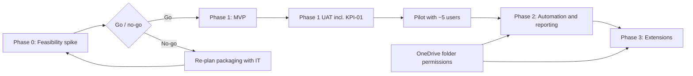
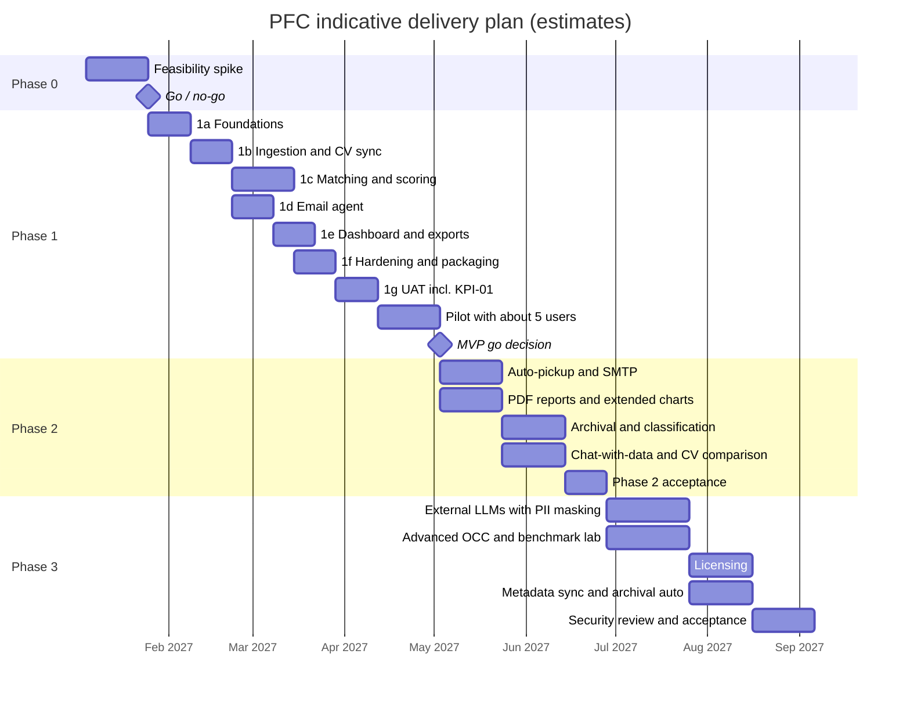

# PerfectFitCandidate (PFC) — Phased Delivery Plan

| Item | Value |
|---|---|
| Document | Phased delivery plan (Phase 0 – Phase 3) |
| Version | 1.0 |
| Status | Draft |
| Source of truth | [REQUIREMENTS_BASELINE.md](REQUIREMENTS_BASELINE.md) — Phase column of every REQ-\* table, decision log §16, open items §17 |
| Related documents | [BRD.md](BRD.md), [FDD.md](FDD.md), [TDD.md](TDD.md), [ARCHITECTURE.md](ARCHITECTURE.md), [WORKFLOW.md](WORKFLOW.md), [GUI_OCC_DESIGN.md](GUI_OCC_DESIGN.md), [FEASIBILITY.md](FEASIBILITY.md), [DASHBOARD_RESEARCH.md](DASHBOARD_RESEARCH.md) |

> All durations and effort figures in this document are **indicative estimates** for planning only. They assume a small delivery team (see [§9](#9-indicative-effort-and-timeline)) and will be re-baselined at the end of Phase 0 once corporate-laptop constraints are known.

---

## Table of contents

1. [Phasing principles](#1-phasing-principles)
2. [Phase overview](#2-phase-overview)
3. [Phase dependencies](#3-phase-dependencies)
4. [Phase 0 — Feasibility spike](#4-phase-0--feasibility-spike)
5. [Phase 1 — MVP](#5-phase-1--mvp)
6. [Phase 2 — Automation and reporting](#6-phase-2--automation-and-reporting)
7. [Phase 3 — Extensions, external LLMs and licensing](#7-phase-3--extensions-external-llms-and-licensing)
8. [Release and rollout approach](#8-release-and-rollout-approach)
9. [Indicative effort and timeline](#9-indicative-effort-and-timeline)
10. [Requirement traceability (REQ ID → phase)](#10-requirement-traceability-req-id--phase)
11. [Open questions](#11-open-questions)

---

## 1. Phasing principles

- **Prove the platform first.** Nothing is built at scale until a real locked-down Windows 11 Pro laptop has run the portable stack without admin rights (REQ-PKG-05).
- **Value early, measured by accuracy.** Phase 1 delivers the full manual matching loop (upload → match → review → approved email → dashboard) and measures **KPI-01 auto-match accuracy** in UAT.
- **Human in the loop throughout.** Every phase keeps per-profile email approval (REQ-EML-01) and treats scores as a shortlist for review (REQ-SCR-05).
- **Local and private by default.** External LLM providers and metadata sync are Phase 3 features; signed settings-package export/import moves approved configuration between local instances in Phase 1. External calls require an enabled Settings flag and PII masking + encryption (REQ-LLM-05, NFR-04).
- **Placeholders before features.** Where the baseline asks for "placeholder configuration" (auto-sync REQ-ING-04, external LLMs REQ-LLM-03), Phase 1 ships the disabled configuration and the plugin interface; the behaviour lands later.
- **One owning phase per requirement.** Each REQ ID is mapped to exactly one **delivery phase** — the phase in which it is fully delivered and accepted. Earlier partial increments (e.g. Phase 1 placeholders) are noted in the traceability table ([§10](#10-requirement-traceability-req-id--phase)).

## 2. Phase overview

| Phase | Name | Headline scope | Indicative duration |
|---|---|---|---|
| 0 | Feasibility spike | Corporate-laptop checks per [FEASIBILITY.md](FEASIBILITY.md): approved `.bat` / `.cmd` launcher, localhost, AV/EDR, Outlook COM, OneDrive sync folder, hardware and model benchmark smoke test | 2–3 weeks |
| 1 | MVP | Manual DL/CT upload, CV sync, eligibility + grade + location rules, seeded editable status map, Analyze JD → Confirm & Start, hybrid matching and 70/10/5/5/5/5 scores, bands, top-five unique-profile shortlist, email drafting + per-profile approval via Outlook COM, dashboard, OCC, authentication, audit, internal-domain allowlist, signed settings-package export/import, model add-on, portable ZIP | 12–14 weeks (incl. UAT and pilot) |
| 2 | Automation and reporting | Synced-folder auto-pickup of DL/CT, Outlook calendar follow-ups, PDF reports, chat-with-data, manual archival + housekeeping, internal/external classification, CV version comparison, SMTP | 8–10 weeks |
| 3 | Extensions | External LLM providers with PII masking/encryption, compatible API-version retries and direct local fallback, advanced OCC (scoring templates, model benchmark lab), archival automation, licensing (per-user ZIP + signed device licence), OneDrive metadata sync replacing or augmenting manual settings packages | 10–12 weeks |

## 3. Phase dependencies

Key cross-phase dependencies:

| Dependency | From | Needed by | Notes |
|---|---|---|---|
| Portable runtime proven on target laptop | Phase 0 | Phase 1 build | Embedded Python, llama.cpp, localhost binding (REQ-PKG-01..05) |
| Local model and embedding model shortlisted | Phase 0 smoke test | Phase 1 (final choice O-05) | Benchmarked further in Phase 1 |
| Outlook COM confirmed | Phase 0 | Phase 1 email agent | Fallback: copy draft / SMTP in Phase 2 |
| Corporate approvals for CV processing, Outlook automation and external LLM use (O-06) | Granted | Not a delivery gate | No candidate privacy notice is required |
| Plugin interfaces (ingestion, LLM provider, email transport — NFR-07) | Phase 1 | Phase 2 / 3 | Phase 2 and 3 features plug into Phase 1 interfaces |
| Scoring template versioning (REQ-SCR-01, REQ-MAT-08) | Phase 1 | Phase 3 advanced templates | |
| Audit log (REQ-AUTH-05) | Phase 1 | Phase 2 archival, Phase 3 external LLM calls | |
| OneDrive sync folder availability | Phase 0 check | Phase 2 auto-pickup, Phase 3 metadata packages | |

## 4. Phase 0 — Feasibility spike

### 4.1 Goals

Confirm, on a **real corporate Windows 11 Pro laptop** with standard (non-admin) rights, that the PFC technical approach is permitted and performant. Corporate approvals for CV processing, Outlook automation and external LLM use are granted and are not a pilot gate. Detailed test cases live in [FEASIBILITY.md](FEASIBILITY.md).

### 4.2 Scope

| Check | Purpose | Requirement |
|---|---|---|
| Unzip-and-run of a harmless portable bundle (embedded Python, `.bat` / `.cmd` launcher) | Corporate execution policy, SmartScreen, AV/EDR acceptance | REQ-PKG-01, REQ-PKG-03, REQ-PKG-05 |
| Local FastAPI server on `127.0.0.1` opened in the default browser | Loopback binding and firewall acceptance | REQ-AUTH-07 |
| llama.cpp CPU inference with a small quantized GGUF model; embedding model | RAM/latency on 16 GB CPU-only hardware | REQ-LLM-01, REQ-LLM-07, NFR-03 |
| SQLite + sqlite-vec (or Qdrant local) load | Vector store viability without services | Baseline §13, [TDD.md](TDD.md) |
| Outlook COM draft creation (no send) from the local process | Email transport availability | REQ-EML-04 |
| OneDrive / SharePoint synced folder visible in File Explorer | CV folder and future auto-pickup | REQ-IN-20, REQ-ING-04 |
| Read sample DL and CT `.xlsx` (header detection, text dates, formulas) | Parser approach against real files | REQ-IN-01, REQ-IN-10..13 |
| Hardware inventory (CPU, RAM, disk, architecture) | Model sizing and packaging | REQ-PKG-05 |
| Verify approved data-processing, Outlook automation and external-LLM controls | Confirm approved operating conditions; no candidate privacy notice or approval gate | O-06 |

### 4.3 Deliverables

- Feasibility report with pass/fail per check and evidence (completes [FEASIBILITY.md](FEASIBILITY.md) results section).
- Recommended packaging approach (launcher type, folder layout, data-folder location).
- Model and embedding shortlist with measured RAM and tokens/s.
- Vector-store recommendation input for [TDD.md](TDD.md).
- Verified operating conditions under the granted corporate approvals.
- Re-baselined Phase 1 plan.

### 4.4 Exit / acceptance criteria

| # | Criterion |
|---|---|
| P0-EX-01 | Portable bundle starts without admin rights and without being blocked or quarantined, or an IT-approved workaround is agreed. |
| P0-EX-02 | Local server reachable only on `127.0.0.1` from the default browser. |
| P0-EX-03 | A candidate local model runs within the NFR-03 footprint and completes a sample JD extraction in an acceptable time (threshold agreed in [FEASIBILITY.md](FEASIBILITY.md)). |
| P0-EX-04 | Outlook COM can create a draft, or the fallback (copy-to-clipboard / SMTP later) is accepted by the business. |
| P0-EX-05 | Sample DL and CT files parse with the expected header detection. |
| P0-EX-06 | Go / no-go decision recorded by Leadership with IT/Security input; granted corporate approvals are not additional pilot gates. |

### 4.5 Dependencies

Access to a representative corporate laptop; sample DL/CT/CV files; IT/Security contact.

### 4.6 Risks

| Risk | Mitigation |
|---|---|
| Unsigned executables blocked | Test early; request allow-listing or code signing; evaluate script-only launcher |
| CPU inference too slow | Smaller quantized model; keep LLM off the per-pair path (NFR-01); rely on deterministic scoring |
| Outlook COM blocked or new Outlook client in use | Accept draft-copy fallback for Phase 1; SMTP in Phase 2 |
| Endpoint policy blocks a runtime component | Validate on the target laptop in Phase 0 and resolve through IT-supported policy controls |

## 5. Phase 1 — MVP

### 5.1 Goals

Deliver the end-to-end manual matching loop for Analyst A, the analytics dashboards for Analysts B and C and leadership, and the OCC Admin controls — packaged as a portable ZIP — and **measure KPI-01 in UAT** before a pilot with ~5 users.

### 5.2 Scope / features

| Feature group | Contents | Key requirements |
|---|---|---|
| Roles, auth, security | Admin + Analyst roles (personas A/B/C and Leadership users); login with role dropdown; corporate email + admin-issued password; strong admin password with first-run setup; five failed attempts / 15-minute lockout / 60-minute idle timeout; localhost-only; audit log; encryption at rest where feasible | REQ-ROLE-01..04, REQ-AUTH-01..07 |
| Ingestion | Manual DL/CT upload; header-row detection; text-date and formula handling; key-based replace; upload preview; ingestion log with hash no-op; OCC approve/modify with uploaded-change notification flag; auto-sync **placeholder configuration** (disabled) | REQ-IN-01..03, REQ-IN-10..14, REQ-ING-01..03, REQ-ING-05, REQ-ING-06, REQ-ING-04 (placeholder) |
| CVs and identity | Configurable resume folder; per-candidate and global Sync; extraction; missing-CV tolerance; Incomplete Candidate Information prompt; identity-match signals; **basic** CV versioning (best CV per person, drill-down) | REQ-IN-20..25 |
| Eligibility | Seeded editable source-status mapping; unmapped statuses stay eligible at priority 2 / binary score 0 and are flagged; unparseable Bench End Date stays eligible with "pending review"; excluded-record view | REQ-ELIG-01..08 |
| Matching and scoring | Analyze JD → Confirm & Start (single and bulk); hybrid vector + keyword + synonym matching; synonym tracker in OCC; ±1 grade rule; location assessment; 70/10/5/5/5/5 versioned template with `status_score_mode`; bands; top five unique candidate profiles; Weak-only counts as no suitable candidate and is separately displayed; breakdown; distinct mandatory gaps; persisted versions; incremental re-scoring; overrides and cached CV extraction removal by OCC Admin | REQ-MAT-01..10, REQ-GRD-01, REQ-GRD-02, REQ-LOC-01, REQ-SCR-01..05 |
| Results and dashboard | Agreed result columns with masked email after name; full filter set; quality-check panel; Grade → JD count and scrollable DL rows; top-five skills in pool and demand vs. eligible-bench supply stacked by Available Capacity Y/N for display only; bench-status distribution and scrollable CT rows; CSV/Excel export; premium-feel CSS | REQ-OUT-01..06, REQ-OUT-08, REQ-OUT-10, REQ-OUT-11, REQ-OUT-07 (core), REQ-OUT-09 (CSV) |
| Email agent | LLM-drafted editable email from shipped template; top four from the top-five shortlist pre-selected, with individual approval; Outlook COM send; resource-team CC; Draft → Approved → Sent / Failed; duplicate prevention; 24 h KPI tracking | REQ-EML-01..03, REQ-EML-05..07, REQ-EML-04 (COM) |
| LLM | llama.cpp local model; default nomic-embed-text-v1.5 embeddings via ONNX Runtime; JD/CV parsing, summarisation, drafting; static approved-model list; external-provider placeholder disabled until Phase 3 | REQ-LLM-01, REQ-LLM-07, REQ-LLM-02 (non-chat), REQ-LLM-06 (static), REQ-LLM-03 (placeholder) |
| Packaging | Portable ZIP with embedded Python, llama.cpp, models, built React frontend, defaults and dummy placeholders for inactive settings; `.bat` / `.cmd` launcher; single instance; upgrade keeps data folder | REQ-PKG-01..04 |
| Internal-domain classification | Default internal-domain allowlist ships in the initial ZIP; Internal / External / Unknown classification with audited override | REQ-CLS-01, REQ-CLS-02 |
| Settings packages | OCC Admin export and Analyst import/preview/atomic apply/audit/rollback; signed monotonic-version package | REQ-OCC-01/02 |
| Embedding model add-on | OCC Admin imports approved signed `.pfcmodel`, triggers re-embedding and records model version per vector | REQ-OCC-03 |
| Non-functional | 500 × 500 re-match in minutes; dashboard < 2 s; offline-first; footprint; reproducibility; usability; plugin interfaces | NFR-01..07 |

### 5.3 Suggested internal increments (indicative)

| Increment | Focus |
|---|---|
| 1a — Foundations | Repo/build/packaging skeleton, auth, roles, audit, SQLite schema, launcher |
| 1b — Ingestion | DL/CT parsers, preview, keys, ingestion log, OCC approve/modify, CV folder + Sync, extraction |
| 1c — Matching | Eligibility, Analyze JD → Confirm & Start, embeddings + vector store, synonyms, score model, bands, evidence, overrides |
| 1d — Outreach | Email template, LLM drafting, approval flow, Outlook COM, sent tracking |
| 1e — Dashboard | Results grid, filters, header summary, demand/bench/match analytics, exports, visual polish |
| 1f — Hardening | Performance (NFR-01), quality panel, security review, packaging on the Phase 0 laptop |
| 1g — UAT and pilot | KPI-01 labelling and measurement, UAT, pilot with ~5 users |

### 5.4 Deliverables

- Portable PFC ZIP (MVP release) and release notes.
- Default email template, default scoring template v1, default synonym list, default status priority list.
- User guide (Analyst) and admin guide (OCC).
- UAT report including **KPI-01 measurement** and baselines for KPI-02 to KPI-05.
- Updated FDD / TDD / GUI_OCC_DESIGN reflecting as-built decisions; resolved O-03, O-04, O-05, O-07.

### 5.5 Exit / acceptance criteria

| # | Criterion |
|---|---|
| P1-EX-01 | All Phase 1 REQ IDs in [§10](#10-requirement-traceability-req-id--phase) pass UAT test cases (Must = 100 %; Should items either passed or explicitly deferred by the product owner). |
| P1-EX-02 | **KPI-01 measured** in UAT using the method in [BRD.md §8.1](BRD.md#81-kpi-01-measurement-method-proposed): labelled sample of demands, blind analyst shortlist, hit-rate@5 and precision@5 reported on a held-out set; target agreed by Leadership and either met or a remediation plan accepted. Measurement CLI and definitions: [KPI01.md](KPI01.md). |
| P1-EX-03 | Baselines captured for KPI-02 (analyst effort), KPI-03 (24 h email turnaround), KPI-04 (match coverage), KPI-05 (data quality). |
| P1-EX-04 | Quality-check panel (REQ-OUT-10) passes on the UAT dataset: valid filled Bench End Date excluded, unparseable dates remain eligible with pending-review flag, ±1 grade, emails copied exactly, masked email after name, evidence and gaps on every row. |
| P1-EX-05 | No email can be sent without per-profile approval; duplicate-send prevention verified. |
| P1-EX-06 | 500 × 500 full re-match within the NFR-01 target on the Phase 0 laptop; dashboard interactions < 2 s. |
| P1-EX-07 | Runs from the ZIP without admin rights on the target laptop, offline except for Outlook / OneDrive. |
| P1-EX-08 | Security review complete (auth, localhost binding, audit, masking, encryption at rest); granted corporate approvals (O-06) are followed; no candidate privacy notice is required. |
| P1-EX-09 | Pilot of 2–4 weeks with ~5 users completed; go decision for Phase 2. |

### 5.6 Dependencies

Phase 0 go decision; representative DL/CT/CV data; SPOC names and resource-team list; analyst time for KPI-01 labelling.

### 5.7 Risks

| Risk | Mitigation |
|---|---|
| KPI-01 below expectation | Tune skills sub-weights (O-04) and synonyms on a tuning split; improve JD extraction prompts; analyst confirmation of JD requirements |
| Scope creep from Phase 2 items | Strict traceability to the phase table; product-owner change control |
| Local LLM extraction quality / latency | Deterministic scoring; LLM only for extraction and drafting; benchmark candidates (O-05) |
| Real-data quality issues | Upload preview, warnings, "Insufficient data" band, KPI-05 reporting |
| Analyst availability for UAT | Schedule labelling sessions at Phase 1 start |

## 6. Phase 2 — Automation and reporting

### 6.1 Goals

Reduce repetitive effort and broaden reporting once the MVP loop is trusted: automatic file pickup, follow-ups, PDF reports, conversational access to data, and data lifecycle management.

### 6.2 Scope / features

| Feature | Contents | Key requirements |
|---|---|---|
| Synced-folder auto-pickup | DL and CT watchers on analyst-configured mapped drive / OneDrive sync folder with file pattern; same validation and preview rules as manual upload | REQ-ING-04 |
| Calendar follow-ups | Outlook follow-up reminder one business day after sending | REQ-EML-08 |
| PDF reports | PDF download of dashboards / analytics and match results | REQ-OUT-09 |
| Extended analytics | Further charts per [DASHBOARD_RESEARCH.md](DASHBOARD_RESEARCH.md) | REQ-OUT-07 |
| Chat-with-data | Local-LLM Q&A over demands, bench and results | REQ-LLM-02 |
| Manual archival + housekeeping | OCC-triggered archival with preview of closed demands and off-bench resources; archived records searchable/exportable; purge temp/logs/orphan vectors; vacuum/backup; retention setting | REQ-ARC-01, REQ-ARC-02, REQ-ARC-03 |
| CV version comparison | Side-by-side comparison of a candidate's CV versions and scores | REQ-IN-24 |
| SMTP transport | Optional SMTP alongside Outlook COM | REQ-EML-04 |

### 6.3 Deliverables

Phase 2 ZIP release (in-place upgrade preserving the data folder, REQ-PKG-04); updated user/admin guides; retention setting agreed with data governance; Phase 2 test report.

### 6.4 Exit / acceptance criteria

| # | Criterion |
|---|---|
| P2-EX-01 | All Phase 2 REQ IDs in [§10](#10-requirement-traceability-req-id--phase) pass acceptance tests. |
| P2-EX-02 | Auto-pickup ingests a dropped DL/CT within the configured interval, with identical results to manual upload of the same file; identical files are no-ops (REQ-ING-06). |
| P2-EX-03 | Archival preview matches what is archived; archived data remains searchable and exportable; no active-view regressions. |
| P2-EX-04 | PDF report content matches on-screen dashboard values. |
| P2-EX-05 | Chat-with-data answers a defined set of reference questions correctly offline. |
| P2-EX-06 | Upgrade from Phase 1 retains all data, results and audit history. |
| P2-EX-07 | KPI-01 re-measured; no regression versus Phase 1 baseline. |

### 6.5 Dependencies

Phase 1 pilot go decision; OneDrive / mapped folder access for DL/CT; SMTP server details (if used); OCC Admin sets the configurable retention value.

### 6.6 Risks

| Risk | Mitigation |
|---|---|
| Partially synced or locked files picked up | Stable-file detection (size/time settle), hash check, preview before commit where configured |
| Chat answers hallucinate | Ground answers in queried data; show source rows; scoring unaffected (REQ-LLM-02) |
| Archival removes data still needed | Preview, manual trigger only, archive (not delete) semantics |
| SMTP not permitted | Keep Outlook COM as primary |

## 7. Phase 3 — Extensions, external LLMs and licensing

### 7.1 Goals

Extend PFC beyond a single local instance and model: governed use of external LLMs, advanced admin tooling, automated lifecycle management, controlled distribution, and approved sharing of structured metadata.

### 7.2 Scope / features

| Feature | Contents | Key requirements |
|---|---|---|
| External LLM providers | Approved providers with user-supplied tokens stored encrypted; active Settings flag required | REQ-LLM-03 |
| PII masking + encryption | Reversible tokenisation of names, emails, phones and identifiers before any external call; TLS; encrypted cache; local-only re-identification | REQ-LLM-05, NFR-04 |
| Smart fallback | Retry compatible API versions, then fall directly to the local model; no external-provider chaining | REQ-LLM-04 |
| Advanced OCC | Role-specific scoring templates; model benchmark lab (extraction accuracy, latency, RAM) publishing the approved list | REQ-LLM-06, REQ-SCR-01 (extended) |
| Archival automation | Scheduled archival and housekeeping | REQ-ARC-04 |
| Licensing | Admin "Generate User ZIP"; device activation request; admin-signed single-user, single-device licence (default 30 days); no private keys in ZIP | REQ-AUTH-08 |
| OneDrive metadata sync packages | Encrypted, incremental metadata packages via an approved OneDrive shared location; admin import, dedupe, audit (docx §10; D-03) | No dedicated REQ ID — see [§11](#11-open-questions) |

### 7.3 Deliverables

Phase 3 ZIP release; admin ZIP-generation and licence-signing tooling (admin-only); provider plugin(s); PII masking test evidence; security and privacy review report; metadata package schema approved by data governance.

### 7.4 Exit / acceptance criteria

| # | Criterion |
|---|---|
| P3-EX-01 | All Phase 3 REQ IDs in [§10](#10-requirement-traceability-req-id--phase) pass acceptance tests. |
| P3-EX-02 | Inspection of outbound external-LLM payloads shows no unmasked PII across a defined test set; every external call is audit-logged (REQ-AUTH-05). |
| P3-EX-03 | Fallback verified for auth failure, rate limit, timeout and API version conflict, ending at the local model. |
| P3-EX-04 | A forwarded ZIP without a valid device licence gives no access; licence expiry and renewal behave as specified. |
| P3-EX-05 | Metadata packages contain only approved fields (no original CVs or raw text), import idempotently and are audit-logged. |
| P3-EX-06 | Security and privacy review complete; external calls require the Settings active flag, masking and encryption. |
| P3-EX-07 | KPI-01 re-measured per approved model / template; no regression versus Phase 1 baseline. |

### 7.5 Dependencies

Provider tokens and active Settings flags; admin signing-key protection; OneDrive shared-folder permissions; approved metadata schema; stable device-fingerprint approach on corporate Windows.

### 7.6 Risks

| Risk | Mitigation |
|---|---|
| PII leakage to external providers | Masking + encryption mandatory, opt-in per provider, payload tests, audit (REQ-LLM-05) |
| Provider API changes / version conflicts | Smart fallback (REQ-LLM-04); local model always available |
| Device fingerprint unstable under corporate policy | Test on multiple laptops; admin re-issue licence |
| Offline revocation not possible before expiry | Short default term (30 days); documented residual risk |
| Metadata sync conflicts / duplicates | Idempotent packages, versioning, admin dedupe |

## 8. Release and rollout approach

### 8.1 Environments and releases

| Stage | Where | Data | Who |
|---|---|---|---|
| Development | Developer machines + Windows 11 test laptop | Synthetic / anonymised DL, CT, CVs | Delivery team |
| UAT | Corporate laptop (Phase 0 reference device) | Representative real data under granted corporate approvals | Analysts A/B/C, OCC Admin |
| Pilot | Each pilot user's own laptop | Live DL/CT/CVs | ~5 named users |
| General use | Same ~5 users (expansion only on Leadership decision) | Live | Users |

Each release is a versioned portable ZIP with release notes and a checksum. Upgrade = replace the app folder, keep the data folder (REQ-PKG-04); database migrations run on first start with an automatic backup.

### 8.2 Pilot with ~5 users

| Step | Activity | Duration (indicative) |
|---|---|---|
| 1 | Onboarding: OCC Admin first-run setup, users created, resource-team list, SPOCs, template and synonyms loaded | 2–3 days |
| 2 | Wave 1: OCC Admin and Analyst A run real DL/CT cycles in parallel with the existing Excel process (shadow mode); compare shortlists | 1–2 weeks |
| 3 | Wave 2: Analysts B and C and leadership use dashboards; Analyst A sends approved emails from PFC | 1–2 weeks |
| 4 | Pilot review: KPI-01..05, defect list, feedback; go / fix decision | 2–3 days |

Support during pilot: named delivery contact, issue log, weekly check-in; rollback = continue the Excel process (PFC does not modify source workbooks).

### 8.3 Change control

Scope changes are raised against REQ IDs in [REQUIREMENTS_BASELINE.md](REQUIREMENTS_BASELINE.md); a change in phase is recorded in the baseline's Phase column and in [§10](#10-requirement-traceability-req-id--phase).

## 9. Indicative effort and timeline

**All figures are estimates** for a small team — indicatively 1 product owner (part-time), 2 full-stack developers (Python/FastAPI + React), 0.5 QA, plus analyst time for UAT — and exclude corporate approval lead times. They will be re-baselined after Phase 0.

| Phase | Indicative duration | Indicative effort (person-weeks) | Main drivers |
|---|---|---|---|
| 0 | 2–3 weeks | 3–5 | Laptop access, IT responsiveness |
| 1 | 12–14 weeks (incl. 2 weeks UAT, 2–4 weeks pilot) | 24–32 | Matching quality, packaging, dashboard breadth |
| 2 | 8–10 weeks | 14–20 | Auto-pickup robustness, PDF, chat |
| 3 | 10–12 weeks | 20–26 | Security/privacy reviews, licensing, metadata sync |

The Gantt chart uses a placeholder start date; only relative durations are meaningful.

## 10. Requirement traceability (REQ ID → phase)

Every REQ ID in [REQUIREMENTS_BASELINE.md](REQUIREMENTS_BASELINE.md) maps to **exactly one delivery phase** (the phase in which it is fully delivered and accepted). The "Baseline phase" column copies the baseline; "Earlier increment" notes partial delivery in a previous phase.

| REQ ID | Summary | Pri | Baseline phase | Delivery phase | Earlier increment |
|---|---|---|---|---|---|
| REQ-ROLE-01 | Admin (OCC) and Analyst roles | M | 1 | 1 | |
| REQ-ROLE-02 | Analyst personas A/B/C; all can upload DL/CT | M | 1 | 1 | |
| REQ-ROLE-03 | OCC Admin capabilities | M | 1 | 1 | |
| REQ-ROLE-04 | Analysts cannot change weights / domains / settings | M | 1 | 1 | |
| REQ-IN-01 | DL sheet located by header row | M | 1 | 1 | |
| REQ-IN-02 | DL key `Code Requisition`; replace on re-upload | M | 1 | 1 | |
| REQ-IN-03 | Normalise JD text | M | 1 | 1 | |
| REQ-IN-10 | CT header-row detection | M | 1 | 1 | |
| REQ-IN-11 | CT key ShortName + Email Address | M | 1 | 1 | |
| REQ-IN-12 | Excel and text dates (UK day-first) | M | 1 | 1 | |
| REQ-IN-13 | Formula cells: cached values, never executed | M | 1 | 1 | |
| REQ-IN-14 | Never construct / correct emails | M | 1 | 1 | |
| REQ-IN-20 | Configurable resume folder | M | 1 | 1 | |
| REQ-IN-21 | Per-candidate and global Sync | M | 1 | 1 | |
| REQ-IN-22 | Missing resume not a blocker | M | 1 | 1 | |
| REQ-IN-23 | CV extraction and Incomplete Candidate Information | M | 1 | 1 | |
| REQ-IN-24 | Multiple CV versions; comparison | S | 1 (basic) / 2 (comparison) | 2 | Phase 1: basic versioning, best CV per person, drill-down |
| REQ-IN-25 | Email as identity signal; ambiguous matches flagged | S | 1 | 1 | |
| REQ-ELIG-01 | Eligibility conditions | M | 1 | 1 | |
| REQ-ELIG-02 | Excluded statuses | M | 1 | 1 | |
| REQ-ELIG-03 | Status priority order (OCC-configurable) | M | 1 | 1 | |
| REQ-ELIG-04 | Flag allocated / proposed / CV with client | M | 1 | 1 | |
| REQ-ELIG-05 | Blank Bench End Date not clearance | M | 1 | 1 | |
| REQ-ELIG-06 | Available Capacity not used for availability | M | 1 | 1 | |
| REQ-ELIG-07 | Editable seeded source-status map; unmapped statuses included and flagged | M | 1 | 1 | |
| REQ-ELIG-08 | "Excluded from matching" view | S | 1 | 1 | |
| REQ-ING-01 | Manual GUI upload | M | 1 | 1 | |
| REQ-ING-02 | Upload preview | S | 1 | 1 | |
| REQ-ING-03 | Immediate apply; OCC notification flag, approve/modify | M | 1 | 1 | |
| REQ-ING-04 | Auto-sync plugin for DL and CT | M (config) / S (impl) | 1 / 2 | 2 | Phase 1: placeholder configuration, disabled |
| REQ-ING-05 | Resume folder path in Settings | M | 1 | 1 | |
| REQ-ING-06 | Ingestion log; identical-hash no-op | S | 1 | 1 | |
| REQ-MAT-01 | Hybrid vector + keyword / synonym matching | M | 1 | 1 | |
| REQ-MAT-02 | Analyze JD → Confirm & Start | M | 1 | 1 | |
| REQ-MAT-03 | Ranked 0–100 % list, top 5 unique candidate profiles per requisition | M | 1 | 1 | |
| REQ-MAT-04 | Weak Match inclusion rule | M | 1 | 1 | |
| REQ-MAT-05 | Skill-synonym tracker in OCC | M | 1 | 1 | |
| REQ-MAT-06 | No inference without evidence; never invent | M | 1 | 1 | |
| REQ-MAT-07 | Reuse extracted CVs; incremental re-scoring; OCC Admin can remove cached CV extractions | S | 1 | 1 | |
| REQ-MAT-08 | Persist model / template / JD / CV versions | M | 1 | 1 | |
| REQ-MAT-09 | Human review and audited overrides | S | 1 | 1 | |
| REQ-MAT-10 | Requisition, account, BU, grade, location and full match-results filter set | M | 1 | 1 | |
| REQ-GRD-01 | Exact / ±1 grade; others excluded | M | 1 | 1 | |
| REQ-GRD-02 | Strong adjacent-grade not downgraded | M | 1 | 1 | |
| REQ-LOC-01 | Location influences ranking; onsite gaps recorded | M | 1 | 1 | |
| REQ-SCR-01 | Admin-only versioned scoring template (70/10/5/5/5/5) | M | 1 | 1 | Phase 3 adds role-specific templates (advanced OCC) |
| REQ-SCR-02 | Match bands | M | 1 | 1 | |
| REQ-SCR-03 | Missing mandatory criteria flagged distinctly | M | 1 | 1 | |
| REQ-SCR-04 | Per-component score breakdown | M | 1 | 1 | |
| REQ-SCR-05 | Scores are relative metrics | M | 1 | 1 | |
| REQ-OUT-01 | Match results columns | M | 1 | 1 | |
| REQ-OUT-02 | Values copied exactly | M | 1 | 1 | |
| REQ-OUT-03 | Email / phone masking with audited unmask | M | 1 | 1 | |
| REQ-OUT-04 | Dashboard header summary | M | 1 | 1 | |
| REQ-OUT-05 | Grade → JD count; DL rows ordered by Position Start Date descending | M | 1 | 1 | |
| REQ-OUT-06 | Top-five pool skills and demand vs. eligible-bench supply; CT rows ordered by Bench Start Date descending | M | 1 | 1 | |
| REQ-OUT-07 | Match / communication analytics | S | 1 / 2 | 2 | Phase 1: coverage, band distribution, email status counts |
| REQ-OUT-08 | Code Requisition, Account Name, BU, Grade, Location, region, band, status, candidate type, identity, mandatory-skill and score-range filters | M | 1 | 1 | |
| REQ-OUT-09 | PDF report; CSV / Excel export | S | 2 (PDF) / 1 (CSV) | 2 | Phase 1: CSV / Excel export |
| REQ-OUT-10 | Quality-check validation panel | S | 1 | 1 | |
| REQ-OUT-11 | Icons, indicators, imagery | C | 1 | 1 | |
| REQ-EML-01 | Per-profile Approve; top 4 suggested | M | 1 | 1 | |
| REQ-EML-02 | Rich, editable LLM email body | M | 1 | 1 | |
| REQ-EML-03 | Editable default template in ZIP | M | 1 | 1 | |
| REQ-EML-04 | Outlook COM primary; SMTP optional | M (COM) / S (SMTP) | 1 / 2 | 2 | Phase 1: Outlook COM |
| REQ-EML-05 | Candidate To; resource-team CC | M | 1 | 1 | |
| REQ-EML-06 | Sent-flag tracking; no reply parsing | M | 1 | 1 | |
| REQ-EML-07 | 24 h turnaround KPI | S | 1 | 1 | |
| REQ-EML-08 | Outlook follow-up reminder one business day after sending | S | 2 | 2 | |
| REQ-LLM-01 | Local llama.cpp default model | M | 1 | 1 | |
| REQ-LLM-02 | LLM uses incl. chat-with-data; deterministic scoring | M | 1 / 2 | 2 | Phase 1: JD/CV parsing, summarisation, drafting |
| REQ-LLM-03 | External providers with user token | M (config) / S (impl) | 1 / 3 | 3 | Phase 1: placeholder configuration, disabled |
| REQ-LLM-04 | Retry compatible API versions, then direct local fallback (no external-provider chain) | M | 3 | 3 | |
| REQ-LLM-05 | PII masking + encryption for external calls | M | 3 | 3 | |
| REQ-LLM-06 | Model benchmarking and approved list | S | 3 (lab) / 1 (static list) | 3 | Phase 1: static approved-model list |
| REQ-LLM-07 | Local embedding model, versioned | M | 1 | 1 | |
| REQ-AUTH-01 | Login with role dropdown | M | 1 | 1 | |
| REQ-AUTH-02 | Analyst email + admin-issued password | M | 1 | 1 | |
| REQ-AUTH-03 | Strong admin password; first-run setup | M | 1 | 1 | |
| REQ-AUTH-04 | Salted slow hashes; five attempts, 15-minute lockout, 60-minute idle timeout | M | 1 | 1 | |
| REQ-AUTH-05 | Audit log | M | 1 | 1 | |
| REQ-AUTH-06 | Encryption at rest where feasible | S | 1 | 1 | |
| REQ-AUTH-07 | Bind to 127.0.0.1 only | M | 1 | 1 | |
| REQ-AUTH-08 | Licensing (per-user ZIP, signed device licence) | S | 3 | 3 | |
| REQ-CLS-01 | Default internal-domain allowlist ships in initial ZIP | S | 1 | 1 | |
| REQ-CLS-02 | Internal / External / Unknown classification | S | 1 | 1 | |
| REQ-ARC-01 | Archive closed demands and off-bench resources | M | 2 | 2 | |
| REQ-ARC-02 | Manual archival trigger with preview | M | 2 | 2 | |
| REQ-ARC-03 | Housekeeping and retention | S | 2 | 2 | |
| REQ-ARC-04 | Archival automation | C | 3 | 3 | |
| REQ-PKG-01 | Portable ZIP, no admin rights | M | 1 | 1 | |
| REQ-PKG-02 | Bundled runtime, model, frontend, defaults and dummy placeholders for inactive settings | M | 1 | 1 | |
| REQ-PKG-03 | `.bat` / `.cmd` launcher; `.cmd` approved; no Ollama | M | 1 | 1 | |
| REQ-PKG-04 | Single instance; data folder kept on upgrade | M | 1 | 1 | |
| REQ-PKG-05 | Feasibility on real corporate laptop | M | 0/1 | 0 | Re-confirmed with the packaged MVP in Phase 1 (P1-EX-07) |
| REQ-OCC-01 | OCC Admin exports signed, versioned settings package | M | 1 | 1 | |
| REQ-OCC-02 | Analyst imports settings package with validation, preview, atomic apply, audit and rollback | M | 1 | 1 | |
| REQ-OCC-03 | Signed embedding-model add-on import; trigger re-embedding and record model version per vector | S | 1 | 1 | |

Summary: Phase 0 = 1, Phase 1 = 79, Phase 2 = 12, Phase 3 = 6 (98 REQ IDs).

KPIs and NFRs are cross-cutting: **KPI-01 to KPI-05** are first measured in Phase 1 UAT/pilot and re-measured in each later phase; **NFR-01 to NFR-07** are acceptance criteria from Phase 1 onwards (NFR-04 extended in Phase 3 for external providers).

## 11. Open questions

Baseline decision items O-01..O-11 are resolved and recorded in [REQUIREMENTS_BASELINE.md](REQUIREMENTS_BASELINE.md) §16–17. Remaining planning questions:

| # | Question | Proposed handling |
|---|---|---|
| PQ-01 | **OneDrive metadata sync packages** are in the Phase 3 summary and D-03 but have no REQ ID in the baseline. | Resolved: Phase 1 uses REQ-OCC-01/02 manual settings packages; Phase 3 metadata sync replaces or augments them. |
| PQ-02 | **Role-specific scoring templates** (advanced OCC) have no separate REQ ID; REQ-SCR-01 covers a single versioned template in Phase 1. | Confirm whether to extend REQ-SCR-01 or add a new Phase 3 REQ ID. |
| PQ-03 | Baseline open item O-06 (corporate approval) may take longer than Phase 1 build. | Resolved: corporate approvals are granted; they do not gate the pilot and no candidate privacy notice is required. |
| PQ-04 | Team size and availability are not defined. | Effort figures in §9 are placeholders; re-baseline after Phase 0. |
| PQ-05 | Pilot length (2–4 weeks) and shadow-mode duration. | Leadership to confirm. |
| PQ-06 | Should Phase 2 and Phase 3 items be re-prioritised after pilot feedback (e.g. PDF reports earlier)? | Review at the Phase 1 pilot review. |
