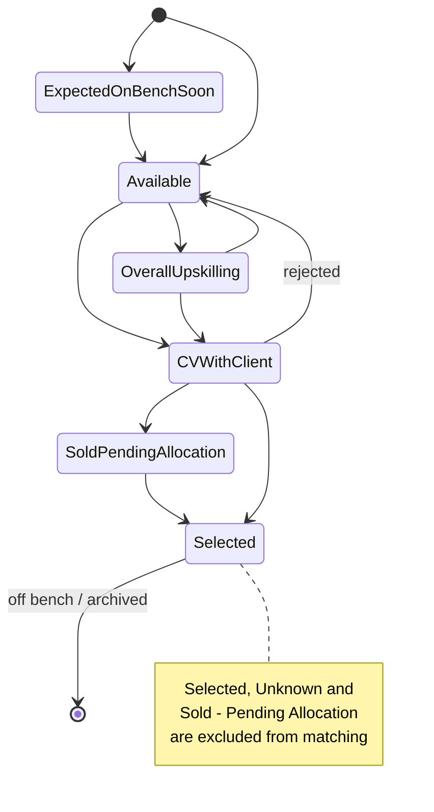

# PerfectFitCandidate (PFC) — Requirements Baseline

| Item | Value |
|---|---|
| Document | Consolidated requirements baseline (single source of truth for all PFC design documents) |
| Version | 1.0 (documentation-only baseline, no application code yet) |
| Sources | Project brief (chat), [`reference/Project-PerfectFitCandidate.docx`](reference/Project-PerfectFitCandidate.docx), [`reference/DL-CT-Metadata.xlsx`](reference/DL-CT-Metadata.xlsx), [`reference/Application-Design.png`](reference/Application-Design.png) |
| Precedence | Where sources conflicted, the decisions in [§16 Decision log](#16-decision-log) apply |

Requirement IDs (`REQ-<AREA>-NN`) are referenced by the BRD, FDD, TDD, WORKFLOW, GUI and PHASES documents. The priority column uses MoSCoW (M = Must, S = Should, C = Could) and the phase column refers to [PHASES.md](PHASES.md).

---

## 1. Product summary

PerfectFitCandidate (PFC) is an internal, local-first web application that matches **bench resources** (people currently on, or soon to be on, the bench) to **open demands** (job requisitions). It replaces a manual Excel-based process where:

- **Analyst A** compares every bench candidate's skills against every JD and produces the top 5 matches per JD with a match %, gaps/checks and eligibility evidence, then emails the top candidates asking them to tailor their CV to the JD.
- **Analyst B** analyses the Demand List for trends (e.g. top 5 skills in demand, top 3 accounts by JD count).
- **Analyst C** analyses the Bench/Candidate Tracker for trends (e.g. top 5 skills in the pool, grade histogram, bench timeline).

| Attribute | Value |
|---|---|
| Users | Leadership + analysts, ~5 named users (Analyst personas A/B/C + OCC Admin) |
| Data volume | 100–500 demands and 100–500 resources at a time (plus history/archive) |
| Deployment | Single instance per user, portable ZIP on a locked-down Windows 11 Pro corporate laptop, mostly offline |
| Primary success metric | **Auto-match accuracy** (see [§14](#14-success-metrics)) |
| Nature of output | A ranked shortlist for **human review** — never an automated staffing or selection decision |

## 2. Users, roles and personas

| ID | Requirement | Pri | Phase |
|---|---|---|---|
| REQ-ROLE-01 | Two system roles: **Admin** (OCC — Object Control Center, full privileges) and **Analyst**. | M | 1 |
| REQ-ROLE-02 | Analyst personas A (matching + candidate email), B (demand analytics), C (bench analytics) all use the **Analyst** role; every analyst can upload the latest DL and CT. | M | 1 |
| REQ-ROLE-03 | OCC Admin approves or modifies existing DL and CT entries, manages resource-team email list, skill-synonym tracker, scoring template, internal email domains, approved LLM models, users and admin settings. OCC is a special admin-only section inside the main GUI. | M | 1 |
| REQ-ROLE-04 | Analysts cannot change scoring weights, internal email domains or admin settings. | M | 1 |

### OCC configuration packages

| ID | Requirement | Pri | Phase |
|---|---|---|---|
| REQ-OCC-01 | OCC Admin can export one signed, versioned settings package named `PFC-settings-v<N>.pfcpkg` (ZIP containing versioned JSON, manifest and Ed25519 signature; monotonic integer version). Include synonyms, scoring template/weights, status list and mapping, grade list, resource-team list, internal-domain allowlist, approved provider/model settings without secrets/tokens, DL/CT approvals, and Analyst accounts (corporate email, role, salted slow hash of an Admin-issued one-time password, `must_change_password=true`). Generate the signing key pair on the Admin instance, protect the private key (DPAPI where available), and embed the matching public key in the distributed app ZIP. A shared/synced folder is the default distribution channel; if unavailable or unsuccessful, the Admin may send the file directly via MS Teams or email. Trust is based on signature validation, not the channel. | M | 1 |
| REQ-OCC-02 | An Analyst can import a settings package from Settings via file picker or from an `inbox\` folder detected at startup. Validate signature, schema version, app-version compatibility and a version newer than installed; reject older/equal versions unless an Admin-signed rollback is used. Show a change preview, apply atomically on confirmation (all-or-nothing, with a clear error on failure), audit-log the import and keep the previous version for one-click rollback. Imported one-time passwords must be changed at first login. Phase 3 metadata sync replaces or augments this Phase 1 manual export/import flow. | M | 1 |
| REQ-OCC-03 | OCC Admin can check for and update the approved embedding model by importing a signed `.pfcmodel` add-on through the settings-package import flow. After import, trigger re-embedding and retain the model version recorded for each vector. | M | 1 |

Capability matrix (from the docx, adapted to Admin/Analyst):

| Capability | Analyst | Admin (OCC) |
|---|---|---|
| Upload DL / CT / sync resumes | Yes | Yes |
| Edit JD extracted requirements before scoring | Yes | Yes (may define defaults) |
| Approve / modify existing DL & CT entries | No (upload only) | Yes |
| Choose active LLM model | From admin-approved list | Benchmark and approve list |
| Change scoring weights / templates | No | Yes |
| View candidate names | Yes | Yes |
| Unmask email / phone | Yes, logged | Yes, logged |
| Configure internal email domains, resource-team list, synonyms | No | Yes |
| Approve and send candidate emails | Yes | Yes |
| Generate per-user ZIP / issue licences | No | Yes (Phase 3) |

## 3. Inputs

### 3.1 Demand List (DL) — `.xlsx`

| ID | Requirement | Pri | Phase |
|---|---|---|---|
| REQ-IN-01 | DL is an `.xlsx` workbook with a **single sheet whose name varies**; the importer must locate the sheet by header row, not by sheet name. | M | 1 |
| REQ-IN-02 | Unique key = `Code Requisition`. Re-uploads **replace** existing rows with the same key (duplicates auto-removed/replaced with the newest entry). | M | 1 |
| REQ-IN-03 | JD text may contain markdown, bullets, code fences and mis-encoded bullet characters (`?`); the parser must normalise this text. | M | 1 |

| Field | Type | Notes |
|---|---|---|
| Code Requisition | VAR | Unique ID, format `T1XXXX` / `T2XXXX` (sample data also contains other alphanumeric IDs — validate as warning, not reject) |
| Position Start Date | DATE | Fixed date, mostly future, may be past |
| Account Name | VAR | Client/account |
| Code Local Grade | CHOICE | A3 → A4 → B1 → B2 → C1 → C2 → D1 → D2 → E1 |
| Demand Request Name | VAR | Role title (e.g. `TC14_Data Business Analyst_UK_London_D1_BUK`) |
| Region | VAR | Demand location (used as role location) |
| BU | VAR | Business unit, e.g. BCM, INS |
| Owner | VAR | Demand owner |
| JD | LIST / text | Detailed job description |

### 3.2 Bench Tracker / ActivityTracker / Candidate Tracker (CT) — `.xlsx`

"Bench Tracker", "ActivityTracker" and "Candidate Tracker (CT)" refer to the **same file**.

| ID | Requirement | Pri | Phase |
|---|---|---|---|
| REQ-IN-10 | CT header row may not be the first row (sample has a title row "Bench Team – Front Sheet"); first column header may be blank (it holds ShortName). Detect header row by known column names. | M | 1 |
| REQ-IN-11 | Unique combination key = `ShortName` + `Email Address`. Re-uploads replace matching rows. | M | 1 |
| REQ-IN-12 | Dates appear both as Excel dates and as text such as `Wed 4/11/2026` (UK day-first); the parser must handle both and flag unparseable values. | M | 1 |
| REQ-IN-13 | `Tracker` and `Group Owner` cells may contain formulas (`HYPERLINK`, `INDEX/MATCH` to external lists); read cached values, keep the link text, never execute formulas. | M | 1 |
| REQ-IN-14 | Never construct, infer or correct an email address — copy it exactly from the CT. | M | 1 |

| Field | Type | Notes |
|---|---|---|
| ShortName | VAR | Part of unique key |
| Email Address | VAR | Part of unique key; masked in GUI by default |
| Grade | CHOICE | A3 → A4 → B1 → B2 → C1 → C2 → D1 → D2 |
| Location | VAR | e.g. `Edinburgh/Glasgow` (may list multiple) |
| Bench Status | CHOICE | See [§4](#4-bench-status-lifecycle-and-eligibility) |
| Skills | LIST (comma separated) | Free text, inconsistent spelling/case (e.g. `DataBricks`, `Bussiness Analysis`); skill-synonym lookup may be required |
| Available Capacity | CHOICE (Y/N) | Yes/Y, No/N, N/A, Unknown — **not** used for availability (see REQ-ELIG-06) |
| Bench Start Date | DATE | Mostly past, may be future |
| Bench End Date | DATE | Mostly future date or NULL |
| Tracker | LINK | Link to the person's timesheet/activity tab |
| Group | CHOICE | Readiness group RG1–RG5, or `Not on Bench` |
| Group Owner | VAR | Owner of the readiness group |

### 3.3 Resumes (CVs)

| ID | Requirement | Pri | Phase |
|---|---|---|---|
| REQ-IN-20 | Resumes (PDF/DOCX) live in an **analyst-configurable path**: MS SharePoint folder synced locally (OneDrive sync client) or a mapped/synced folder. | M | 1 |
| REQ-IN-21 | A **per-candidate Sync** button finds that candidate's profile in the folder, extracts skills and experience and stores them (DB + vector store). A **global Sync** button syncs all manually selected candidates; it is enabled only when at least one candidate is selected. | M | 1 |
| REQ-IN-22 | A missing resume is **not a blocker**: the candidate is still matched on CT skills, with "CV not found" recorded under Gaps / Checks. | M | 1 |
| REQ-IN-23 | Extract name, email(s), phone, skills, experience, qualifications, projects and evidence/provenance where available. Missing name/email → "Incomplete Candidate Information" prompt with options: manual entry, generate internal ID and continue (default), review later. Missing phone is a warning only. Never invent emails/phones; store NULL. | M | 1 |
| REQ-IN-24 | One candidate can have many CV versions; Candidate ID and Resume ID are separate. Each CV version is scored independently; ranking shows each person once using their highest-scoring CV, with drill-down to all versions. | S | 1 (basic) / 2 (comparison) |
| REQ-IN-25 | Email is an identity-match signal, not an immutable primary key; ambiguous matches are flagged for human confirmation. | S | 1 |

## 4. Bench status lifecycle and eligibility

| ID | Requirement | Pri | Phase |
|---|---|---|---|
| REQ-ELIG-01 | A person is **eligible for matching** only when **all** hold: Bench Status is not an excluded status (below); Group ≠ `Not on Bench`; Bench End Date is blank or unparseable; Grade is recorded; Skills are sufficient to support an assessment. An unparseable Bench End Date does not exclude the person and adds a "pending review" check flag. | M | 1 |
| REQ-ELIG-02 | **Excluded statuses** (occupied / unavailable / allocated, no comparison with JD): `Selected`, `Unknown`, `CV with Client - Sold - Pending Allocation`. | M | 1 |
| REQ-ELIG-03 | Eligible statuses are compared in **priority order** (used for ranking tie-breaks and ordering): 1 `Available` → 2 `Overall upskilling (New bench)` → 3 `CV with client - Demand Proposed` / `CV with client - Proactive Proposed` → 4 `Expected on Bench Soon` (available from Bench Start Date) → 5 `Status - x` → 6 `Status - y` (placeholders). The status list and priorities are OCC-configurable. | M | 1 |
| REQ-ELIG-04 | People who are allocated, proposed to another role or have a CV with a client remain match-eligible but must be flagged under **Gaps / Checks / Eligibility Evidence** on the dashboard. | M | 1 |
| REQ-ELIG-05 | A blank Bench End Date alone is not confirmation that the person can be submitted without review. | M | 1 |
| REQ-ELIG-06 | **Available Capacity must not be used** to determine availability for a role (it indicates capacity for business-development activities). It is displayed only. | M | 1 |
| REQ-ELIG-07 | OCC ships an editable default status-mapping list (source status value → canonical status, priority and excluded flag), seeded with statuses in REQ-ELIG-02/03. A CT status not yet mapped remains eligible for matching with the same priority as `Overall upskilling (New bench)` (priority 2) and the binary status score (0); show an "Unmapped status" data-quality warning in Gaps / Checks and the OCC data-quality view. Do not silently exclude it. | M | 1 |
| REQ-ELIG-08 | Excluded people are listed with the exclusion reason in an "Excluded from matching" view for transparency. | S | 1 |

## 5. Ingestion

| ID | Requirement | Pri | Phase |
|---|---|---|---|
| REQ-ING-01 | **Manual GUI upload** of DL and CT `.xlsx` is the default (MVP). | M | 1 |
| REQ-ING-02 | Upload preview: rows read, new / updated / unchanged / rejected counts, validation warnings, before commit. | S | 1 |
| REQ-ING-03 | Uploaded changes are applied immediately for matching; OCC Admin receives a notification flag for uploaded changes and can later approve or modify any DL/CT entry (audit-logged). | M | 1 |
| REQ-ING-04 | **Auto-sync plugin** (DL and CT separately): analyst-configurable watch path (mapped drive / OneDrive sync folder) and file pattern. **Placeholder configuration only** in Phase 1 (disabled by default); auto-pickup implemented in Phase 2. | M (config) / S (impl) | 1 / 2 |
| REQ-ING-05 | Resume folder path configurable in Settings (see REQ-IN-20). | M | 1 |
| REQ-ING-06 | Every ingestion run is recorded (file name, hash, user, timestamp, counts, errors). Re-uploading an identical file (same hash) is a no-op. | S | 1 |

## 6. Matching and scoring

### 6.1 Process

| ID | Requirement | Pri | Phase |
|---|---|---|---|
| REQ-MAT-01 | JDs and CVs/CT skills are **embedded** and indexed (chunked) in a local vector store; matching uses **vector (semantic) search plus exact keyword / synonym matching** (hybrid). | M | 1 |
| REQ-MAT-02 | JD analysis is explicit: user clicks **Analyze JD** → local LLM extracts mandatory/preferred skills, experience, qualifications, domain, location/onsite requirement → user reviews/edits → **Confirm & Start** scores. Bulk "analyze all new demands" allowed, still requiring confirmation before scoring. | M | 1 |
| REQ-MAT-03 | Output per demand: **ranked candidate list** with a numeric **0–100 % match score**, match band, matching evidence, gaps/checks and eligibility evidence. Normally the **top 5 unique candidate profiles** per requisition; one row per requisition–person combination (a person may appear under several requisitions). | M | 1 |
| REQ-MAT-04 | Candidates in the Weak band (below 61 %, see O-03) are included only when no strong candidates exist and the person has relevant transferable experience; labelled **Weak Match**. | M | 1 |
| REQ-MAT-05 | Skill-synonym / abbreviation tracker maintained by the system and editable in OCC (e.g. BA ↔ Business Analyst ↔ Business Analysis; PM ↔ Project Manager ↔ Project Management; Data Analysis ↔ Data Analyst ↔ DA; Databricks ↔ DataBricks; GenAI ↔ Generative AI ↔ AI; Data migration ↔ data mapping ↔ reconciliation ↔ profiling ↔ data quality; Delivery Lead ↔ Program Manager ↔ Project Manager where responsibilities are relevant). | M | 1 |
| REQ-MAT-06 | Do not infer specialist experience without evidence; missing information is "not recorded / requires validation", not proof of absence. Never invent candidates, emails, skills, grades, locations or experience. | M | 1 |
| REQ-MAT-07 | Previously extracted CVs are reused across JDs without re-extraction; re-scoring is incremental when a DL/CT/CV changes. OCC Admin can manually remove cached CV extractions. | S | 1 |
| REQ-MAT-08 | Every scoring run persists: model name/version, embedding model, scoring-template version, JD version, CV version, timestamps and evidence. Template changes create new versions; previous results are kept. | M | 1 |
| REQ-MAT-09 | Human review and documented overrides (e.g. pin/unpin, exclude, adjust band) with audit trail. | S | 1 |
| REQ-MAT-10 | Code Requisition, Account Name, BU, Grade and Location are shown as **filterable columns** on match results, in addition to score components. | M | 1 |

### 6.2 Grade rules

Grade sequence: `A3 < A4 < B1 < B2 < C1 < C2 < D1 < D2 < E1`.

| ID | Requirement | Pri | Phase |
|---|---|---|---|
| REQ-GRD-01 | Exact grade = 1st priority; one grade above or below = 2nd priority. People more than one grade away are **excluded**. Examples: D1 demand → C2, D1, D2; C2 → C1, C2, D1; C1 → B2, C1, C2. | M | 1 |
| REQ-GRD-02 | An adjacent-grade person with strong skills alignment must not be automatically rejected or materially downgraded; skills remain dominant, so a strong adjacent-grade candidate may outrank a weaker exact-grade one. | M | 1 |
| REQ-LOC-01 | Location influences ranking but never auto-excludes; a mandatory onsite requirement that cannot be confirmed is recorded under Gaps / Checks. | M | 1 |

### 6.3 Location assessment

| Classification | Meaning | Indicative points (of 5) |
|---|---|---|
| Aligned | Locations match or are reasonably equivalent | 5 |
| Remote/unspecified | Demand has no location or suits remote delivery | 5 |
| Potential travel | Person may support the location; travel/hybrid to confirm | 3 |
| Location check | Potential mismatch requiring confirmation | 1 |

Location influences ranking, never auto-excludes — unless the JD states a mandatory onsite requirement, which is recorded under Gaps / Checks when compatibility can't be confirmed (REQ-LOC-01, M, Phase 1).

### 6.4 Score model (0–100 %)

Weights come from the metadata sheet / docx and are held in an **admin-only, versioned scoring template** (REQ-SCR-01, M, Phase 1).

| Component | Weight | Indicative rule (template default, admin-configurable) |
|---|---|---|
| Skills, experience and domain alignment | **70** | Hybrid of mandatory-skill coverage, preferred-skill coverage and semantic similarity (CV/CT ↔ JD), using the synonym tracker |
| Grade alignment | **10** | Exact = 10; ±1 grade = reduced (default 7); >1 grade = excluded |
| Location alignment | **5** | Per §6.3 |
| Bench Start Date | **5** | Full points when on bench / available on or before Position Start Date; reduced as the gap grows |
| Bench End Date | **5** | Full points when blank (eligibility requires blank, so constant for eligible people; retained for template completeness) |
| Bench Status | **5** | Default **binary**: 5 for `Available`, otherwise 0 (as per metadata sheet). Config switch `status_score_mode = binary \| tiered` (tiered awards points by REQ-ELIG-03 priority) — default `binary` |
| Available Capacity, Tracker, Group, Group Owner | 0 | Not scored |

| ID | Requirement | Pri | Phase |
|---|---|---|---|
| REQ-SCR-01 | OCC Admin maintains a versioned scoring template with weights 70/10/5/5/5/5; skill sub-weights default to 0.60 / 0.15 / 0.25 and are tuned in Phase 1 UAT. | M | 1 |
| REQ-SCR-02 | **Match bands**: Strong ≥ 90 %; Potential 70–89 %; Avg. 61–69 %; Weak < 61 % (see open item O-03 for the 60–61 boundary); **Insufficient data** when bench data cannot support a reliable assessment. | M | 1 |
| REQ-SCR-03 | Missing mandatory criteria are flagged distinctly; a high aggregate score must not hide an eligibility gap. | M | 1 |
| REQ-SCR-04 | Score breakdown per component is visible for every match (explainability). | M | 1 |
| REQ-SCR-05 | Scores are relative matching metrics, not calibrated predictions of job performance. | M | 1 |

## 7. Output — match results and analytics dashboard

| ID | Requirement | Pri | Phase |
|---|---|---|---|
| REQ-OUT-01 | Match results columns: Requisition, Start Date, Account, Role, Demand Grade, Role Location ("Unspecified" if none), Potential Person, Person Email (masked, **immediately after** Potential Person), Person Grade, Person Location, Match % (percentage + doughnut indicator), Match Band, Location Assessment, Matching Evidence, Gaps / Checks, Eligibility Evidence. | M | 1 |
| REQ-OUT-02 | Values copied exactly from source (requisition ID, dates as genuine dates in a consistent format, account, role, grade, email). | M | 1 |
| REQ-OUT-03 | Email masking default: keep the first 2 characters of the local part, mask every remaining local-part character with one `*`, and keep `@` and the domain (e.g. CT sample `AlexBorder@capgemini.com` → `Al********@capgemini.com`); phone masked; authorised "Show details / Hide" with audit log. Masking is a presentation control, not encryption. The user approved this change from the earlier rule (mask 6 characters after the 2nd position), because long addresses stayed mostly readable. | M | 1 |
| REQ-OUT-04 | Dashboard header summary: number of requisitions assessed; number of role-to-person combinations; number of roles with no suitable candidate; material data-quality limitations in DL/CT. | M | 1 |
| REQ-OUT-05 | Demand analytics (Analyst B): top 5 skills in demand, top 3 accounts by JD count, open demands by BU / region, demand start-date pipeline, and a Grade → JD count chart. Include a bottom scrollable panel listing DL rows ordered by Position Start Date descending. | M | 1 |
| REQ-OUT-06 | Bench analytics (Analyst C): overall top 5 skills in the pool, a chart comparing the 5 most demanded skills in open demands with the count of all eligible bench people who have each skill, shown as a stacked split by Available Capacity Y/N (display only; Available Capacity is never used for matching or availability per REQ-ELIG-06), grade histogram, bench timeline bubble (Bench Start → End/today), bench aging and Bench Status distribution. Include a bottom scrollable panel listing CT rows ordered by Bench Start Date descending. | M | 1 |
| REQ-OUT-07 | Match/communication analytics: match coverage (demands with ≥1 Strong/Potential match), band distribution, email status counts. Further charts per [DASHBOARD_RESEARCH.md](DASHBOARD_RESEARCH.md). | S | 1 / 2 |
| REQ-OUT-08 | Filters: Code Requisition, Account Name, BU, Grade, Location, region, band, status, candidate type (Internal/External/Unknown), incomplete identity, mandatory-skill status and score range. | M | 1 |
| REQ-OUT-09 | **PDF report download** of dashboard/analytics and match results; Excel/CSV export of match results. | S | 2 (PDF) / 1 (CSV) |
| REQ-OUT-10 | Quality checks shown as a validation panel per run: every included person has blank Bench End Date; Available Capacity not used as a filter; every person within one grade; every email copied from CT; masked email follows person name; every match has evidence and gaps/checks; Match % percentage-formatted; Start Date consistent format. | S | 1 |
| REQ-OUT-11 | Could have: icons, indicators, stickers and stock imagery for a professional look. | C | 1 |

## 8. Email agent (human-in-the-loop)

| ID | Requirement | Pri | Phase |
|---|---|---|---|
| REQ-EML-01 | **Per-profile Approve** button: nothing is sent without explicit human approval per candidate–demand email. Default suggestion: top 4 candidates per JD. | M | 1 |
| REQ-EML-02 | Rich email body generated by the LLM and editable before approval: match analysis, score/band, low-score gaps, profile/CV improvement pointers tailored to the JD, request to update CV against the attached JD and share with `<SPOC-1>` and `<SPOC-2>` placeholders. | M | 1 |
| REQ-EML-03 | **Editable default template** shipped in the ZIP (placeholders such as `{candidate_name}`, `{requisition}`, `{role}`, `{match_pct}`, `{gaps}`, `{pointers}`, `{spoc_1}`, `{spoc_2}`). | M | 1 |
| REQ-EML-04 | Transport: **Outlook draft file handoff (default; works with new and classic Outlook; analyst sends from Outlook and confirms Sent in PFC)** or **Outlook COM automation (classic Outlook only)**; SMTP optional (configurable). | M (draft file / COM) / S (SMTP) | 1 / 2 |
| REQ-EML-05 | Recipients: the candidate (To) + **admin-defined resource-team list** (CC); list maintained in OCC. | M | 1 |
| REQ-EML-06 | **Sent-flag tracking** per candidate–demand (Draft → Approved → Sent / Failed), with timestamp and sender; **no reply parsing**. Prevent duplicate sends for the same pair unless explicitly re-sent. For the draft-file transport, Sent is analyst-confirmed and duplicates are prevented by PFC state (Sending/Sent), not Outlook Sent Items. | M | 1 |
| REQ-EML-07 | Target turnaround: candidate emailed within **24 h** of demand upload (tracked as a KPI). | S | 1 |
| REQ-EML-08 | **Outlook calendar follow-ups** (scheduling assistance): create a follow-up reminder/meeting in Outlook one business day after sending. | S | 2 |

## 9. LLM

| ID | Requirement | Pri | Phase |
|---|---|---|---|
| REQ-LLM-01 | **Local default**: llama.cpp (portable, no install) running a small quantized GGUF model sized for a 16 GB RAM CPU-only laptop (AMD integrated GPU with 512 MB VRAM — treat as CPU inference). One active model at a time. | M | 1 |
| REQ-LLM-02 | LLM powers: JD parsing, CV parsing, summarisation, email drafting, and chat-with-data Q&A (chat in Phase 2). Scoring itself is deterministic and does not depend on free-form LLM output. | M | 1 / 2 |
| REQ-LLM-03 | Settings allow **external providers** (e.g. Devin, ChatGPT/OpenAI) with a **user-supplied token**; placeholder plugin configuration in Phase 1, implementation in Phase 3. | M (config) / S (impl) | 1 / 3 |
| REQ-LLM-04 | **Smart fallback**: on provider error, incl. token/API **version conflict**, auth failure, rate limit or timeout, retry with a compatible API version where possible; otherwise fall back directly to the local model (do not chain to another external provider). The user is notified which provider served the request. | M | 3 |
| REQ-LLM-05 | **PII masking + encryption** before any external call: names, emails, phones and other identifiers replaced by reversible tokens; payload encrypted in transit (TLS) and any cached request/response encrypted at rest; re-identification only locally. | M | 3 |
| REQ-LLM-06 | Admin benchmarks models (extraction accuracy, latency, RAM) and publishes an approved model list; users choose from it, with approximate disk/RAM shown. Model licences must permit internal distribution. | S | 3 (lab) / 1 (static list) |
| REQ-LLM-07 | Use **nomic-embed-text-v1.5** as the default medium, CPU-optimized local embedding model: approximately 137M parameters, Apache-2.0, 768 dimensions with optional Matryoshka truncation, 8,192-token context, and required `search_document:` / `search_query:` task prefixes. Run it with ONNX Runtime by default; llama.cpp GGUF is an alternative. Record the model version with every vector. OCC Admin can check for and update the model by importing an approved signed `.pfcmodel` add-on through the settings-package import flow; trigger re-embedding after import and record the model version per vector. | M | 1 |

## 10. Authentication and security

| ID | Requirement | Pri | Phase |
|---|---|---|---|
| REQ-AUTH-01 | Login screen with **role dropdown** (Admin / Analyst). | M | 1 |
| REQ-AUTH-02 | Analyst logs in with **corporate email + admin-provided password**; can change the password in Settings. | M | 1 |
| REQ-AUTH-03 | OCC Admin uses a **strong password** (enforced complexity), changeable after login. No default admin password is shipped in the ZIP — first-run admin setup. | M | 1 |
| REQ-AUTH-04 | Passwords stored as salted slow hashes (e.g. Argon2/bcrypt); lock out after five consecutive failed attempts for 15 minutes; idle session timeout after 60 minutes. | M | 1 |
| REQ-AUTH-05 | Audit log for logins, unmasking, OCC changes, email approvals/sends, archival, settings changes and external LLM calls. | M | 1 |
| REQ-AUTH-06 | Sensitive local data (DB, tokens, CV cache) encrypted at rest where feasible; external provider tokens stored encrypted (e.g. Windows DPAPI). | S | 1 |
| REQ-AUTH-07 | The local web server binds to `127.0.0.1` only. | M | 1 |
| REQ-AUTH-08 | **Licensing** (from docx): admin "Generate User ZIP" → device activation request → admin-signed, single-user, single-device licence (default 30 days, configurable); forwarding the ZIP alone gives no access; no private keys or admin secrets in the ZIP. | S | 3 |

## 11. Candidate classification and identity

| ID | Requirement | Pri | Phase |
|---|---|---|---|
| REQ-CLS-01 | Admin maintains an allowlist of internal email domains (e.g. `capgemini.com`; `@capgemini.com` input normalised); a default allowlist ships in the initial app ZIP. | S | 1 |
| REQ-CLS-02 | Candidate-level classification: Internal if any confirmed email matches the allowlist; External if an email exists but doesn't match; Unknown if no email. Shown on the dashboard; audited manual override; re-evaluated when the allowlist changes. Domain is a heuristic, not proof of employment. | S | 2 |

## 12. Archival and housekeeping

| ID | Requirement | Pri | Phase |
|---|---|---|---|
| REQ-ARC-01 | Archive **closed demands** (removed from latest DL or marked closed) and **off-bench resources** (Selected / Not on Bench / Bench End Date set) with their match and email history. | M | 2 |
| REQ-ARC-02 | **Manual trigger** (OCC) with preview of what will be archived; archived records leave active views but remain searchable/exportable. | M | 2 |
| REQ-ARC-03 | Housekeeping: purge temp files after 7 days and logs after 45 days, remove orphaned vectors, vacuum/backup while retaining the last 3 backups; audit log is retained. Retention periods are configurable and set by OCC Admin. | S | 2 |
| REQ-ARC-04 | Scheduled/automatic archival and housekeeping (archival automation). | C | 3 |

## 13. Packaging, platform and stack

| ID | Requirement | Pri | Phase |
|---|---|---|---|
| REQ-PKG-01 | **Portable ZIP**: unzip-and-run, no admin rights, no installer, on **Windows 11 Pro**, locked-down, approved-software-only, mostly offline. | M | 1 |
| REQ-PKG-02 | Bundles **embedded Python** runtime, **llama.cpp** binaries, a default **quantized model**, the built React frontend, default email template, default config and dummy placeholders for inactive settings. | M | 1 |
| REQ-PKG-03 | Starts via a `.bat` or `.cmd` launcher that starts the local FastAPI server and opens the default browser; `.cmd` execution is approved. Ollama is not assumed (installer requires admin). | M | 1 |
| REQ-PKG-04 | Single instance per user (lock file); data folder inside or beside the extracted ZIP; upgrade = replace app folder, keep data folder. | M | 1 |
| REQ-PKG-05 | Feasibility must be validated on a real corporate laptop (EXE/script execution policy, localhost binding, AV/EDR, OneDrive sync folder, hardware) — see [FEASIBILITY.md](FEASIBILITY.md). | M | 0/1 |

| Layer | Choice |
|---|---|
| Backend | Python, **FastAPI** |
| Frontend | **TypeScript + React**, CSS |
| Scripting | Shell / batch for launcher and packaging; Go templates only if needed |
| App DB | **SQLite** |
| Vector store | **sqlite-vec** (preferred, single file) or **Qdrant** (local/embedded mode) — decided in [TDD.md](TDD.md) |
| LLM runtime | **llama.cpp** (local), pluggable external providers |
| Email | Outlook COM (pywin32), optional SMTP |
| Deployment | Single instance, localhost only |

## 14. Success metrics

| ID | Metric | Definition |
|---|---|---|
| KPI-01 | **Auto-match accuracy (primary)** | Share of demands where the analyst-confirmed shortlist overlaps the system's top 5 (precision@5 / hit-rate@5), measured on a labelled sample; target to be agreed during Phase 1 UAT. |
| KPI-02 | Analyst effort | Time from DL/CT upload to reviewed shortlist (baseline: manual Excel process). |
| KPI-03 | Email turnaround | % of approved candidates emailed within 24 h of demand upload. |
| KPI-04 | Match coverage | % of open demands with ≥ 1 Strong or Potential match. |
| KPI-05 | Data quality | % of CT rows with grade, skills and valid email; parse error rate on upload. |

## 15. Non-functional requirements

| ID | Requirement |
|---|---|
| NFR-01 | Performance: full re-match of 500 demands × 500 resources completes within a few minutes on target hardware (embeddings cached; LLM used only for JD/CV extraction and drafting, not per pair). Dashboard interactions < 2 s. |
| NFR-02 | Offline-first: all core features work without network; network-backed features (including Outlook/SMTP, SharePoint/OneDrive sync and optional external LLMs) are available only when their active flag is enabled in Settings. |
| NFR-03 | Resource footprint: app + model fits within 16 GB RAM alongside Outlook/Teams; target ≤ 8 GB RAM for the model process. |
| NFR-04 | Privacy: CV content and inference stay local by default; external calls only after PII masking + encryption and explicit opt-in. |
| NFR-05 | Auditability and reproducibility of every score (REQ-MAT-08). |
| NFR-06 | Usability: professional, modern dashboard UI; accessible colour contrast; keyboard navigation. |
| NFR-07 | Maintainability: config in versioned files/DB; plugin interfaces for ingestion sources, LLM providers and email transports. |

## 16. Decision log

| # | Topic | Decision | Source |
|---|---|---|---|
| D-01 | Bench eligibility | Exclude `Selected`, `Unknown`, `CV with Client - Sold - Pending Allocation`, Group `Not on Bench`, and a parsed nonblank Bench End Date; rank eligible statuses by priority (REQ-ELIG-01..03). Unparseable Bench End Date remains eligible with a pending-review flag. Supersedes the brief's "only Selected excluded". | User decision |
| D-02 | Scoring | Use the docx/metadata weights 70/10/5/5/5/5 with the ±1 grade rule and bands; grade and location also shown as filterable columns. Supersedes the brief's "skills-only scoring". | User decision |
| D-03 | Docx-only scope | Include licensing, OneDrive/metadata sync, internal/external classification, CV versioning, Analyze JD → Confirm & Start, synonym tracker and Analyst A/B/C personas, spread across Phases 1–3. | User decision |
| D-04 | Database | SQLite (not Postgres) for the app DB; sqlite-vec or Qdrant for vectors. | Brief |
| D-05 | Roles | Two roles (Admin, Analyst); Analysts A/B/C are personas within Analyst. | Brief + docx |
| D-06 | Repo | Old `ref/Resume_Pro.zip` removed via normal PR; reference attachments stored under `PFC/docs/reference/`. | User decision |
| D-07 | Bench Status score | Binary (Available = 5, else 0) by default per metadata sheet, with `status_score_mode` switch for tiered scoring. | Metadata sheet |
| D-08 | Grade list | Ship and seed the configurable ordered nine grades `A3 < A4 < B1 < B2 < C1 < C2 < D1 < D2 < E1`; E1 is valid. | User decision |
| D-09 | Requirements raised in O-02..O-11 and document open-question tables | Adopt the resolved defaults recorded in §17 and the companion document tables; those rows remain for traceability and carry explicit resolution text. | User decision |
| D-10 | Bench Status mapping | Include unmapped values in matching using priority 2 and the binary status score of 0, flag them as "Unmapped status", and provide an editable default status map seeded from REQ-ELIG-02/03. | User decision |
| D-11 | OCC settings package | Phase 1 manual export/import uses a signed, versioned package; Phase 3 metadata sync replaces or augments package distribution. Signing, validation, preview, atomic apply, audit and rollback follow REQ-OCC-01/02. | User decision |
| D-12 | Embedding model | Default to nomic-embed-text-v1.5 with ONNX Runtime; llama.cpp GGUF remains an alternative. Signed `.pfcmodel` updates trigger re-embedding and retain per-vector model versions. | User decision |
| D-13 | Corporate approvals and candidate notice | Corporate approval for CV processing, Outlook automation and external LLM use is already granted; a candidate privacy notice is not required. | User decision |

## 17. Open items

| # | Item | Resolution |
|---|---|---|
| O-01 | Metadata appendix grade list shows `E1` and omits B1/B2; is E1 a valid demand/bench grade? | Resolved: yes; seed the nine-grade sequence A3–E1 (D-08). |
| O-02 | Code Requisition format: sample IDs (e.g. `ABCD123`) don't follow `T1/T2XXXX`. | Resolved: validate format mismatch as a warning only. |
| O-03 | Band gap between 60 % and 61 %. | Resolved: any score below 61 % is Weak. |
| O-04 | Exact skills sub-weighting (mandatory vs preferred vs semantic) within the 70 points. | Resolved: use the admin scoring-template defaults of 0.60 / 0.15 / 0.25 and tune them in Phase 1 UAT against KPI-01. |
| O-05 | Final local LLM and embedding model choice. | Resolved: nomic-embed-text-v1.5 with ONNX Runtime is the embedding default (D-12); retain the documented local LLM candidates for Phase 1 benchmark and approval. |
| O-06 | Corporate approval for CV processing, Outlook automation and external LLM use. | Resolved: corporate approval is already granted; no candidate privacy notice is required (D-13). |
| O-07 | Number of candidates emailed per JD (docx says top 4, shortlist shows top 5). | Resolved: pre-select the top 4 of the top-5 shortlist; analyst approves each email. |
| O-08 | How OCC changes reach each analyst's single-instance install before Phase 3 OneDrive metadata sync. | Resolved: Phase 1 uses a signed settings package; Phase 3 metadata sync replaces or augments it (D-11). |
| O-09 | Which role leadership users receive. | Resolved: leadership users receive the Analyst role; OCC remains Admin-only. |
| O-10 | Bench Status values in the CT that are not on the OCC status list. | Resolved: include with priority 2 and binary status score 0 until mapped; flag "Unmapped status" and provide an editable seeded map (D-10). |
| O-11 | Whether "Roles with no suitable candidate" counts requisitions that only have Weak matches. | Resolved: yes; count Weak-only requisitions as no suitable candidate and show them separately. |
