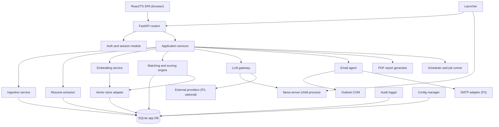
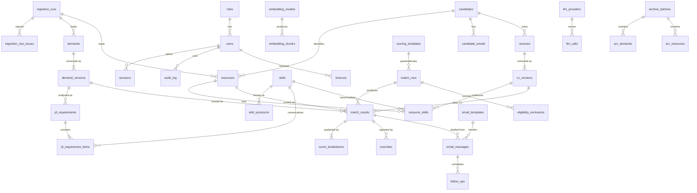
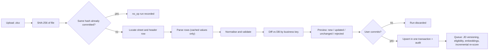
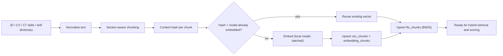
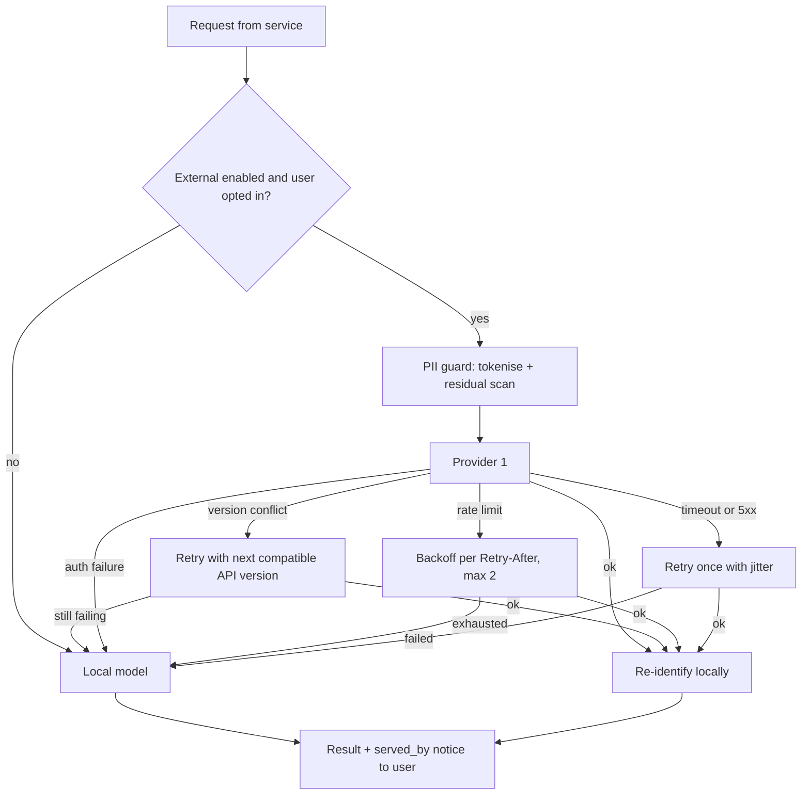
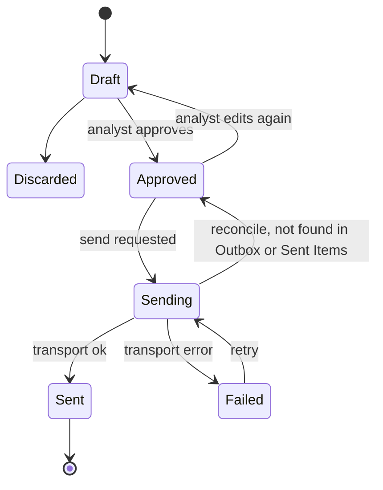

# PerfectFitCandidate (PFC) — Technical Design Document (TDD)

| Item | Value |
|---|---|
| Document | Technical Design Document (TDD) |
| Version | 1.0 |
| Status | Draft |
| Source of truth | [REQUIREMENTS_BASELINE.md](REQUIREMENTS_BASELINE.md) (requirement IDs `REQ-*`, decisions `D-*`, open items `O-*`) |
| Related documents | [BRD.md](BRD.md) · [FDD.md](FDD.md) · [ARCHITECTURE.md](ARCHITECTURE.md) · [WORKFLOW.md](WORKFLOW.md) · [GUI_OCC_DESIGN.md](GUI_OCC_DESIGN.md) · [FEASIBILITY.md](FEASIBILITY.md) · [PHASES.md](PHASES.md) · [DASHBOARD_RESEARCH.md](DASHBOARD_RESEARCH.md) |
| Reference inputs | [reference/Project-PerfectFitCandidate.docx](reference/Project-PerfectFitCandidate.docx) · [reference/DL-CT-Metadata.xlsx](reference/DL-CT-Metadata.xlsx) · [reference/Application-Design.png](reference/Application-Design.png) |

> This is a design document only. Code fragments, DDL and pseudo-code illustrate intent; they are not the implementation. Where this document proposes a default that the baseline does not fix, it is labelled **proposed default** and listed in [§19 Open questions](#19-open-questions).

## Table of contents

1. [Introduction](#1-introduction)
2. [Component breakdown](#2-component-breakdown)
3. [Project and folder layout (proposal)](#3-project-and-folder-layout-proposal)
4. [SQLite data model](#4-sqlite-data-model)
5. [Ingestion and extraction](#5-ingestion-and-extraction)
6. [Embedding and indexing pipeline](#6-embedding-and-indexing-pipeline)
7. [Scoring engine](#7-scoring-engine)
8. [LLM abstraction layer](#8-llm-abstraction-layer)
9. [Authentication, roles and secrets](#9-authentication-roles-and-secrets)
10. [Email agent](#10-email-agent)
11. [Scheduler and background jobs](#11-scheduler-and-background-jobs)
12. [API surface](#12-api-surface)
13. [Packaging](#13-packaging)
14. [Logging and error handling](#14-logging-and-error-handling)
15. [Performance budgets](#15-performance-budgets)
16. [Testing strategy](#16-testing-strategy)
17. [Security considerations](#17-security-considerations)
18. [Requirement traceability](#18-requirement-traceability)
19. [Open questions](#19-open-questions)

---

## 1. Introduction

### 1.1 Purpose

This TDD describes **how** PFC is built: its components, the SQLite schema, the embedding/indexing pipeline, the deterministic scoring engine, the LLM abstraction layer, authentication, the email agent, the REST API, packaging and the engineering practices (logging, performance, testing, security). The system-level view (context, containers, deployment, data flows, ADRs) is in [ARCHITECTURE.md](ARCHITECTURE.md); functional behaviour is in [FDD.md](FDD.md); the end-to-end process is in [WORKFLOW.md](WORKFLOW.md).

### 1.2 Design drivers (from the baseline)

| Driver | Baseline reference | Design consequence |
|---|---|---|
| Portable ZIP, no admin rights, Windows 11 Pro, mostly offline | REQ-PKG-01..04, NFR-02 | Embedded Python + vendored wheels, prebuilt llama.cpp binaries, localhost-only server, no installers or services |
| 16 GB RAM, CPU-only inference | REQ-LLM-01, NFR-03 | Small quantized GGUF model (≤ 8 GB process), medium CPU-optimized embedding model, LLM never in the per-pair scoring loop |
| Auto-match accuracy is the primary KPI | KPI-01 | Hybrid retrieval (vector + keyword + synonyms), human-confirmed JD requirements, evaluation harness, tunable admin template |
| Explainable, reproducible scores | REQ-MAT-08, REQ-SCR-04, NFR-05 | Deterministic scoring engine with persisted inputs, versions and per-component breakdown |
| Human-in-the-loop | REQ-MAT-02, REQ-EML-01 | Explicit Analyze JD → Confirm & Start; per-profile email Approve; no automated selection |
| Privacy by default | NFR-04, REQ-LLM-05, REQ-OUT-03 | Local inference default; PII tokenisation + encryption before any external call (Phase 3); masking in GUI; audit log |
| Small user base (~5), 100–500 demands/resources | §1 | Single-process monolith, SQLite, brute-force vector search is sufficient |

### 1.3 Phase tags

Each feature is tagged **P1** (MVP), **P2** or **P3** consistent with the phase summary in [PHASES.md](PHASES.md):

- **P1** — manual DL/CT upload, CV sync per candidate/global, JD analysis + confirm, matching + scores, email approval via Outlook COM, advanced dashboard, auth, OCC basics, signed settings-package export/import, CSV export.
- **P2** — synced-folder auto-pickup, Outlook calendar follow-ups, PDF reports, chat-with-data, manual archival, internal/external classification, CV version comparison, SMTP transport.
- **P3** — external LLM providers with PII masking/encryption and local-only fallback, advanced OCC (role-specific scoring templates, model benchmark lab), archival automation, licensing (per-user ZIP + signed device licence), OneDrive metadata sync packages that replace or augment the Phase 1 settings-package flow.

### 1.4 Terminology

| Term | Meaning |
|---|---|
| DL | Demand List workbook (one row per requisition, key `Code Requisition`) |
| CT | Candidate Tracker / Bench Tracker / ActivityTracker workbook (key `ShortName` + `Email Address`) |
| Resource | One CT row (a person on, or expected on, the bench) |
| Candidate | A person identity that links a resource to zero or more CVs (REQ-IN-24, REQ-IN-25) |
| CV version | One extracted version of a resume file; scored independently (REQ-IN-24) |
| Demand version | A specific JD text of a requisition (new version when JD text hash changes) |
| JD requirements | LLM-extracted, analyst-confirmed mandatory/preferred skills, experience, qualifications, domain, location/onsite (REQ-MAT-02) |
| Match run | One execution of the scoring engine over a scope of demands × resources with frozen versions (REQ-MAT-08) |
| OCC | Object Control Center — admin-only section of the GUI (REQ-ROLE-03) |

---

## 2. Component breakdown

PFC is a **modular monolith**: one Python process (FastAPI on `127.0.0.1`) hosting all services, plus a child `llama-server` process for local generation, plus the user's browser running the React SPA. Outlook is driven out-of-process via COM.



| # | Component | Responsibility | Key technology | Phase | Baseline |
|---|---|---|---|---|---|
| C1 | **React/TS SPA** | Login, dashboard (match results, demand/bench/match analytics), upload preview, JD review/confirm, CV sync, email drafts/approval, OCC admin section, settings | TypeScript, React 18, Vite build, React Router, TanStack Query, a charting library (see [DASHBOARD_RESEARCH.md](DASHBOARD_RESEARCH.md)), plain CSS modules / design tokens | P1 | REQ-OUT-*, REQ-AUTH-01, NFR-06 |
| C2 | **FastAPI app** | REST API (`/api/v1`), static file serving of the built SPA, request validation (Pydantic v2), dependency-injected services, OpenAPI schema for the frontend client | FastAPI, Uvicorn (single worker), Pydantic v2 | P1 | REQ-AUTH-07 |
| C3 | **Routers** | Thin HTTP layer per area: `auth`, `uploads`, `demands`, `resources`, `candidates`, `matching`, `results`, `emails`, `analytics`, `occ`, `settings`, `jobs`, `reports` (P2), `chat` (P2), `licence` (P3) | FastAPI `APIRouter` | P1–P3 | §12 |
| C4 | **Ingestion service** | Read DL/CT `.xlsx`, locate header rows, normalise values, validate, compute row hashes, preview diff (new/updated/unchanged/rejected), commit with upsert by business key, record ingestion runs; Phase 2 watch-folder pickup | openpyxl (`read_only=True`, `data_only=True`), pandas for tabular transforms, python-dateutil | P1 / P2 | REQ-IN-01..14, REQ-ING-01..06 |
| C5 | **Resume extractor** | Locate a candidate's CV(s) in the configured folder, extract text (PDF/DOCX), section the text, extract identity and facts (rule-based + LLM JSON), manage CV versions and identity resolution | pypdf / pdfminer.six (PDF), python-docx (DOCX), LLM gateway | P1 / P2 | REQ-IN-20..25 |
| C6 | **Embedding service** | Normalise and chunk JD/CV/CT text, compute embeddings with the local embedding model, skip unchanged chunks via content hashes, record model version per vector | ONNX Runtime or llama.cpp embeddings (see §6.4) | P1 | REQ-MAT-01, REQ-LLM-07 |
| C7 | **Vector store adapter** | `VectorStore` interface (`upsert`, `delete`, `knn`, `get_vectors`) with `SqliteVecStore` (default), `QdrantLocalStore` (alternative) and `NumpyStore` (fallback) implementations; FTS5 keyword index | sqlite-vec, SQLite FTS5, qdrant-client local mode (optional), NumPy | P1 | REQ-MAT-01 |
| C8 | **Matching and scoring engine** | Eligibility gates, grade filter, hybrid skill matching, component scoring, bands, ranking, shortlist, evidence/gaps text, run persistence; incremental re-scoring | Pure Python + NumPy; no LLM in the scoring path | P1 | REQ-MAT-*, REQ-GRD-*, REQ-LOC-01, REQ-SCR-*, REQ-ELIG-* |
| C9 | **LLM gateway** | Provider interface (`generate`, `embed`, `health`, `capabilities`), prompt templates, JSON-schema/GBNF constrained output, concurrency limits, timeouts, compatible API-version retry then direct local-model fallback (P3), PII masking (P3) | httpx, llama.cpp `llama-server`, JSON Schema | P1 / P3 | REQ-LLM-01..07 |
| C10 | **Email agent** | Draft generation (template + LLM sections), per-profile approval, send via Outlook COM (P1) or SMTP (P2), idempotency, status tracking, calendar follow-ups (P2) | pywin32 (`win32com.client`), smtplib | P1 / P2 | REQ-EML-01..08 |
| C11 | **Scheduler and job runner** | In-process background jobs (ingestion commit, bulk JD analysis, CV sync, embedding, match runs, PDF), periodic tasks (session cleanup, housekeeping, follow-up creation, watch-folder polling), progress reporting | `asyncio` + bounded `ThreadPoolExecutor`; APScheduler (in-memory) for periodic jobs | P1 / P2 | REQ-ARC-03, REQ-EML-08, REQ-ING-04 |
| C12 | **Auth/session module** | First-run admin setup, login with role dropdown, Argon2id hashing, sessions, lockout, RBAC dependency, CSRF, Host/Origin checks | argon2-cffi, `secrets`, FastAPI dependencies | P1 | REQ-AUTH-01..07, REQ-ROLE-* |
| C13 | **Audit logger** | Append-only, hash-chained audit events for logins, unmasking, OCC changes, approvals/sends, archival, settings and external LLM calls | SQLite table + service API | P1 | REQ-AUTH-05 |
| C14 | **PDF report generator** | Render dashboard/analytics and match result reports to PDF from HTML templates (P2); CSV/XLSX export of match results (P1) | Jinja2 HTML templates + a pure-Python PDF renderer (candidate: xhtml2pdf / ReportLab; WeasyPrint needs GTK — avoid) ; openpyxl for XLSX | P1 (CSV) / P2 (PDF) | REQ-OUT-09 |
| C15 | **Config manager** | Layered configuration: shipped defaults (`config/*.toml|yaml|json`) → DB `settings` (admin/user) → environment overrides for diagnostics; typed access, validation, change audit | pydantic-settings, tomllib | P1 | NFR-07, REQ-ROLE-03/04 |
| C16 | **Launcher** | `PFC.cmd` → embedded Python launcher module: single-instance lock, data-dir init, port selection, DB backup + migrations, start Uvicorn, start/stop `llama-server`, open default browser, graceful shutdown | Batch + Python | P1 | REQ-PKG-03, REQ-PKG-04 |
| C17 | **PII guard** (P3) | Reversible tokenisation of names/emails/phones/IDs, residual-PII scan, encrypted token vault, re-identification on response | Regex + DB entity dictionary, AES-GCM (`cryptography`), DPAPI-protected key | P3 | REQ-LLM-05, NFR-04 |
| C18 | **Archive & housekeeping service** (P2/P3) | Archive preview/run, retention purge, orphan vector cleanup, VACUUM, backups | SQLite, file system | P2 / P3 | REQ-ARC-01..04 |
| C19 | **Licence service** (P3) | Device activation request, signed licence import and verification (Ed25519 public key embedded), feature policy, expiry | `cryptography` (Ed25519) | P3 | REQ-AUTH-08 |

### 2.1 Layering rules

- Routers call **services** only; services call **repositories** (SQL) and **adapters** (vector store, LLM, email transport, file sources). Adapters are behind interfaces registered in a small plugin registry so that new ingestion sources, LLM providers and email transports can be added without touching services (NFR-07).
- The scoring engine is a **pure domain module** (`pfc.domain.scoring`): it receives immutable inputs (confirmed requirements, resource facts, stored vectors, template) and returns results. It performs no I/O and has no LLM dependency, which makes it deterministic and unit-testable (REQ-LLM-02, NFR-05).
- All write operations that change business data emit an audit event in the **same SQLite transaction** as the change.

---

## 3. Project and folder layout (proposal)

Proposed layout of the future codebase under `PFC/` (description only — nothing is created by this document):

| Path | Contents |
|---|---|
| `PFC/app/` | Python package `pfc` |
| `PFC/app/pfc/main.py` | FastAPI app factory, middleware (Host check, CSRF, request ID, security headers), static mount for the SPA |
| `PFC/app/pfc/api/routers/` | One module per router (`auth.py`, `uploads.py`, `demands.py`, `resources.py`, `candidates.py`, `matching.py`, `results.py`, `emails.py`, `analytics.py`, `occ.py`, `settings.py`, `jobs.py`, `reports.py`, `chat.py`, `licence.py`) |
| `PFC/app/pfc/api/schemas/` | Pydantic request/response models (shared with the frontend via generated OpenAPI types) |
| `PFC/app/pfc/services/` | Application services (ingestion, resumes, embedding, matching, email, analytics, archive, reports, chat) |
| `PFC/app/pfc/domain/` | Pure domain logic: `scoring/` (eligibility, grade, location, skills, bands, ranking), `normalise/` (text, dates, skills), `models.py` (dataclasses) |
| `PFC/app/pfc/adapters/` | `vector/` (sqlite-vec, Qdrant local, NumPy), `llm/` (llama.cpp, OpenAI, Devin), `email/` (Outlook COM, SMTP, fake), `sources/` (manual upload, watch folder, resume folder), `pdf/` |
| `PFC/app/pfc/db/` | Connection management (WAL, pragmas, extension loading), repositories, `migrations/NNNN_*.sql` |
| `PFC/app/pfc/security/` | Hashing, sessions, RBAC, CSRF, DPAPI wrapper, PII guard, licence verification |
| `PFC/app/pfc/jobs/` | Job runner, periodic task definitions |
| `PFC/app/pfc/launcher.py` | Single-instance lock, port selection, process supervision, browser open |
| `PFC/app/tests/` | `unit/`, `integration/`, `golden/` (scoring snapshots), `fixtures/` (sample DL/CT workbooks, CVs) |
| `PFC/frontend/` | Vite + React + TypeScript SPA: `src/pages/`, `src/components/`, `src/features/` (results, analytics, occ, emails, uploads), `src/api/` (generated client), `src/styles/` (tokens, CSS) ; `tests/` (Vitest, Playwright) |
| `PFC/config/` | Shipped read-only defaults: `defaults.toml`, `grades.yaml` (A3–E1), `bench_statuses.yaml` and `status_map.yaml` (priorities, exclusions and source mappings), `scoring_template.default.json`, `skill_synonyms.seed.csv`, `location_aliases.yaml`, `llm_models.approved.json`, `email.toml`, and inactive-setting placeholders |
| `PFC/templates/` | `email/candidate_default.html` (REQ-EML-03), `prompts/*.md` (JD/CV extraction, email sections, chat), `grammars/*.gbnf` and `schemas/*.json` (constrained outputs), `reports/*.html` (PDF) |
| `PFC/models/` | Not in git. Build-time download target for the default GGUF LLM and the embedding model, with `MODELS.lock` (name, URL, SHA-256, licence) |
| `PFC/data/` | Not in git. Runtime data folder created at first run (DB, vector files, logs, backups, cache, exports) — see §13.4 |
| `PFC/packaging/` | Build scripts, `requirements.lock` (hashed), wheel vendoring, `python3xx._pth` template, `PFC.cmd` launcher, llama.cpp binary manifest, ZIP assembly, licence/third-party notices |
| `PFC/docs/` | This documentation set |

---

## 4. SQLite data model

### 4.1 Conventions

- One SQLite database file `data/db/pfc.db` in **WAL** mode (`journal_mode=WAL`, `synchronous=NORMAL`, `foreign_keys=ON`, `busy_timeout=5000`). Vectors live in the same file when sqlite-vec is used (§6.5), so a single transaction covers business rows and vectors.
- Surrogate integer primary keys (`INTEGER PRIMARY KEY`); **business keys** enforced with `UNIQUE` constraints: `demands.code_requisition` (REQ-IN-02) and `resources(short_name_key, email_key)` (REQ-IN-11).
- Source values are stored **exactly as read** (e.g. `email_address`, `code_requisition`, dates) to satisfy REQ-IN-14 / REQ-OUT-02; separate `*_key` / `*_norm` columns hold normalised forms used only for matching/uniqueness and are never displayed as the source value.
- Timestamps are ISO-8601 UTC text (`YYYY-MM-DDTHH:MM:SSZ`); business dates (`position_start_date`, `bench_start_date`, `bench_end_date`) are ISO dates (`YYYY-MM-DD`).
- JSON columns are `TEXT` validated with `json_valid()` checks.
- Versioned entities (demand versions, CV versions, scoring templates, email templates) are **append-only**; prior versions are never updated in place (REQ-MAT-08).
- Schema migrations: ordered SQL files with a `schema_migrations` table; a backup of `pfc.db` is taken before every migration (§13.5).

### 4.2 Entity-relationship diagram



Supporting tables without diagram edges: `settings`, `resource_team_recipients`, `internal_email_domains`, `bench_statuses`, `grades`, `llm_models`, `jobs`, `schema_migrations`, FTS5/vec virtual tables, `arc_match_results`, `arc_email_messages`, `activation_requests`, `sync_packages`.

### 4.3 Identity, users and sessions

```sql
CREATE TABLE roles (
  role_id      INTEGER PRIMARY KEY,
  name         TEXT NOT NULL UNIQUE CHECK (name IN ('Admin','Analyst'))   -- REQ-ROLE-01, D-05
);

CREATE TABLE users (
  user_id              INTEGER PRIMARY KEY,
  email                TEXT NOT NULL UNIQUE COLLATE NOCASE,              -- corporate email (REQ-AUTH-02)
  display_name         TEXT NOT NULL,
  role_id              INTEGER NOT NULL REFERENCES roles(role_id),
  persona              TEXT CHECK (persona IN ('A','B','C')),            -- Analyst persona, informational only (REQ-ROLE-02)
  password_hash        TEXT NOT NULL,                                    -- Argon2id encoded string (REQ-AUTH-04)
  must_change_password INTEGER NOT NULL DEFAULT 1,
  failed_attempts      INTEGER NOT NULL DEFAULT 0,
  locked_until         TEXT,
  is_active            INTEGER NOT NULL DEFAULT 1,
  created_at           TEXT NOT NULL,
  updated_at           TEXT NOT NULL,
  last_login_at        TEXT
);

CREATE TABLE sessions (
  session_id      INTEGER PRIMARY KEY,
  token_hash      TEXT NOT NULL UNIQUE,           -- SHA-256 of the random cookie token; raw token never stored
  csrf_hash       TEXT NOT NULL,
  user_id         INTEGER NOT NULL REFERENCES users(user_id) ON DELETE CASCADE,
  role_at_login   TEXT NOT NULL,                  -- role chosen in the login dropdown (REQ-AUTH-01)
  created_at      TEXT NOT NULL,
  last_seen_at    TEXT NOT NULL,
  expires_at      TEXT NOT NULL,
  revoked_at      TEXT
);
CREATE INDEX ix_sessions_user ON sessions(user_id);
CREATE INDEX ix_sessions_expires ON sessions(expires_at);
```

### 4.4 Ingestion runs

```sql
CREATE TABLE ingestion_runs (
  ingestion_run_id INTEGER PRIMARY KEY,
  kind             TEXT NOT NULL CHECK (kind IN ('DL','CT','CV')),
  source           TEXT NOT NULL CHECK (source IN ('manual_upload','watch_folder','resume_folder')),  -- watch_folder = P2 (REQ-ING-04)
  file_name        TEXT NOT NULL,
  file_sha256      TEXT NOT NULL,
  file_size        INTEGER NOT NULL,
  sheet_name       TEXT,                            -- detected sheet (REQ-IN-01)
  header_row       INTEGER,                         -- detected header row (REQ-IN-10)
  uploaded_by      INTEGER REFERENCES users(user_id),
  status           TEXT NOT NULL CHECK (status IN ('preview','committed','no_op','discarded','failed')),
  rows_read        INTEGER, rows_new INTEGER, rows_updated INTEGER, rows_unchanged INTEGER, rows_rejected INTEGER,
  started_at       TEXT NOT NULL,
  committed_at     TEXT,
  error_summary    TEXT
);
CREATE INDEX ix_ingestion_runs_hash ON ingestion_runs(kind, file_sha256);   -- identical re-upload => no_op (REQ-ING-06)

CREATE TABLE ingestion_row_issues (
  issue_id         INTEGER PRIMARY KEY,
  ingestion_run_id INTEGER NOT NULL REFERENCES ingestion_runs(ingestion_run_id) ON DELETE CASCADE,
  row_number       INTEGER NOT NULL,
  field            TEXT,
  severity         TEXT NOT NULL CHECK (severity IN ('info','warning','error')),
  code             TEXT NOT NULL,          -- e.g. REQ_ID_FORMAT, DATE_UNPARSEABLE, EMAIL_MISSING, DUPLICATE_IN_FILE
  message          TEXT NOT NULL,
  raw_value        TEXT
);
CREATE INDEX ix_row_issues_run ON ingestion_row_issues(ingestion_run_id);
```

### 4.5 Demands and JD requirements

```sql
CREATE TABLE demands (
  demand_id            INTEGER PRIMARY KEY,
  code_requisition     TEXT NOT NULL UNIQUE,         -- exact source value; business key (REQ-IN-02)
  id_format_ok         INTEGER NOT NULL,             -- T1XXXX/T2XXXX check, warning only (O-02)
  position_start_date  TEXT,
  account_name         TEXT,
  code_local_grade     TEXT REFERENCES grades(code),
  demand_request_name  TEXT,                         -- role title
  region               TEXT,                         -- role location; 'Unspecified' rendered when NULL (REQ-OUT-01)
  bu                   TEXT,
  owner                TEXT,
  current_version_id   INTEGER REFERENCES demand_versions(demand_version_id),
  lifecycle            TEXT NOT NULL DEFAULT 'open' CHECK (lifecycle IN ('open','closed','archived')),
  row_hash             TEXT NOT NULL,                -- hash of normalised row; drives updated/unchanged
  first_ingestion_id   INTEGER REFERENCES ingestion_runs(ingestion_run_id),
  last_ingestion_id    INTEGER REFERENCES ingestion_runs(ingestion_run_id),
  occ_reviewed_by      INTEGER REFERENCES users(user_id),   -- OCC approve/modify (REQ-ING-03)
  occ_reviewed_at      TEXT,
  created_at           TEXT NOT NULL,
  updated_at           TEXT NOT NULL
);
CREATE INDEX ix_demands_lifecycle ON demands(lifecycle);
CREATE INDEX ix_demands_filters ON demands(bu, region, account_name, code_local_grade);
CREATE INDEX ix_demands_start ON demands(position_start_date);

CREATE TABLE demand_versions (
  demand_version_id INTEGER PRIMARY KEY,
  demand_id         INTEGER NOT NULL REFERENCES demands(demand_id),
  version_no        INTEGER NOT NULL,
  jd_text_raw       TEXT NOT NULL,                   -- as uploaded
  jd_text_norm      TEXT NOT NULL,                   -- normalised (REQ-IN-03, §6.2)
  jd_sha256         TEXT NOT NULL,                   -- of jd_text_norm
  ingestion_run_id  INTEGER REFERENCES ingestion_runs(ingestion_run_id),
  created_at        TEXT NOT NULL,
  UNIQUE (demand_id, version_no),
  UNIQUE (demand_id, jd_sha256)
);

CREATE TABLE jd_requirements (
  jd_req_id          INTEGER PRIMARY KEY,
  demand_version_id  INTEGER NOT NULL REFERENCES demand_versions(demand_version_id),
  revision           INTEGER NOT NULL,                 -- edits create a new revision
  status             TEXT NOT NULL CHECK (status IN ('draft','confirmed','superseded')),
  extracted_by       TEXT,                             -- provider/model/version or 'rule_based' or 'manual'
  prompt_version     TEXT,
  extraction_json    TEXT CHECK (extraction_json IS NULL OR json_valid(extraction_json)),
  location_norm      TEXT,
  onsite_required    INTEGER,                          -- REQ-LOC-01 (NULL = not stated)
  min_years_exp      REAL,
  confirmed_by       INTEGER REFERENCES users(user_id),
  confirmed_at       TEXT,                             -- 'Confirm & Start' (REQ-MAT-02)
  created_at         TEXT NOT NULL,
  UNIQUE (demand_version_id, revision)
);
CREATE UNIQUE INDEX ux_jdreq_one_confirmed ON jd_requirements(demand_version_id) WHERE status = 'confirmed';

CREATE TABLE jd_requirement_items (
  item_id            INTEGER PRIMARY KEY,
  jd_req_id          INTEGER NOT NULL REFERENCES jd_requirements(jd_req_id) ON DELETE CASCADE,
  kind               TEXT NOT NULL CHECK (kind IN ('mandatory_skill','preferred_skill','experience','qualification','domain')),
  text               TEXT NOT NULL,
  canonical_skill_id INTEGER REFERENCES skills(skill_id),
  source_span        TEXT,                            -- evidence offsets/quote in the JD
  position           INTEGER NOT NULL
);
CREATE INDEX ix_jditems_req ON jd_requirement_items(jd_req_id, kind);
```

### 4.6 Resources, candidates and CVs

```sql
CREATE TABLE resources (                          -- one CT row
  resource_id         INTEGER PRIMARY KEY,
  short_name          TEXT NOT NULL,              -- exact source value
  email_address       TEXT,                       -- exact source value, never constructed or corrected (REQ-IN-14)
  short_name_key      TEXT NOT NULL,              -- lower(trim(short_name))
  email_key           TEXT NOT NULL DEFAULT '',   -- lower(trim(email_address)) or '' when missing
  grade               TEXT REFERENCES grades(code),
  location            TEXT,
  location_norm       TEXT,                       -- JSON array of normalised places, e.g. ["edinburgh","glasgow"]
  bench_status        TEXT,                       -- exact source value
  bench_status_code   TEXT REFERENCES bench_statuses(code),
  skills_raw          TEXT,                       -- 'Skills (comma separated)' as read
  available_capacity  TEXT,                       -- displayed only, never used for availability (REQ-ELIG-06)
  bench_start_date    TEXT,
  bench_end_date      TEXT,                        -- parsed date; NULL when blank or unparseable
  bench_end_date_parse_status TEXT NOT NULL DEFAULT 'blank'
                                                    CHECK (bench_end_date_parse_status IN ('valid','blank','unparseable')),
  tracker_text        TEXT,                       -- cached value / link text, formulas never executed (REQ-IN-13)
  tracker_url         TEXT,
  group_name          TEXT,                       -- RG1..RG5 or 'Not on Bench'
  group_owner         TEXT,
  candidate_id        INTEGER REFERENCES candidates(candidate_id),
  eligibility         TEXT NOT NULL CHECK (eligibility IN ('eligible','excluded')),
  exclusion_reason    TEXT,                       -- REQ-ELIG-08
  row_hash            TEXT NOT NULL,
  lifecycle           TEXT NOT NULL DEFAULT 'active' CHECK (lifecycle IN ('active','off_bench','archived')),
  first_ingestion_id  INTEGER REFERENCES ingestion_runs(ingestion_run_id),
  last_ingestion_id   INTEGER REFERENCES ingestion_runs(ingestion_run_id),
  occ_reviewed_by     INTEGER REFERENCES users(user_id),
  occ_reviewed_at     TEXT,
  created_at          TEXT NOT NULL,
  updated_at          TEXT NOT NULL,
  UNIQUE (short_name_key, email_key)              -- ShortName + Email business key (REQ-IN-11)
);
CREATE INDEX ix_resources_elig ON resources(eligibility, grade);
CREATE INDEX ix_resources_status ON resources(bench_status_code);
CREATE INDEX ix_resources_candidate ON resources(candidate_id);

CREATE TABLE candidates (
  candidate_id            INTEGER PRIMARY KEY,
  internal_ref            TEXT NOT NULL UNIQUE,     -- generated ID, e.g. 'PFC-C-000123' (REQ-IN-23)
  display_name            TEXT,                     -- NULL allowed when unknown
  phone                   TEXT,                     -- NULL when missing; never invented
  identity_status         TEXT NOT NULL CHECK (identity_status IN ('complete','incomplete','ambiguous','review_later')),
  classification          TEXT CHECK (classification IN ('Internal','External','Unknown')),   -- P2 (REQ-CLS-02)
  classification_override TEXT CHECK (classification_override IN ('Internal','External','Unknown')),
  override_by             INTEGER REFERENCES users(user_id),
  created_at              TEXT NOT NULL,
  updated_at              TEXT NOT NULL
);

CREATE TABLE candidate_emails (                   -- email = identity signal, not PK (REQ-IN-25)
  candidate_id  INTEGER NOT NULL REFERENCES candidates(candidate_id) ON DELETE CASCADE,
  email         TEXT NOT NULL,                    -- exact value as found (CT or CV)
  email_key     TEXT NOT NULL,
  source        TEXT NOT NULL CHECK (source IN ('CT','CV','manual')),
  confirmed     INTEGER NOT NULL DEFAULT 0,
  PRIMARY KEY (candidate_id, email_key)
);
CREATE INDEX ix_candidate_emails_key ON candidate_emails(email_key);

CREATE TABLE resumes (                            -- one physical file
  resume_id     INTEGER PRIMARY KEY,
  candidate_id  INTEGER REFERENCES candidates(candidate_id),
  source_path   TEXT NOT NULL,                    -- path relative to configured resume root (REQ-IN-20)
  file_name     TEXT NOT NULL,
  file_sha256   TEXT NOT NULL UNIQUE,
  file_mtime    TEXT,
  mime_type     TEXT NOT NULL CHECK (mime_type IN ('application/pdf','application/vnd.openxmlformats-officedocument.wordprocessingml.document')),
  discovered_at TEXT NOT NULL
);

CREATE TABLE cv_versions (                        -- one extraction of one resume (REQ-IN-24)
  cv_version_id      INTEGER PRIMARY KEY,
  resume_id          INTEGER NOT NULL REFERENCES resumes(resume_id),
  candidate_id       INTEGER REFERENCES candidates(candidate_id),
  version_no         INTEGER NOT NULL,            -- per candidate, ordered by file date
  text_sha256        TEXT NOT NULL,
  text_norm          TEXT NOT NULL,               -- local only; never sent externally unmasked
  sections_json      TEXT CHECK (json_valid(sections_json)),
  facts_json         TEXT CHECK (json_valid(facts_json)),   -- name, emails, phone, skills, experience, qualifications, projects + evidence
  extracted_by       TEXT NOT NULL,               -- provider/model/version
  prompt_version     TEXT,
  identity_match     TEXT CHECK (identity_match IN ('email_exact','name_fuzzy','manual','ambiguous','none')),
  is_latest          INTEGER NOT NULL DEFAULT 0,
  extracted_at       TEXT NOT NULL,
  UNIQUE (candidate_id, version_no),
  UNIQUE (resume_id, text_sha256)
);
CREATE INDEX ix_cv_versions_candidate ON cv_versions(candidate_id, is_latest);
```

### 4.7 Skills and synonyms

```sql
CREATE TABLE skills (                              -- canonical skill dictionary
  skill_id     INTEGER PRIMARY KEY,
  name         TEXT NOT NULL UNIQUE COLLATE NOCASE,   -- e.g. 'Business Analysis'
  category     TEXT,                                  -- e.g. 'Data', 'Delivery', 'Cloud'
  created_by   TEXT NOT NULL CHECK (created_by IN ('seed','system','admin')),
  is_active    INTEGER NOT NULL DEFAULT 1
);

CREATE TABLE skill_synonyms (                      -- synonym/abbreviation tracker (REQ-MAT-05)
  synonym_id         INTEGER PRIMARY KEY,
  skill_id           INTEGER NOT NULL REFERENCES skills(skill_id) ON DELETE CASCADE,
  term               TEXT NOT NULL,                  -- as entered, e.g. 'BA', 'DataBricks', 'Bussiness Analysis'
  term_norm          TEXT NOT NULL UNIQUE,           -- casefolded, punctuation-stripped
  relation           TEXT NOT NULL CHECK (relation IN ('equivalent','abbreviation','misspelling','related')),
  credit             REAL NOT NULL DEFAULT 1.0 CHECK (credit BETWEEN 0 AND 1),   -- 'related' < 1.0
  status             TEXT NOT NULL CHECK (status IN ('suggested','approved','rejected')),  -- system suggests, OCC approves
  created_by         INTEGER REFERENCES users(user_id),
  updated_at         TEXT NOT NULL
);
CREATE INDEX ix_synonyms_skill ON skill_synonyms(skill_id);

CREATE TABLE resource_skills (                     -- skills per resource from CT and/or CV
  resource_skill_id  INTEGER PRIMARY KEY,
  resource_id        INTEGER NOT NULL REFERENCES resources(resource_id) ON DELETE CASCADE,
  cv_version_id      INTEGER REFERENCES cv_versions(cv_version_id),   -- NULL => from CT skills
  source             TEXT NOT NULL CHECK (source IN ('CT','CV')),
  skill_raw          TEXT NOT NULL,
  skill_norm         TEXT NOT NULL,
  canonical_skill_id INTEGER REFERENCES skills(skill_id),
  evidence           TEXT,                           -- quote/section for CV-derived skills
  years              REAL
);
CREATE INDEX ix_resource_skills_res ON resource_skills(resource_id, source, cv_version_id);
CREATE INDEX ix_resource_skills_canon ON resource_skills(canonical_skill_id);
```

### 4.8 Reference data

```sql
CREATE TABLE grades (                              -- configurable in OCC; default A3..E1 (nine grades)
  code     TEXT PRIMARY KEY,
  ordinal  INTEGER NOT NULL UNIQUE,                -- A3=1, A4=2, B1=3, B2=4, C1=5, C2=6, D1=7, D2=8, E1=9, E1=9
  active   INTEGER NOT NULL DEFAULT 1
);

CREATE TABLE bench_statuses (                      -- REQ-ELIG-02/03, OCC-configurable
  code          TEXT PRIMARY KEY,                  -- e.g. 'AVAILABLE'
  label         TEXT NOT NULL UNIQUE COLLATE NOCASE,   -- exact CT text, e.g. 'Available'
  is_excluded   INTEGER NOT NULL,                  -- 1 for Selected, Unknown, CV with Client - Sold - Pending Allocation
  priority      INTEGER,                           -- 1..6 for eligible statuses; NULL when excluded
  flag_in_gaps  INTEGER NOT NULL DEFAULT 0,        -- 1 for CV-with-client / proposed statuses (REQ-ELIG-04)
  available_from_bench_start INTEGER NOT NULL DEFAULT 0   -- 1 for 'Expected on Bench Soon'
);

CREATE TABLE status_map (                           -- REQ-ELIG-07, OCC-editable source-to-canonical map
  source_value       TEXT PRIMARY KEY COLLATE NOCASE, -- normalised source status from CT
  canonical_code     TEXT REFERENCES bench_statuses(code),
  priority           INTEGER NOT NULL DEFAULT 2,      -- unmapped values default to priority 2
  is_excluded        INTEGER NOT NULL DEFAULT 0,
  mapped_by          INTEGER REFERENCES users(user_id),
  updated_at         TEXT NOT NULL
);
```

Default seed for `bench_statuses` (from the baseline):

| label | is_excluded | priority | flag_in_gaps | available_from_bench_start |
|---|---|---|---|---|
| Available | 0 | 1 | 0 | 0 |
| Overall upskilling (New bench) | 0 | 2 | 0 | 0 |
| CV with client - Demand Proposed | 0 | 3 | 1 | 0 |
| CV with client - Proactive Proposed | 0 | 3 | 1 | 0 |
| Expected on Bench Soon | 0 | 4 | 0 | 1 |
| Status - x | 0 | 5 | 0 | 0 |
| Status - y | 0 | 6 | 0 | 0 |
| Selected | 1 | NULL | — | — |
| Unknown | 1 | NULL | — | — |
| CV with Client - Sold - Pending Allocation | 1 | NULL | — | — |

Seed `status_map` from all known statuses above. An unmapped source value remains eligible at priority 2 and has binary status score 0; flag it as "Unmapped status" in Gaps / Checks and the OCC data-quality view. Never silently exclude an unmapped status (REQ-ELIG-07).

### 4.9 Embeddings metadata and indexes

```sql
CREATE TABLE embedding_models (
  embedding_model_id INTEGER PRIMARY KEY,
  name               TEXT NOT NULL,                 -- default 'nomic-embed-text-v1.5'
  runtime            TEXT NOT NULL CHECK (runtime IN ('onnx','llamacpp')),
  file_sha256        TEXT NOT NULL,
  dim                INTEGER NOT NULL,
  normalised         INTEGER NOT NULL DEFAULT 1,    -- L2-normalised vectors => cosine = dot product
  pipeline_version   TEXT NOT NULL,                 -- normalisation + chunking version
  is_active          INTEGER NOT NULL DEFAULT 0,
  UNIQUE (name, file_sha256, pipeline_version)
);
CREATE UNIQUE INDEX ux_embedding_models_active ON embedding_models(is_active) WHERE is_active = 1;

CREATE TABLE embedding_chunks (
  chunk_id            INTEGER PRIMARY KEY,           -- also the rowid in vec_chunks
  owner_type          TEXT NOT NULL CHECK (owner_type IN ('jd','jd_item','cv','ct_skills','skill')),
  owner_id            INTEGER NOT NULL,              -- demand_version_id / item_id / cv_version_id / resource_id / skill_id
  section             TEXT NOT NULL,                 -- e.g. 'responsibilities', 'experience', 'skills'
  chunk_no            INTEGER NOT NULL,
  text                TEXT NOT NULL,
  text_sha256         TEXT NOT NULL,
  token_count         INTEGER NOT NULL,
  embedding_model_id  INTEGER NOT NULL REFERENCES embedding_models(embedding_model_id),
  created_at          TEXT NOT NULL,
  UNIQUE (owner_type, owner_id, section, chunk_no, embedding_model_id)
);
CREATE INDEX ix_chunks_hash ON embedding_chunks(text_sha256, embedding_model_id);   -- reuse identical text
CREATE INDEX ix_chunks_owner ON embedding_chunks(owner_type, owner_id);

-- sqlite-vec virtual table (default store, §6.5); dimension fixed per active model
CREATE VIRTUAL TABLE vec_chunks USING vec0(embedding float[384]);

-- FTS5 keyword index for BM25 (hybrid retrieval, §6.7)
CREATE VIRTUAL TABLE fts_chunks USING fts5(text, owner_type UNINDEXED, owner_id UNINDEXED,
                                           content='embedding_chunks', content_rowid='chunk_id',
                                           tokenize='unicode61 remove_diacritics 2');
```

### 4.10 Scoring templates, runs and results

```sql
CREATE TABLE scoring_templates (                   -- admin-only, versioned (REQ-SCR-01, REQ-ROLE-04)
  template_id     INTEGER PRIMARY KEY,
  name            TEXT NOT NULL,                   -- 'default'; role-specific templates in P3
  version         INTEGER NOT NULL,
  role_family     TEXT,                            -- P3: e.g. 'Data Engineer'
  weights_json    TEXT NOT NULL CHECK (json_valid(weights_json)),   -- {"skills":70,"grade":10,"location":5,"bench_start":5,"bench_end":5,"status":5}
  rules_json      TEXT NOT NULL CHECK (json_valid(rules_json)),     -- sub-weights, thresholds, status_score_mode, bands, top_n
  status          TEXT NOT NULL CHECK (status IN ('draft','active','retired')),
  created_by      INTEGER REFERENCES users(user_id),
  created_at      TEXT NOT NULL,
  activated_at    TEXT,
  UNIQUE (name, version)
);
CREATE UNIQUE INDEX ux_template_active ON scoring_templates(name, IFNULL(role_family,'')) WHERE status = 'active';

CREATE TABLE match_runs (                          -- REQ-MAT-08
  run_id               INTEGER PRIMARY KEY,
  scope                TEXT NOT NULL CHECK (scope IN ('full','demands','resources','incremental')),
  scope_json           TEXT,
  template_id          INTEGER NOT NULL REFERENCES scoring_templates(template_id),
  embedding_model_id   INTEGER NOT NULL REFERENCES embedding_models(embedding_model_id),
  llm_model            TEXT,                        -- model used for JD/CV extraction of inputs (recorded per input too)
  engine_version       TEXT NOT NULL,               -- scoring engine semantic version
  synonyms_version     TEXT NOT NULL,               -- hash of approved synonym set
  config_hash          TEXT NOT NULL,               -- hash of every input parameter => reproducibility
  triggered_by         INTEGER REFERENCES users(user_id),
  status               TEXT NOT NULL CHECK (status IN ('queued','running','completed','failed','cancelled')),
  started_at           TEXT, finished_at TEXT,
  demands_assessed     INTEGER, pairs_scored INTEGER, roles_without_candidate INTEGER,   -- dashboard header (REQ-OUT-04)
  dq_summary_json      TEXT
);

CREATE TABLE eligibility_exclusions (              -- 'Excluded from matching' view (REQ-ELIG-07)
  run_id       INTEGER NOT NULL REFERENCES match_runs(run_id) ON DELETE CASCADE,
  resource_id  INTEGER NOT NULL REFERENCES resources(resource_id),
  demand_id    INTEGER REFERENCES demands(demand_id),     -- NULL => global exclusion; set => pair-level (grade >1 away)
  reason_code  TEXT NOT NULL,       -- STATUS_EXCLUDED, NOT_ON_BENCH, BENCH_END_SET, NO_GRADE, NO_SKILLS, GRADE_GAP_GT1
  detail       TEXT
);
CREATE INDEX ix_excl_run ON eligibility_exclusions(run_id, reason_code);

CREATE TABLE match_results (                       -- one row per requisition-person (REQ-MAT-03)
  result_id            INTEGER PRIMARY KEY,
  run_id               INTEGER NOT NULL REFERENCES match_runs(run_id) ON DELETE CASCADE,
  demand_id            INTEGER NOT NULL REFERENCES demands(demand_id),
  demand_version_id    INTEGER NOT NULL REFERENCES demand_versions(demand_version_id),
  jd_req_id            INTEGER NOT NULL REFERENCES jd_requirements(jd_req_id),
  resource_id          INTEGER NOT NULL REFERENCES resources(resource_id),
  candidate_id         INTEGER REFERENCES candidates(candidate_id),
  best_cv_version_id   INTEGER REFERENCES cv_versions(cv_version_id),   -- NULL => scored on CT skills only
  score                REAL NOT NULL CHECK (score BETWEEN 0 AND 100),   -- rounded to 1 dp
  band                 TEXT NOT NULL CHECK (band IN ('Strong','Potential','Avg','Weak','Insufficient data')),
  rank                 INTEGER NOT NULL,
  shortlisted          INTEGER NOT NULL,            -- in top-N for the requisition
  email_preselected    INTEGER NOT NULL DEFAULT 0,  -- top 4 default (REQ-EML-01, O-07)
  grade_relation       TEXT NOT NULL CHECK (grade_relation IN ('exact','adjacent_above','adjacent_below')),
  location_assessment  TEXT NOT NULL CHECK (location_assessment IN ('Aligned','Remote/unspecified','Potential travel','Location check')),
  status_priority      INTEGER,
  mandatory_missing    INTEGER NOT NULL DEFAULT 0,  -- REQ-SCR-03
  matching_evidence    TEXT NOT NULL,
  gaps_checks          TEXT NOT NULL,
  eligibility_evidence TEXT NOT NULL,
  UNIQUE (run_id, demand_id, resource_id)
);
CREATE INDEX ix_results_demand ON match_results(run_id, demand_id, rank);
CREATE INDEX ix_results_resource ON match_results(run_id, resource_id);
CREATE INDEX ix_results_band ON match_results(run_id, band, score);

CREATE TABLE match_cv_scores (                     -- per-CV-version scores for drill-down (REQ-IN-24)
  result_id      INTEGER NOT NULL REFERENCES match_results(result_id) ON DELETE CASCADE,
  cv_version_id  INTEGER REFERENCES cv_versions(cv_version_id),   -- NULL => CT-only basis
  score          REAL NOT NULL,
  band           TEXT NOT NULL,
  PRIMARY KEY (result_id, cv_version_id)
);

CREATE TABLE score_breakdowns (                    -- explainability (REQ-SCR-04)
  result_id    INTEGER NOT NULL REFERENCES match_results(result_id) ON DELETE CASCADE,
  component    TEXT NOT NULL CHECK (component IN ('skills','grade','location','bench_start','bench_end','status')),
  points       REAL NOT NULL,
  max_points   REAL NOT NULL,
  inputs_json  TEXT NOT NULL CHECK (json_valid(inputs_json)),   -- e.g. matched items, similarities, day gap, status label
  PRIMARY KEY (result_id, component)
);

CREATE TABLE overrides (                           -- REQ-MAT-09
  override_id  INTEGER PRIMARY KEY,
  demand_id    INTEGER NOT NULL REFERENCES demands(demand_id),
  resource_id  INTEGER NOT NULL REFERENCES resources(resource_id),
  result_id    INTEGER REFERENCES match_results(result_id),
  action       TEXT NOT NULL CHECK (action IN ('pin','unpin','exclude','include','adjust_band')),
  new_band     TEXT,
  reason       TEXT NOT NULL,
  created_by   INTEGER NOT NULL REFERENCES users(user_id),
  created_at   TEXT NOT NULL,
  revoked_by   INTEGER REFERENCES users(user_id),
  revoked_at   TEXT
);
CREATE INDEX ix_overrides_pair ON overrides(demand_id, resource_id) WHERE revoked_at IS NULL;
```

Overrides are stored against the **demand–resource pair**, not the run, so they survive re-scoring; they are applied as a presentation layer on top of the computed result and never alter the stored computed `score`.

### 4.11 Email, recipients and follow-ups

```sql
CREATE TABLE email_templates (                     -- REQ-EML-03
  email_template_id INTEGER PRIMARY KEY,
  name              TEXT NOT NULL,
  version           INTEGER NOT NULL,
  subject           TEXT NOT NULL,                 -- e.g. 'Opportunity {requisition} – {role}'
  body_html         TEXT NOT NULL,                 -- placeholders {candidate_name} {requisition} {role} {match_pct} {gaps} {pointers} {spoc_1} {spoc_2}
  is_default        INTEGER NOT NULL DEFAULT 0,
  created_by        INTEGER REFERENCES users(user_id),
  created_at        TEXT NOT NULL,
  UNIQUE (name, version)
);

CREATE TABLE resource_team_recipients (            -- CC list maintained in OCC (REQ-EML-05)
  recipient_id  INTEGER PRIMARY KEY,
  email         TEXT NOT NULL UNIQUE COLLATE NOCASE,
  display_name  TEXT,
  is_active     INTEGER NOT NULL DEFAULT 1,
  added_by      INTEGER REFERENCES users(user_id),
  added_at      TEXT NOT NULL
);

CREATE TABLE email_messages (                      -- REQ-EML-01/02/06
  message_id         INTEGER PRIMARY KEY,
  demand_id          INTEGER NOT NULL REFERENCES demands(demand_id),
  resource_id        INTEGER NOT NULL REFERENCES resources(resource_id),
  result_id          INTEGER REFERENCES match_results(result_id),
  send_seq           INTEGER NOT NULL DEFAULT 1,       -- >1 only for explicit re-send
  email_template_id  INTEGER NOT NULL REFERENCES email_templates(email_template_id),
  to_address         TEXT NOT NULL,                    -- copied exactly from CT (REQ-IN-14)
  cc_json            TEXT NOT NULL CHECK (json_valid(cc_json)),
  subject            TEXT NOT NULL,
  body_html          TEXT NOT NULL,
  jd_attachment_path TEXT,
  status             TEXT NOT NULL CHECK (status IN ('Draft','Approved','Sending','Sent','Failed','Discarded')),
  idempotency_key    TEXT NOT NULL UNIQUE,             -- sha256(demand_id|resource_id|send_seq|install_id)
  transport          TEXT CHECK (transport IN ('outlook_com','smtp')),
  transport_ref      TEXT,                             -- Outlook EntryID / SMTP Message-ID
  drafted_by_model   TEXT,
  created_by         INTEGER NOT NULL REFERENCES users(user_id),
  approved_by        INTEGER REFERENCES users(user_id), approved_at TEXT,
  sent_by            INTEGER REFERENCES users(user_id), sent_at TEXT,
  last_error         TEXT,
  attempts           INTEGER NOT NULL DEFAULT 0,
  created_at         TEXT NOT NULL,
  updated_at         TEXT NOT NULL,
  UNIQUE (demand_id, resource_id, send_seq)            -- prevents duplicate sends for the same pair
);
CREATE INDEX ix_email_status ON email_messages(status, updated_at);

CREATE TABLE follow_ups (                          -- P2 (REQ-EML-08)
  follow_up_id   INTEGER PRIMARY KEY,
  message_id     INTEGER NOT NULL REFERENCES email_messages(message_id),
  kind           TEXT NOT NULL CHECK (kind IN ('reminder','meeting')),
  due_at         TEXT NOT NULL,
  outlook_ref    TEXT,                             -- AppointmentItem EntryID
  status         TEXT NOT NULL CHECK (status IN ('pending','created','failed','cancelled')),
  created_at     TEXT NOT NULL,
  UNIQUE (message_id, kind)
);

CREATE TABLE internal_email_domains (              -- P2 (REQ-CLS-01)
  domain     TEXT PRIMARY KEY,                     -- normalised, '@' stripped, lower-case
  added_by   INTEGER REFERENCES users(user_id),
  added_at   TEXT NOT NULL
);
```

`Sending` is an internal transient state (persisted just before the transport call) used for crash-safe idempotency (§10.4); the GUI shows it as "Approved – sending". `Discarded` marks drafts removed by the analyst. The baseline lifecycle Draft → Approved → Sent / Failed is otherwise unchanged.

### 4.12 Settings, LLM, jobs and audit

```sql
CREATE TABLE settings (
  setting_id  INTEGER PRIMARY KEY,
  scope       TEXT NOT NULL CHECK (scope IN ('system','user')),
  user_id     INTEGER REFERENCES users(user_id),       -- NULL for system scope
  key         TEXT NOT NULL,                           -- e.g. 'resume.root_path', 'email.transport', 'matching.top_n'
  value_json  TEXT NOT NULL CHECK (json_valid(value_json)),
  admin_only  INTEGER NOT NULL DEFAULT 0,
  updated_by  INTEGER REFERENCES users(user_id),
  updated_at  TEXT NOT NULL
);
CREATE UNIQUE INDEX ux_settings_key ON settings(scope, IFNULL(user_id,0), key);

CREATE TABLE settings_packages (
  package_id         INTEGER PRIMARY KEY,
  package_version    INTEGER NOT NULL UNIQUE,       -- monotonic integer
  schema_version     TEXT NOT NULL,
  app_version        TEXT NOT NULL,
  package_sha256     TEXT NOT NULL,
  signing_key_id     TEXT NOT NULL,
  imported_by        INTEGER NOT NULL REFERENCES users(user_id),
  imported_at        TEXT NOT NULL,
  previous_package_id INTEGER REFERENCES settings_packages(package_id),
  is_active          INTEGER NOT NULL DEFAULT 0
);
CREATE UNIQUE INDEX ux_settings_packages_active
  ON settings_packages(is_active) WHERE is_active = 1;

CREATE TABLE llm_models (                          -- approved model list (REQ-LLM-06)
  model_id         INTEGER PRIMARY KEY,
  name             TEXT NOT NULL UNIQUE,           -- e.g. 'qwen2.5-1.5b-instruct-q4_k_m'
  file_name        TEXT NOT NULL,
  file_sha256      TEXT NOT NULL,
  size_mb          INTEGER NOT NULL,
  ram_estimate_mb  INTEGER NOT NULL,
  context_tokens   INTEGER NOT NULL,
  licence          TEXT NOT NULL,
  approved         INTEGER NOT NULL DEFAULT 0,
  benchmark_json   TEXT,                           -- P3 benchmark lab
  is_active        INTEGER NOT NULL DEFAULT 0
);
CREATE UNIQUE INDEX ux_llm_models_active ON llm_models(is_active) WHERE is_active = 1;   -- one active model (REQ-LLM-01)

CREATE TABLE llm_providers (                       -- REQ-LLM-03/04
  provider_id       INTEGER PRIMARY KEY,
  name              TEXT NOT NULL UNIQUE,          -- 'local', 'openai', 'devin'
  kind              TEXT NOT NULL CHECK (kind IN ('llamacpp','openai_compatible','devin')),
  enabled           INTEGER NOT NULL DEFAULT 0,    -- external disabled by default; P1 = placeholder config only
  fallback_order    INTEGER NOT NULL,              -- external requests fall back directly to local; no external-provider chain
  base_url          TEXT,
  api_version       TEXT,                          -- preferred API version
  compatible_versions_json TEXT,                   -- ordered fallbacks for version-conflict retry
  model             TEXT,
  token_blob        BLOB,                          -- DPAPI-protected user token (REQ-AUTH-06)
  owner_user_id     INTEGER REFERENCES users(user_id),   -- user-supplied token
  capabilities_json TEXT,
  timeout_s         INTEGER NOT NULL DEFAULT 60,
  max_concurrency   INTEGER NOT NULL DEFAULT 1,
  updated_at        TEXT NOT NULL
);

CREATE TABLE llm_calls (                           -- telemetry + audit for every LLM request
  call_id         INTEGER PRIMARY KEY,
  provider_id     INTEGER REFERENCES llm_providers(provider_id),
  model           TEXT NOT NULL,
  purpose         TEXT NOT NULL CHECK (purpose IN ('jd_extract','cv_extract','email_draft','summary','chat','embed','benchmark')),
  prompt_version  TEXT,
  request_sha256  TEXT NOT NULL,
  masked          INTEGER NOT NULL DEFAULT 0,      -- 1 if PII guard applied (external)
  status          TEXT NOT NULL CHECK (status IN ('ok','error','fallback','timeout','rejected_pii')),
  fallback_from   INTEGER REFERENCES llm_calls(call_id),
  latency_ms      INTEGER,
  tokens_in       INTEGER, tokens_out INTEGER,
  user_id         INTEGER REFERENCES users(user_id),
  created_at      TEXT NOT NULL,
  error           TEXT
);
CREATE INDEX ix_llm_calls_time ON llm_calls(created_at);

CREATE TABLE jobs (                                -- background jobs (§11)
  job_id        INTEGER PRIMARY KEY,
  kind          TEXT NOT NULL,                     -- 'ingest_commit','jd_analyze','cv_sync','embed','match_run','pdf_report','archive','housekeeping'
  params_json   TEXT,
  status        TEXT NOT NULL CHECK (status IN ('queued','running','completed','failed','cancelled')),
  progress      REAL NOT NULL DEFAULT 0,
  message       TEXT,
  created_by    INTEGER REFERENCES users(user_id),
  created_at    TEXT NOT NULL, started_at TEXT, finished_at TEXT
);

CREATE TABLE audit_log (                           -- REQ-AUTH-05, append-only
  audit_id     INTEGER PRIMARY KEY,
  ts           TEXT NOT NULL,
  user_id      INTEGER REFERENCES users(user_id),
  action       TEXT NOT NULL,      -- LOGIN_OK, LOGIN_FAIL, LOCKOUT, UNMASK, OCC_EDIT, TEMPLATE_ACTIVATE, EMAIL_APPROVE, EMAIL_SEND, ARCHIVE_RUN, SETTING_CHANGE, LLM_EXTERNAL_CALL, OVERRIDE, LICENCE_IMPORT
  entity_type  TEXT,
  entity_id    TEXT,
  details_json TEXT CHECK (details_json IS NULL OR json_valid(details_json)),   -- never contains unmasked PII values
  prev_hash    TEXT NOT NULL,
  row_hash     TEXT NOT NULL       -- sha256(prev_hash || canonical row) => tamper evidence
);
CREATE INDEX ix_audit_ts ON audit_log(ts);
CREATE INDEX ix_audit_action ON audit_log(action, ts);
-- triggers reject UPDATE and DELETE on audit_log (except retention purge by the housekeeping job, which itself is audited)
```

### 4.13 Archive tables (P2 manual, P3 automated)

```sql
CREATE TABLE archive_batches (                     -- REQ-ARC-01/02
  batch_id      INTEGER PRIMARY KEY,
  trigger       TEXT NOT NULL CHECK (trigger IN ('manual','scheduled')),   -- scheduled = P3 (REQ-ARC-04)
  criteria_json TEXT NOT NULL,
  preview_json  TEXT NOT NULL,                     -- counts shown before confirmation
  run_by        INTEGER REFERENCES users(user_id),
  created_at    TEXT NOT NULL,
  status        TEXT NOT NULL CHECK (status IN ('previewed','completed','failed'))
);
-- arc_* tables mirror the columns of their active counterparts plus batch_id and archived_at:
-- arc_demands(… , batch_id, archived_at)          closed / removed demands
-- arc_resources(… , batch_id, archived_at)        Selected / Not on Bench / Bench End Date set
-- arc_match_results(… , batch_id, archived_at)    results + breakdowns as JSON snapshot
-- arc_email_messages(… , batch_id, archived_at)   email history
```

Archived rows are moved (INSERT … SELECT then DELETE in one transaction) and remain searchable/exportable through read-only archive endpoints. Vectors of archived entities are deleted from `vec_chunks`/`fts_chunks` (orphan cleanup, REQ-ARC-03).

### 4.14 Licensing and sync (P3)

```sql
CREATE TABLE activation_requests (
  request_id          INTEGER PRIMARY KEY,
  package_id          TEXT NOT NULL,                -- embedded in the per-user ZIP
  user_email          TEXT NOT NULL,
  device_fingerprint  TEXT NOT NULL,                -- salted hash of stable device attributes
  created_at          TEXT NOT NULL
);

CREATE TABLE licences (                            -- REQ-AUTH-08
  licence_id          INTEGER PRIMARY KEY,
  user_id             INTEGER REFERENCES users(user_id),
  package_id          TEXT NOT NULL,
  device_fingerprint  TEXT NOT NULL,
  issued_at           TEXT NOT NULL,
  expires_at          TEXT NOT NULL,                -- default issued_at + 30 days
  feature_policy_json TEXT NOT NULL,
  key_id              TEXT NOT NULL,                -- public key identifier
  signature           BLOB NOT NULL,                -- Ed25519 over canonical licence JSON
  status              TEXT NOT NULL CHECK (status IN ('active','expired','superseded','invalid')),
  imported_at         TEXT NOT NULL
);

CREATE TABLE sync_packages (                       -- OneDrive metadata exchange
  package_id     TEXT PRIMARY KEY,
  direction      TEXT NOT NULL CHECK (direction IN ('outbound','inbound')),
  schema_version TEXT NOT NULL,
  sha256         TEXT NOT NULL,
  record_count   INTEGER NOT NULL,
  status         TEXT NOT NULL CHECK (status IN ('queued','written','imported','rejected')),
  created_at     TEXT NOT NULL
);
```

---

## 5. Ingestion and extraction

### 5.1 DL / CT workbook ingestion (P1)



| Step | Design | Baseline |
|---|---|---|
| Open | `openpyxl.load_workbook(read_only=True, data_only=True)` — formulas are **never evaluated**; cached values are read. For `HYPERLINK` cells the link target is read from the cell hyperlink object (non read-only pass on the Tracker column only) and the display text is kept. Macro-enabled or encrypted files rejected. | REQ-IN-13 |
| Sheet detection | Iterate all sheets; for each, scan the first 30 rows for the row that contains the most **known headers** (case/whitespace-insensitive aliases, e.g. `Skills` ≈ `Skills (comma separated)`, `Available Capacity` ≈ `Available Capacity (Y/N)`). DL requires `Code Requisition` + `JD`; CT requires `Email Address` + `Grade` + `Bench Status`. A blank first header in CT is mapped to `ShortName`. Ignore title rows such as "Bench Team – Front Sheet". | REQ-IN-01, REQ-IN-10 |
| Bounded read | The sample DL reports ~1,048,070 used rows (formatting artefact); parsing stops after **N consecutive empty rows** (default 50) to avoid scanning a million blank rows. | NFR-01 |
| Dates | Accept Excel serial/`datetime`; text dates parsed **day-first** with optional weekday prefix (`Wed 4/11/2026` → 2026-11-04); unparseable → NULL + `DATE_UNPARSEABLE` warning, raw value kept in the issue row. | REQ-IN-12 |
| Text | JD normalisation per §6.2; trim cells; preserve source value columns exactly. | REQ-IN-03, REQ-OUT-02 |
| Keys | DL: `code_requisition` exact string; T1/T2 format check is a warning only. CT: `(lower(trim(ShortName)), lower(trim(Email)))`. Duplicates **inside** a file: last occurrence wins, earlier ones reported as `DUPLICATE_IN_FILE`. | REQ-IN-02, REQ-IN-11, O-02 |
| Email | Copied exactly; only validated syntactically (warning if invalid). Never constructed or corrected. | REQ-IN-14 |
| Choice fields | Grade validated against `grades`; Bench Status mapped to `bench_statuses` by label (case-insensitive, whitespace-collapsed); Available Capacity stored as-is (displayed only). | REQ-ELIG-06 |
| Diff | `row_hash = sha256(canonical JSON of normalised business fields)`. New key → new; same key + different hash → updated; same hash → unchanged; fatal validation error (e.g. missing key) → rejected. | REQ-ING-02 |
| Commit | Single transaction: upsert rows, create `demand_versions` when `jd_sha256` changes, recompute resource `eligibility`, write audit event, then queue downstream jobs. Changes apply immediately (OCC may later approve/modify). | REQ-ING-03 |
| Closed demands | Requisitions present in DB but absent from a full DL upload are flagged `closed` (candidate for archive, REQ-ARC-01); they are not deleted. | REQ-ARC-01 |

**Phase 2 watch folder** (REQ-ING-04): a `WatchFolderSource` plugin polls a configured path (mapped drive / OneDrive-synced folder) every *n* minutes for files matching a glob per kind (DL, CT). A file is processed once it is **stable** (size and mtime unchanged across two polls, and not an Office lock file `~$*`). Auto-pickup commits automatically only if the preview has no `error` rows; otherwise it waits for an analyst. In Phase 1 the settings exist but `enabled=false`.

### 5.2 Resume extraction (P1)

| Step | Design | Baseline |
|---|---|---|
| Locate | Resume root path from settings (OneDrive-synced SharePoint library or mapped folder). Candidate lookup by (a) email found in file name or text, (b) ShortName / display-name tokens in the file name, (c) cached `resumes.source_path`. Multiple hits → all treated as CV versions; ambiguous identity → `identity_match='ambiguous'` for human confirmation. Files that are OneDrive "online-only" placeholders are reported (not force-downloaded) — see [FEASIBILITY.md](FEASIBILITY.md). | REQ-IN-20, REQ-IN-25 |
| Per-candidate / global Sync | Per-candidate Sync queues one `cv_sync` job; global Sync queues a job for the selected candidates only (button enabled when ≥ 1 is selected). | REQ-IN-21 |
| Text extraction | PDF: `pypdf` text extraction, fallback `pdfminer.six` for complex layouts; scanned/image-only PDFs flagged "no extractable text" (OCR out of scope for P1). DOCX: `python-docx` paragraphs + tables + headers. | REQ-IN-23 |
| Change detection | `file_sha256` unchanged → no work; text hash unchanged → reuse previous `cv_versions` row (REQ-MAT-07). | REQ-MAT-07 |
| Sectioning | Rule-based heading detection (Summary, Skills, Experience, Projects, Education, Certifications) with fallback to fixed windows. | §6.3 |
| Facts | Two-stage: (1) deterministic extraction — regex for emails/phones, skill dictionary + synonym matching for skills; (2) local LLM JSON extraction (schema-constrained, §8.6) for experience entries, qualifications, projects and evidence quotes. Facts are merged; LLM-only facts carry `source='llm'` and an evidence quote; facts without evidence are dropped (REQ-MAT-06). | REQ-IN-23, REQ-MAT-06 |
| Identity | Missing name/email → "Incomplete Candidate Information" prompt; default action generates `internal_ref` and continues. Missing phone → warning. Emails/phones never invented; NULL stored. | REQ-IN-23 |
| Missing CV | Not a blocker: the person is scored on CT skills and "CV not found" is added to Gaps / Checks. | REQ-IN-22 |

---

## 6. Embedding and indexing pipeline

### 6.1 Overview



### 6.2 Text normalisation

Applied to JD text, CV text and CT skill strings (pipeline version recorded in `embedding_models.pipeline_version`):

1. Unicode NFKC; replace non-breaking spaces and zero-width characters.
2. Repair mis-encoded bullets: a leading `?`, `•`, `▪`, `·`, `\uf0b7` or `*` followed by whitespace at the start of a line → `- ` (REQ-IN-03, observed in the sample DL).
3. Strip code fences (```` ``` ````), markdown emphasis (`**`, `__`), heading markers (`#`) while keeping the heading text as a section boundary hint.
4. Collapse whitespace; normalise line endings; keep line breaks that separate bullets.
5. For the **keyword index and skill matching only**: casefold, strip punctuation except `+ # . /` inside tokens (keeps `C++`, `C#`, `.NET`, `CI/CD`), split CT skills on `,` `;` `/` and ` and ` where both sides are known skills.
6. Skill canonicalisation: look up `skill_synonyms.term_norm` (approved only) → `skill_id`; unknown terms kept as free text and surfaced in OCC as **suggested** synonyms when similar to an existing skill (cosine ≥ 0.85 or edit distance ≤ 2, e.g. `Bussiness Analysis`).

### 6.3 Chunking strategy

| Source | Chunk unit | Size / overlap | Notes |
|---|---|---|---|
| JD (`owner_type='jd'`) | Section (Role Purpose / Overview, Responsibilities, Requirements / Essential, Desirable, Other) split from headings; long sections windowed | ≤ 256 tokens, 32-token overlap | Role title (`Demand Request Name`) prefixed to every chunk for context |
| JD requirement item (`jd_item`) | One confirmed requirement item (mandatory/preferred skill, experience, qualification, domain) | Single short text | These are the **query vectors** used by the scoring engine |
| CV (`cv`) | Section; Experience split **per role/position**; Skills section as one chunk | ≤ 256 tokens, 32-token overlap | Evidence quotes reference chunk IDs |
| CT skills (`ct_skills`) | One chunk with the full skill list + one chunk per skill term | Short | Always present, so people without a CV are still matched (REQ-IN-22) |
| Skill dictionary (`skill`) | One vector per canonical skill name (+ approved synonyms concatenated) | Short | Used for synonym suggestions and semantic fallback |

JD and CV chunks are capped at 256 tokens for retrieval quality and predictable CPU use; the default embedding model accepts up to 8192 tokens. Add `search_document:` to document text and `search_query:` to query text before embedding.

Volume estimate for 500 demands + 500 resources: ~500 × 6 JD chunks + ~500 × 12 JD items + ~500 × 15 CV chunks + ~500 × 10 CT chunks ≈ **20k chunks** → 20k × 384 × 4 bytes ≈ **30 MB** of vectors.

### 6.4 Embedding model candidates

| Model | Params | Dim | Max tokens | Disk (approx.) | RAM in use (approx.) | CPU throughput (indicative, to benchmark) | Licence | Runtime |
|---|---|---|---|---|---|---|---|---|
| bge-small-en-v1.5 (alternative) | 33 M | 384 | 512 | ~130 MB ONNX fp32 / ~35–70 MB GGUF Q8/F16 | ~200–300 MB | ~50–150 chunks/s (256-token chunks, 4–8 threads) | MIT | ONNX Runtime or llama.cpp |
| all-MiniLM-L6-v2 | 22 M | 384 | 256 (trained 128) | ~90 MB ONNX / ~25–45 MB GGUF | ~150–250 MB | fastest (~1.5–2× bge-small) | Apache-2.0 | ONNX Runtime or llama.cpp |
| bge-base-en-v1.5 (alternative) | 109 M | 768 | 512 | varies by format | varies by runtime | benchmark before use | MIT | ONNX Runtime or llama.cpp |
| **nomic-embed-text-v1.5 (default)** | ~137 M | 768 (Matryoshka truncation option) | 8192 | ~270 MB F16 / ~140 MB Q8 GGUF (estimates) | ~400–700 MB (estimate) | benchmark in Phase 1 | Apache-2.0 | ONNX Runtime default or llama.cpp (GGUF); requires `search_document:` / `search_query:` task prefixes |

Nomic file-size and memory figures are estimates pending measurement of the packaged ONNX model. Evaluate the default against KPI-01 on a labelled sample; bge-small and bge-base remain alternatives. Runtime choice: **ONNX Runtime in-process** (CPU wheel, no extra process) is the default; **llama.cpp `llama-server --embeddings`** with a GGUF embedding model is the alternative. Both are hidden behind `EmbeddingProvider.embed(texts) -> float32[n, d]`.

Determinism: vectors are L2-normalised, rounded to float32 and **persisted**; scoring always reads stored vectors, so results are reproducible regardless of thread scheduling during embedding.

### 6.5 Vector store: sqlite-vec vs Qdrant (local mode)

| Criterion | sqlite-vec | Qdrant local mode (`qdrant-client` in-process) | Qdrant server binary |
|---|---|---|---|
| Deployment | Loadable SQLite extension (`vec0.dll`) loaded into the app's SQLite connection | Pure Python, data in a local folder | Separate `qdrant.exe` process + port |
| Footprint | Very small; vectors inside `pfc.db` | Moderate (Python implementation, loads collection into memory) | Larger; extra process |
| Transactions | Same transaction as business rows; one backup file | Separate store; consistency managed by the app | Separate store |
| Search | Exact (brute-force) KNN; fast at 20k × 384 (milliseconds to tens of ms) | Exact search in local mode; adequate for small volumes | HNSW ANN, filters, payload indexes |
| Filtering | SQL joins / metadata columns | Payload filters | Payload filters |
| Maturity | Pre-1.0, API may change; pin version | Stable client; local mode documented for testing/small data | Mature |
| Locked-down laptop risk | DLL load via Python `sqlite3.enable_load_extension` must be permitted (python.org Windows builds support it; to verify in [FEASIBILITY.md](FEASIBILITY.md)) | Lowest (pure Python) | Highest (unsigned EXE, extra port) |
| Fit for 100–500 × 100–500 | Excellent | Good | Over-engineered |

**Recommendation:** `SqliteVecStore` is the default (single-file, transactional, simplest backup/archival). `QdrantLocalStore` is the documented alternative implementation of the same `VectorStore` interface. A `NumpyStore` (vectors as BLOBs in `embedding_chunks`, brute-force with NumPy) is the always-available fallback if extension loading is blocked by policy — at this data volume it meets the budgets in §15. The Qdrant server binary is not recommended.

### 6.6 Incremental re-index

- Every chunk stores `text_sha256`; before embedding, the service looks up `(text_sha256, embedding_model_id)` and **reuses** the vector if present (identical text in another owner/version also reuses it).
- Owner change (new demand version, new CV version, changed CT skills) → re-chunk the owner, diff chunk hashes, embed only new hashes, delete vectors of removed chunks.
- Model or pipeline change → new `embedding_models` row; a background **full re-embed** job builds vectors for the new model while the old ones stay active; activation switches `is_active` atomically; old vectors are purged by housekeeping (REQ-ARC-03).
- Every vector is linked to its `embedding_model_id` (REQ-LLM-07) and every match run records the model it used (REQ-MAT-08).

### 6.7 Hybrid retrieval

Hybrid retrieval combines three signals (REQ-MAT-01):

| Signal | Mechanism | Used for |
|---|---|---|
| Exact / synonym | Canonical skill IDs via the synonym tracker (approved terms, relation credit) | Mandatory / preferred item coverage (primary evidence) |
| Keyword (BM25) | SQLite FTS5 `bm25()` over `fts_chunks`; query = requirement text expanded with approved synonyms (OR-joined phrases) | Evidence snippets, tie support, chat search |
| Semantic | Cosine similarity between requirement-item vectors and the person's chunk vectors (CT skills + best CV) | Partial credit where wording differs; overall JD ↔ profile similarity |

For scoring, retrieval is **exhaustive** rather than top-k: at 500 × 500 every grade-compatible pair can be scored directly with a vectorised similarity matrix (items × chunks per pair), which avoids ANN recall loss and keeps results deterministic. KNN search (`vec_chunks MATCH ? ORDER BY distance LIMIT k`) is used for interactive features: "find similar candidates", synonym suggestions and chat-with-data retrieval (P2). Reciprocal-rank fusion (RRF, k = 60) merges BM25 and vector lists for those interactive searches.

### 6.8 Versioning of embeddings

`embedding_models` identifies `(name, file_sha256, pipeline_version)`; changing the model file, the normalisation rules or the chunker increments the version. Results from older runs remain explainable because `match_runs.embedding_model_id` and the stored `score_breakdowns.inputs_json` (with similarities) are kept even after vectors are purged.

---

## 7. Scoring engine

### 7.1 Principles

- Implements the baseline score model exactly: **Skills 70 · Grade 10 · Location 5 · Bench Start Date 5 · Bench End Date 5 · Bench Status 5** = 100 (REQ-SCR-01, D-02). Available Capacity, Tracker, Group and Group Owner score **0** (Group is used only for the `Not on Bench` eligibility gate).
- **Deterministic and reproducible** (NFR-05): pure function of (confirmed JD requirements, resource facts, CV facts, stored vectors, approved synonyms, active template, engine version). No LLM call, no randomness, no wall-clock dependency except an explicit `as_of_date` captured in the run.
- Every component returns `(points, max_points, inputs)` persisted in `score_breakdowns` (REQ-SCR-04).
- Floating-point aggregation is done in a fixed order with intermediate values rounded to 4 decimals; the final score is rounded **half-up to 1 decimal**, and the **band is assigned on the rounded value**, so the displayed % and band always agree.

### 7.2 Template (defaults)

```json
{
  "weights": {"skills": 70, "grade": 10, "location": 5, "bench_start": 5, "bench_end": 5, "status": 5},
  "grade": {"exact": 10, "adjacent": 7, "max_distance": 1},
  "location_points": {"Aligned": 5, "Remote/unspecified": 5, "Potential travel": 3, "Location check": 1},
  "skills": {
    "sub_weights": {"mandatory": 0.60, "preferred": 0.15, "semantic": 0.25},
    "semantic_low": 0.45, "semantic_high": 0.80, "semantic_item_cap": 0.80,
    "related_synonym_credit": 0.60,
    "min_evidence_terms": 3
  },
  "bench_start": {"tiers_days": [[0, 5], [30, 4], [45, 3], [60, 2], [90, 1]], "beyond": 0, "missing": 0},
  "status_score_mode": "binary",
  "status_tiered_points": {"1": 5, "2": 4, "3": 3, "4": 2, "5": 1, "6": 0},
  "bands": {"Strong": 90, "Potential": 70, "Avg": 61},
  "top_n": 5,
  "email_preselect_n": 4,
  "weak_inclusion": {"enabled": true, "requires_no_strong": true, "min_transferable_semantic": 0.60},
  "mandatory_gap_policy": "flag_only"
}
```

Fixed by the baseline: the six weights, grade exact = 10 / adjacent default 7 / > 1 excluded, location 5/5/3/1, Bench Start tiers, Bench End blank = 5, status binary 5/0 default with `status_score_mode` switch, band thresholds, top 5, top 4 email pre-selection. Default skill sub-weights are mandatory / preferred / semantic = 0.60 / 0.15 / 0.25; thresholds 0.45–0.80, with related-synonym credit tuned in Phase 1 UAT against KPI-01. `min_evidence_terms`, weak-inclusion threshold, and `mandatory_gap_policy` (`flag_only` default; `cap_band` optional switch that caps the band at Potential when a mandatory item is missing) are OCC template settings.

### 7.3 Algorithm (pseudo-code)

```text
FUNCTION run_match(scope, template, as_of_date):
    run := create match_run(scope, template.version, active_embedding_model, engine_version,
                            synonyms_hash, config_hash(all inputs), as_of_date)
    demands   := open demands in scope WITH confirmed jd_requirements      # REQ-MAT-02
    resources := all active resources (CT rows)

    # 1. Global eligibility gates (REQ-ELIG-01/02/07, D-01) — Available Capacity is NEVER read (REQ-ELIG-06)
    FOR r IN resources ORDERED BY resource_id:
        reason := NULL
        IF status_map marks status_of(r) excluded (e.g. Selected | Unknown | CV with Client - Sold - Pending Allocation)
                                                    -> reason := STATUS_EXCLUDED
        ELSE IF r.group = 'Not on Bench'            -> reason := NOT_ON_BENCH
        ELSE IF r.bench_end_date_parse_status = 'valid' AND r.bench_end_date IS NOT NULL
                                                    -> reason := BENCH_END_SET
        ELSE IF r.grade IS NULL                     -> reason := NO_GRADE
        ELSE IF no skills from CT and no CV skills  -> reason := NO_SKILLS
        IF reason: record eligibility_exclusion(run, r, NULL, reason); CONTINUE
        IF status_of(r) has no status_map entry: set priority 2, binary status score 0,
            flag 'Unmapped status' in Gaps / Checks and OCC data-quality view
        eligible.add(r)

    FOR d IN demands ORDERED BY code_requisition:
        req := confirmed requirements of d.current_version
        rows := []
        FOR r IN eligible ORDERED BY resource_id:
            # 2. Grade rule (REQ-GRD-01)
            dist := ordinal(r.grade) - ordinal(d.grade)
            IF abs(dist) > template.grade.max_distance:
                record eligibility_exclusion(run, r, d, GRADE_GAP_GT1); CONTINUE
            grade_pts := template.grade.exact IF dist = 0 ELSE template.grade.adjacent

            # 3. Score each basis (CT-only + each CV version) independently (REQ-IN-24)
            bases := [CT skills] + [each cv_version of r.candidate]
            per_basis := [score_basis(d, req, r, b, grade_pts, template, as_of_date) FOR b IN bases]
            best := argmax(per_basis BY (score DESC, basis_is_latest DESC, cv_version_id ASC))
            rows.add(best WITH per_basis for drill-down)

        # 4. Rank and shortlist (REQ-MAT-03/04)
        sort rows BY (score DESC, status_priority ASC, grade_relation exact first,
                      mandatory_missing ASC, short_name_key ASC, resource_id ASC)
        non_weak := rows WHERE band IN (Strong, Potential, Avg)
        shortlist := first template.top_n of non_weak
        IF template.weak_inclusion.enabled
           AND (NOT requires_no_strong OR no row has band = Strong)
           AND len(shortlist) < template.top_n:
            add Weak rows with semantic_similarity >= min_transferable_semantic,
                in rank order, until top_n                       # labelled 'Weak Match'
        Insufficient-data rows are listed (not shortlisted) for transparency
        mark email_preselected on the first template.email_preselect_n shortlisted rows   # O-07
        persist results, breakdowns, per-CV scores
        IF shortlist is empty: run.roles_without_candidate += 1   # REQ-OUT-04
    persist run summary + data-quality summary; RETURN run


FUNCTION score_basis(d, req, r, basis, grade_pts, t, as_of_date):
    # Skills, experience and domain (70)
    items_m := req.items WHERE kind = mandatory_skill  (plus mandatory experience/qualification)
    items_p := req.items WHERE kind IN (preferred_skill, domain, preferred qualification)
    FOR item IN items_m + items_p:
        exact := 1.0 IF item.canonical_skill IN basis.canonical_skills (equivalent/abbrev/misspelling)
                 ELSE t.related_synonym_credit IF related synonym present ELSE 0
        cos   := max cosine(item.vector, chunk.vector) over basis chunks
        sem   := clamp((cos - t.semantic_low) / (t.semantic_high - t.semantic_low), 0, 1) * t.semantic_item_cap
        item.credit := max(exact, sem);  item.evidence := best matching term / chunk quote
    mand_cov := mean(credit of items_m) (1.0 if none)
    pref_cov := mean(credit of items_p) (1.0 if none)
    semantic := clamp((cosine(mean JD chunk vector, mean basis vector) - t.semantic_low)
                      / (t.semantic_high - t.semantic_low), 0, 1)
    skills_pts := 70 * (w_m * mand_cov + w_p * pref_cov + w_s * semantic)
    mandatory_missing := count(items_m WHERE credit < 0.5)                    # REQ-SCR-03

    # Location (5) — §7.4 ; never excludes (REQ-LOC-01)
    (loc_class, loc_pts) := assess_location(d.region, req.location_norm, r.location_norm)

    # Bench Start Date (5)
    IF r.bench_start_date IS NULL: bs_pts := t.bench_start.missing; gap 'Bench Start Date not recorded'
    ELSE:
        available_from := r.bench_start_date
        reference      := d.position_start_date OR as_of_date
        gap_days := max(0, available_from - reference)
        bs_pts := points of first tier where gap_days <= tier_days, else t.bench_start.beyond

    # Bench End Date (5) — eligible people always have a blank end date
    be_pts := 5

    # Bench Status (5) — D-07
    IF t.status_score_mode = 'binary': st_pts := 5 IF status = 'Available' ELSE 0
    ELSE: st_pts := t.status_tiered_points[status.priority]

    score := round_half_up(skills_pts + grade_pts + loc_pts + bs_pts + be_pts + st_pts, 1)
    band  := assign_band(score, basis, t)
    RETURN (score, band, breakdown, evidence, gaps, eligibility_evidence)


FUNCTION assign_band(score, basis, t):
    IF count(distinct recognised skill terms in basis) <= 1
       OR no confirmed mandatory requirement can be evaluated:
                                                  RETURN 'Insufficient data'   # REQ-SCR-02
    IF score >= 90:  RETURN 'Strong'
    IF score >= 70:  RETURN 'Potential'
    IF score >= 61:  RETURN 'Avg'
    RETURN 'Weak'                                 # 60.x => Weak (O-03)
```

### 7.4 Location assessment

1. Normalise both sides: split on `/ , & ;` and ` or `, casefold, map aliases via `location_aliases.yaml` (e.g. `Edinburgh/Glasgow` → `{edinburgh, glasgow}`; `Remote`, `Any`, `UK Remote` → remote).
2. Demand location empty or remote → **Remote/unspecified** (5); displayed role location "Unspecified" when empty (REQ-OUT-01).
3. Intersection of place sets non-empty → **Aligned** (5).
4. Places in the same configured **travel cluster** (OCC-maintained, e.g. a UK region grouping) → **Potential travel** (3).
5. Otherwise → **Location check** (1).
6. If `onsite_required = 1` and class ≠ Aligned → Gaps / Checks: "Onsite requirement — compatibility not confirmed" (REQ-LOC-01).

### 7.5 Evidence, gaps and eligibility text

Generated **deterministically from templates** (not by the LLM) so they are reproducible:

- **Matching Evidence**: top matched items with source, e.g. "Mandatory: Databricks (CT: 'DataBricks'), PySpark (CV v2, Experience – Bank X); Preferred: Azure (semantic 0.78)".
- **Gaps / Checks**: missing mandatory items ("not recorded — requires validation", never "lacks", REQ-MAT-06), adjacent grade, location/onsite, Bench Start after Position Start, CV not found (REQ-IN-22), CV-with-client/proposed status caveat (REQ-ELIG-04), incomplete identity, Insufficient data reason.
- **Eligibility Evidence**: "Bench End Date blank; grade C2 within ±1 of D1; status 'Available' (priority 1); 7 recognised skills" plus REQ-ELIG-05 caveat that a blank end date is not submission clearance.

### 7.6 Incremental re-scoring

A change event (new/updated demand version, confirmed requirements, CT row hash change, new CV version, synonym approval, template activation) marks affected pairs **dirty**. An `incremental` run re-scores only dirty pairs and copies unchanged results forward from the previous run (with a reference), so every run remains a complete, self-contained snapshot (REQ-MAT-07/08). Template activation always triggers a full run and keeps previous results (REQ-MAT-08).

### 7.7 Validation panel

Each run computes the REQ-OUT-10 quality checks as assertions over the persisted results (blank Bench End Date for all included; Available Capacity not referenced by the engine — enforced by code review and a unit test that the engine input type has no such field; grade distance ≤ 1; email equals the CT source value byte-for-byte; every row has evidence and gaps; percentage formatting and date format checked in the API serializer). Results are shown in the GUI validation panel.

---

## 8. LLM abstraction layer

### 8.1 Provider interface

```text
INTERFACE LlmProvider:
    name, kind
    capabilities() -> {generate, embed, json_schema, grammar, max_context, streaming,
                       api_versions[], data_residency: local|external}
    health()       -> {status: ok|degraded|down, model, version, latency_ms, detail}
    generate(prompt: PromptRequest) -> GenerateResult
        PromptRequest  = {template_id, template_version, messages, json_schema?, grammar?,
                          temperature, seed, max_tokens, timeout_s, purpose}
        GenerateResult = {text, parsed_json?, served_by, model, api_version,
                          tokens_in, tokens_out, latency_ms, fallback_chain[]}
    embed(texts[]) -> float32[n, d]          # local only by default
```

`LlmGateway` is the only entry point used by services. It resolves the provider chain, applies the PII guard for external providers, enforces concurrency/timeouts, validates structured output and writes `llm_calls`.

### 8.2 Local provider: llama.cpp (P1 default)

| Option | Pros | Cons | Decision |
|---|---|---|---|
| **`llama-server.exe`** (prebuilt Windows CPU binaries from llama.cpp releases) as a child process bound to `127.0.0.1:<port>` | No compilation; OpenAI-compatible `/v1/chat/completions`; supports `json_schema`/GBNF `grammar`, `/health`, `/v1/embeddings` (with `--embeddings`); crash isolation from the API process; easy model swap by restart | Extra process and loopback port; EXE must be allowed by AppLocker/EDR | **Default** |
| `llama-cpp-python` in-process | No extra port; Python API | Native wheel must match CPU/Python; a crash takes down the API; prebuilt CPU wheels less predictable | Fallback if EXEs are blocked but DLLs in wheels are allowed |

Process settings (proposed): `--ctx-size 4096` (8192 for long CVs), `--threads <physical cores - 1>`, `--parallel 1`, memory-mapped model loading left enabled (default) to reduce committed RAM, `--host 127.0.0.1`, random free port, `--api-key <per-launch random>` so other local processes cannot use the server. Started lazily on first LLM use and stopped after an idle timeout to free RAM for Outlook/Teams (NFR-03). One active model at a time (REQ-LLM-01).

### 8.3 Local GGUF model candidates (16 GB RAM, CPU-only)

| Model (Q4_K_M GGUF) | Params | File size (approx.) | Process RAM @ 4k ctx (approx.) | Generation speed on a modern 8-core laptop CPU (indicative) | Licence (verify before distribution) | Notes |
|---|---|---|---|---|---|---|
| **Qwen2.5-1.5B-Instruct** | 1.5 B | ~1.0 GB | ~1.5–2.0 GB | ~15–30 tok/s | Apache-2.0 | Fast; good JSON adherence; candidate default for bulk JD/CV extraction |
| **Qwen3-4B-Instruct-2507** | 4.0 B | ~2.5 GB | ~2.9–5.4 GB (context-dependent; see FEASIBILITY.md) | ~8–16 tok/s (16 tok/s measured on an 8-vCPU AVX2 VM, FEASIBILITY.md) | Apache-2.0 | Proposed default candidate per [FEASIBILITY.md](FEASIBILITY.md) and baseline O-05 |
| Qwen2.5-3B-Instruct | 3.1 B | ~1.9–2.0 GB | ~2.5–3.5 GB | ~8–15 tok/s | Qwen Research licence (non-Apache) — **legal check required** for internal distribution | Better extraction quality |
| Llama-3.2-3B-Instruct | 3.2 B | ~2.0 GB | ~2.5–3.5 GB | ~8–15 tok/s | Llama 3.2 Community Licence (acceptable-use + attribution) | Good instruction following |
| Phi-3.5-mini-instruct | 3.8 B | ~2.2–2.4 GB | ~3.0–4.5 GB | ~6–12 tok/s | MIT | Strong reasoning for size; larger KV cache at long context |

All candidates fit the **≤ 8 GB model-process budget** (NFR-03) with headroom. Final choice is a Phase 1 benchmark (O-05; REQ-LLM-06) measuring JSON-extraction F1 against analyst-labelled JDs/CVs, latency per JD/CV and peak RAM. Model licence compatibility with internal distribution is a gating criterion (REQ-LLM-06).

### 8.4 External providers (P3; placeholder config in P1)

| Provider | Adapter | Capabilities | Notes |
|---|---|---|---|
| OpenAI / ChatGPT API | `openai_compatible` (httpx; `POST /v1/chat/completions`, structured outputs via JSON schema) | generate (sync), json_schema | User-supplied API key (REQ-LLM-03), stored DPAPI-encrypted; base URL configurable (also covers Azure OpenAI-style gateways where approved); never chains to another external provider |
| Devin API | `devin` (session-based REST API with the user's token) | generate (asynchronous task model: create session → poll for result) | Suited to non-interactive tasks (e.g. batch summarisation); not used for latency-sensitive calls; capability flags mark it `async_only`; never chains to another external provider |
| Local llama.cpp | `llamacpp` | generate, embed, grammar, json_schema | Direct fallback when an enabled external request cannot be served |

In Phase 1 the **Settings → LLM providers** page and `llm_providers` rows exist (disabled), so configuration is forward-compatible; the gateway refuses to route to external providers until Phase 3 code and explicit admin enablement + user opt-in exist (NFR-04). **Embeddings are never sent to external providers** (vectors must come from the same local model to be comparable, REQ-LLM-07).

### 8.5 Smart fallback chain (P3, REQ-LLM-04)



| Error class | Detection | Action |
|---|---|---|
| **API / token version conflict** | HTTP 400/404/410/422 indicating an unsupported API version, deprecated endpoint, unknown model or schema/parameter mismatch; or token scope incompatible with the requested API version | Look up `compatible_versions_json`; retry each compatible API version with the request adapted; if none works → local model |
| Auth failure | 401/403 | Mark token invalid for the session, notify user ("token rejected by <provider>"), use local model |
| Rate limit | 429 | Honour `Retry-After` for up to 2 attempts within the request timeout, then use local model |
| Timeout / 5xx / network | `httpx` timeout, connection error, 5xx | Retry once with jitter, then use local model; circuit breaker opens after 3 consecutive failures for 5 minutes |
| Invalid structured output | JSON schema validation failure | One repair retry with the validation error in the prompt; then use local model |
| PII guard rejection | Residual PII detected after masking | Do **not** send; route to local; audit `rejected_pii` |

Each external attempt is a row in `llm_calls`; a failed external provider is never chained to another external provider. Every external call is an audit event (REQ-AUTH-05). The GUI shows which provider served the result (REQ-LLM-04).

### 8.6 PII masking, tokenisation and encryption (P3, REQ-LLM-05)

1. **Entity dictionary** from the local DB: all candidate names, ShortNames, emails, phones, internal refs; plus regex detectors for emails, phone numbers, URLs and IDs (requisition codes and account names optionally masked by admin setting).
2. **Tokenise** longest-match first: `Alex Border` → `⟦PERSON_07⟧`, `AlexBorder@capgemini.com` → `⟦EMAIL_03⟧`. Tokens are stable within one request so the model can refer to them.
3. **Residual scan** of the outbound payload for any dictionary value or regex hit; any hit → block.
4. Token ↔ value map stored only in memory for the request, or encrypted (AES-256-GCM, key protected by Windows DPAPI current-user scope) if the request is async (Devin).
5. Transport over **TLS 1.2+** with certificate validation against the Windows certificate store (corporate proxy CAs) via `truststore`; proxy settings from system configuration.
6. Any cached request/response is stored **encrypted at rest** (same AES-GCM key) with a retention limit.
7. **Re-identification** happens locally after the response is validated.

### 8.7 Prompt templates and constrained outputs

- Prompts are versioned files (`templates/prompts/jd_extract.v1.md`, `cv_extract.v1.md`, `email_sections.v1.md`, `chat_answer.v1.md`); the version is stored with every output (`jd_requirements.prompt_version`, `cv_versions.prompt_version`).
- Structured tasks pass a **JSON Schema** (`templates/schemas/jd_requirements.schema.json`) → for llama.cpp the server's `json_schema` option (internally converted to a GBNF grammar) or an explicit `.gbnf` grammar file; for OpenAI the structured-output mode. Output is always validated with `jsonschema` before use.
- Extraction calls use `temperature = 0`, fixed `seed`, bounded `max_tokens`. LLM outputs are **inputs reviewed by humans** (JD requirements are confirmed by the analyst before scoring, REQ-MAT-02), never scores.
- Example JD extraction schema (abridged): `{mandatory_skills: [{text, evidence}], preferred_skills: [...], experience: [{text, years?}], qualifications: [...], domain: [...], location: string|null, onsite_required: boolean|null}`.
- Email drafting asks only for the variable sections (`analysis`, `gaps`, `pointers`) which are then inserted into the editable template (REQ-EML-02/03).

### 8.8 Timeouts and concurrency

| Setting | Default (proposed) |
|---|---|
| Local generation concurrency | 1 in-flight request (CPU-bound); queue with priority: interactive (Analyze JD, email draft) > bulk (analyze all, CV sync) |
| Local generation timeout | 120 s per request (JD), 180 s (CV); bulk jobs continue on timeout with item marked failed |
| External timeout | Connect 10 s, read 60 s, total 90 s |
| External concurrency | `max_concurrency` per provider (default 2) |
| Embedding | Batches of 32 chunks; 1 embedding job at a time |
| Cancellation | Jobs cancellable from the GUI; in-flight llama.cpp request aborted by closing the HTTP connection |

---

## 9. Authentication, roles and secrets

### 9.1 First-run setup and login

- **No default admin password** ships in the ZIP (REQ-AUTH-03). On first launch with no Admin user, the launcher generates a one-time **setup code** written to the console window and to `data/run/setup-code.txt` (current-user ACL) and opens `/setup`; entering the code allows creation of the first Admin with a strong password. The code is deleted after use.
- Login screen: role dropdown (Admin / Analyst), email, password (REQ-AUTH-01). The chosen role must match the user's assigned role; an Admin may sign in as Analyst to see the analyst view (role-at-login stored in the session).
- Analysts are created by the Admin in OCC with a temporary password and `must_change_password = 1`; they change it in Settings (REQ-AUTH-02).

### 9.2 Password storage and policy

| Item | Design |
|---|---|
| Hash | **Argon2id** via `argon2-cffi` (RFC 9106 low-memory profile: m = 64 MiB, t = 3, p = 4; parameters stored in the encoded hash, re-hash on login when parameters change). bcrypt (cost 12) only as fallback if the Argon2 wheel is unavailable (REQ-AUTH-04) |
| Admin policy | ≥ 14 characters, at least 3 of 4 character classes, not containing the email local part, checked against a small bundled common-password list (REQ-AUTH-03) |
| Analyst policy | ≥ 10 characters, same blocklist |
| Lockout | 5 consecutive failures → locked 15 minutes; Admin can unlock; every failure and lockout audited |
| Timing | Constant-time verify; generic "invalid credentials" message |

### 9.3 Sessions, cookies and CSRF

- Session token: 256-bit random (`secrets.token_urlsafe(32)`), stored hashed (SHA-256) in `sessions`; cookie `pfc_session` with `HttpOnly`, `SameSite=Strict`, `Path=/`. (`Secure` is not applicable on `http://127.0.0.1`; loopback traffic does not leave the machine.)
- Idle timeout 60 min, absolute 12 h (configurable); sliding refresh on activity; logout revokes.
- **CSRF**: synchroniser token returned by `/auth/me` and required in `X-CSRF-Token` on every state-changing request, plus `SameSite=Strict` and an `Origin` check.
- **DNS-rebinding / cross-site protection**: middleware rejects requests whose `Host` is not `127.0.0.1:<port>` or `localhost:<port>`, and whose `Origin` (when present) differs.
- Security headers: strict `Content-Security-Policy` (`default-src 'self'`), `X-Content-Type-Options: nosniff`, `Referrer-Policy: no-referrer`, `X-Frame-Options: DENY`.
- **Localhost only**: Uvicorn binds `127.0.0.1` (never `0.0.0.0`); the launcher refuses other host values (REQ-AUTH-07).

### 9.4 RBAC matrix

| Capability / endpoint group | Analyst | Admin | Baseline |
|---|---|---|---|
| Upload DL / CT, preview, commit | ✔ | ✔ | REQ-ROLE-02 |
| CV sync (per candidate / global) | ✔ | ✔ | REQ-IN-21 |
| Analyze JD, edit requirements, Confirm & Start | ✔ | ✔ | REQ-MAT-02 |
| Start match runs, view results, export CSV | ✔ | ✔ | REQ-MAT-03 |
| Overrides (pin / exclude / adjust band) with reason | ✔ | ✔ | REQ-MAT-09 |
| Unmask email/phone (audited) | ✔ | ✔ | REQ-OUT-03 |
| Draft, edit, approve, send candidate emails | ✔ | ✔ | REQ-EML-01 |
| Choose active LLM from approved list | ✔ | ✔ | REQ-LLM-06 |
| Personal settings (password, resume path, watch paths, own LLM tokens) | ✔ | ✔ | REQ-AUTH-02, REQ-ING-04/05 |
| OCC: approve/modify DL & CT entries | ✘ | ✔ | REQ-ROLE-03 |
| OCC: scoring templates & weights, status list/priorities, grades | ✘ | ✔ | REQ-ROLE-04 |
| OCC: synonyms, resource-team list, internal domains, email templates | ✘ | ✔ | REQ-ROLE-03 |
| OCC: users, admin settings, approved models, provider enablement | ✘ | ✔ | REQ-ROLE-03 |
| OCC: audit log viewer, archive preview/run, housekeeping | ✘ | ✔ | REQ-ARC-02 |
| OCC: generate user ZIP, issue licences (P3) | ✘ | ✔ | REQ-AUTH-08 |

Enforced server-side by a `require_role("Admin")` dependency on every OCC router; the SPA merely hides OCC navigation for analysts.

### 9.5 Secrets storage

- External provider tokens, SMTP credentials and the local data-encryption key are protected with **Windows DPAPI** (`win32crypt.CryptProtectData`, current-user scope, with an app-specific entropy value) and stored as BLOBs (`llm_providers.token_blob`, `settings`). They are never logged or returned by the API (write-only fields).
- Data at rest (REQ-AUTH-06, "where feasible"): Phase 1 relies on BitLocker (corporate standard, to confirm) + the data folder under the user profile + field-level AES-GCM for secrets and cached external payloads. Full-database encryption with SQLCipher is evaluated as an option (needs a SQLCipher-enabled `sqlite3` build compatible with sqlite-vec) — see §19.
- Non-Windows development: DPAPI is replaced by a file-key fallback for tests only.

---

## 10. Email agent

### 10.1 Flow

1. Analyst selects shortlisted rows (top 4 pre-selected, REQ-EML-01 / O-07) → **Generate drafts**.
2. For each pair: render the default (or chosen) template with deterministic placeholders (`{candidate_name}`, `{requisition}`, `{role}`, `{match_pct}`, `{spoc_1}`, `{spoc_2}`) and LLM-drafted sections (`{gaps}`, `{pointers}`, analysis) (REQ-EML-02/03). Placeholders use `str.format_map` with an escaping dict (no template code execution).
3. Recipients: To = CT email (exact, REQ-IN-14); CC = active `resource_team_recipients` (REQ-EML-05). JD attached as a generated `.docx`/`.txt` file from the stored JD text.
4. Analyst edits, then clicks **Approve** per profile (REQ-EML-01) → status `Approved`.
5. **Send** (per message or "send all approved") → transport → `Sent` / `Failed` with timestamp and sender (REQ-EML-06). No reply parsing.

### 10.2 Outlook COM transport (P1 primary, REQ-EML-04)

- Library: `pywin32` (`win32com.client`). All COM calls run on a **dedicated single-threaded apartment (STA) worker thread** (`pythoncom.CoInitialize()`), fed by a queue — FastAPI request threads never touch COM directly.
- `outlook = Dispatch("Outlook.Application")` — attaches to the user's running Outlook (or starts it). `mail = outlook.CreateItem(0)` (olMailItem); set `To`, `CC`, `Subject`, `HTMLBody`, `Attachments.Add(path)`; set a custom named MAPI property via `mail.PropertyAccessor.SetProperty("http://schemas.microsoft.com/mapi/string/{00020329-0000-0000-C000-000000000046}/PFC-IdempotencyKey", key)`; then `mail.Send()`.
- Optional "Display instead of Send" mode (`mail.Display()`) for organisations where programmatic send triggers the Outlook **Object Model Guard** prompt — the analyst presses Send in Outlook and the status becomes `Sent (manual confirm)` after reconciliation. To be validated in [FEASIBILITY.md](FEASIBILITY.md).
- Error mapping: COM `pywintypes.com_error` codes → `Failed` with readable message (Outlook not installed, profile not configured, blocked by policy, attachment too large).

### 10.3 SMTP transport (P2, optional)

`smtplib.SMTP` with `STARTTLS` (or SMTPS), credentials DPAPI-protected, `Message-ID` header derived from the idempotency key, same queue and state machine. Selected by setting `email.transport = outlook_com | smtp`.

### 10.4 Idempotency and duplicate prevention



- `UNIQUE(demand_id, resource_id, send_seq)` + `UNIQUE(idempotency_key)` prevent a second message for the same pair; an explicit **Re-send** creates `send_seq + 1` with its own approval and audit (REQ-EML-06).
- The row is moved to `Sending` and committed **before** calling the transport. On startup (or after a crash), rows stuck in `Sending` are reconciled by searching Outbox and Sent Items for the idempotency-key property (`Items.Restrict("@SQL=...PFC-IdempotencyKey = 'key'")`): found → `Sent`; not found → back to `Approved` with a warning (never auto-resent).
- KPI-03 / REQ-EML-07: `sent_at − demand first_ingested_at` computed for the 24 h turnaround metric.

### 10.5 Calendar follow-ups (P2, REQ-EML-08)

After `Sent`, if enabled, create an Outlook `AppointmentItem` (`CreateItem(1)`) as a **reminder in the analyst's own calendar** at +1 business day (configurable, skipping weekends and configured holidays) with the candidate/requisition in the subject; optional `meeting` mode creates a meeting request (`MeetingStatus = olMeeting`) only after an additional confirmation. Stored in `follow_ups` with `UNIQUE(message_id, kind)` for idempotency.

---

## 11. Scheduler and background jobs

| Job | Trigger | Concurrency | Phase |
|---|---|---|---|
| `ingest_commit` (+ downstream fan-out) | Upload commit | 1 per kind | P1 |
| `jd_analyze` (single / bulk "analyze all new") | User click | LLM queue (1) | P1 |
| `cv_sync` (per candidate / global selected) | User click | 2 file readers + LLM queue | P1 |
| `embed` | After ingestion/extraction | 1 | P1 |
| `match_run` (full / incremental) | Confirm & Start, template activation, user | 1 (later requests coalesce) | P1 |
| `email_send` | User send | COM STA worker (1) | P1 |
| Session & temp cleanup | Every 15 min | — | P1 |
| DB backup (online backup API) | Daily at first launch of the day + before migrations | — | P1 |
| Watch-folder poll | Every *n* min when enabled | 1 | P2 |
| Follow-up creation | After send | COM worker | P2 |
| PDF report | User click | 1 | P2 |
| Housekeeping (logs, temp, orphan vectors, VACUUM) | Manual (P2), scheduled (P3) | — | P2 / P3 |
| Archival | Manual with preview (P2), scheduled (P3) | — | P2 / P3 |

Implementation: an in-process job runner (bounded thread pool, job rows in `jobs`, progress polling via `GET /jobs/{id}`; optional Server-Sent Events). Periodic tasks via APScheduler with an in-memory job store (jobs re-registered from config at startup). Tasks run **only while PFC is running** — no Windows services or scheduled tasks (no admin rights).

---

## 12. API surface

Base path `/api/v1`; JSON; cookie session + `X-CSRF-Token` on writes; errors as RFC 9457 `application/problem+json`. Role column: **A** = Analyst and Admin, **Adm** = Admin only.

| Method | Path | Purpose | Role | Phase | Baseline |
|---|---|---|---|---|---|
| GET | `/health` | Liveness (unauthenticated, no data) | — | P1 | — |
| POST | `/setup/admin` | First-run admin creation with setup code | — | P1 | REQ-AUTH-03 |
| POST | `/auth/login` · `/auth/logout` | Login with role dropdown / logout | — | P1 | REQ-AUTH-01 |
| GET | `/auth/me` | Current user, role, CSRF token | A | P1 | — |
| POST | `/auth/password` | Change own password | A | P1 | REQ-AUTH-02 |
| POST | `/uploads/{kind}` (`dl`\|`ct`) | Upload workbook → preview (ingestion run in `preview`) | A | P1 | REQ-ING-01/02 |
| GET | `/ingestion-runs` · `/ingestion-runs/{id}` · `/ingestion-runs/{id}/issues` | History, counts, row issues | A | P1 | REQ-ING-06 |
| POST | `/ingestion-runs/{id}/commit` · `/discard` | Commit or discard preview | A | P1 | REQ-ING-03 |
| GET | `/demands` · `/demands/{id}` | List (filters BU, region, account, grade, lifecycle) / detail incl. versions | A | P1 | REQ-OUT-08 |
| POST | `/demands/{id}/analyze` · `/demands/analyze` (bulk) | Queue JD extraction | A | P1 | REQ-MAT-02 |
| GET / PUT | `/demands/{id}/requirements` | Read / edit draft requirements | A | P1 | REQ-MAT-02 |
| POST | `/demands/{id}/requirements/confirm` | Confirm & Start (queues scoring) | A | P1 | REQ-MAT-02 |
| GET | `/resources` · `/resources/{id}` | Bench list (filters) / detail | A | P1 | REQ-OUT-06 |
| GET | `/resources/excluded` | Excluded-from-matching view with reasons | A | P1 | REQ-ELIG-08 |
| POST | `/resources/{id}/cv-sync` · `/resources/cv-sync` (body: ids ≥ 1) | Per-candidate / global sync | A | P1 | REQ-IN-21 |
| GET | `/candidates/{id}` · `/candidates/{id}/cv-versions` | Identity, CV versions, scores | A | P1 / P2 | REQ-IN-24 |
| PUT | `/candidates/{id}/identity` | Resolve incomplete/ambiguous identity | A | P1 | REQ-IN-23/25 |
| PUT | `/candidates/{id}/classification` | Manual classification override (audited) | A | P2 | REQ-CLS-02 |
| POST | `/match-runs` | Start full/incremental run | A | P1 | REQ-MAT-03 |
| GET | `/match-runs` · `/match-runs/{id}` | Run history, versions, validation panel | A | P1 | REQ-MAT-08, REQ-OUT-10 |
| GET | `/match-runs/{id}/results` | Results grid (filters, sort, paging) | A | P1 | REQ-OUT-01/08 |
| GET | `/match-results/{id}` | Detail with breakdown, evidence, per-CV scores | A | P1 | REQ-SCR-04 |
| POST / DELETE | `/match-results/{id}/overrides` | Add / revoke override (reason required) | A | P1 | REQ-MAT-09 |
| GET | `/match-runs/{id}/export?format=csv\|xlsx` | Export results | A | P1 | REQ-OUT-09 |
| POST | `/pii/unmask` | Reveal email/phone for one record (audited) | A | P1 | REQ-OUT-03 |
| GET | `/analytics/summary` · `/analytics/demand` · `/analytics/bench` · `/analytics/match` | Dashboard header and chart datasets | A | P1 | REQ-OUT-04..07 |
| POST | `/emails/drafts` | Generate drafts for selected results | A | P1 | REQ-EML-02 |
| GET / PUT | `/emails` · `/emails/{id}` | List by status / edit draft | A | P1 | REQ-EML-06 |
| POST | `/emails/{id}/approve` · `/emails/{id}/send` · `/emails/send-approved` · `/emails/{id}/resend` | Approval and sending | A | P1 | REQ-EML-01/06 |
| GET / POST | `/follow-ups` | Calendar follow-ups | A | P2 | REQ-EML-08 |
| GET | `/jobs/{id}` · `/jobs/{id}/events` (SSE) · POST `/jobs/{id}/cancel` | Background job progress | A | P1 | — |
| GET / PUT | `/settings/me` | Personal settings (resume path, watch paths, active model choice) | A | P1 | REQ-ING-04/05 |
| GET / PUT | `/llm/models` · `/llm/active` · `/llm/health` | Approved models, active choice, health | A | P1 | REQ-LLM-01/06 |
| GET / PUT | `/llm/providers` · `/llm/providers/{id}/token` | Provider config (P1 placeholder), user token (write-only) | A (own token) / Adm (enable) | P1 / P3 | REQ-LLM-03 |
| POST | `/reports/pdf` | Generate PDF report (job) | A | P2 | REQ-OUT-09 |
| POST | `/chat` | Chat-with-data question (local RAG) | A | P2 | REQ-LLM-02 |
| GET / PUT | `/occ/demands/{id}` · `/occ/resources/{id}` | Approve / modify DL & CT entries | Adm | P1 | REQ-ROLE-03 |
| CRUD | `/occ/users` (+ `/unlock`, `/reset-password`) | User management | Adm | P1 | REQ-ROLE-03 |
| CRUD | `/occ/scoring-templates` (+ `/activate`) | Versioned templates | Adm | P1 (single) / P3 (role-specific) | REQ-SCR-01 |
| CRUD | `/occ/synonyms` (+ approve/reject suggestions) | Synonym tracker | Adm | P1 | REQ-MAT-05 |
| CRUD | `/occ/bench-statuses` · `/occ/status-map` · `/occ/grades` · `/occ/location-aliases` | Reference data and editable source-status map | Adm | P1 | REQ-ELIG-03, REQ-ELIG-07 |
| CRUD | `/occ/email-templates` · `/occ/resource-team` | Templates and CC list | Adm | P1 | REQ-EML-03/05 |
| CRUD | `/occ/internal-domains` | Internal email domains; seeded default allowlist | Adm | P1 | REQ-CLS-01 |
| CRUD | `/occ/llm-models` · `/occ/llm-providers` · POST `/occ/llm-models/{id}/benchmark` | Approved list; benchmark lab | Adm | P1 / P3 | REQ-LLM-06 |
| GET / PUT | `/occ/settings` | Admin settings | Adm | P1 | REQ-ROLE-04 |
| POST | `/occ/settings-package/export` | Create signed, versioned settings package | Adm | P1 | REQ-OCC-01 |
| POST | `/settings/settings-package/import` · `/preview` · `/rollback` | Validate/preview import, atomic apply, or restore previous package | A | P1 | REQ-OCC-02 |
| POST | `/occ/embedding-models/import` | Import approved signed `.pfcmodel`, re-embed and record model version per vector | Adm | P1 | REQ-OCC-03 |
| GET | `/occ/audit-log` | Audit viewer + export | Adm | P1 | REQ-AUTH-05 |
| POST | `/occ/archive/preview` · `/occ/archive/run` · GET `/archive/...` | Archival | Adm | P2 | REQ-ARC-01/02 |
| POST | `/occ/housekeeping` | Purge/vacuum/backup | Adm | P2 | REQ-ARC-03 |
| POST | `/occ/packages` · `/occ/licences` · `/licence/activation-request` · `/licence/import` | ZIP generation, licences | Adm / A | P3 | REQ-AUTH-08 |
| POST | `/occ/sync/export` · `/occ/sync/import` | OneDrive metadata packages | Adm | P3 | D-03 |

The OpenAPI document generated by FastAPI is the contract for the generated TypeScript client in `frontend/src/api/`.

---

## 13. Packaging

### 13.1 Approach (REQ-PKG-01..04)

| Element | Design |
|---|---|
| Python runtime | **Python embeddable distribution** (python.org `python-3.13.x-embed-amd64.zip`, Authenticode-signed `python.exe`); `python313._pth` edited to add `..\app` and `Lib\site-packages`, with `import site` enabled |
| Dependencies | Wheels resolved on a build machine from a **hashed lock file** (`pip install --require-hashes --only-binary=:all: --platform win_amd64 --python-version 3.13 --target runtime/python/Lib/site-packages`); no network access needed at runtime; no compilers |
| llama.cpp | Prebuilt Windows CPU release binaries (x64, AVX2-capable build; recent releases include CPU-feature variants), pinned release tag + SHA-256 in a manifest; only `llama-server.exe` and required DLLs shipped |
| Models | Approved local LLM plus default nomic-embed-text-v1.5 ONNX model in `models/`, with `MODELS.lock` (name, source, SHA-256, licence); verified at startup |
| Frontend | `vite build` output copied to `web/`; served by FastAPI `StaticFiles` (SPA fallback to `index.html`) |
| Defaults | `config/` (defaults, statuses, status map, grades, synonyms seed, template, and dummy placeholders for inactive settings), `templates/` (email, prompts, grammars, report templates) |
| Launcher | Windows launchers are `.bat` / `.cmd` only; `PFC.cmd` at ZIP root → `runtime\python\python.exe -m pfc.launcher` (no PowerShell dependency; `.cmd` execution is approved) |
| Size estimate | Rough estimate only: Python + wheels ~150–250 MB, llama.cpp ~30–60 MB, LLM 1–2.5 GB, nomic embedding ONNX ~270 MB estimated, frontend < 10 MB. Re-measure the ZIP after selecting and packaging the ONNX artifact; no packaged-size measurement is implied. |

### 13.2 Signed settings packages (REQ-OCC-01..03)

- OCC Admin export produces one `PFC-settings-v<N>.pfcpkg` ZIP containing versioned JSON, a manifest and an Ed25519 signature. Its monotonic integer version and schema/app compatibility are recorded in `settings_packages`.
- Include synonyms, scoring template and weights, status list and mapping, grades, resource teams, internal-domain allowlist, approved provider/model settings without secrets or tokens, DL/CT approvals, and Analyst accounts (corporate email, role, salted slow hash of an Admin-issued one-time password, `must_change_password=true`).
- Generate the signing key pair on the Admin instance; protect the private key (DPAPI where available) and embed the matching public key in the distributed application ZIP. Default distribution is a shared/synced folder; if unavailable or unsuccessful, Admin may send the file by MS Teams or email. Trust depends on signature verification, not the transport.
- Analyst imports from Settings using a file picker, or startup detects a package in `inbox\\`. Validate signature, schema, app-version compatibility and monotonic version; reject older/equal versions unless an Admin-signed rollback is used. Show a diff preview, apply all changes atomically on confirmation, report any failure without partial application, audit the import, and retain the previous version for one-click rollback. Imported one-time passwords require a change at first login.
- A signed `.pfcmodel` add-on uses the same approved import flow; after import, trigger re-embedding and retain the model version for every vector. Phase 3 metadata sync replaces or augments the Phase 1 manual package flow.

### 13.3 ZIP folder layout

| Path | Contents | Replaced on upgrade |
|---|---|---|
| `PFC-<version>/PFC.cmd` | Launcher | Yes |
| `app/` | `pfc` Python package | Yes |
| `runtime/python/` | Embedded Python + site-packages | Yes |
| `runtime/llama/` | `llama-server.exe` + DLLs | Yes |
| `models/` | GGUF / ONNX models | Yes (or reused if hash matches) |
| `web/` | Built SPA | Yes |
| `config/`, `templates/` | Shipped defaults (read-only) | Yes |
| `data/` | `db/pfc.db`, `vectors/` (if Qdrant), `logs/`, `backups/`, `cache/`, `exports/`, `run/` (lock, port, setup code) | **No — preserved** |
| `VERSION`, `THIRD_PARTY_NOTICES.txt`, `LICENSES/` | Version and licence notices | Yes |

Data-folder location: default `data/` beside the app; configurable to `%LOCALAPPDATA%\PFC\data` (recommended when the ZIP is extracted inside a OneDrive-synced folder, because syncing a live SQLite database corrupts it — see [FEASIBILITY.md](FEASIBILITY.md)).

### 13.4 Launcher behaviour

1. Acquire **single-instance lock**: `data/run/pfc.lock` opened exclusively (`msvcrt.locking`) holding PID and port. If held by a live process → open the browser at the existing port and exit (REQ-PKG-04).
2. Ensure data directories; run DB backup + migrations.
3. Pick port: configured (default 8765) if free, otherwise a free ephemeral port on `127.0.0.1`; write it to `data/run/port`.
4. Start Uvicorn (1 worker) bound to `127.0.0.1`; wait for `/health`.
5. Open the default browser at `http://127.0.0.1:<port>/` (`os.startfile` / `webbrowser`).
6. Supervise `llama-server` (lazy start, idle stop, restart on crash with back-off).
7. Graceful shutdown on console close / "Quit" in the GUI: stop jobs, stop `llama-server`, release lock.

### 13.5 Upgrade strategy

Upgrade = extract the new ZIP and copy over the old `data/` folder (or point to the same external data folder). On first start the launcher detects `schema_migrations` < app version, takes a backup (`data/backups/pfc-<ts>-pre-<ver>.db`), applies forward-only migrations in a transaction, and on failure restores the backup and shows an error. Embedding pipeline changes trigger a background re-embed (§6.6).

### 13.6 Packaging options compared

| Option | How it runs | Pros | Cons on locked-down Windows | Verdict |
|---|---|---|---|---|
| **Embeddable Python + vendored wheels** | Signed `python.exe` runs app source | No build toolchain, transparent, easy patching, signed interpreter more likely allowed | Visible source; many files; `.cmd` must be permitted | **Recommended** |
| PyInstaller | Bootloader EXE (onefile extracts to `%TEMP%`) | Single EXE | Unsigned EXE frequently flagged by AV/EDR; onefile extraction to temp often blocked by AppLocker | Not recommended unless code-signed |
| Nuitka | Compiles Python to C → native EXE | Performance, obfuscation | Needs C compiler at build; unsigned EXE same AV/AppLocker concerns; longer builds | Not recommended for P1 |

Detailed feasibility checks (execution policy, AppLocker/WDAC, SmartScreen, loopback, Outlook OM guard, OneDrive) are in [FEASIBILITY.md](FEASIBILITY.md).

---

## 14. Logging and error handling

- **Structured JSON logs** (`data/logs/pfc.log`, rotating 10 MB × 5; `llm.log` for `llama-server` stdout/stderr), fields: `ts`, `level`, `logger`, `request_id`, `user_id`, `job_id`, `event`, `duration_ms`.
- **PII redaction filter** on all log handlers (emails, phones, known names → masked); CV/JD text is never logged; DEBUG level disabled by default.
- Request ID middleware; job IDs propagate to log records.
- Errors: domain exceptions mapped to RFC 9457 problem responses with stable `code` values (e.g. `INGEST_HEADER_NOT_FOUND`, `JD_NOT_CONFIRMED`, `EMAIL_DUPLICATE_PAIR`, `LLM_UNAVAILABLE`, `OUTLOOK_UNAVAILABLE`); unexpected errors return a generic message with the request ID and full detail only in the log.
- Partial failure: bulk jobs record per-item failures and continue; the job summary shows failed items with retry.
- Degraded modes: LLM down → manual requirement entry and rule-based skill extraction still work; Outlook unavailable → drafts stay `Approved`, user notified; vector extension unavailable → `NumpyStore`.
- Diagnostics: OCC "Download diagnostics" bundles logs (redacted), versions and config hashes — never the DB.

---

## 15. Performance budgets

Target hardware: Windows 11 laptop, 16 GB RAM, modern 8-core x64 CPU, SSD, CPU-only inference (REQ-LLM-01). Volume: 500 demands × 500 resources (NFR-01).

| Operation | Budget (target) | Basis |
|---|---|---|
| DL upload preview (500 rows, long JDs) | ≤ 10 s | openpyxl read-only, bounded empty-row scan |
| CT upload preview (500 rows) | ≤ 5 s | — |
| Commit + eligibility recompute | ≤ 5 s | single transaction |
| Embedding, full initial (≈ 20k chunks) | ≤ 5–10 min (background) | nomic-embed-text-v1.5 CPU; benchmark target, incremental thereafter seconds |
| Embedding, incremental (one JD / CV) | ≤ 5 s | hash reuse |
| **Full re-match 500 × 500** (vectors cached) | **≤ 2 min**, target < 60 s | ~94k grade-compatible pairs (±1 of nine grades); NumPy item × chunk similarity; no LLM |
| Incremental re-match (one demand) | ≤ 3 s | dirty pairs only |
| Analyze JD (local LLM, 1.5B–3B) | ≤ 30–90 s per JD (interactive); bulk runs in background | ~400–800 output tokens |
| CV extraction (local LLM) | ≤ 60–180 s per CV (background) | rule-based skills available immediately |
| Dashboard / grid interactions | < 2 s (target < 500 ms API) | pre-aggregated run summaries, indexed queries, server paging |
| PDF report | ≤ 30 s | P2 |
| App memory (excluding model) | ≤ 1 GB | — |
| Model process | ≤ 8 GB (expected 1.5–4.5 GB) | NFR-03 |

Bulk LLM extraction of 500 new JDs/CVs is the one long-running operation (hours on CPU with a 3B model). Mitigations: incremental processing (only new/changed hashes, REQ-MAT-07), smaller model for bulk, rule-based skill pre-extraction so analysts can start immediately, and prioritising demands by start date. This is flagged for validation in [FEASIBILITY.md](FEASIBILITY.md).

---

## 16. Testing strategy

| Level | Scope | Tooling |
|---|---|---|
| Unit | Normalisation (bullets, dates `Wed 4/11/2026`, skills split), header detection, eligibility gates, grade rule, location classes, each score component, band boundaries (60.9 → Weak, 61.0 → Avg, 69.9 → Avg, 70.0 → Potential, 89.9 → Potential, 90.0 → Strong), `status_score_mode` binary vs tiered, ranking tie-breaks, PII tokeniser | pytest, Hypothesis (property tests: score ∈ [0,100], determinism, monotonicity in skill coverage) |
| Golden / snapshot | Full scoring of the sample DL/CT (`reference/DL-CT-Metadata.xlsx`) and synthetic fixtures; byte-identical results across runs | pytest snapshot files |
| Integration | API + SQLite + sqlite-vec + fake LLM provider + fake email transport; ingestion → match → email lifecycle; idempotent re-upload; crash reconciliation of `Sending` | FastAPI TestClient, temporary data dirs |
| Contract | LLM providers against recorded responses (incl. version-conflict, 401, 429, timeout scenarios for fallback); JSON-schema validation | respx / httpx mock |
| Accuracy (KPI-01) | Labelled sample of demands with analyst-confirmed shortlists; precision@5 / hit-rate@5 per template and embedding model; regression gate on template changes | evaluation script + report |
| Frontend | Components, masking display, filters, approval flow | Vitest + React Testing Library; Playwright e2e against the packaged app |
| Windows-specific | Outlook COM send/display, calendar items, DPAPI, launcher lock, port selection, extension loading, embeddable Python | Manual + scripted checks on a clean Windows 11 VM and the target corporate laptop |
| Performance | Synthetic 500 × 500 dataset; budgets in §15 | pytest-benchmark, timing logs |
| Security | SAST with **SonarQube**, dependency audit (`pip-audit`, `npm audit`), secret scanning, licence scan of bundled models and wheels, CSRF/Host-check tests | CI pipeline |

---

## 17. Security considerations

| Threat / concern | Mitigation |
|---|---|
| Other local processes or web pages calling the API | `127.0.0.1` binding, session auth, CSRF token, `SameSite=Strict`, Host/Origin validation (DNS rebinding), random `llama-server` API key |
| Credential compromise | Argon2id, lockout, no default admin, strong admin policy, session expiry, audit |
| PII exposure in GUI | Default masking (6 chars after 2nd position), audited unmask (REQ-OUT-03) — presentation control only |
| PII exposure externally | External providers off by default; PII tokenisation + residual scan + TLS + encrypted cache (REQ-LLM-05); embeddings never external |
| PII in logs/diagnostics | Redaction filter; no CV/JD text in logs; diagnostics exclude DB |
| Data at rest | BitLocker assumption, data folder ACL under user profile, DPAPI for secrets, field-level AES-GCM; SQLCipher option |
| Malicious input files | No formula evaluation, no macros, size limits, zip-bomb guard for `.xlsx`/`.docx`, PDF parser limits, HTML sanitisation of email bodies and LLM text rendered in the GUI |
| Prompt injection via JD/CV text | LLM outputs are constrained JSON, validated, human-confirmed; LLM has no tools/actions; scoring independent of LLM |
| Tampering with scores/audit | Deterministic recomputation from stored inputs; hash-chained audit log; append-only versions |
| Supply chain | Hashed lock files, pinned llama.cpp release + SHA-256, model hashes, SonarQube SAST, dependency audits, licence review |
| Licensing bypass (P3) | Ed25519-signed device-bound licences; no private keys in ZIP; residual risks (clock tampering, binary patching, offline revocation) accepted per docx and documented |

---

## 18. Requirement traceability

| Baseline area | TDD sections |
|---|---|
| REQ-ROLE-*, REQ-AUTH-01..07 | §9, §4.3, §12 |
| REQ-IN-01..14, REQ-ING-01..06 | §5.1, §4.4–4.6 |
| REQ-IN-20..25 | §5.2, §4.6 |
| REQ-ELIG-01..08, D-01 | §7.3, §4.8, §4.10 |
| REQ-MAT-01, REQ-LLM-07 | §6 |
| REQ-MAT-02..10, REQ-GRD-*, REQ-LOC-01, REQ-SCR-*, D-02, D-07 | §7, §4.10 |
| REQ-OUT-01..11 | §7.5, §7.7, §12, [GUI_OCC_DESIGN.md](GUI_OCC_DESIGN.md) |
| REQ-EML-01..08 | §10, §4.11 |
| REQ-LLM-01..07 | §6, §8, §4.12 |
| REQ-CLS-01..02 | §4.6, §4.11, §12 |
| REQ-ARC-01..04 | §4.13, §11 |
| REQ-PKG-01..05 | §13, [FEASIBILITY.md](FEASIBILITY.md) |
| REQ-AUTH-08 | §4.14, §2 (C19) |
| REQ-OCC-01..03 | §4.12, §12, §13.2 |
| NFR-01..07, KPI-01..05 | §15, §16, §17 |

---

## 19. Open questions

| # | Question | Decision | Related |
|---|---|---|---|
| Q-01 | Skill sub-weights within the 70 points (mandatory / preferred / semantic) and semantic thresholds | Resolved: weights are 0.60 / 0.15 / 0.25; semantic thresholds 0.45–0.80, with related-synonym credit tuned in Phase 1 UAT against KPI-01. | O-04 |
| Q-02 | Bench Start Date reduction curve ("reduced as the gap grows") | Resolved: 0 days = 5; ≤30 = 4; ≤45 = 3; ≤60 = 2; ≤90 = 1; beyond 90 = 0. | REQ-SCR-01 |
| Q-03 | Treatment of unrecognised Bench Status values | Resolved: include at priority 2 with binary status score 0 until mapped; flag "Unmapped status" and use the editable seeded status map. | REQ-ELIG-07 |
| Q-04 | Points per priority when `status_score_mode = tiered` | Resolved: 5/4/3/2/1/0 for priorities 1–6. | D-07 |
| Q-05 | "Insufficient data" vs eligibility "sufficient skills": where is the line? | Resolved: the band is Insufficient data when skill-term count is ≤1 or no confirmed mandatory requirement can be evaluated. A missing CV alone does not trigger it. | REQ-ELIG-01, REQ-SCR-02 |
| Q-06 | Weak inclusion: does "no strong candidates" mean no **Strong** band, or no Strong/Potential? Threshold for "transferable experience"? | Resolved: no Strong-band candidate enables the configured Weak-only shortlist; Weak-only requisitions count as no suitable candidate and are displayed separately. | REQ-MAT-04 |
| Q-07 | Should a missing mandatory skill cap the band? | Resolved: `mandatory_gap_policy = flag_only` by default; `cap_band` remains an optional OCC template switch. | REQ-SCR-03 |
| Q-08 | Embedding runtime: ONNX Runtime in-process vs llama.cpp embeddings | Resolved: nomic-embed-text-v1.5 via ONNX Runtime is the default; llama.cpp GGUF is the alternative. | REQ-LLM-07 |
| Q-09 | sqlite-vec DLL loading permitted under corporate policy? | Resolved: use sqlite-vec where permitted; retain `NumpyStore` as the fallback if extension loading is blocked. | REQ-PKG-05 |
| Q-10 | Outlook Object Model Guard prompts on programmatic send | Resolved: corporate approval for Outlook automation is granted; use Outlook COM, with Display/manual-send fallback if the local guard prevents automation. | REQ-EML-04 |
| Q-11 | Full-database encryption (SQLCipher) required, or BitLocker + field-level encryption sufficient? | Resolved: Phase 1 uses BitLocker plus field-level encryption; SQLCipher is not required. | REQ-AUTH-06 |
| Q-12 | Qwen2.5-3B licence acceptability for internal distribution | Resolved: distribute only licence-reviewed approved models; retain the listed Qwen candidates subject to the approved model list. | REQ-LLM-06 |
| Q-13 | Travel clusters for "Potential travel" (which locations are reachable) | Resolved: OCC-maintained `location_aliases.yaml` clusters, empty by default (→ Location check). | §6.3 of baseline |
| Q-14 | JD attachment format in candidate emails | Resolved: generate a PDF from confirmed JD text. | REQ-EML-02 |
| Q-15 | Business-day calendar for follow-ups (UK bank holidays?) | Resolved: follow up after one business day; skip weekends and the OCC-configurable holiday list. | REQ-EML-08 |
| Q-16 | Grade list incl. `E1`? | Resolved: the configurable `grades` table ships with A3–E1 (nine grades). | O-01 |
