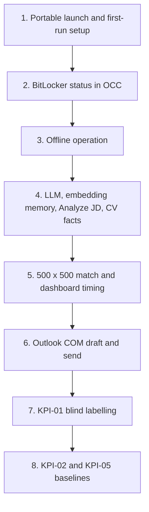

# Phase 1 UAT runbook: target-laptop validation

This script covers every Phase 1 item that
[PHASE1_TRACEABILITY.md](PHASE1_TRACEABILITY.md) marks as UAT-only or dependent on
the target laptop. CI and Linux VM evidence ([PERFORMANCE.md](PERFORMANCE.md),
[packaging/README.md](../packaging/README.md)) does not replace these steps.
Requirement IDs refer to [REQUIREMENTS_BASELINE.md](REQUIREMENTS_BASELINE.md).

**Rules for every step**

- Use only synthetic or masked data. Never use real candidate CVs, real CT/DL
  exports or real personal emails. Test mailboxes must belong to the delivery team.
- Never paste passwords, setup codes or tokens into the evidence. Record "entered"
  instead.
- Name screenshots `UAT-<step>-<n>.png` (for example `UAT-3-1.png`). Store them with
  the completed copy of this runbook.
- Fill in every **Evidence** row: the observed value, the screenshot name, and
  **Pass** or **Fail**. Explain any Fail in the Notes line.

## Test record

| Field | Value |
| --- | --- |
| Tester (role, not name) | |
| Date (UTC) | |
| Laptop model / CPU / RAM / disk | |
| Windows edition and build (`winver`) | |
| Package artifact name and source run | |
| Package SHA-256 (expected) | |

## 1. Portable launch without admin rights, hash check, first-run setup

Requirements: REQ-PKG-01, REQ-PKG-02, REQ-AUTH-03, REQ-AUTH-07; exit criterion P1-EX-07.

**Preconditions**

- Windows 11 Pro target laptop, signed in as a standard (non-admin) user.
- The model-complete ZIP (`pfc-windows-x64-with-models` artifact) copied to the
  laptop, and its expected SHA-256 from the release run's evidence.
- No earlier PFC data on this account: `%LOCALAPPDATA%\PFC\data` does not exist.

**Actions**

1. In PowerShell (not as administrator), run
   `Get-FileHash <path-to-zip> -Algorithm SHA256` and compare it with the expected value.
2. Run `whoami /groups | findstr /i "S-1-5-32-544"`. The Administrators group must be
   absent or shown as "Group used for deny only".
3. Extract the ZIP to a user-writable folder, for example `C:\Users\<you>\Tools\PFC`.
4. Double-click `PFC.cmd`. Note the time.
5. When the browser opens on the setup page, note the time. Enter the setup code
   that the console window prints (also saved in `%LOCALAPPDATA%\PFC\data\run\setup-code.txt`).
   Create the OCC Admin with a synthetic name and a test email.
6. Sign out, then sign in as that Admin.
7. In PowerShell, run `netstat -ano | findstr LISTENING` and find PFC's port (shown in
   the browser address bar).
8. Run `icacls "$env:LOCALAPPDATA\PFC\data"`.

**Expected result**

- The hash matches exactly.
- No UAC or elevation prompt appears at any point.
- The setup page opens without errors, setup succeeds, and sign-in works.
- PFC's port listens on `127.0.0.1` only, never `0.0.0.0` (REQ-AUTH-07).
- The data directory's ACL lists only the current user and `NT AUTHORITY\SYSTEM`.

**Evidence**

| Check | Value | Screenshot | Pass/Fail |
| --- | --- | --- | --- |
| SHA-256 matches | | | |
| Not an administrator | | | |
| No elevation prompt | | | |
| Launch to setup page (s) | | | |
| First-run setup and sign-in | | | |
| Listening address | | | |
| Data dir ACL entries | | | |

Notes:

## 2. BitLocker status in OCC

Requirements: REQ-AUTH-06 (SECURITY_REVIEW S6/S7). This status is informational and never blocks start-up.

**Preconditions**

- Step 1 passed; signed in as Admin.
- You know whether the system drive is BitLocker-protected. Without admin rights,
  open File Explorer → This PC: a protected drive shows a padlock icon, and its
  right-click menu shows "Manage BitLocker".

**Actions**

1. Open **OCC → Overview** and read the **Data volume encryption** tile.
2. Open `http://127.0.0.1:<port>/api/v1/health` in the browser and read
   `details.dataVolumeEncryption`.

**Expected result**

- The tile and the health field show the same value.
- It matches the drive's real state: **Encrypted** for BitLocker on, **Not encrypted**
  for off, and **Unknown** only if the status could not be read.

**Evidence**

| Check | Value | Screenshot | Pass/Fail |
| --- | --- | --- | --- |
| Drive state per File Explorer | | | |
| OCC tile value | | | |
| `/health` value | | | |

Notes:

## 3. Offline operation

Requirements: REQ-PKG-01, NFR-04 (local-first); exit criterion P1-EX-07.

**Preconditions**

- Step 1 passed.
- Synthetic inputs from the generator, written on a delivery-team machine from `PFC/app` with
  the backend environment activated, then copied to the laptop:
  `PYTHONPATH=. python scripts/generate_uat_data.py --out uat-small --demands 5 --resources 5`.
  It writes `DL.xlsx`, `CT.xlsx` and `resumes\*.txt` (example.com emails, Ofcom drama
  phone numbers only). In **Settings → Data sources**, set the resume folder to the copied
  `uat-small\resumes` folder.

**Actions**

1. Close PFC. Turn on Airplane mode, or disconnect Wi-Fi and Ethernet.
2. Start `PFC.cmd` and sign in.
3. Upload the synthetic DL and CT, have the Admin approve them, and commit.
4. Run **Sync** for one synthetic candidate.
5. On **Demand List**, choose **Analyze JD** on one demand, then **Confirm & Start**,
   and wait for the run to complete.
6. Open **Match Results** and **Dashboard**.
7. While PFC runs, run `netstat -ano` and filter for the PIDs of `python.exe` and
   `llama-server.exe` (from Task Manager → Details).

**Expected result**

- Every action completes with no network error.
- Analyze JD shows "Extracted by local AI model". A rule-based fallback warning here
  is a Fail; record the reason code shown.
- No PFC process has a connection to a non-loopback address.

**Evidence**

| Check | Value | Screenshot | Pass/Fail |
| --- | --- | --- | --- |
| Network off confirmed | | | |
| Upload, approval and commit | | | |
| CV sync | | | |
| Analyze JD method | | | |
| Run completed | | | |
| Non-loopback connections | | | |

Notes:

## 4. LLM and embedding memory, Analyze JD, CV facts

Requirements: REQ-LLM-01, REQ-LLM-07, REQ-MAT-02, REQ-IN-23. Memory target: ≤ 8 GB for LLM plus embedding (16 GB laptop).

**Preconditions**

- Step 1 passed. OCC → Approved models lists the bundled GGUF and the nomic
  embedding model as approved, and the GGUF is selected as the active model.
- At least three synthetic JDs and three synthetic CVs with known skills,
  qualifications, location and a phone number.

**Actions**

1. Open Task Manager → Details and add the **Peak working set (memory)** column.
2. Run **Analyze JD** on three demands, one after another.
3. In each JD review, compare the extracted mandatory/preferred skills,
   qualifications, location and mandatory-onsite flag with the synthetic JD. Edit
   one value and **Save draft**. Reopen and confirm the edit was kept.
4. Run **Sync** for three candidates, then open each Candidate Profile → **CV versions**.
5. Read the peak working set of `llama-server.exe` and of `python.exe`.

**Expected result**

- Each Analyze JD finishes and shows "Extracted by local AI model".
- The extracted values match the synthetic JD, apart from differences you record.
- CV facts show values with an evidence quote and a Rule or Local AI tag. Phone
  numbers stay masked. Empty categories show "Not found in CV".
- The combined peak working set of `llama-server.exe` and `python.exe` is ≤ 8 GB.

**Evidence**

| Check | Value | Screenshot | Pass/Fail |
| --- | --- | --- | --- |
| Analyze JD time per demand (s) | | | |
| Extraction differences found | | | |
| Edit saved and reloaded | | | |
| CV facts correct and masked | | | |
| Peak working set llama-server.exe (GB) | | | |
| Peak working set python.exe (GB) | | | |
| Combined ≤ 8 GB | | | |

Notes:

## 5. 500 × 500 match timing and dashboard interactions

Requirements: NFR-01, REQ-MAT-07 (incremental re-scoring); exit criterion P1-EX-06 (dashboard interactions < 2 s).

**Preconditions**

- Synthetic 500 × 500 inputs from the generator, written as in step 3 and copied to the laptop:
  `PYTHONPATH=. python scripts/generate_uat_data.py --out uat-500 --dirty-percent 1`.
  This adds `CT_dirty.xlsx`, a copy of the CT with 1% (5) of its rows changed. The CT
  deliberately includes Selected, end-dated, unparseable-date ("TBC") and unmapped-status
  rows, so expect warnings, but no errors, in the upload preview.
- Laptop on mains power; other applications closed.
- Steps 1 and 4 passed.

**Actions**

1. Upload, approve and commit the 500-row DL and CT.
2. Confirm requirements for all 500 demands (Analyze all new, then Confirm & Start
   per demand, or an existing confirmed set from the delivery team).
3. Start a full run. Read the run's start and completion timestamps from
   `http://127.0.0.1:<port>/api/v1/match-runs`.
4. Upload `CT_dirty.xlsx` from `uat-500`, check that the preview shows 5 changed rows, then
   approve and commit it.
5. Open **Match Results** and reload. The "Data changed since this run" banner names
   "DL/CT committed". Choose **Re-run changed only**, wait for the run to complete and
   reload. Read the timestamps as in action 3, and the **Mode** in the run summary
   (`incremental`, or `full (<reason>)` if the backend had to score everything).
6. On **Dashboard**, change each filter once (BU, region, account, grade) and switch
   between panels. In developer tools → Network, record the slowest `/api/v1/analytics/*`
   request and the time until the panel shows the new data.
7. On **Match Results**, filter, sort and page the grid. Record the slowest interaction.

**Expected result**

- The full run completes within the NFR-01 target in REQUIREMENTS_BASELINE.md.
- The incremental run completes with Mode `incremental`, faster than the full run, and the banner clears.
- Every dashboard and Match Results interaction completes in < 2 s.

**Evidence**

| Check | Value | Screenshot | Pass/Fail |
| --- | --- | --- | --- |
| Full run duration (s) | | | |
| Incremental run duration (s) | | | |
| Slowest analytics request (s) | | | |
| Slowest dashboard interaction (s) | | | |
| Slowest Match Results interaction (s) | | | |

Notes:

## 6. Outlook COM draft and send to a test mailbox

Requirements: REQ-EML-01, REQ-EML-04, REQ-EML-05.

**Preconditions**

- Corporate Outlook desktop is installed, signed in and open on the laptop.
- A delivery-team test mailbox on an internal domain is listed in **OCC → Internal
  domains**.
- A synthetic CT row uses the test mailbox as its Email Address, and that candidate
  appears in a completed run.

**Actions**

1. In **Match Results**, select the synthetic candidate and choose **Send selected to
   Email Approval**.
2. In **Email Approval**, open the draft. Check the recipient, subject and body.
   Choose **Approve**, then **Send**.
3. Check Outlook's Sent Items and the test mailbox's Inbox.
4. Repeat once with Outlook closed, and record what PFC shows.

**Expected result**

- Nothing is sent before **Approve**.
- After **Send**, the email arrives in the test mailbox with the approved content,
  and the PFC status shows it as sent.
- With Outlook closed, PFC shows a clear send failure and **Retry send**; it doesn't
  report the email as sent.

**Evidence**

| Check | Value | Screenshot | Pass/Fail |
| --- | --- | --- | --- |
| Draft content correct | | | |
| Send blocked until Approve | | | |
| Arrived in test mailbox (time) | | | |
| PFC status after send | | | |
| Behaviour with Outlook closed | | | |

Notes:

## 7. KPI-01 blind labelling

Requirements: KPI-01; exit criterion P1-EX-02. Method: [KPI01.md](KPI01.md).

**Preconditions**

- A completed run on a representative synthetic or masked sample, and its run ID.
- A tune/holdout partition of the demands, agreed before labelling.
- Two analysts (A and B) who have not seen PFC's results for the sample.
- The KPI-01 target, agreed with Leadership before labelling.

**Actions**

1. Each analyst independently labels suitable candidates per demand, or "no suitable",
   in the CSV format in KPI01.md, without opening Match Results.
2. A delivery-team member runs `scripts/measure_kpi01.py` against a copy of the
   laptop's data directory, with `--run-id`, `--labels A.csv` and `--labels-b B.csv`,
   as shown in KPI01.md.
3. Read the holdout figures in `kpi01.md`.

**Expected result**

- The reports are generated and contain masked emails only.
- The holdout precision@5 is recorded and compared with the agreed target. The
  holdout figure is the primary result.

**Evidence**

| Check | Value | Screenshot | Pass/Fail |
| --- | --- | --- | --- |
| Agreed target | | | |
| Labelled / scored / excluded / no-suitable | | | |
| Holdout precision@5 | | | |
| A/B agreement | | | |
| Meets target | | | |

Notes:

## 8. KPI-02 and KPI-05 baselines

Requirements: KPI-02, KPI-05; exit criterion P1-EX-03. Method: [KPI_BASELINES.md](KPI_BASELINES.md).

**Preconditions**

- Steps 3 to 6 completed, so the data directory has uploads, confirmations, runs and
  approvals.
- PFC is closed, or a copy of the data directory is used.

**Actions**

1. A delivery-team member runs `scripts/measure_kpi_baselines.py --data-dir <copy>`
   with `--out-json` and `--out-md` outside the data directory, as shown in
   KPI_BASELINES.md.
2. For KPI-02, record the analysts' manual timings for the parts PFC does not
   timestamp, as described in KPI_BASELINES.md.

**Expected result**

- Both reports are generated without errors and contain no raw emails or file paths.
- KPI-05 data-quality figures and the KPI-02 PFC timestamp part are recorded as the
  Phase 1 baseline.

**Evidence**

| Check | Value | Screenshot | Pass/Fail |
| --- | --- | --- | --- |
| KPI-05 figures | | | |
| KPI-02 PFC timestamp part | | | |
| KPI-02 manual timings | | | |
| Reports free of raw PII | | | |

Notes:

## Sign-off

| Role | Decision (Pass / Fail / Pass with actions) | Date |
| --- | --- | --- |
| UAT lead | | |
| OCC Admin | | |
| Delivery lead | | |
