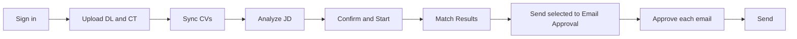

# PerfectFitCandidate — Analyst user guide

This guide covers the current screens as built in `PFC/frontend` against the `/api/v1` backend. Anything not yet available is marked **Pending** with the reason. Scores are relative matching metrics for human review, not hiring decisions.

Use the Summary card on Candidate Profile or in the JD review drawer to generate or regenerate a local, masked reading aid, expand each sentence’s evidence and regenerate after a source change; it is not used in scoring and must be checked against the source.

Summaries fully redact emails and phones; other screens use the REQ-OUT-03 mask.

Matching now scans the whole stored CV for approved dictionary skills, including
experience bullets without section headings. Skills-section evidence takes priority;
other hits quote their source line as `found in CV text: '…'` (`cv-text`).
The combined basis is CT ∪ CV: CT Skills, CV Skills and CV text all receive equal
skill credit and combined evidence identifies the source. Candidates without a CV
still score from CT Skills alone, retain `CV not found`, and use the previous
semantic behavior for experience/degree items.
Matching evidence beside Score breakdown and in email drafts also explains
`Experience: 23 yrs ≥ 5 (CV)` (`cv-experience`) and
`Degree: Bachelor, technical (CV)` (`cv-degree`). Partial experience says, for
example, `Experience: 3 yrs of 5 (CV); partial — requires validation`.
Unknown qualifications or durations retain semantic evidence and need validation.
These are overall CV years, not proof of specialist skill tenure. Scores may change
for everyone on the next scoring run; historical results remain unchanged.

## Contents

1. [Daily flow](#1-daily-flow)
2. [First sign-in and password change](#2-first-sign-in-and-password-change)
3. [Import the settings package](#3-import-the-settings-package)
4. [Upload the Demand List and Candidate Tracker](#4-upload-the-demand-list-dl-and-candidate-tracker-ct)
5. [Sync CVs](#5-sync-cvs)
6. [Analyze JD, then Confirm & Start](#6-analyze-jd-then-confirm--start)
7. [Match Results](#7-match-results)
8. [Overrides](#8-overrides)
9. [Excluded view](#9-excluded-view)
10. [Email approval and send](#10-email-approval-and-send)
11. [Dashboard](#11-dashboard)
12. [Export](#12-export)
13. [Your settings](#13-your-settings)
14. [Pending in this build](#14-pending-in-this-build)
15. [Chat with PFC data](#15-chat-with-pfc-data)

## 1. Daily flow

The left panel has Dashboard, Demand List, Bench List, Match Results, Candidate Profile, Email Approval, Chat and Settings. OCC Admin is shown to Admins only.

### Task status popups

Bottom-right task cards follow DL/CT uploads, auto-pickup, commits and discards, JD analysis,
CV sync, matching, PDF reports and Chat questions across page navigation. Each shows **Started**, **In Progress**
(with a percentage when available), **Completed**, **Failed** or **Cancelled**.
Completed cards disappear after about ten seconds. Failed cards keep a safe,
short reason until you close them; retry the action or contact your administrator.
Use **+N more** to expand beyond three cards, or **Minimize tasks** to keep just
the task count. Close a card with its Dismiss button, or press Escape while
focused inside it. Dismissed server jobs do not return during this signed-in visit.
Linked CV and matching cards open Bench List and the current Match Results view.
Auto-pickup cards name the Demand List or Candidate Tracker file and report
**committed**, **awaiting review** or **no changes**; their link opens
**Settings → Data sources**.
Polling pauses while the browser tab is hidden and resumes when it is visible.
The header Sync dot reflects active/failed tasks, not fabricated upload times;
the footer shows the selected local generation model, or `Local model: not loaded`.

Traceability: these cards provide operational feedback for the upload flow
(REQ-ING-01..03), CV sync (REQ-IN-21) and JD analysis/confirmation (REQ-MAT-02).

## 2. First sign-in and password change

1. Open PFC in the browser (by default `http://127.0.0.1:8765`).
2. On **Sign in**, choose the role **Analyst**, then enter your corporate email and the one-time password your OCC Admin gave you (or that came with the settings package).
3. A one-time password must be changed before anything else. PFC opens **Set a new password**: enter the current password, the new one twice, and meet every item on the checklist (length, character types, not your email or name, not a common password).
4. After the change you land on the Dashboard.

Later password changes are in **Settings → Account → Change password**.

If you see "Your session ended. Sign in again to continue.", the session timed out; sign in again.

Too many failed sign-ins lock the account for a period set by the OCC Admin; an Admin can unlock it early from OCC → Users & passwords.

## 3. Import the settings package

The OCC Admin publishes a signed `PFC-settings-v<N>.pfcpkg` with the approved synonyms, scoring template, status list and mapping, grades, resource-team list, internal domains and Analyst accounts. Trust comes from the signature, not from how the file reached you.

**Settings → Settings package**

- **From a file:** choose the `.pfcpkg` in the file picker (from the synced folder, Teams or email).
- **From `inbox\`:** files placed in the `inbox\` folder of the PFC data folder are detected when PFC starts and listed under **Found in inbox**. Choose one to preview it.

The preview shows the file, the package version against the installed version, signature status and a before → after list of changes by area. Choose **Apply package** to apply it in one step; if anything fails, the current settings stay unchanged and the error is shown.

**Import history** lists each version with when and by whom it was applied, and marks the **Installed** one. Rollback is offered on the installed version when an earlier applied version exists; the confirmation names the version that will be restored.

## 4. Upload the Demand List (DL) and Candidate Tracker (CT)

- **Demand List → Upload DL**
- **Bench List → Upload CT**

1. Choose the `.xlsx`. PFC finds the sheet and header row by column names, so a title row above the headers is fine.
2. Review the preview: file, detected sheet, **Rows read / New / Updated / Unchanged / Rejected**, and any row warnings (row number, column and message).
3. Choose **Commit N rows**, or **Cancel** to discard. A file identical to the last import shows "This file was already imported — nothing to do."

Alternatively, configure [DL/CT auto-pickup](#dlct-auto-pickup) in Settings.
Auto-pickup uses the same validation and commit pipeline as manual upload, with
identical results for the same workbook. Clean files can commit automatically;
files held for review use the same preview, **Commit N rows** and **Discard**
actions under **Settings → Data sources → Awaiting review**. Closing a review
dialog leaves that run awaiting review; **Discard** explicitly discards it.
Rows with error-severity issues always leave the file awaiting review, even
when automatic commit is enabled. Warnings alone do not prevent automatic commit.

In CT Skills cells, separate skills with commas, semicolons, or line breaks (including Excel Alt+Enter).

Committed changes apply to matching immediately and are queued for OCC review. Emails are copied from the CT exactly as written.

On the **Demand List**, a Code Requisition that is not in `T1XXXX`/`T2XXXX` format is flagged as a warning.

On the **Bench List**, the tabs **Eligible**, **Excluded from matching** and **All** show counts. Eligibility uses both CT skills and the latest non-removed CV skills, just as matching does; after CV Sync or a dictionary approval, the Bench List refreshes without re-uploading CT. A `NO_SKILLS` exclusion is shown as **No skills in dictionary (N unrecognised)**; hover for the safe unrecognised terms. Rows can show **Incomplete identity** (no email) and **Unmapped status** (a bench status the OCC mapping does not cover). The masked email follows the name; **Show email** reveals it where your role allows. Available Capacity is display only and never decides availability.

Each **ShortName** links to the **Candidate Profile**: the CT data as uploaded, eligibility, and the tabs **CV versions**, **Skills & evidence**, **Matches & score history** and **Activity**. Incomplete or ambiguous identities automatically open **Incomplete Candidate Information**; **Resolve identity** can reopen it. **Generate internal ID and continue** remains the default; **Review later** and selection of a matching CT record are also available. **Manual entry** accepts only a nonblank name (up to 200 characters); surrounding whitespace is removed and the identity becomes complete. It does not add or change any email or its classification. GQ-06 remains in force: an email can only be selected/copied exactly from an existing CT record, never typed, constructed or corrected. Use the matching CT record option to select an email. Resolution errors appear inline and leave the dialog open so you can choose another option.

The profile's **Overview → Classification** shows the effective classification used by the application and the computed classification from current emails and internal domains. When an Admin has overridden it, the redacted reason, setter's user ID and time are shown. Analysts see this read-only; ask an Admin to set or clear an override. Clearing requires a reason and recomputes immediately. Domains are a heuristic, not proof of employment.

An Admin can clear cached CV text in **OCC → Cached CV text**. This preserves original CV files, candidate identities and past match runs; the next CV sync re-reads the files. A removed extraction may have no facts until that sync completes.

**CV facts.** On **CV versions**, each synced CV has a **CV facts** card: name, phone, experience, qualifications, projects and **Skills**. Skills show their verbatim CV token and, when different, an approved canonical name (for example, `BA → Business Analysis`). Each value shows its source (**Rule** or **Local AI**) and an expandable **Evidence** quote from the CV. Grounded CV fact skills count alongside CT skills toward exact/synonym and semantic credit under each CV basis, using the run's current approved synonyms; recognised CV-only skills can lift a NO_SKILLS exclusion. Matching evidence labels the CV basis (for example, `CV v1`). Existing CV skill rows take precedence over duplicate fact tokens. Removed extractions contribute no fact skills, and changes to skill facts trigger changed-only rescoring. These facts are never written to `resource_skills`. Their per-skill vectors are created and cached in the vector store when matching runs, not when Sync runs. IN-21 stays Partial because Sync itself does not store skill-fact vectors, and no test asserts skill-fact vector persistence. The **Skills & evidence** scoring view is separate. Only values found in the CV text are shown; a category with nothing found shows "Not found in CV", and nothing is filled in or guessed. Phone numbers and emails stay masked in values and evidence, and there is no reveal for CV facts. A CV version whose facts have not been extracted yet shows "CV facts not extracted yet" instead.

**Compare CV versions (Phase 2).** When a candidate has two or more CV versions, **CV versions** shows a **Compare** checkbox per version. Tick exactly two and choose **Compare selected (2/2)**; the older version is shown on the left. The comparison is read-only and keeps PII masked (there is no reveal). It shows: **Facts** (name, phone, years of experience read from dated CV text, and highest degree) with expandable evidence; **Skills** and any experience, qualifications and projects marked **Added**, **Removed** or **Unchanged**; **Text differences**, a line-by-line diff of the normalised CV text with long unchanged runs collapsed; and **Scores for current demands**, the stored ranked score and each version's stored score from the current matching run (normally only the latest version is scored). **Score both versions** runs a background task (shown in the task pop-up as *CV comparison scoring CV-x vs CV-y*, which links back to the comparison). It scores each version as if it were the latest CV, using the active scoring template and each demand's run date, and shows the per-demand score delta and an expandable component breakdown (skills, grade, location, bench start/end, status and mandatory items missing). It never changes match results, rankings, shortlists or emails; run matching to change those. A version whose extraction was removed by OCC Admin can be compared but not scored. **Close comparison** returns to the CV facts cards.

**Missing phone.** A CV with no extracted phone shows a non-blocking warning on its facts card. If it is the latest CV (not necessarily the best-scoring CV), the profile also shows **Latest CV: Phone not found in CV.** This does not prevent browsing, identity resolution, sync or matching. Legacy versions with no facts do not acquire a guessed warning. Missing CV name alone currently shows "Not found in CV"; it does not reopen the identity dialog for an identity already marked complete.

## 5. Sync CVs

1. Set **Settings → Data sources → Resume folder path**, then choose **CV file formats in this folder** and save.
2. On **Bench List**, tick candidates and choose **Sync selected (N)**, or **Sync** on one row, then confirm.

CVs are searched in the configured resume folder. A missing CV is not a blocker: matching continues on CT skills.

The format checkboxes offer Word (`.docx`), PDF (`.pdf`), Text (`.txt`),
PowerPoint (`.pptx`), OpenDocument (`.odt`), Rich text (`.rtf`),
Word 97-2003 (`.doc`) and PowerPoint 97-2003 (`.ppt`). The default is `.docx`
and `.pdf`. Select at least one format; saving is blocked if none are selected.
Unticking a format does not delete or deactivate CVs already synced.

Legacy `.doc` and `.ppt` files convert offline using bundled LibreOffice 25.8.7.
If it is unavailable, the settings show **Converter not installed — save as
.docx/.pptx**. Unchecked legacy formats cannot be selected, but previously saved
legacy selections can still be unticked. Ask your administrator about a missing
converter or conversion timeouts; the extraction budget is `cv.extract_timeout_s`.

The backend CV sync job summary reports `skipped_count` and `skipped_files`
(filename and reason) when files are skipped: **format not selected** for an
unticked supported format, **format not supported** for an unknown extension,
or **converter unavailable** for a selected legacy file without a converter.
These also contribute to warnings. The Bench List does not currently display
this detailed job summary; an administrator must inspect the stored job result.

The Bench List **CV status** column shows **Synced (N)** when N CV versions are stored for that candidate, otherwise **Not synced**.

## 6. Analyze JD, then Confirm & Start

1. On **Demand List**, choose **Analyze JD** on a row, or **Analyze all new (N)** for every demand that has not been analysed.
2. The **JD review** window shows the normalised, read-only job description and the extracted requirements. Add or remove **mandatory** and **preferred** skills (type and press Enter; ✕ removes), and edit experience, **Qualifications** (separate several with `;`), domain, **Location (extracted from JD)** and **Mandatory onsite**. The header's **DL region** is the Demand List's Region column; it is shown separately and is not edited here.
3. **Save draft** keeps your edits. **Confirm & Start ▶** saves and starts a scoring run; it needs at least one mandatory skill.

Requirements marked “Evidence not found in JD text — check before confirming” need human review, but you can still edit, save and confirm them; newly added or edited skills have no extraction metadata.

“Moved to Preferred based on JD wording” or “Moved to Mandatory based on JD wording” records the post-check's category adjustment; the skill stays editable and confirmable.

**How the requirements were extracted.** When the local AI model extracted the requirements, the window shows a quiet "Extracted by local AI model" note. If the model was unavailable or its answer was unusable, the backend extracts them with rules instead. The window then shows a warning with the backend's reason code, such as `provider_unavailable`, `provider_error` or `schema_invalid`. Check every requirement carefully before **Confirm & Start**. Older drafts show neither note. Either way, nothing is scored until you choose **Confirm & Start**.

The scoring template is read-only for Analysts. The JD status column shows **Not analysed** (no requirements for the current JD yet), **Draft** (analysed or edited, not yet confirmed), **Confirmed** (Confirm & Start done for the current JD) or **JD changed** (a newer DL upload changed the JD, so only the old JD's requirements exist). **Analyze JD** appears for Not analysed and JD changed; for JD changed the review shows a banner that the JD changed since the last analysis.

## 7. Match Results

The grid shows the latest **completed** run. While a newer run is queued or running, a banner says so ("Showing the last completed results until it finishes") and the page switches to the new results when the run completes.

**Filters:** Code Requisition, Account Name, BU, Grade, Location, region, band, status, candidate type, incomplete identity, mandatory-skill status and score range.

Each row shows the band, score and the masked email after the name. Expand a row for **Score breakdown**, **Matching evidence**, **Eligibility evidence** and **Gaps / Checks**. When no candidate is suitable, the requisition shows "No suitable candidate — Weak Match shown".

The top 4 of 5 per requisition are pre-selected for email (the count is an OCC setting).

**Data changed since this run.** If DL/CT data is committed, an OCC approval or edit is made, a JD is confirmed or CVs are synced after the run on screen finished, an information banner names those reasons and notes that the scores are a point-in-time snapshot. **Re-run changed only** starts a new run with the same scope as the run on screen; the backend re-scores only changed demands and candidates when it can. **Full re-run** opens Demand List, where Analyze JD → Confirm & Start scores again. The run summary shows each run's **Mode**: `incremental`, or `full (<reason>)` with the backend's reason code, for example `scope_not_full` for a run limited to some demands, `no_base_run` or `config_changed`. The Dashboard shows the same banner for the latest completed run.

## 8. Overrides

Choose **Override** on a result row and pick one:

- **Pin (keep in shortlist)**
- **Exclude from this requisition**
- **Adjust band**

Add a reason and choose **Save override**. Overrides are recorded in the audit log.

## 9. Excluded view

**Bench List → Excluded from matching** lists bench rows that cannot be matched, with the exclusion reasons (for example an excluded bench status or a grade outside the grade list). **All** shows eligible and excluded rows together.

**Match Results → Excluded from matching** lists the people the run on screen did not score: the name (linked to the Candidate Profile) with the masked email, grade, bench status, the scope (**All requisitions**, or one requisition code) and each exclusion reason as a label; hover a label for the detail. Grade and bench status come from the current bench list. To remove one person from one requisition, use the **Exclude from this requisition** override.

## 10. Email approval and send

1. In **Match Results**, select candidates and choose **Send selected to Email Approval (N)**. Drafts are created from the completed run on screen.
2. In **Email Approval**, open a draft, edit it if needed and **Save**.
3. Approve each email: **Approve** on the open draft, **Approve selected (N)**, or **Approve all listed**. Nothing is handed off until you approve it.
4. With the default **Outlook draft file** transport, choose **Open in Outlook**, review the editable draft and attachment, then click **Send** in Outlook. Return to PFC and choose **Mark as sent**. If you close it without sending, choose **Not sent**; the email returns to Approved. Use **Open again** to reopen an active handoff. If PFC cannot open the file directly, download and open the `.eml` draft.
5. An email awaiting confirmation is labelled **Awaiting confirmation**. PFC does not detect delivery from Outlook Sent Items; it records Sent only after your confirmation. The draft file is removed after either confirmation. If the same candidate and requisition were already emailed, PFC asks you to confirm the re-send.

Recipients come from the OCC resource-team list; "No resource-team recipients" means the Admin has not set it up. Outlook COM is an Admin-selectable alternative for classic Outlook only. Replies are not tracked. Approvals, handoffs and analyst confirmations are recorded in the audit log.

## 11. Dashboard

The Dashboard is the landing page. Its current match population combines the latest completed scoring run per open demand; run information and the scoring template version are shown in the header.

- **Filters:** the same filter bar as Match Results. Grade means demand grade in demand/result views and person grade in bench views. Filters apply to the relevant population: result-only band, mandatory-skill and score filters do not restrict independent demand/bench counts, email-status totals or the time-to-email trend. The funnel and accuracy metrics follow the selected matching pairs. Latest-ingestion quality counts are not entity-filtered.
- **Sections:** Overview, Demand analytics, Bench analytics, Match & communication and Data quality.
- **Overview tiles:** Requisitions assessed (of open requisitions), Role-to-person combinations, Roles with no suitable candidate and Data-quality limitations.
- **Demand analytics:** open demand by BU and region, top skills, Grade → JD count, top accounts, start pipeline, and the DL table sorted by start date (newest first).
- **Bench analytics:** top skills, the top-5 demanded skills against eligible bench supply split by Available Capacity Y/N (display only), grade histogram, bench timeline and aging, bench status distribution, and the CT table sorted by bench start date (newest first).
- **Match & communication:** band distribution, email status counts and the validation checks.

Without a completed scoring run, match datasets are empty; demand, bench, ingestion and communication metrics can still be available. While filters update, previous values remain visible with **Updating analytics…**. Charts below the viewport render when scrolled into view. Use **View as table** to inspect chart values and **Show more** for additional table rows. Person emails in these extended cards are masked.

### Extended charts

| Chart | What it shows and how to read it |
|---|---|
| **DB-14 Demand grade × eligible bench grade** | Potential grade supply: open demand count × eligible bench count in each cell, in the configured grade order. `=` marks exact grade and `±1` adjacent grade; borders also distinguish them without colour. These are possible supply combinations, not scored matches. |
| **DB-16 Match-score histogram** | Five-point score bins; the upper boundary is excluded except that the last bin includes 100. Switch **All pairs / Top-5**; Top-5 uses stored rank ≤5 per requisition. Lines mark 61/70/90. Analyst-excluded pairs are left out. |
| **DB-17 Shortlist funnel** | Distinct requisitions with at least one non-excluded match → analyst-reviewed/shortlisted → email approved → email sent. Review uses the confirmation proxy below, not the automatic shortlist flag. |
| **DB-18 Unmatched demands** | Open requisitions without a filtered effective Strong, Potential or Avg match. Start date is ascending, missing dates last. Reason chips describe available evidence: no person in grade window, mandatory skill gap, insufficient data, all candidates excluded, or other; they are not inferred explanations. |
| **DB-19 Weekly time-to-email** | Median hours and percentage within 24 hours, grouped by UTC Monday week of sending. Time starts at the first DL ingestion, falling back to the selected demand run start. Invalid/missing/negative intervals are omitted; exactly 24 hours qualifies. Re-sends are separate samples. This is recorded sending/confirmation time, not proof of delivery. |
| **DB-20 Readiness group × bench status** | Stacked counts of active resources by CT Group and bench status, not a scoring-derived readiness assessment. |
| **DB-21 Demand region × person location** | Open region demand count × eligible bench-location count. Multi-valued locations split on slash, comma, semicolon or pipe and are deduplicated per person/location. One person can contribute to several cells. This is potential supply, not confirmed location alignment. |
| **DB-22 Top-15 JD skill co-occurrence** | Confirmed canonical mandatory/preferred skills in open JDs, with the 15 most frequent skills. Each JD counts once per skill pair; the diagonal is each skill's JD frequency. |
| **DB-24 Upskilling vs demanded skills** | Resources with CT status **Overall upskilling (New bench)**, their CT skills present/missing against the top five demanded skills, and their best filtered Match %. Missing scores are **Not recorded**, not zero. |
| **DB-25 Auto-match accuracy by run** | Hit rate at 5 and precision at 5 against the analyst-confirmation proxy below. Ratios are **0–1**, not percentages. **No analyst-confirmed shortlists yet** is missing confirmation data, not zero accuracy. |
| **DB-26 Exclusion reasons** | Stored reasons for noneligible active resources, with **other** when unspecified. One resource can have several reasons, so reason totals need not equal excluded headcount. |
| **DB-27 Candidate type split** | Active resource counts classified as Internal, External or Unknown. |
| **DB-28 Candidate contention** | Top 20 resources with Strong/Potential matches for more than one open requisition, ranked by distinct requisition count. This signals competing demand, not an assignment or reservation. |
| **DB-29 Demand aging** | Days since first DL ingestion, falling back to demand creation, in 0–6, 7–13, 14–29, 30–59 and 60+ day buckets; future origins count as zero. **Unknown start** counts unavailable age origins. **Past start without match** counts DB-18 requisitions whose position start date is before today. |
| **DB-30 Override rate per run** | Percentage of selected pairs with at least one active, nonrevoked override. The denominator includes analyst-excluded pairs. **By type** counts actions, not unique pairs, so those counts can exceed the number of overridden pairs. |

### Analyst-confirmation proxy

For DB-17 and DB-25, a pair is confirmed by an active analyst **pin/include**
whose last shortlist action has not been superseded by **unpin**, or an email
approval record/status for that demand/person pair. Analyst-excluded pairs are
not confirmed. Automatically preselected shortlist rows alone do **not** count.

- **Hit rate at 5:** confirmed requisitions with at least one confirmed pair at stored rank ≤5, divided by all confirmed requisitions in that run.
- **Precision at 5:** confirmed pairs at stored rank ≤5, divided by the actual available non-excluded top-five rows for those confirmed requisitions, not a fixed five rows per requisition.
- A missing denominator gives no ratio, not zero. Older pair-level email approvals can count in more than one contributing run. These are review/approval proxies, not independently labelled ground-truth accuracy or a staffing-success prediction.

Demand and bench views use current records even when a specific run is selected;
match views use that run's scored facts and effective overrides. Email-status
and time-to-email metrics use current demand/person filters across runs, not only messages
from the selected run. A PDF uses these same dataset definitions.

## 12. Export

**Match Results → Export** downloads the results of the completed run on screen.

1. Choose **CSV** or **XLSX**.
2. Leave **Include full emails** clear to export masked emails (the default). Tick it to export emails exactly as in the CT; this is recorded in the audit log as an unmask. If the OCC Admin has disabled unmasking for Analysts, PFC says so and you can export with masked emails instead.
3. Choose **Export CSV** or **Export XLSX**.

The current Match Results view combines the latest completed run per open demand, so earlier requisitions remain visible after a demand-scoped run. Use **Group by requisition** or the flat list, which sorts by Match % descending. Result and Dashboard filters are shared multi-selects: choose **All** or several values; values within a filter are ORed and different filters are ANDed. Requisition is an exact, case-insensitive match. Email drafts can be created from selected results across runs.

The current export starts with contributing-run metadata, then the disclaimer, then the result columns. Overridden-out rows are left out, and cells that start with a formula character are protected. The export applies the same filters as the grid. Every export is recorded in the audit log. Dashboard analytics use the same current per-demand run set unless a specific run is selected.

### PDF reports from Dashboard and Match Results

Choose **PDF report** in either page header (REQ-OUT-09).

1. Set **Scope** to **Current filters** to use that page's shared filters (and the Match Results grid's current sort), or **All** to ignore filters and use the report's default ordering.
2. Select **Sections**. Dashboard offers **Cover and provenance**, **Summary and KPIs**, **Demand analytics**, **Bench analytics**, **Match & communication**, **Unmatched demands**, **Further analytics**, and **Data quality & scoring method**; select at least one. Match Results requires both **Cover and provenance** and **Match results**.
3. Choose **Orientation**: Dashboard defaults to **Portrait**, Match Results to **Landscape**. Both can be changed.
4. Choose **Generate**. The dialog closes and a **PDF report** task card appears at the bottom right. Generation is local and runs in the background, without an LLM, network service or browser renderer. Keep PFC running until it finishes; you can navigate to other pages meanwhile.
5. When the card says **PDF report: Completed**, click its link to download `PFC-report-<job_id>.pdf`. You must still be signed in. Analysts can download their own reports; an Admin can download any completed report. If the card fails, review its safe error message and retry or contact your Admin.

**Emails are always masked**, including emails embedded in evidence text, even
if full emails are visible on screen or allowed in CSV/XLSX exports. There is no
PDF unmask option. Reports can still contain names and staffing information;
handle downloaded files under your organisation's data policy.

PDF values come from the same analytics and current-results services as the
screen: for the same scope, filters and source data, the numbers agree. Match %
uses integer rounding and other dashboard percentages retain the screen's
precision. This is not a screenshot: charts include values tables, even when
the screen has not expanded every row; the histogram includes both population
variants. Match Results is grouped by requisition with repeated column headers
and wrapped evidence, gaps and eligibility checks, with a visible truncation
note if more than **5,000 rows** match. Group order follows first appearance in
the selected sort; ordering within a requisition is preserved. Reports do not
update after later uploads, overrides or email activity: generate a new report
for changed data. Each page reminds you that the shortlist needs human review,
not an automated staffing decision.

PFC keeps its server copy at `<data>/reports/<job_id>.pdf`; on the default Windows
setup this is `%LOCALAPPDATA%\PFC\data\reports\<job_id>.pdf`, or `reports` under
the `PFC_DATA_DIR` override. Browser downloads are separate copies. Completed
task cards disappear after about ten seconds; dismissing a card does **not**
delete its file. If you no longer have the link, you can generate another report.
Server files persist until deleted; this change adds no automatic cleanup.
Generation and downloads are audit-logged.

## 13. Your settings

**Settings** has Data sources (resume folder path and DL/CT auto-sync), LLM provider (admin-approved local models only; external providers are Phase 3), Email (Outlook COM; SMTP is Phase 2), Email template, Display (Comfortable or Compact) and Account. Saving settings is recorded in the audit log.

### DL/CT auto-pickup

Configure **Auto-sync — Demand List** and **Auto-sync — Candidate Tracker**
separately under **Settings → Data sources**:

1. Tick **Enabled** and enter an absolute **Watch path**, such as
   `Z:\Staffing\DL` on a mapped drive or a local OneDrive-synced folder. The
   folder must exist and be accessible to the account running PFC. In OneDrive,
   select **Always keep on this device** for the watched folder/files. Online-only
   files are skipped as **not synced**; PFC never forces a cloud download.
2. Set **File pattern**, for example `DL_*.xlsx` or `CT_*.xlsx`. Matching is
   case-insensitive and applies only to files directly in the folder, not
   subfolders. Use a bare filename glob ending in `.xlsx`, with no `/`, `\` or
   `..`. When sharing a folder, use different patterns for DL and CT.
3. Set **Poll every N minutes** to an integer from **1–1440** (default **5**).
4. Tick **Hold for my review before committing** to preview every new file.
   Leave it clear to commit clean files automatically. Files with error rows
   still wait for review regardless of this switch.
5. Choose **Save**. A rejected path or pattern appears as an error without
   clearing your edits. Correct it and save again.

Pickup runs **only while PFC is running**, using each user's saved settings.
After a scan discovers a file, its size and modification time must stay unchanged
for about **10 seconds** before pickup; PFC checks settling files on its short
internal tick rather than waiting another full poll interval. Excel's `~$` lock
files are ignored, and a workbook with a sibling `~$<filename>` lock waits until
Excel releases it. Online-only, partially synced, changing or temporarily
unreadable files are skipped and retried; shortcuts/symlinks and reparse points
are not picked up.

Identical files are skipped: a file already committed manually can produce a
**no changes** (`no_op`) run without applying anything. The same user's watched
content for the same source kind is not picked up again, even after a discard or
failure; save changed workbook content to trigger a new run. Renaming unchanged
content does not force another import.

Each source shows its last scan time, folder reachability or error, pending
filenames and reasons, and last pickup filename, status, time and counts. These
statuses refresh about every **15 seconds** while Data sources is open. Watch
the bottom-right task card for completion, or use the source's **Awaiting review**
list and **Review** button to inspect, commit or discard a held run. Committed
changes still enter the normal OCC approval workflow.

## 14. Pending in this build

| Area | Status |
|---|---|
| Lockout countdown on sign-in | Pending: the backend answers a locked account with 401 invalid credentials. The sign-in screen shows the lockout message on a 423, with a countdown when the reply carries `Retry-After` |

## 15. Chat with PFC data

Open **Chat** and wait for **Local model ready**. Pick a suggested question or type your
own, then select **Ask**. **Recent questions** shows your last 50 questions. You can
return to a running question from the **Chat question** task card, or choose **Stop**
on the question to cancel it.

| Example | How PFC answers |
|---|---|
| How many open demands are there? | Counts open demand records. You can specify a business unit or account by name. |
| Top 5 skills in demand for INS this month | Counts mandatory and preferred skills once per open demand with a confirmed JD, using its position start date for this month's filter. |
| Who on the bench has Databricks and is C1–C2? | Lists masked resource IDs for active, eligible bench records with the skill in the CT or latest available CV, using the configured grade order. |
| Why is Resource #42 ranked #2 for T10001? | Shows the score, band and stored component points in the latest completed assessment for that open requisition. Use the actual resource ID, requisition and rank. |

Open the links in **Sources** to check the records used. Chat shows masked resource
IDs and strips recognized names and contact details. Use requisition codes and
resource IDs and keep personal information out of your questions. Questions and
answers are recorded locally. If PFC has no matching data, the answer says so.
Use **Check again** after restoring the local model in **Settings**. Chat is
read-only. Use the usual matching and approval screens for staffing and outreach.
