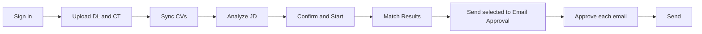

# PerfectFitCandidate — Analyst user guide (Phase 1)

This guide covers the Phase 1 screens as built in `PFC/frontend` against the `/api/v1` backend. Anything not yet available is marked **Pending** with the reason. Scores are relative matching metrics for human review, not hiring decisions.

Use the Summary card on Candidate Profile or in the JD review drawer to generate or regenerate a local, masked reading aid, expand each sentence’s evidence and regenerate after a source change; it is not used in scoring and must be checked against the source.

Summaries fully redact emails and phones; other screens use the REQ-OUT-03 mask.

## Contents

1. [Daily flow](#1-daily-flow)
2. [First sign-in and password change](#2-first-sign-in-and-password-change)
3. [Import the settings package](#3-import-the-settings-package)
4. [Upload the Demand List and Candidate Tracker](#4-upload-the-demand-list-dl-and-candidate-tracker-ct)
5. [Sync CVs](#5-sync-cvs)
6. [Analyze JD, then Confirm & Start](#6-analyze-jd-then-confirm--start)
7. [Match Results](#7-match-results)
8. [Overrides](#8-overrides)
9. [Excluded view](#9-excluded-view)
10. [Email approval and send](#10-email-approval-and-send)
11. [Dashboard](#11-dashboard)
12. [Export](#12-export)
13. [Your settings](#13-your-settings)
14. [Pending in this build](#14-pending-in-this-build)

## 1. Daily flow

The left panel has Dashboard, Demand List, Bench List, Match Results, Candidate Profile, Email Approval and Settings. OCC Admin is shown to Admins only. Chat is Phase 2 and is not shown.

## 2. First sign-in and password change

1. Open PFC in the browser (by default `http://127.0.0.1:8765`).
2. On **Sign in**, choose the role **Analyst**, then enter your corporate email and the one-time password your OCC Admin gave you (or that came with the settings package).
3. A one-time password must be changed before anything else. PFC opens **Set a new password**: enter the current password, the new one twice, and meet every item on the checklist (length, character types, not your email or name, not a common password).
4. After the change you land on the Dashboard.

Later password changes are in **Settings → Account → Change password**.

If you see "Your session ended. Sign in again to continue.", the session timed out; sign in again.

Too many failed sign-ins lock the account for a period set by the OCC Admin; an Admin can unlock it early from OCC → Users & passwords.

## 3. Import the settings package

The OCC Admin publishes a signed `PFC-settings-v<N>.pfcpkg` with the approved synonyms, scoring template, status list and mapping, grades, resource-team list, internal domains and Analyst accounts. Trust comes from the signature, not from how the file reached you.

**Settings → Settings package**

- **From a file:** choose the `.pfcpkg` in the file picker (from the synced folder, Teams or email).
- **From `inbox\`:** files placed in the `inbox\` folder of the PFC data folder are detected when PFC starts and listed under **Found in inbox**. Choose one to preview it.

The preview shows the file, the package version against the installed version, signature status and a before → after list of changes by area. Choose **Apply package** to apply it in one step; if anything fails, the current settings stay unchanged and the error is shown.

**Import history** lists each version with when and by whom it was applied, and marks the **Installed** one. Rollback is offered on the installed version when an earlier applied version exists; the confirmation names the version that will be restored.

## 4. Upload the Demand List (DL) and Candidate Tracker (CT)

- **Demand List → Upload DL**
- **Bench List → Upload CT**

1. Choose the `.xlsx`. PFC finds the sheet and header row by column names, so a title row above the headers is fine.
2. Review the preview: file, detected sheet, **Rows read / New / Updated / Unchanged / Rejected**, and any row warnings (row number, column and message).
3. Choose **Commit N rows**, or **Cancel** to discard. A file identical to the last import shows "This file was already imported — nothing to do."

In CT Skills cells, separate skills with commas, semicolons, or line breaks (including Excel Alt+Enter).

Committed changes apply to matching immediately and are queued for OCC review. Emails are copied from the CT exactly as written.

On the **Demand List**, a Code Requisition that is not in `T1XXXX`/`T2XXXX` format is flagged as a warning.

On the **Bench List**, the tabs **Eligible**, **Excluded from matching** and **All** show counts. Eligibility uses both CT skills and the latest non-removed CV skills, just as matching does; after CV Sync or a dictionary approval, the Bench List refreshes without re-uploading CT. A `NO_SKILLS` exclusion is shown as **No skills in dictionary (N unrecognised)**; hover for the safe unrecognised terms. Rows can show **Incomplete identity** (no email) and **Unmapped status** (a bench status the OCC mapping does not cover). The masked email follows the name; **Show email** reveals it where your role allows. Available Capacity is display only and never decides availability.

Each **ShortName** links to the **Candidate Profile**: the CT data as uploaded, eligibility, and the tabs **CV versions**, **Skills & evidence**, **Matches & score history** and **Activity**. Incomplete or ambiguous identities automatically open **Incomplete Candidate Information**; **Resolve identity** can reopen it. **Generate internal ID and continue** remains the default; **Review later** and selection of a matching CT record are also available. **Manual entry** accepts only a nonblank name (up to 200 characters); surrounding whitespace is removed and the identity becomes complete. It does not add or change any email or its classification. GQ-06 remains in force: an email can only be selected/copied exactly from an existing CT record, never typed, constructed or corrected. Use the matching CT record option to select an email. Resolution errors appear inline and leave the dialog open so you can choose another option.

The profile's **Overview → Classification** shows the effective classification used by the application and the computed classification from current emails and internal domains. When an Admin has overridden it, the redacted reason, setter's user ID and time are shown. Analysts see this read-only; ask an Admin to set or clear an override. Clearing requires a reason and recomputes immediately. Domains are a heuristic, not proof of employment.

An Admin can clear cached CV text in **OCC → Cached CV text**. This preserves original CV files, candidate identities and past match runs; the next CV sync re-reads the files. A removed extraction may have no facts until that sync completes.

**CV facts.** On **CV versions**, each synced CV has a **CV facts** card: name, phone, experience, qualifications, projects and **Skills**. Skills show their verbatim CV token and, when different, an approved canonical name (for example, `BA → Business Analysis`). Each value shows its source (**Rule** or **Local AI**) and an expandable **Evidence** quote from the CV. Grounded CV fact skills count alongside CT skills toward exact/synonym and semantic credit under each CV basis, using the run's current approved synonyms; recognised CV-only skills can lift a NO_SKILLS exclusion. Matching evidence labels the CV basis (for example, `CV v1`). Existing CV skill rows take precedence over duplicate fact tokens. Removed extractions contribute no fact skills, and changes to skill facts trigger changed-only rescoring. These facts are never written to `resource_skills`. Their per-skill vectors are created and cached in the vector store when matching runs, not when Sync runs. IN-21 stays Partial because Sync itself does not store skill-fact vectors, and no test asserts skill-fact vector persistence. The **Skills & evidence** scoring view is separate. Only values found in the CV text are shown; a category with nothing found shows "Not found in CV", and nothing is filled in or guessed. Phone numbers and emails stay masked in values and evidence, and there is no reveal for CV facts. A CV version whose facts have not been extracted yet shows "CV facts not extracted yet" instead.

**Missing phone.** A CV with no extracted phone shows a non-blocking warning on its facts card. If it is the latest CV (not necessarily the best-scoring CV), the profile also shows **Latest CV: Phone not found in CV.** This does not prevent browsing, identity resolution, sync or matching. Legacy versions with no facts do not acquire a guessed warning. Missing CV name alone currently shows "Not found in CV"; it does not reopen the identity dialog for an identity already marked complete.

## 5. Sync CVs

1. Set **Settings → Data sources → Resume folder path** once.
2. On **Bench List**, tick candidates and choose **Sync selected (N)**, or **Sync** on one row, then confirm.

CVs are searched in the configured resume folder. A missing CV is not a blocker: matching continues on CT skills.

The Bench List **CV status** column shows **Synced (N)** when N CV versions are stored for that candidate, otherwise **Not synced**.

## 6. Analyze JD, then Confirm & Start

1. On **Demand List**, choose **Analyze JD** on a row, or **Analyze all new (N)** for every demand that has not been analysed.
2. The **JD review** window shows the normalised, read-only job description and the extracted requirements. Add or remove **mandatory** and **preferred** skills (type and press Enter; ✕ removes), and edit experience, **Qualifications** (separate several with `;`), domain, **Location (extracted from JD)** and **Mandatory onsite**. The header's **DL region** is the Demand List's Region column; it is shown separately and is not edited here.
3. **Save draft** keeps your edits. **Confirm & Start ▶** saves and starts a scoring run; it needs at least one mandatory skill.

Requirements marked “Evidence not found in JD text — check before confirming” need human review, but you can still edit, save and confirm them; newly added or edited skills have no extraction metadata.

“Moved to Preferred based on JD wording” or “Moved to Mandatory based on JD wording” records the post-check's category adjustment; the skill stays editable and confirmable.

**How the requirements were extracted.** When the local AI model extracted the requirements, the window shows a quiet "Extracted by local AI model" note. If the model was unavailable or its answer was unusable, the backend extracts them with rules instead. The window then shows a warning with the backend's reason code, such as `provider_unavailable`, `provider_error` or `schema_invalid`. Check every requirement carefully before **Confirm & Start**. Older drafts show neither note. Either way, nothing is scored until you choose **Confirm & Start**.

The scoring template is read-only for Analysts. The JD status column shows **Not analysed** (no requirements for the current JD yet), **Draft** (analysed or edited, not yet confirmed), **Confirmed** (Confirm & Start done for the current JD) or **JD changed** (a newer DL upload changed the JD, so only the old JD's requirements exist). **Analyze JD** appears for Not analysed and JD changed; for JD changed the review shows a banner that the JD changed since the last analysis.

## 7. Match Results

The grid shows the latest **completed** run. While a newer run is queued or running, a banner says so ("Showing the last completed results until it finishes") and the page switches to the new results when the run completes.

**Filters:** Code Requisition, Account Name, BU, Grade, Location, region, band, status, candidate type, incomplete identity, mandatory-skill status and score range.

Each row shows the band, score and the masked email after the name. Expand a row for **Score breakdown**, **Matching evidence**, **Eligibility evidence** and **Gaps / Checks**. When no candidate is suitable, the requisition shows "No suitable candidate — Weak Match shown".

The top 4 of 5 per requisition are pre-selected for email (the count is an OCC setting).

**Data changed since this run.** If DL/CT data is committed, an OCC approval or edit is made, a JD is confirmed or CVs are synced after the run on screen finished, an information banner names those reasons and notes that the scores are a point-in-time snapshot. **Re-run changed only** starts a new run with the same scope as the run on screen; the backend re-scores only changed demands and candidates when it can. **Full re-run** opens Demand List, where Analyze JD → Confirm & Start scores again. The run summary shows each run's **Mode**: `incremental`, or `full (<reason>)` with the backend's reason code, for example `scope_not_full` for a run limited to some demands, `no_base_run` or `config_changed`. The Dashboard shows the same banner for the latest completed run.

## 8. Overrides

Choose **Override** on a result row and pick one:

- **Pin (keep in shortlist)**
- **Exclude from this requisition**
- **Adjust band**

Add a reason and choose **Save override**. Overrides are recorded in the audit log.

## 9. Excluded view

**Bench List → Excluded from matching** lists bench rows that cannot be matched, with the exclusion reasons (for example an excluded bench status or a grade outside the grade list). **All** shows eligible and excluded rows together.

**Match Results → Excluded from matching** lists the people the run on screen did not score: the name (linked to the Candidate Profile) with the masked email, grade, bench status, the scope (**All requisitions**, or one requisition code) and each exclusion reason as a label; hover a label for the detail. Grade and bench status come from the current bench list. To remove one person from one requisition, use the **Exclude from this requisition** override.

## 10. Email approval and send

1. In **Match Results**, select candidates and choose **Send selected to Email Approval (N)**. Drafts are created from the completed run on screen.
2. In **Email Approval**, open a draft, edit it if needed and **Save**.
3. Approve each email: **Approve** on the open draft, **Approve selected (N)**, or **Approve all listed**. Nothing is handed off until you approve it.
4. With the default **Outlook draft file** transport, choose **Open in Outlook**, review the editable draft and attachment, then click **Send** in Outlook. Return to PFC and choose **Mark as sent**. If you close it without sending, choose **Not sent**; the email returns to Approved. Use **Open again** to reopen an active handoff. If PFC cannot open the file directly, download and open the `.eml` draft.
5. An email awaiting confirmation is labelled **Awaiting confirmation**. PFC does not detect delivery from Outlook Sent Items; it records Sent only after your confirmation. The draft file is removed after either confirmation. If the same candidate and requisition were already emailed, PFC asks you to confirm the re-send.

Recipients come from the OCC resource-team list; "No resource-team recipients" means the Admin has not set it up. Outlook COM is an Admin-selectable alternative for classic Outlook only. Replies are not tracked. Approvals, handoffs and analyst confirmations are recorded in the audit log.

## 11. Dashboard

The Dashboard is the landing page. It uses the latest completed scoring run; the run date and template version are shown in the header.

- **Filters:** the same filter bar as Match Results. The Grade filter applies to the demand's local grade, not the candidate's person grade.
- **Sections:** Overview, Demand analytics, Bench analytics, Match & communication and Data quality.
- **Overview tiles:** Requisitions assessed (of open requisitions), Role-to-person combinations, Roles with no suitable candidate and Data-quality limitations.
- **Demand analytics:** open demand by BU and region, top skills, Grade → JD count, top accounts, start pipeline, and the DL table sorted by start date (newest first).
- **Bench analytics:** top skills, the top-5 demanded skills against eligible bench supply split by Available Capacity Y/N (display only), grade histogram, bench timeline and aging, bench status distribution, and the CT table sorted by bench start date (newest first).
- **Match & communication:** band distribution, email status counts and the validation checks.

With no completed run yet, the tiles show zero and the charts are empty.

## 12. Export

**Match Results → Export** downloads the results of the completed run on screen.

1. Choose **CSV** or **XLSX**.
2. Leave **Include full emails** clear to export masked emails (the default). Tick it to export emails exactly as in the CT; this is recorded in the audit log as an unmask. If the OCC Admin has disabled unmasking for Analysts, PFC says so and you can export with masked emails instead.
3. Choose **Export CSV** or **Export XLSX**.

The current Match Results view combines the latest completed run per open demand, so earlier requisitions remain visible after a demand-scoped run. Use **Group by requisition** or the flat list, which sorts by Match % descending. Result and Dashboard filters are shared multi-selects: choose **All** or several values; values within a filter are ORed and different filters are ANDed. Requisition is an exact, case-insensitive match. Email drafts can be created from selected results across runs.

The current export starts with contributing-run metadata, then the disclaimer, then the result columns. Overridden-out rows are left out, and cells that start with a formula character are protected. The export applies the same filters as the grid. Every export is recorded in the audit log. Dashboard analytics use the same current per-demand run set unless a specific run is selected.

PDF report download is Phase 2 (REQ-OUT-09).

## 13. Your settings

**Settings** has Data sources (resume folder path; DL/CT auto-sync is a Phase 2 placeholder), LLM provider (admin-approved local models only; external providers are Phase 3), Email (Outlook COM; SMTP is Phase 2), Email template, Display (Comfortable or Compact) and Account. Saving settings is recorded in the audit log.

## 14. Pending in this build

| Area | Status |
|---|---|
| PDF export | Phase 2 |
| DL/CT auto-sync, SMTP, Chat | Phase 2 |
| Lockout countdown on sign-in | Pending: the backend answers a locked account with 401 invalid credentials. The sign-in screen shows the lockout message on a 423, with a countdown when the reply carries `Retry-After` |
