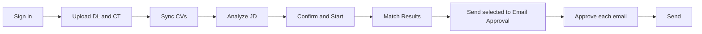

# PerfectFitCandidate — Analyst user guide (Phase 1)

This guide covers the Phase 1 screens as built in `PFC/frontend` against the `/api/v1` backend. Anything not yet available is marked **Pending** with the reason. Scores are relative matching metrics for human review, not hiring decisions.

## Contents

1. [Daily flow](#1-daily-flow)
2. [First sign-in and password change](#2-first-sign-in-and-password-change)
3. [Import the settings package](#3-import-the-settings-package)
4. [Upload the Demand List and Candidate Tracker](#4-upload-the-demand-list-dl-and-candidate-tracker-ct)
5. [Sync CVs](#5-sync-cvs)
6. [Analyze JD, then Confirm & Start](#6-analyze-jd-then-confirm--start)
7. [Match Results](#7-match-results)
8. [Overrides](#8-overrides)
9. [Excluded view](#9-excluded-view)
10. [Email approval and send](#10-email-approval-and-send)
11. [Dashboard](#11-dashboard)
12. [Export](#12-export)
13. [Your settings](#13-your-settings)
14. [Pending in this build](#14-pending-in-this-build)

## 1. Daily flow

The left panel has Dashboard, Demand List, Bench List, Match Results, Candidate Profile, Email Approval and Settings. OCC Admin is shown to Admins only. Chat is Phase 2 and is not shown.

## 2. First sign-in and password change

1. Open PFC in the browser (by default `http://127.0.0.1:8765`).
2. On **Sign in**, choose the role **Analyst**, then enter your corporate email and the one-time password your OCC Admin gave you (or that came with the settings package).
3. A one-time password must be changed before anything else. PFC opens **Set a new password**: enter the current password, the new one twice, and meet every item on the checklist (length, character types, not your email or name, not a common password).
4. After the change you land on the Dashboard.

Later password changes are in **Settings → Account → Change password**.

If you see "Your session ended. Sign in again to continue.", the session timed out; sign in again.

Too many failed sign-ins lock the account for a period set by the OCC Admin; an Admin can unlock it early from OCC → Users & passwords.

## 3. Import the settings package

The OCC Admin publishes a signed `PFC-settings-v<N>.pfcpkg` with the approved synonyms, scoring template, status list and mapping, grades, resource-team list, internal domains and Analyst accounts. Trust comes from the signature, not from how the file reached you.

**Settings → Settings package**

- **From a file:** choose the `.pfcpkg` in the file picker (from the synced folder, Teams or email).
- **From `inbox\`:** files placed in the `inbox\` folder of the PFC data folder are detected when PFC starts and listed under **Found in inbox**. Choose one to preview it.

The preview shows the file, the package version against the installed version, signature status and a before → after list of changes by area. Choose **Apply package** to apply it in one step; if anything fails, the current settings stay unchanged and the error is shown.

**Import history** lists each version with when and by whom it was applied, and marks the **Installed** one. Rollback is offered on the installed version when an earlier applied version exists; the confirmation names the version that will be restored.

## 4. Upload the Demand List (DL) and Candidate Tracker (CT)

- **Demand List → Upload DL**
- **Bench List → Upload CT**

1. Choose the `.xlsx`. PFC finds the sheet and header row by column names, so a title row above the headers is fine.
2. Review the preview: file, detected sheet, **Rows read / New / Updated / Unchanged / Rejected**, and any row warnings (row number, column and message).
3. Choose **Commit N rows**, or **Cancel** to discard. A file identical to the last import shows "This file was already imported — nothing to do."

Committed changes apply to matching immediately and are queued for OCC review. Emails are copied from the CT exactly as written.

On the **Demand List**, a Code Requisition that is not in `T1XXXX`/`T2XXXX` format is flagged as a warning.

On the **Bench List**, the tabs **Eligible**, **Excluded from matching** and **All** show counts. Rows can show **Incomplete identity** (no email) and **Unmapped status** (a bench status the OCC mapping does not cover). The masked email follows the name; **Show email** reveals it where your role allows. Available Capacity is display only and never decides availability.

## 5. Sync CVs

1. Set **Settings → Data sources → Resume folder path** once.
2. On **Bench List**, tick candidates and choose **Sync selected (N)**, or **Sync** on one row, then confirm.

CVs are searched in the configured resume folder. A missing CV is not a blocker: matching continues on CT skills.

**Pending:** the Bench List **CV status** column shows "Not synced" for every row, because the bench list rows from the backend do not yet carry CV data.

## 6. Analyze JD, then Confirm & Start

1. On **Demand List**, choose **Analyze JD** on a row, or **Analyze all new (N)** for every demand that has not been analysed.
2. The **JD review** window shows the normalised, read-only job description and the extracted requirements. Add or remove **mandatory** and **preferred** skills (type and press Enter; ✕ removes).
3. **Save draft** keeps your edits. **Confirm & Start ▶** saves and starts a scoring run; it needs at least one mandatory skill.

The scoring template is read-only for Analysts. The JD status column moves from Not analysed → Analysed — awaiting confirmation → Confirmed — scoring → Scored.

## 7. Match Results

The grid shows the latest **completed** run. While a newer run is queued or running, a banner says so ("Showing the last completed results until it finishes") and the page switches to the new results when the run completes.

**Filters:** Code Requisition, Account Name, BU, Grade, Location, region, band, status, candidate type, incomplete identity, mandatory-skill status and score range.

Each row shows the band, score and the masked email after the name. Expand a row for **Score breakdown**, **Matching evidence**, **Eligibility evidence** and **Gaps / Checks**. When no candidate is suitable, the requisition shows "No suitable candidate — Weak Match shown".

The top 4 of 5 per requisition are pre-selected for email (the count is an OCC setting).

## 8. Overrides

Choose **Override** on a result row and pick one:

- **Pin (keep in shortlist)**
- **Exclude from this requisition**
- **Adjust band**

Add a reason and choose **Save override**. Overrides are recorded in the audit log.

## 9. Excluded view

**Bench List → Excluded from matching** lists bench rows that cannot be matched, with the exclusion reasons (for example an excluded bench status or a grade outside the grade list). **All** shows eligible and excluded rows together.

**Pending:** a per-run excluded list in Match Results. The backend serves `GET /match-runs/{id}/excluded`, but the Match Results screen does not show it yet. To remove one person from one requisition, use the **Exclude from this requisition** override.

## 10. Email approval and send

1. In **Match Results**, select candidates and choose **Send selected to Email Approval (N)**. Drafts are created from the completed run on screen.
2. In **Email Approval**, open a draft, edit it if needed and **Save**.
3. Approve each email: **Approve** on the open draft, **Approve selected (N)**, or **Approve all listed**. Each email gets its own Approved state; nothing is sent until you choose **Send**.
4. **Send** is enabled only for Approved emails. A failed send shows the reason and offers **Retry send**.
5. If the same candidate and requisition were already emailed, PFC asks you to confirm the re-send.

Recipients come from the OCC resource-team list; "No resource-team recipients" means the Admin has not set it up. Status stops at Sent or Failed; replies are not tracked. Approvals and sends are recorded in the audit log.

## 11. Dashboard

**Pending:** the Dashboard sections (Overview, Demand analytics, Bench analytics, Match & communication, Data quality) read the `/analytics/*` endpoints, which are not merged yet. Against the real backend the Dashboard shows an error with **Retry** until they are.

## 12. Export

- **Match Results → Export CSV** downloads the filtered grid as CSV. Cells that start with a formula character are protected.
- **Pending:** PDF report download of the dashboard and match results is Phase 2 (REQ-OUT-09).

## 13. Your settings

**Settings** has Data sources (resume folder path; DL/CT auto-sync is a Phase 2 placeholder), LLM provider (admin-approved local models only; external providers are Phase 3), Email (Outlook COM; SMTP is Phase 2), Email template, Display (Comfortable or Compact) and Account. Saving settings is recorded in the audit log.

## 14. Pending in this build

| Area | Status |
|---|---|
| Dashboard analytics | Pending: `/analytics/*` not merged |
| Candidate Profile | Pending: `GET /candidates/{id}` not served; bench names are not links yet |
| Bench List CV status | Pending: list rows carry no CV data yet |
| Per-run excluded list in Match Results | Pending: not on screen yet |
| PDF export | Phase 2 |
| DL/CT auto-sync, SMTP, Chat | Phase 2 |
| Lockout countdown on sign-in | Pending: the backend answers a lockout as invalid credentials |
