# PerfectFitCandidate (PFC) — End-to-End Workflow

| Item | Value |
|---|---|
| Document | End-to-end workflow and operating procedures |
| Version | 1.0 |
| Status | Draft |
| Source of truth | [REQUIREMENTS_BASELINE.md](REQUIREMENTS_BASELINE.md) |
| Related documents | [FDD.md](FDD.md) · [BRD.md](BRD.md) · [TDD.md](TDD.md) · [ARCHITECTURE.md](ARCHITECTURE.md) · [GUI_OCC_DESIGN.md](GUI_OCC_DESIGN.md) · [FEASIBILITY.md](FEASIBILITY.md) · [PHASES.md](PHASES.md) · [DASHBOARD_RESEARCH.md](DASHBOARD_RESEARCH.md) |

## Table of contents

- [1. Purpose and scope](#1-purpose-and-scope)
- [2. Overall workflow](#2-overall-workflow)
- [3. Responsibility matrix (swimlanes)](#3-responsibility-matrix-swimlanes)
- [4. Step-by-step workflows](#4-step-by-step-workflows)
  - [4.1 Ingestion — upload, parse/validate, dedupe](#41-ingestion--upload-parsevalidate-dedupe)
  - [4.2 Resume sync and embedding/indexing](#42-resume-sync-and-embeddingindexing)
  - [4.3 JD analysis, eligibility, matching and scoring](#43-jd-analysis-eligibility-matching-and-scoring)
  - [4.4 Review, filter and override](#44-review-filter-and-override)
  - [4.5 Email approval, sending, sent flag and follow-up](#45-email-approval-sending-sent-flag-and-follow-up)
  - [4.6 Archival and housekeeping](#46-archival-and-housekeeping)
- [5. Timing and SLA](#5-timing-and-sla)
- [6. Exception paths](#6-exception-paths)
- [7. Persona day-in-the-life flows](#7-persona-day-in-the-life-flows)
- [8. Phase applicability](#8-phase-applicability)
- [9. Open questions](#9-open-questions)

---

## 1. Purpose and scope

This document describes how work flows through PFC from a new Demand List (DL) and Candidate Tracker (CT) to an emailed candidate, a follow-up and eventual archival. It complements the feature-level rules in [FDD.md](FDD.md) (FR-* IDs) and the requirement IDs in [REQUIREMENTS_BASELINE.md](REQUIREMENTS_BASELINE.md) (REQ-*). Screen-level detail is in [GUI_OCC_DESIGN.md](GUI_OCC_DESIGN.md); component detail in [ARCHITECTURE.md](ARCHITECTURE.md) and [TDD.md](TDD.md).

Guiding principles that apply to every step:

- PFC produces a **shortlist for human review**; nothing is sent without explicit per-profile approval (REQ-EML-01, REQ-SCR-05).
- Scoring is **deterministic** and reproducible; the LLM is used for extraction and drafting only (REQ-LLM-02, REQ-MAT-08).
- Each Analyst uploads their own DL and CT copies to their separate local instance. Network-backed features are available only when their active flag is enabled in Settings; all core matching runs locally (NFR-02).

## 2. Overall workflow

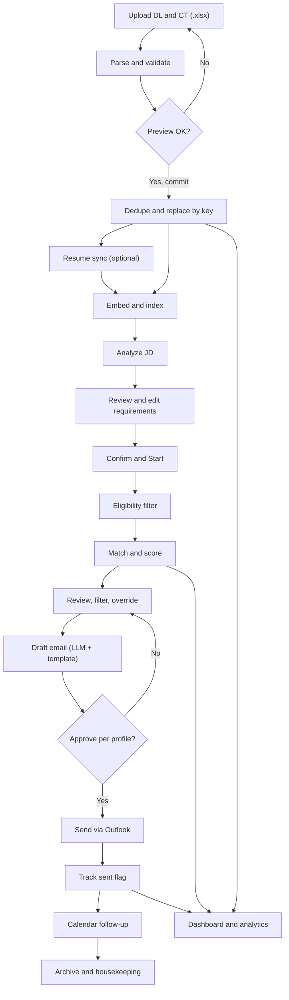

| Step | Owner | Key rules | FDD |
|---|---|---|---|
| Upload | Each Analyst on their own instance | Upload own DL/CT copies; auto-pickup Phase 2 | §2.1, §2.2 |
| Parse / validate | System | Header-row detection, varying sheet name, UK dates incl. `Wed 4/11/2026`, formula cached values | FR-ING-02..11 |
| Dedupe | System | DL key `Code Requisition`; CT key `ShortName` + `Email Address`; replace with newest | FR-ING-06 |
| Resume sync | Analyst triggers, System executes | Per-candidate / global Sync; missing CV not a blocker | §2.3 |
| Embed / index | System | Local embedding model, versioned vectors | FR-MAT-42 |
| JD analysis & confirm | Analyst A, System | Analyze JD → review/edit → Confirm & Start | §3 |
| Eligibility | System | Exclude mapped excluded statuses, Group Not on Bench, and parseable filled Bench End Date; unparseable Bench End Date stays eligible with "pending review"; unmapped status stays eligible at priority 2 / binary score 0 and is flagged; grade ±1 | §4.1–4.3 |
| Match & score | System | 70/10/5/5/5/5, bands, top 5, weak-match rule | §4.5–4.6 |
| Review / override | Analyst A, Admin | Pin, unpin, exclude, adjust band with comment | §4.7 |
| Approve email | Analyst A | Per-profile approval, top 4 pre-selected | §7 |
| Send | Outlook | COM primary, SMTP Phase 2 | FR-EML-06 |
| Sent flag | System | Draft → Approved → Sent / Failed, no duplicates | FR-EML-07, FR-EML-08 |
| Follow-up | Outlook | Calendar reminder at +1 business day (Phase 2) | FR-EML-10 |
| Archive | OCC Admin | Manual with preview (Phase 2), automated (Phase 3) | §11 |

## 3. Responsibility matrix (swimlanes)

R = responsible (does the work), A = approves / accountable, C = consulted / provides input, I = informed, — = not involved.

| Step | Analyst | Admin / OCC | System | Outlook | Candidate |
|---|---|---|---|---|---|
| Upload DL / CT | R | R (may also upload), A (later approval of entries) | C (validation, preview) | — | — |
| Parse, validate, dedupe | I (reviews preview, commits) | I | R | — | — |
| Configure resume folder / auto-sync paths | R (own Settings) | — | C (path validation) | — | — |
| Resume sync | R (triggers) | — | R (extract, store, index) | — | — |
| Incomplete Candidate Information | R (manual entry / internal ID / later) | A (may modify later) | C (prompt) | — | — |
| Embed / index | — | — | R | — | — |
| Analyze JD | R (trigger) | C (default requirement sets) | R (LLM extraction) | — | — |
| Review / confirm requirements | R, A | — | I | — | — |
| Eligibility + scoring | I | C (template, synonyms, status list) | R | — | — |
| Review shortlist, overrides | R | R (may override), I | C (breakdown, evidence) | — | — |
| Approve OCC changes to DL/CT entries | — | R, A | C (re-score) | — | — |
| Draft email | R (edit) | C (default template, resource-team list) | R (LLM draft) | — | — |
| Approve email | R, A | — | C (blocks if checks fail) | — | — |
| Send email | I | I (CC via resource-team list) | R (hands off) | R (delivers) | I (receives) |
| Track sent flag | I | I | R | C (send result) | — |
| Update and share CV with SPOCs | I | — | — | — | R (outside PFC) |
| Calendar follow-up | R (attends follow-up) | — | R (creates item) | R (stores reminder) | — |
| Analytics (demand / bench / match) | R (B, C, A) | I | R (computes) | — | — |
| Archival and housekeeping | I | R, A | R (executes, previews) | — | — |
| Audit review | — | R | R (records) | — | — |

## 4. Step-by-step workflows

### 4.1 Ingestion — upload, parse/validate, dedupe

Trigger: an analyst receives a new DL or updates the CT (REQ-ING-01). Phase 2 adds auto-pickup from a synced folder (REQ-ING-04).

1. Analyst opens **Upload**, selects DL or CT and chooses the `.xlsx` file.
2. System computes the file hash; identical hash → "already imported", stop (REQ-ING-06).
3. System finds the sheet by headers (name varies), detects the header row (CT title row, blank first header → ShortName), reads rows until the last keyed row (REQ-IN-01, REQ-IN-10).
4. System parses dates (Excel dates and `Wed 4/11/2026` day-first), reads cached values of formula cells, normalises JD text and skills, copies emails exactly (REQ-IN-03, REQ-IN-12..14).
5. System shows the **preview**: new / updated / unchanged / rejected / skipped counts and warnings (REQ-ING-02).
6. Analyst commits (or cancels). System applies replace-by-key, records the run, creates JD versions for changed JDs, flags demands absent from the DL as "Not in latest DL", sets an OCC Admin notification flag for the uploaded changes, and queues incremental re-scoring (REQ-IN-02, REQ-IN-11, REQ-ING-03, REQ-MAT-07).
7. OCC Admin later sees changed entries in the approval queue (REQ-ROLE-03).

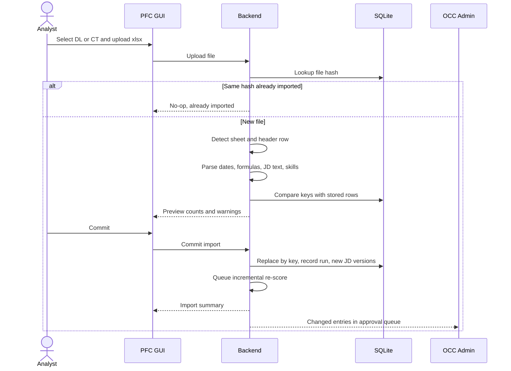

### 4.2 Resume sync and embedding/indexing

Trigger: analyst clicks **Sync** on a candidate, or selects candidates and clicks the global **Sync** (enabled only when ≥ 1 is selected) (REQ-IN-21). Resume folder configured in Settings (REQ-ING-05).

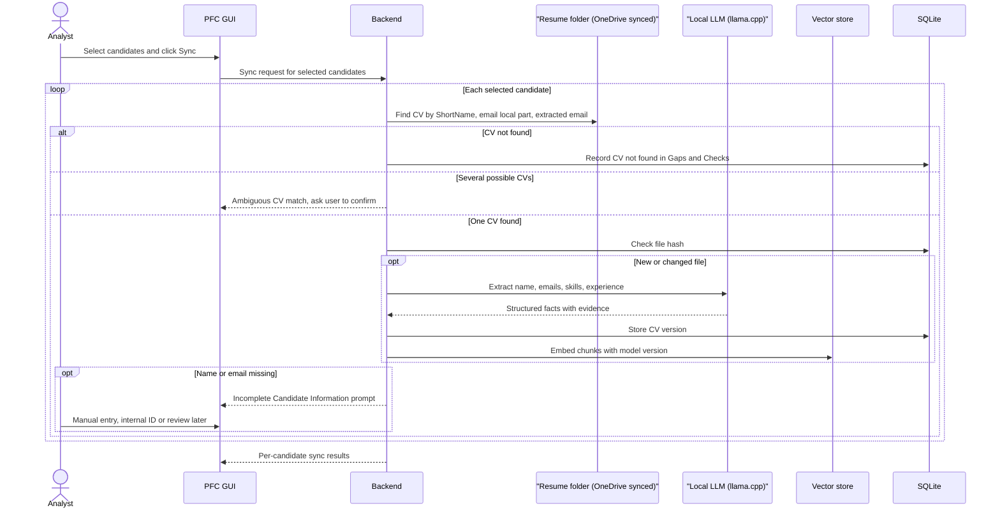

CT skills are embedded on CT import even when no CV exists, so every eligible person can be matched (REQ-IN-22, REQ-MAT-01).

### 4.3 JD analysis, eligibility, matching and scoring

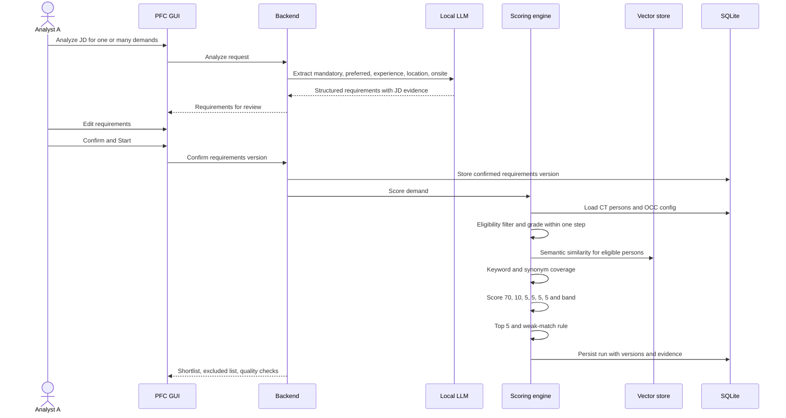

Rules applied (see [FDD.md §4](FDD.md#4-eligibility-and-matching)):

- Eligibility: exclude mapped statuses marked excluded (seeded defaults include `Selected`, `Unknown`, `CV with Client - Sold - Pending Allocation`), Group `Not on Bench`, parseable filled Bench End Date, missing grade and no skills. An unparseable Bench End Date remains eligible with a "pending review" flag. An unmapped status remains eligible at priority 2 with binary status score 0 and is flagged "Unmapped status" in Gaps / Checks and OCC data quality. **Available Capacity is never used** for matching (REQ-ELIG-01..08).
- Grade: exact or ±1 only (REQ-GRD-01); adjacent grade not materially downgraded (REQ-GRD-02).
- Score: skills 70, grade 10, location 5, bench start 5, bench end 5, bench status 5 (`status_score_mode` binary by default) (REQ-SCR-01, D-02, D-07).
- Bands: Strong ≥ 90, Potential 70–89, Avg. 61–69, Weak < 61, Insufficient data (REQ-SCR-02).
- Up to five unique candidate profiles per requisition; Weak-only requisitions count as no suitable candidate and appear separately. Weak rows may be shown separately when no Strong candidate exists (REQ-MAT-03/04, REQ-OUT-04).

### 4.4 Review, filter and override

1. Analyst A opens **Match results**, filtered by BU / region / account / grade / band / status etc. (REQ-OUT-08).
2. For each requisition the analyst reads Match %, band, Location Assessment, Matching Evidence, Gaps / Checks and Eligibility Evidence (REQ-OUT-01) and opens the score breakdown (REQ-SCR-04).
3. The analyst checks the **quality-checks panel** for the run (REQ-OUT-10).
4. Where needed, the analyst pins, unpins, excludes or adjusts a band with a mandatory comment; the original score remains visible (REQ-MAT-09).
5. Unmasking an email (Show details) is logged (REQ-OUT-03).
6. Requisitions with no suitable candidate are visible in the dashboard header and can be escalated outside PFC (REQ-OUT-04).

### 4.5 Email approval, sending, sent flag and follow-up

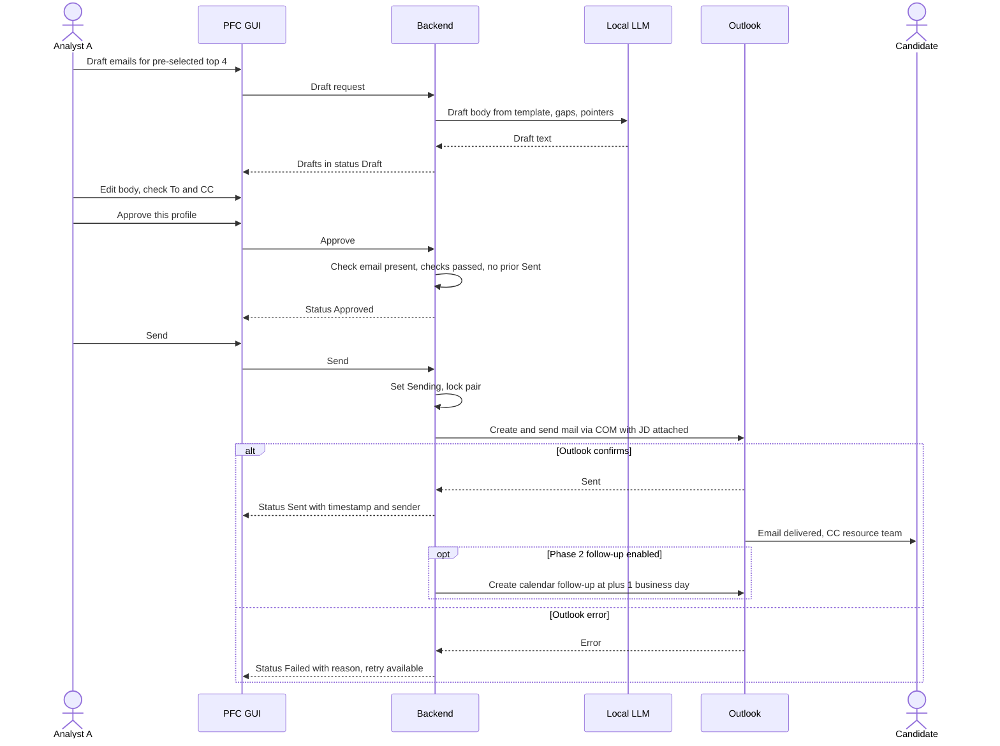

Sent-flag rules (REQ-EML-06, [FDD.md §7.2](FDD.md#72-email-status-state-machine)): one active email per candidate–demand pair; `Sent` pairs can only be re-sent through an explicit, confirmed **Re-send**; no reply parsing — the candidate replies to the SPOCs outside PFC.

### 4.6 Archival and housekeeping

Phase 2 manual trigger by the OCC Admin (REQ-ARC-02); Phase 3 adds scheduling (REQ-ARC-04).

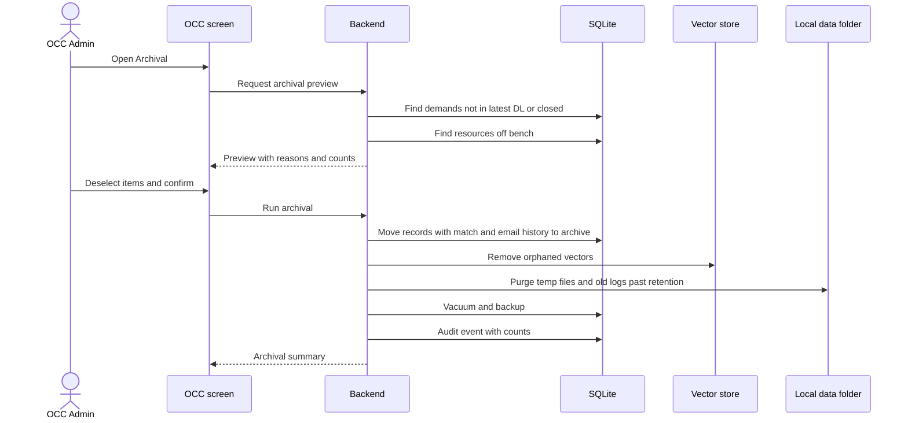

## 5. Timing and SLA

| Item | Target | Measured as | Source |
|---|---|---|---|
| Candidate email turnaround | Within **24 h** of demand upload | First ingestion timestamp of the demand → `Sent` timestamp per candidate–demand pair | REQ-EML-07, KPI-03 |
| Full re-match | A few minutes for 500 demands × 500 resources on target hardware | Scoring-run duration | NFR-01 |
| Dashboard interaction | < 2 s | UI response | NFR-01 |
| Analyst effort | Reduced vs manual Excel baseline | Upload → reviewed shortlist duration | KPI-02 |

Suggested working timeline within the 24 h window (operational guidance, not a system constraint):

| Elapsed since DL upload | Activity |
|---|---|
| 0 – 1 h | Upload DL/CT, commit preview, Sync CVs for new bench joiners |
| 1 – 4 h | Analyze JD (bulk), review and Confirm & Start; scoring runs |
| 4 – 8 h | Review shortlists, overrides, draft and approve emails |
| 8 – 20 h | Send; retry failures (Outlook offline, etc.) |
| 20 – 24 h | PFC highlights unsent approved/pending pairs nearing the SLA (FR-EML-09) |

Time consumed by the LLM is mainly JD analysis and email drafting; per-pair scoring is deterministic and does not call the LLM (NFR-01). On CPU-only hardware, bulk JD analysis should be started early in the window.

## 6. Exception paths

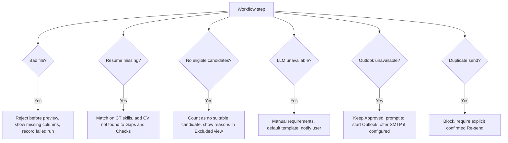

| Exception | Detection | System behaviour | User action | Ref |
|---|---|---|---|---|
| Bad file (not xlsx, corrupt, protected, missing required columns, no header row found) | Parse stage | Rejected before preview; list of expected vs found headers; failed run recorded | Fix file and re-upload | FR-ING-02..05, REQ-ING-06 |
| Row-level problems (unparseable date, invalid email syntax, unknown grade/status, formula without cached value) | Parse stage | Row kept with warning or rejected per validation table; data-quality summary updated | Correct at source or via OCC | FDD §2.1, REQ-OUT-04 |
| Identical file re-uploaded | Hash check | No-op | None | REQ-ING-06 |
| Missing resume | Sync | Candidate matched on CT skills; "CV not found" in Gaps / Checks | Optionally place CV in folder and Sync again | REQ-IN-22 |
| Ambiguous CV match | Sync | Prompt to choose the correct file | Confirm or skip | REQ-IN-25 |
| Incomplete name/email | CT import / sync | Incomplete Candidate Information prompt; no email = cannot be emailed | Manual entry, internal ID (default) or review later | REQ-IN-23 |
| Resume folder offline (OneDrive not synced) | Sync | Sync disabled with message; CT-only matching continues | Reconnect / wait for sync | NFR-02 |
| Unmapped Bench Status | CT ingestion / matching | Keep eligible at priority 2, binary score 0; flag "Unmapped status" and surface it in Gaps / Checks and OCC data quality; editable seeded map supports Admin mapping | OCC Admin maps the source value | REQ-ELIG-07 |
| Unparseable Bench End Date | CT ingestion / matching | Keep eligible and flag "pending review"; do not treat as a populated/valid end date | Correct source value when available | REQ-ELIG-01 |
| No eligible candidates for a demand | Scoring | Demand counted as "no suitable candidate"; Excluded view shows reasons (e.g. grade outside ±1, mapped excluded status) | Escalate outside PFC; revisit after next CT upload | REQ-OUT-04, REQ-ELIG-08 |
| Only weak candidates | Scoring | Count as "no suitable candidate"; show Weak-only rows separately | Review separately before emailing | REQ-MAT-04, REQ-OUT-04 |
| LLM unavailable (model missing, out of memory, external provider error) | JD analysis / CV sync / drafting | JD: manual requirement entry. CV: text-only deterministic extraction. Email: default template with deterministic gaps. Phase 3: retry compatible API versions, then fall directly to local model; never chain to another external provider | Continue manually or use local fallback | REQ-LLM-04, FR-LLM-08 |
| Outlook unavailable / COM blocked / security prompt cancelled | Send | Email stays `Approved` or moves to `Failed` with reason; SMTP offered if configured (Phase 2) | Start Outlook and retry | REQ-EML-04, FR-EML-06 |
| Duplicate send attempt | Approve / Send | Blocked for `Sent` pairs; double click is idempotent; Re-send requires confirmation showing the previous send | Confirm Re-send only if intended | REQ-EML-06 |
| Quality check fails for a row | Scoring | Approval blocked for that row | Investigate data, fix and re-score | REQ-OUT-10, FR-EML-12 |
| Demand removed from latest DL while emails are pending | DL import | Demand flagged "Not in latest DL"; approval shows warning | Decide to send or discard | FR-ING-16 |
| Session timeout during edits | Any | Draft requirements / emails retained as drafts | Log in again | FR-AUTH-08 |

## 7. Persona day-in-the-life flows

All personas use the **Analyst** role except the OCC Admin (REQ-ROLE-02). Every analyst may upload the latest DL and CT.

### 7.1 Analyst A — matching and candidate email

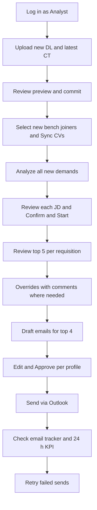

| Time | Activity | PFC feature |
|---|---|---|
| Morning | Receives new DL by email; uploads DL and CT; handles warnings in preview | Upload + preview (FDD §2.1) |
| Morning | Syncs CVs for people who joined the bench since yesterday; resolves Incomplete Candidate Information prompts | Sync (FDD §2.3–2.4) |
| Late morning | Bulk Analyze JD; reviews extracted mandatory/preferred skills and onsite requirements; Confirm & Start | JD analysis (FDD §3) |
| Midday | Reviews shortlists, opens breakdowns, checks quality panel, pins/excludes with comments | Results + overrides (FDD §4.7, §5) |
| Afternoon | Drafts emails for the pre-selected top 4, edits pointers, approves each, sends | Email agent (FDD §7) |
| End of day | Checks tracker for Failed/Approved-not-sent items within the 24 h window; follow-ups appear in Outlook calendar (Phase 2) | Tracker, follow-ups |

### 7.2 Analyst B — demand analytics

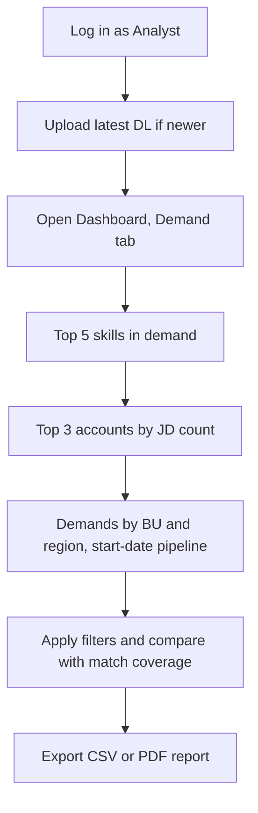

| Activity | PFC feature | Ref |
|---|---|---|
| Ensures the DL is current (uploads if a newer file exists) | Upload | REQ-ROLE-02 |
| Reviews skills in demand (synonym-normalised), accounts, BU/region split, start-date pipeline | Demand analytics | REQ-OUT-05 |
| Cross-checks match coverage to highlight skills with no bench supply | Match analytics | REQ-OUT-07, KPI-04 |
| Shares report with leadership | CSV (Phase 1), PDF (Phase 2) | REQ-OUT-09 |
| Asks questions in natural language (Phase 2) | Chat-with-data | REQ-LLM-02 |

### 7.3 Analyst C — bench analytics

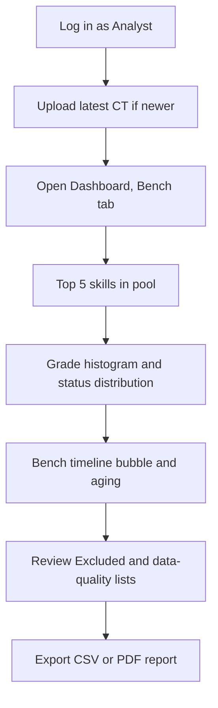

| Activity | PFC feature | Ref |
|---|---|---|
| Ensures the CT is current | Upload | REQ-ROLE-02 |
| Reviews skills in pool, grade histogram, bench timeline (start → end/today), aging, status distribution | Bench analytics | REQ-OUT-06 |
| Reviews data-quality limitations (unparsed dates, missing grades, empty skills) and excluded people with reasons | Summary header, Excluded view | REQ-OUT-04, REQ-ELIG-07 |
| Notes that Available Capacity is display-only and not an availability signal | Bench analytics | REQ-ELIG-06 |
| Shares report | CSV / PDF | REQ-OUT-09 |

### 7.4 OCC Admin

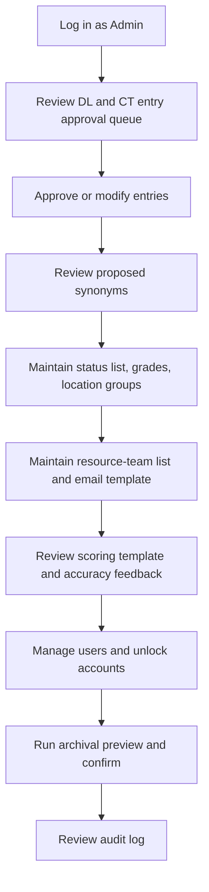

| Cadence | Activity | PFC feature | Ref |
|---|---|---|---|
| Daily | Approve or modify DL/CT entries changed by uploads | OCC approval queue | REQ-ROLE-03, REQ-ING-03 |
| Daily | Accept/reject proposed synonyms (e.g. misspellings such as `Project Manger`) | Synonym tracker | REQ-MAT-05 |
| Weekly | Review overrides and analyst-confirmed shortlists against top 5 to track auto-match accuracy; adjust template if needed (new version) | Scoring template | KPI-01, REQ-SCR-01 |
| As needed | Maintain resource-team CC list, default template, SPOCs, status list/map, grade list, location groups | OCC lists | REQ-EML-03, REQ-EML-05, REQ-ELIG-03/07 |
| As needed | Create/disable/unlock users, reset passwords | Users | REQ-AUTH-02..04 |
| Phase 1 | Maintain seeded internal email allowlist; export signed settings packages | OCC domains and package export | REQ-CLS-01, REQ-OCC-01 |
| Phase 1 | Model import and re-embedding through signed `.pfcmodel` add-on | OCC model settings | REQ-OCC-03 |
| Phase 2 | Manual archival with preview | Archival | REQ-ARC-02 |
| Phase 3 | Model benchmark lab, role-specific templates, Generate User ZIP and licences, OneDrive metadata sync replacing or augmenting package export/import | Advanced OCC, Licensing | REQ-LLM-06, REQ-AUTH-08, REQ-OCC-02 |

### 7.5 Settings package export and import

Phase 1 operating flow for separate local Analyst instances (REQ-OCC-01/02):

```mermaid
sequenceDiagram
    actor Admin as OCC Admin
    participant OCC as Admin PFC
    participant Sign as Ed25519 signer
    participant Share as Shared folder or Teams/email
    actor Analyst
    participant Settings as Analyst Settings
    participant Apply as Atomic settings importer
    Admin->>OCC: Export settings package
    OCC->>Sign: Sign versioned JSON and manifest
    Sign-->>OCC: PFC-settings-v<N>.pfcpkg
    OCC->>Share: Share signed package
    Analyst->>Settings: Select package or use startup inbox
    Settings->>Settings: Validate signature, schema, app compatibility, version
    Settings-->>Analyst: Preview changes and import result
    Analyst->>Settings: Confirm import
    Settings->>Apply: Apply all package changes atomically
    Apply->>Apply: Audit import and retain previous version
    Settings-->>Analyst: Imported; rollback available
```

The channel is not trusted in place of signature validation. Invalid or incompatible packages fail without partial application and show a clear error. A signed model add-on is imported through the same flow and triggers re-embedding with model version recorded per vector.

## 8. Phase applicability

| Workflow step | Phase 1 (MVP) | Phase 2 | Phase 3 |
|---|---|---|---|
| Upload | Manual GUI upload; auto-sync config placeholder | Synced-folder auto-pickup | — |
| Resume sync | Per-candidate and global Sync, basic CV versions | CV version comparison | OneDrive metadata sync packages |
| JD analysis, matching, scoring | Full (local LLM, hybrid matching, template) | — | External LLM providers with PII masking and smart fallback; role-specific templates |
| Review / override | Full | — | — |
| Email | Per-profile approval, Outlook COM, sent flag | SMTP, calendar follow-ups | — |
| Analytics | Dashboards, CSV export | PDF reports, chat-with-data, internal/external classification | — |
| Archival | — | Manual trigger with preview, housekeeping | Archival automation |
| Access | Login, roles | — | Per-user ZIP + signed device licence |

See [PHASES.md](PHASES.md) for the delivery plan.

## 9. Open questions

| # | Question | Decision | Related |
|---|---|---|---|
| WQ-01 | Exact start point of the 24 h SLA: first upload of the demand, or Confirm & Start? | Resolved: first PFC ingestion of the demand, as REQ-EML-07 states "demand upload". | §5, REQ-EML-07 |
| WQ-02 | Are weekends/holidays excluded from the 24 h SLA? | Resolved: the turnaround KPI uses elapsed calendar hours; the separate follow-up reminder skips weekends and OCC-configured holidays. | §5 |
| WQ-03 | How do OCC approvals and configuration (synonyms, template, resource-team list) reach other analysts' single-user instances before Phase 3 sync? | Resolved: signed manual settings-package export/import in Phase 1; Phase 3 metadata sync replaces or augments it. | §3, §7.5 |
| WQ-04 | When several analysts upload overlapping DL/CT versions on separate instances, which is authoritative? | Resolved: each instance keeps its latest upload; OCC Admin distributes approved configuration through signed packages and reconciles source data through the operating process. | §4.1 |
| WQ-05 | Should follow-up reminders be created for the analyst only or as meetings with the candidate? | Resolved: create a reminder for the sending Analyst only, one business day after sending; do not create a candidate meeting. | §4.5, REQ-EML-08 |
| WQ-06 | Escalation path for demands with no suitable candidate (outside PFC). | Resolved: list no-suitable demands in the dashboard header and CSV export for manual escalation. | §6 |
